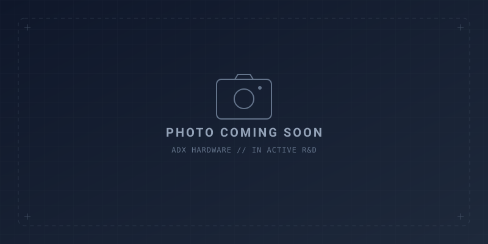

<!--
Copyright (c) 2026 ADX Project Contributors
SPDX-License-Identifier: CC-BY-4.0
-->

# ADX (Advanced Devices eXtended)

[ **English** | [日本語 (docs/ja/README.md)](docs/ja/README.md) ]

<p align="center">
  
</p>

### *The Working Arduino*
> **A tougher, enclosure-native board engineered to run your Arduino sketches reliably in the real world.**

**ADX** is an open-hardware modular ecosystem designed for projects that need to step off the workbench and run continuously inside real enclosures—neatly mounted, cleanly wired, and shielded with field-ready protections.

---

## Quick Navigation by Goal

Find what you need based on what you want to achieve:

| What do you want to do? | Key Documentation | Primary Links |
| :--- | :--- | :--- |
| 🚀 **Build with USB** | Standard USB Core board with ATtiny1616 & CH342K | [CORE-U Specification](hardware/CORE-U/spec_proposal.md) |
| 🛡 **Deploy tough RS-485 nodes** | High-temp (-40℃ ~ +105℃) isolated Core board | [CORE-A5 Specification](hardware/archive/CORE-A5/spec_study.md) |
| 🔌 **Build custom addon CARDs** | Universal 20-pin bus pinout & layout rules | [ADX 20-Pin Bus (SSOT)](docs/spec/ADX_PINOUT.md) (v4.0) |
| 📖 **Learn pinout engineering rationale**| Gravity fail-safe & coplanar shielding details | [ADX Pinout Architecture Guide](docs/en/ADX_pinout.md) |
| 📦 **Design or 3D-print cases** | Dimensions, M3 hole spacing & rail margins | [8748 Form Factor Specification](docs/en/8748_formfactor.md) |

---

## 1. Overview: From Workbench to Workplace

Prototyping on a workbench with a breadboard is an incredible, creative way to bring ideas to life.

However, when it is time to deploy those sketches permanently—inside a factory control cabinet, greenhouse watering rig, outdoor lighting fixture, or custom architectural enclosure—makers and engineers face identical physical friction:

1. **Awkward Mounting**: Mounting holes are too close to delicate traces, making tightening M3 screws feel risky.
2. **Hard to Enclose**: Connectors and cables protrude in all four directions, forcing complex multi-sided case cutouts.
3. **Loose Wiring**: Standard jumper wires loosen under minor vibration, ambient temperature swings, or accidental tugs.
4. **Maintenance Friction**: Dragging a heavy laptop up a ladder or into a crawl space just to tweak a few lines of code is exhausting.

**ADX solves these hurdles with a grounded philosophy: "The Working Arduino."**  
Not a high-cost, proprietary industrial PLC, but an accessible, open-hardware companion that makes taking Arduino sketches into real-world installations natural, safe, and robust.

---

## 2. The Foundation: Open Hardware Standards

The ADX ecosystem is built upon two open, modular physical standards:

```text
       ════════════════════════════════════════════════════════════════════
                         【 ADX ECOSYSTEM ARCHITECTURE 】
         ・8748 Form Factor (87.0 mm × 48.0 mm standardized profile)
         ・Corner M3 Mounting Holes with Φ5.0 mm Washer Clearances
         ・Unidirectional I/F Edge (All field wiring on a single face)
         ・ADX Pinout v4.0 (Gravity-Safe Power, Edge Guard, Native 3.3V)
       ════════════════════════════════════════════════════════════════════
                                       │
            ┌──────────────────────────┴──────────────────────────┐
            ▼                                                     ▼
   【 Main Core Boards 】                                【 Modular CARDs 】
     ・ADX CORE-U   (USB Standard / ATtiny1616 / Case-Friendly)        ADX CARD Ecosystem
     ・ADX CORE-A24 (Industrial DC24V & Isolated RS-485 / Planning)   ・Prototyping CARD
     ・Dual Type-C or Push-in Terminals                               ・Power Supply CARDs
     ・Automated 20P IDC Fixture Inspection & Flashing                ・3D-Printable Enclosures
```

### 2.1 8748 Form Factor & Mechanical Mounting
- **Dimensions**: Standardized `87.0 mm × 48.0 mm` (`3425 mil × 1890 mil`).
- **Clearance for Real Screws**: Four-corner M3 mounting holes (`77.0 mm × 38.0 mm` pitch) with generous **Φ5.0 mm washer clearances**, ensuring screws and lock washers never bite into traces.
- **Enclosure Grab Margins**: Dedicated keep-out zones along both long edges support **slot-in rail mounting** and **3D-printed snap-fit tabs**.
- *Reference*: [8748 Form Factor Specification](docs/en/8748_formfactor.md)

### 2.2 Unidirectional Interface Edge
External field connections (power and communications) are strictly aligned along **one single edge of the PCB**.  
By eliminating multi-directional wire routing, enclosure cutouts and front-panel machining are simplified to a single opening.

### 2.3 Universal 20-Pin Bus (ADX-BUS-SPEC-v4.0)
All Core boards and Card modules interconnect via a standardized 2×10-pin shrouded IDC connector:
- **Gravity Fail-Safe Power (`VBUS`: Pins 17–20)**:  
  High-current power bus ($4.5\text{V} \sim 5.0\text{V}$ / up to **2.0A–3.0A continuous**) is positioned at the bottom of the connector. In vertical slot-in mounts, disconnected power wires drop downward under gravity, physically preventing shorts against communication lines.
- **Protective Boundary Wall (`Pin 16: GND`)**:  
  Direct short barrier directly above VBUS, safely grounding crimp misalignments.
- **Outer Edge Guard & Coplanar Analog (`Pins 1–4`)**:  
  Pin 1 (GND) protects cable perimeter; Pin 3 (AIN) is shielded between Pins 1 and 4 from high-speed digital switching.
- **One-Wire Maintenance (`Pin 2: OWD`)**:  
  Unified 1-wire test and UF2 bootloader flashing interface via IDC test fixture.
- **Native 3.3V Logic**: All digital pins (UART, I2C, SPI) operate at **3.3V LVCMOS**.
- *Reference (SSOT)*: [ADX 20-Pin Bus Specification](docs/spec/ADX_PINOUT.md) | [Architecture Guide](docs/en/ADX_pinout.md)

---

## 3. Core Board Portfolio

Choose the right Core board based on your operating environment and connectivity needs:

1. **[ADX CORE-U](hardware/CORE-U/spec_proposal.md) (Standard USB Core)**:
   - **MCU**: Microchip ATtiny1616-MNR (8-bit AVR 3.3V 10MHz, Flash 16KB, SRAM 2KB)
   - **Highlights**: Case-friendly development UX (no buttons needed), Dual Type-C ports (5V/2A Power + Com), CH342K dual USB-UART bridge (Port 1: SerialUPDI / Port 2: Serial Monitor), full compatibility with Arduino IDE 1.8.x & megaTinyCore.
2. **[ADX CORE-A5](hardware/archive/CORE-A5/spec_study.md) / CORE-A24 (Industrial Edge)**:
   - **MCU**: Microchip ATtiny1616-MNR (8-bit 10MHz, negligible self-heating)
   - **Highlights**: Industrial -40℃ to +105℃ rated components, 2500V galvanic isolated RS-485, push-in spring clamp terminals. (CORE-A24 with native DC24V support is currently in planning).
