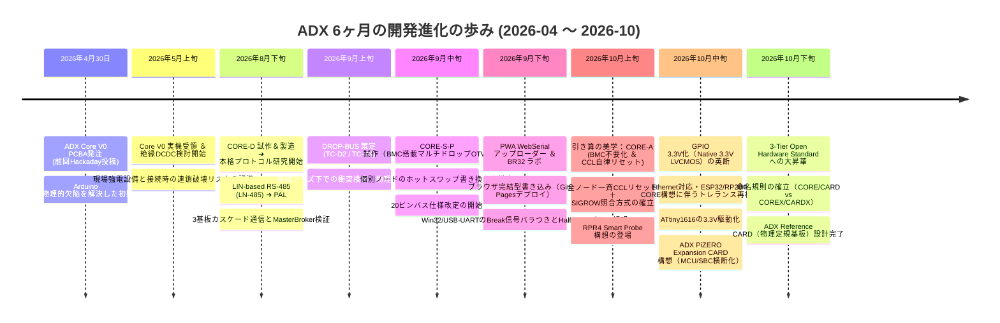

<!--
Copyright (c) 2026 ADX Project Contributors
SPDX-License-Identifier: CC-BY-4.0
-->

# ADX 開発振り返りメモ：2026年4月（Core V0発注）から10月（3層オープン規格）への歩み
〜 「産業用Arduino基板」から「Enclosure-Native Modular Electronics 規格」への進化の軌跡 〜

- **策定日**: 2026-10-22 (全マイルストーン日付＆技術的背景反映版)
- **ステータス**: APPROVED / 内部公式振り返り ＆ Hackaday執筆用 SSOT
- **対象ファイル**: `docs/blog/memo/2026-10-22_half_year_review.md`
- **関連ドキュメント**:
  - 前回のHackadayログ (2026-04-30): [ADX Core V0 Design Freeze and PCBA Order Placed](https://hackaday.io/project/205547-adx-enclosure-native-modular-hardware-standard/log/247524-adx-core-v0-design-freeze-and-pcba-order-placed)
  - プロジェクト構想 v1: [`docs/blog/posts/hackadayio_project_v1.md`](../posts/hackadayio_project_v1.md)
  - プロジェクト構想 v2 (最新): [`docs/blog/posts/hackadayio_project_v2.md`](../posts/hackadayio_project_v2.md)
  - 普遍的20ピンバス仕様書 (SSOT): [`docs/spec/ADX_PINOUT.md`](../../spec/ADX_PINOUT.md)
  - 8748 フォームファクタ仕様書: [`docs/en/8748_formfactor.md`](../../en/8748_formfactor.md)

---

## 1. エグゼクティブ・サマリー：半年間の変遷の核心

2026年4月30日、Hackaday.io に投稿した [ADX Core V0 Design Freeze and PCBA Order Placed](https://hackaday.io/project/205547-adx-enclosure-native-modular-hardware-standard/log/247524-adx-core-v0-design-freeze-and-pcba-order-placed) から約**6ヶ月間（半年）**。

当時の投稿は、「Arduino Unoフォームファクタが抱える物理的欠陥（四方コネクタ、M3ネジ座金がパターンを削る問題）を解決した、頑丈なATtiny1616産業用基板（Core V0）」のPCBA発注報告でした。

しかし現在のADXは、単なる「はたらくArduino（The Working Arduino）」という特定マイコンボードの枠を遥かに超え、**MCU（ATtiny/RP2040/ESP32）からSBC（Raspberry Pi Zero等）までを横断する「Enclosure-Native Modular Electronics（筐体親和型モジュラー・ハードウェア標準規格）」** という3層オープン規格へと劇的に昇華しました。

```text
┌────────────────────────────────────────────────────────────────────────┐
│               【 ADX 3-TIER OPEN HARDWARE STANDARD 】                  │
├────────────────────────────────────────────────────────────────────────┤
│  Tier 1: 8748 Form Factor (87 × 48 mm, M3 10mm Keep-out, 1-Edge I/O)  │
│  Tier 2: ADX 20-Pin Bus (VBUS 5V/2A, Pin 5 GND Shield, 3.3V Logic)    │
│  Tier 3: Ecosystem (MCU COREs, SBC CARDs, Power/Proto CARDs, WebSerial)│
└────────────────────────────────────────────────────────────────────────┘
```

---

## 2. 実機開発タイムライン（年月とブレークスルー）



---

## 3. 主要な技術的ブレークスルーと意思決定の裏側

### ① CORE-D から始まった本格プロトコル研究（2026年8月下旬〜9月上旬）
- Core V0の製造・検証後、RS-485通信プロトコルとブートローダの本格検証専用ボードとして **CORE-D** を試作・製造。
- LIN-based RS-485（**LN-485**）をベースに、複数基板（3board）実機でのデータストリーミング、衝突検知、スルーレート制御などを徹底的に実験。
- 物理アクセス層 **PAL**（Physical Access Layer）を経て、現場ノイズ下で確実に届く **DROP-BUS**（Phase 2 / TC-D2 / TC-D3）へと発展させた。

### ② PWA WebSerial アップローダーの誕生と OTW の現実解（2026年9月下旬）
- 「現場の配電盤や高所にある基板を直すためだけに、重いPCと専用プログラマを持っていくのをやめたい」というペインから、ブラウザからRS-485経由で直接ファームウェアを書き込む **WebSerial アップローダー（PWA）** を開発。
- これにより、ブラウザさえあれば現場で直接デバッグ＆書き換えができる世界線が開かれ、**「Smartphone dev & debug（スマホ1台での現場開発）」** という強烈なブレークスルーの地平が発生。
- **現実解としてのフォーカス**:
  - スマホ直結でのフル機能運用には専用ハードウェア（**RPR4 Smart Probe**: RP2040＋完全絶縁RS-485）が必要となるため、今回の第一弾ローンチではスマホ単体運用を前面に出さず、「PC ＋ ブラウザPWA」によるWebSerial運用を主軸に据えた。
  - プログラマ側には、**市販の安価なUSB-RS485ドングル ＋ ボーレートトリック（Half-Baudによるパルス注入）** を採用し、誰でもすぐに使える堅牢な OTW（One-The-Wire）書き込みを実現した。

### ③ マルチドロップOTW：BMC搭載（CORE-S-P）から「BMC不要化（CORE-A）」への英断（2026年9月中旬〜10月上旬）
- 複数ノードが1本のRS-485バスにぶら下がる環境で、特定のマイコンだけを書き換える「マルチドロップOTW」を実現するため、当初は **BMC（Baseboard Management Controller）** を搭載した **CORE-S-P** を試作実装（2026年9月中旬）。
  - **当初の構想**: バス稼働中に、BMCが指定コマンドを受信し、自基板のMCUだけをピン制御でリセット（ホットスワップ個別書き換え）。
- **しかし、エンジニアリングとしての「引き算」を決断（2026年10月上旬）**:
  - 別チップ（BMC）を載せることは、BOMコストの増加、基板面積の圧迫、故障要因の増加を招く。
  - そこで ATtiny1616 内蔵の **CCL（Configurable Custom Logic）** を活用。
  - **現在の洗練された方式**:
    1. ホストからバス全体へ一貫したリブート信号（Breakパルス）を一斉送出。
    2. 全ノードのCCLがハードウェア単体でこれを受信し、**バス上の全ADX COREが同時にブートローダモードに突入**。
    3. 各マイコン固有の **SIGROW（Device Signature / 個体シリアル番号）** を照合し、指定されたスケッチのみが対象ノードに書き込まれる。
  - これにより、ホットスワップ個別書き換えはオミットされたが、**別チップを一切追加することなく、極めて安価かつ堅牢にマルチドロップOTWを達成** した。

### ④ GPIO の 3.3V 化（Native 3.3V LVCMOS）の英断（2026年10月中旬）
- **Ethernet対応と高速MCU構想**:
  - RPR4の開発以降、CORE-A（ATtiny1616）がどうしてもEthernet等のネットワーク系処理に対してパワー不足であることを補う必要が生じた。
  - そこで、将来のラインナップとして **ESP32** や **RP2040** を搭載したハイパワーCOREボードが構想された。
- **しわ寄せの再検討**:
  - 高速マイコン（ESP32/RP2040）はネイティブ3.3Vロジックであるため、「バス全体においてGPIOの3.3V/5Vトレランス（耐圧）のしわ寄せをどこに持っていくべきか？」を再検討。
  - アドオンCARD側に毎回レベルシフタを強いるのはエコシステムの拡張性を殺す。
- **結論**:
  - バス全体のGPIO仕様を **Native 3.3V LVCMOS** へ統一。
  - **ATtiny1616自体を3.3Vで駆動させる仕様変更（3V3トレラント／3V3ネイティブ）** を断行した。
  - これにより、拡張CARD側はレベルシフタが一切不要となり、ATtiny、RP2040、ESP32が同一バス上で完全にシームレスに混在できるようになった。

### ⑤ ADX PiZERO Expansion CARD構想：Working Arduinoから「3-Tier規格」への昇華（2026年10月中旬）
- これまで「Arduinoの現場版」として考えていたADXに、決定的なパラダイムシフトをもたらしたのが **ADX PiZERO Expansion CARD** の概念設計。
- **幾何学的な奇跡**:
  - ADXの 8748 フォームファクタ基板上に Raspberry Pi Zero を載せる検証を行ったところ、**単一辺開口部（I/O edge 67mm）側に、Pi ZeroのUSB端子およびmini HDMI端子がピッタリ揃う** ことが判明。
- **電源・バスとの完全統合**:
  - Expansion CARD側に USBシリアル（CH340系）やeFuse、保護回路を設けることで、ADXの電源規格（VBUS 5V/2A）および20ピンバスに完璧に整合。
- **この発見がもたらしたパラダイムシフト**:
  - ADXは「特定マイコン（ATtiny）のボード」ではなく、**「MCU（ATtiny/RP2040/ESP32等）からSBC（Raspberry Pi Zero, Radxa Zero等）までを同一の筐体・同一の電源・同一のモジュール群で扱える、横断的ハードウェア規格」** へと進化した。
  - 工場用24V絶縁Power CARDや乾電池Power CARDが、マイコンだけでなくそのままLinuxシングルボードコンピュータでも共通利用可能になる。
  - これにより、プロジェクトのコンセプトは最新の [hackadayio_project_v2.md](../posts/hackadayio_project_v2.md)（3-Tier Open Hardware Standard）へと昇華した。

### ⑥ ADX Reference CARD の設計完了（2026年10月下旬・現在）
- Crowd Supply等のローンチ時に「物理リファレンス定規基板（おまけ）」として配布予定の **ADX Reference CARD** がほぼ設計完了。
- 回路的な実用基板ではなく、**実際のFR4プリント基板にすべての設計ルールをシルク印刷した「手元に置いておくエンジニアの物理定規基板」**:
  - 87.0 mm × 48.0 mm 外形寸法、V-CUT可能な完全長方形
  - 10 mm M3 ネジ穴 Keep-out（Φ5.0mm ワッシャー逃げマージン）
  - 3 mm 筐体レール掴みマージン ＆ 筐体掴み禁止区域
  - 20ピン IDC コネクタ設置寸法
  - SMD-only 区域（筐体レール干渉防止・片面実装化による製造コスト削減）
  - VBUS 5V/2A 仕様、3.3V LVCMOS ロジック仕様

### ⑦ 3-Tier STANDARD に伴うシンプルな命名規則：CORE/CARD vs COREX/CARDX
- 規格が3層標準へと普遍化されたことに伴い、ハードウェアの命名規則も複雑な接尾辞を廃止し、極めて直感的で分かりやすいルールへと再定義。
  - **CORE / CARD**: 通常グレード（一般的な室内・デスク・プロトタイプ向け）。
  - **COREX / CARDX**: **Extended Industrial Grade (-40℃ to +105℃)**。
    - 全コンポーネントが産業用耐熱定格を満たし、完全絶縁・サージ保護を備えた極限環境・工場配電盤・屋外向けの最高信頼性グレード。
- 「無印（通常） vs `X`（Extended Industrial）」という明快な2区分により、開発者は机上のプロトタイプから過酷な現場配備まで、目的に応じて迷わずハードウェアを選択可能になった。

---

## 4. Hackaday.io カムバック記事（Reboot Log）の骨子案

半年ぶりの投稿となるため、この生々しい進化のドラマをHackaday読者の好む「Lab Notebook（研究ノート）」のトーンで執筆します。

### 記事構成案:
1. **The Lead (再開と告白)**:
   - 「4月にCore V0のPCBAを発注して以来、半年間沈黙していた。サボっていたわけではない。机の上のプロトタイプを現場のリアルな箱へ連れ出そうとした結果、怒涛の試行錯誤とブレークスルーに呑み込まれていた。」
2. **Phase 1: The Network & The Bootloader (CORE-D & WebSerial)**:
   - Core V0が届いた後、CORE-Dを作ってRS-485マルチドロップ通信の泥臭い実験に没頭したこと（8月〜9月）。
   - ブラウザ（WebSerial PWA）から現場のマイコンを直接書き換えるブレークスルーと、市販ドングル＋Half-BaudパルスによるOTWの実現。
3. **Phase 2: The Art of Subtraction (CORE-S-P to CORE-A)**:
   - マルチドロップOTWのために一度はBMC（別マイコン）を積んだが、「引き算の美学」でそれを全廃し、ATtiny1616のCCL自律リセットとSIGROW照合で解決したハック（9月〜10月）。
4. **Phase 3: The 3.3V Pivot & Beyond Arduino (Pi Zero & 3-Tier Standard)**:
   - Ethernet対応やESP32/RP2040 COREを見据え、ATtiny1616を3.3V駆動化してバス全体をNative 3.3V LVCMOSへ統一した英断。
   - Pi Zeroが8748のI/O辺に吸い付くようにピッタリ収まった瞬間の発見（10月中旬）。
   - 「Arduinoの現場版」から「MCUとSBCを横断する 3-Tier Enclosure-Native Standard」への昇華。
   - 規格を1枚の基板に刻み込んだ「ADX Reference CARD」のチラ見せ。
5. **Call to Conversation (今後の定期連載宣言)**:
   - 「半年間の怒涛の試行錯誤を経て、ようやく3層のオープン規格とコアアーキテクチャが固まった。」
   - 「今回は大枠のキャッチアップで情報過多になってしまったが、今後は各モジュール（CORE-A5、Power CARD、Pi Zero CARD）の詳細や、WebSerialの波形解析、基板製造の様子などを毎週定期的に（Weekly DevLogとして）ポストしていく予定。」
   - 「ぜひプロジェクトのフォロー（Follow / Skull）をお願いします！次回もお楽しみに。」
