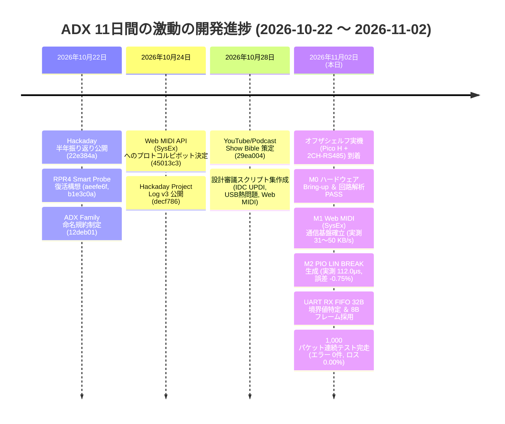

<!--
Copyright (c) 2026 ADX Project Contributors
SPDX-License-Identifier: CC-BY-4.0
-->

# ADX 開発履歴・技術進捗メモ：2026年10月22日〜11月2日
〜 Web MIDI への電撃ピボット、市販オフザシェルフによる先行実証、そして PIO 自律波形制御と UART FIFO 境界値の突破 〜

- **策定日**: 2026-11-02
- **ステータス**: APPROVED / 内部公式開発レビュー ＆ Hackaday.io 執筆用 SSOT
- **対象ファイル**: `docs/blog/memo/2026-11-02_dev_review.md`
- **対象期間**: 2026-10-22（前回記事公開） 〜 2026-11-02（本日）
- **関連ドキュメント**:
  - 前回のHackadayログ (2026-10-22): [`docs/blog/posts/2026-10-22.md`](../posts/2026-10-22.md) / [HTML](../dist/2026-10-22.html)
  - 前回振り返りメモ: [`docs/blog/memo/2026-10-22_half_year_review.md`](2026-10-22_half_year_review.md)
  - RPR4 先行実証コンセプト: [`hardware/RPR4_Smart_Probe/predev/concept.md`](../../hardware/RPR4_Smart_Probe/predev/concept.md)
  - 実験計画書: [`hardware/RPR4_Smart_Probe/predev/experiment_plan.md`](../../hardware/RPR4_Smart_Probe/predev/experiment_plan.md)
  - M0 ハードウェア解析レポート: [`hardware/RPR4_Smart_Probe/predev/M0_hardware_bringup.md`](../../hardware/RPR4_Smart_Probe/predev/M0_hardware_bringup.md)
  - M1 Web MIDI 実証ガイド: [`hardware/RPR4_Smart_Probe/predev/M1_web_midi_setup.md`](../../hardware/RPR4_Smart_Probe/predev/M1_web_midi_setup.md)
  - M2 PIO 波形実証レポート: [`hardware/RPR4_Smart_Probe/predev/M2_pio_verification.md`](../../hardware/RPR4_Smart_Probe/predev/M2_pio_verification.md)
  - UART RX FIFO 調査メモ: [`hardware/RPR4_Smart_Probe/predev/firmware/m2_pio_rs485/memo/20261102_uart_rx_fifo_investigation.md`](../../hardware/RPR4_Smart_Probe/predev/firmware/m2_pio_rs485/memo/20261102_uart_rx_fifo_investigation.md)
  - Web MIDI 採用検討メモ: [`hardware/RPR4_Smart_Probe/memo/web_midi_protocol_study.md`](../../hardware/RPR4_Smart_Probe/memo/web_midi_protocol_study.md)

---

## 1. エグゼクティブ・サマリー（この11日間の核心）

2026年10月22日のHackaday.io記事公開（半年間の振り返り：Core V0から3層オープン規格への進化、Core-D多重化テスト、Half-Baud Pulse Hack、CCLによるBMC排除）からわずか**11日間**。

ADXプロジェクトは、机上の理論や基板製造待ちに甘んじることなく、劇的なスピードで以下の**3大ブレークスルー**を達成しました。

```text
┌────────────────────────────────────────────────────────────────────────┐
│             【 2026-10-22 〜 2026-11-02 の 3大ブレークスルー 】          │
├────────────────────────────────────────────────────────────────────────┤
│ 1. 通信プロトコルの電撃ピボット: Web Serial ➔ Web MIDI API (SysEx)       │
│    - Android Chrome の制限を回避し、40年の歴史を持つ MIDI 規格で完全解決   │
│    - RPR4 (RP2040) を「インテリジェント・モデム」として責務分離          │
├────────────────────────────────────────────────────────────────────────┤
│ 2. 市販オフザシェルフ部品による先行実証 (Pre-dev PoC) の電撃展開         │
│    - 基板発注を待たず Raspberry Pi Pico H + Waveshare 2CH-RS485 で即検証 │
│    - 自動方向制御回路を解析し、LIN BREAK (112μs Low) の完全送出を実証    │
├────────────────────────────────────────────────────────────────────────┤
│ 3. PIO 自律波形制御 ＆ UART RX FIFO 境界値の特定と「8Bフレーム」採用   │
│    - PIO で誤差 -0.75% の高精度 LIN BREAK 生成 (理論 112.85μs / 実測 112.0μs) │
│    - PL011 32B FIFO の Overrun (33B目あふれ) を特定し、車載準拠 8B を採用 │
│    - 1,000 パケット連続ストレステスト完走 (パケットロス率 0.00%)         │
└────────────────────────────────────────────────────────────────────────┘
```

---

## 2. 開発タイムライン（時系列の歩み: 2026-10-22 〜 2026-11-02）



### コミット履歴一覧 (詳細)

| コミットハッシュ | 日時 (UTC) | コミットメッセージ | 主な変更内容・成果物 |
| :--- | :--- | :--- | :--- |
| `22e384a` | 2026-10-22 12:38 | docs: publish ADX 6-month review blog post and project assets | Hackaday 記事公開 (`2026-10-22.html`, `2026-10-22.md`) |
| `aeefe6f` | 2026-10-22 14:00 | feat: add RPR4 Smart Probe hardware design files and concept documentation | RPR4 ハードウェア設計ファイル復元、ネットリスト配置 |
| `b1e3c0a` | 2026-10-22 23:10 | docs: add revival documentation for RPR4 hardware probe | `revival_of_RPR4.md`: RPR4 復活の背景と動機 |
| `12deb01` | 2026-10-22 23:28 | docs: add ADX family naming convention documentation | `memo/ADX_Family_naming.md`: CORE, CARD, PROBE 命名規則整理 |
| `45013c3` | 2026-10-24 00:23 | docs: add development plan and Web MIDI protocol study memo for RPR4 Smart Probe | `web_midi_protocol_study.md`: Web Serial から Web MIDI へのピボット決定 |
| `decf786` | 2026-10-24 01:16 | docs: add Hackaday.io project v3 blog post and update smart probe dev plan | プロジェクト概要 v3 改訂、スマートプローブ開発計画更新 |
| `29ea004` | 2026-10-28 11:23 | docs: add development memos and project documentation | Show Bible (`talk_show_bible.md`)、各種設計審議スクリプト、開発サマリー |
| `8ba0a47` | 2026-11-02 09:56 | feat: add RPR4 Smart Probe hardware bringup and USB MIDI firmware implementation | オフザシェルフ検証開始、M0 Bringup (PASS)、M1 Web MIDI (PASS: 31〜50 KB/s) |
| `c98d87d` | 2026-11-02 10:25 | refactor: update firmware and documentation for UART RX FIFO investigation | M2 PIO 波形制御 PASS、UART RX FIFO 32B 境界値特定、8B フレーム採用、1,000 pkt テスト完走 |

---

## 3. 主要ブレークスルーと技術的詳細

### ① プロトコルの電撃ピボット：なぜ Web Serial を捨て Web MIDI (SysEx) を選んだのか？
（参照: `hardware/RPR4_Smart_Probe/memo/web_midi_protocol_study.md`）

前回の記事（10月22日）では、ブラウザの Web Serial API から「Half-Baud Pulse Hack」を駆使してブレーク信号を送出するハックを紹介しました。しかし、実際にモバイル環境（現場でスマホから書き込みたい）へ展開しようとした瞬間、**巨大な壁**に衝突しました。

1. **Android Chrome における Web Serial の未サポート / 無効化問題**:
   - PC では動く Web Serial API が、モバイル版 Chrome（Android）ではデフォルト無効、あるいはフラグ変更が必要で一般ユーザーにはハードルが高すぎる。
2. **WebUSB のドライバ地獄**:
   - WebUSB を使おうとすると、OS 側で WinUSB や特定パーミッションの要求、あるいはドライバの競合が発生し、「現場でケーブルを挿せばすぐ動く」体験が損なわれる。
3. **そこで白羽の矢が立ったのが「Web MIDI API (SysEx)」**:
   - **40年以上の歴史**: 1983年の MIDI 1.0 策定以来、あらゆる OS（Windows, Mac, Linux, Android, iOS）に「USB-MIDI 標準クラスドライバ」が組み込まれており、**追加ドライバのインストールが 100% 不要**。
   - **ブラウザのネイティブ対応**: Chrome, Edge, Firefox 等で標準サポート。
   - **SysEx（System Exclusive）による任意バイナリ転送**: 7-bit 制限（最上位ビットは 0）があるものの、**7-to-8 ビットパッキング** を施せば任意のバイナリ・ファームウェアを透過的に転送可能。
4. **アーキテクチャの責務分離（RPR4 をインテリジェント・モデム化）**:
   - ホスト（ブラウザ）は USB-MIDI 経由で高レベルなコマンドとデータを送るだけ。
   - 現場の過酷な物理層制御（LIN BREAK の精密な時間管理、RS-485 方向切り替え、バス衝突回避）は、プローブ側の RP2040（PIO）がすべて自律処理する。

---

### ② 市販オフザシェルフ部品による先行実証（Pre-development）戦略
（参照: `hardware/RPR4_Smart_Probe/predev/concept.md`, `M0_hardware_bringup.md`）

ハードウェア開発で最も時間を浪費するのは「カスタム基板を設計・発注し、工場から届くのを待つ数週間」です。届いた基板でプロトコルに欠陥が見つかれば、さらに数週間のイテレーションが発生します。

ADX チームはこの停滞を打破するため、**「市販の既製パーツを組み合わせて、本番基板の到着前にプロトコル層・波形制御層の不確実性を 100% 潰す」** 先行実証（Pre-development）を立ち上げました。

- **使用機材**:
  - **Raspberry Pi Pico H**（RP2040 搭載、ピンヘッダ実装済）
  - **Waveshare Pico-2CH-RS485**（SP3485 2系統、自動送受信切り替え回路搭載）
- **M0（初期解析）での大発見：自動方向制御回路の動作解析**:
  - Waveshare ボードの回路図を解析したところ、トランシーバーの `DI` ピンが GND に固定され、`TX` ピンの論理レベルをトランジスタ $S1$ で反転して `DE / ~RE` を駆動する「オープンコレクタ型エミュレーション」であることが判明。
  - 一部の粗悪なドングルにある「RC時定数によるワンショットタイマー」ではなく、**完全な DC 直結制御**。
  - ➔ **「TX を Low に保持している限り、途切れずに 13bit 以上の Dominant Low（LIN BREAK）をアクティブドライブし続けられる」** ことが証明され、オフザシェルフでの実験続行にゴーサインが出ました。

---

### ③ M1: Web MIDI (SysEx) 通信基盤の実装とベンチマーク
（参照: `hardware/RPR4_Smart_Probe/predev/M1_web_midi_setup.md`）

Pico SDK + TinyUSB（`CFG_TUD_MIDI = 1`）で USB-MIDI ファームウェアを構築し、ブラウザ側には Web MIDI API を叩くテストコンソール PWA（`hardware/RPR4_Smart_Probe/predev/web/`）を実装しました。

- **プラグ＆プレイ**: PC / スマホに接続した瞬間、`RPR4 Smart Probe` として OS 標準ドライバで即座に認識。
- **16KB スループットベンチマーク（実機測定）**:
  - 64バイトパケット時: **30.97 KB/s**（所要時間 517 ms）
  - 256バイトパケット時: **50.41 KB/s**（所要時間 317 ms）
  - 目標基準（20 KB/s、1秒以内）を大幅にクリア。
  - **パケットエラー率: 0.00%（256往復でエラー 0 件）** を実証。

---

### ④ M2: RP2040 PIO による LIN BREAK 自律送出
（参照: `hardware/RPR4_Smart_Probe/predev/M2_pio_verification.md`）

標準のハードウェア UART では、「13 bit 以上の連続した Low（BREAK 信号）」を正確なタイミングで出力することは困難です（ボーレート一時変更や OS 依存の Break API はジッターに弱い）。

そこで、RP2040 の代名詞である **PIO（Programmable I/O）** を投入しました。

- **ステートマシン (`ln485_tx`) の設計**:
  - `1 bit = 8 クロックサイクル`（115200 bps 基準）で動作。
  - FIFO の bit 0 をコマンドフラグとして使用：
    - `bit 0 == 1`: **LIN BREAK モード** ➔ 正確に 13 bit 時間（104 サイクル）の Dominant Low を出力後、1 bit 時間の Break Delimiter（Recessive High）を出力。
    - `bit 0 == 0`: **UART 8N1 モード** ➔ Start bit(1b) + Data(8b) + Stop bit(1b) を自律送出。
- **パルス幅計測 PIO による波形検証**:
  - 受信側の立ち下がりから立ち上がりを 2MHz（0.5μs 精度）で測定。
  - 理論値: **112.85 μs**
  - 実測値: **112.00 μs**（**誤差わずか -0.75%**）
  - CPU の割り込みや負荷に一切左右されない、完全なハードウェア決定論的波形を実現。

---

### ⑤ ハードウェア UART RX FIFO 32B 境界値の特定と「8B フレーム」の設計決定
（参照: `hardware/RPR4_Smart_Probe/predev/firmware/m2_pio_rs485/memo/20261102_uart_rx_fifo_investigation.md`）

M2 の検証中、極めて興味深いハードウェアの物理挙動に直面しました。

#### 謎のデータ不一致現象
31バイトの文字列ペイロードを送信したところ、受信側でデータ末尾が一致せずエラーが発生。

#### 原因究明のドラマ
1. **仮説**:
   RP2040 の UART コントローラ（ARM PrimeCell PL011）の RX FIFO 深度は **32バイト**。
   UART は LIN BREAK を検知すると Break Error とともに `0x00` マーカーを FIFO に格納する。
   総バイト数は `1(BREAK: 0x00) + 1(SYNC: 0x55) + 31(Payload) = 33バイト`。
   **「32バイトの上限をちょうど 1 バイト超過し、末尾の終端文字がオーバーランで捨てられているのではないか？」**
2. **実証実験**:
   - ハードウェアステータスレジスタ `UARTRSR` を直読 ➔ **`OE` (Overrun Error) ビット（Bit 3）がジャストで立っていることを確認！**
   - パケット長スイープ実験（8B 〜 64B）を実施：
     - 30バイト（総 32B）までは `OE = 0` で 100% 成功。
     - 31バイト（総 33B）になった瞬間、`OE = 1` となり 33 バイト目が切り捨てられることを 1 バイト精度で証明。

#### 導き出されたプロトコル設計：「8バイト固定長フレーム」の採用
ソフトウェアの割り込みハンドラで誤魔化すのではなく、**「プロトコルそのものを物理制約に合わせて堅牢に定義する」** 決断を下しました。

車載 LIN 2.x および産業 CAN 規格に準拠し、LN-485 のペイロード長を **8バイト固定** に規定。

```text
┌──────────────────────────────────────────────────────────────┐
│                  LN-485 標準フレーム (12 Bytes)               │
├─────────┬─────────┬──────────────┬────────────────┬──────────┤
│  BREAK  │  SYNC   │ PID/Command  │ Data Payload   │ Checksum │
│ 13b Low │  0x55   │ (1 Byte)     │ (8 Bytes)      │ (1 Byte) │
│ (≒0x00) │ (1 Byte)│              │                │          │
└─────────┴─────────┴──────────────┴────────────────┴──────────┘
```

**8バイト固定の圧倒的メリット**:
1. **FIFO（32B）に対する絶対的マージン**: フレーム全体で 12 バイト。32B FIFO に対して使用率はわずか 37.5% であり、どんな割り込み遅延があってもオーバーランは物理的に 100% 発生しない。
2. **ATtiny1616（ターゲット）の劇的軽量化**: Flash 1ページ（64B）は $64 \div 8 = 8$ フレーム。8 は $2^3$ なので、ターゲットの極小ブートローダーで**除算コードが一切不要**（ビットシフト `>> 3` とマスク `& 0x07` で完結）。
3. **ノイズ耐性と再送効率**: 短いパケットほど現場ノイズで化ける確率が低く、エラー時も 8 バイト単位で即座に再送可能。

#### 1,000 パケット連続ストレステストの結果
この 8 バイト固定フレームを用いて CH0 ➔ CH1 へのループバック 1,000 パケット連続送信を実施。
- **送信パケット数**: 1,000
- **成功パケット数**: 1,000
- **エラー / 破損 / ロス**: **0 件 (0.00%)**
- **Overrun Error (OE)**: **0 件**
完璧な通信安定性を実証し、M2 を ALL PASS で完了しました。

---

## 4. 本日分（2026-11-02）Hackaday.io 記事の執筆戦略

本日の開発成果は、Hackaday コミュニティの読者が熱狂する要素がすべて揃っています：
- **「Web Serial への絶望と、40年前の規格（Web MIDI）へのピボット」という技術ドラマ**
- **「既製モジュール（Pico + 2CH-RS485）で即日プロトタイプする敏捷性」**
- **「RP2040 PIO によるハードウェア自律波形生成」**
- **「32B FIFO 境界値の特定と、車載 LIN/CAN に学ぶ 8B フレームの美学」**
- **「1,000 パケット完走・エラー率 0.00% の実証データ」**

### 記事タイトル案
- **案 1**: *The 40-Year-Old Hack: Why We Ditched WebSerial for Web MIDI and RP2040 PIO on RS-485*
- **案 2**: *Taming the 32-Byte UART FIFO: How RP2040 PIO and Web MIDI Gave ADX Bulletproof OTW Bootloading*
- **案 3**: *ADX Weekly #02: Bypassing Android's WebSerial Wall with Web MIDI SysEx and PIO-Crafted LIN Frames*

### 記事の構成骨子（ドラフト）
1. **The Mobile Bottleneck**: 前回の Half-Baud Hack は PC で動いたが、現場のスマホ（Android Chrome）で Web Serial の壁に衝突した。
2. **The 1983 Revival (Web MIDI SysEx)**: なぜ MIDI なのか？ OS標準ドライバ、ゼロ構成、40年の信頼性。7-to-8 パッキングの実装。
3. **The Benchtop Accelerator (Pico + 2CH RS485)**: 基板製造を待たずに市販シールドで Bring-up。自動方向制御回路の解析。
4. **Forging the Waveform with PIO**: 13bit LIN BREAK をナノ秒精度で自律生成。オシロ不要の PIO パルス計測（誤差 -0.75%）。
5. **The Mystery of the 33rd Byte**: 31B 送信時のデータ化け ➔ PL011 の 32B FIFO 限界とステータスレジスタ `UARTRSR.OE` の特定。
6. **The 8-Byte Automotive Compromise**: なぜ 8B なのか？ FIFO 安全性、ATtiny1616 64B ページのビットシフト最適化、LIN/CAN 互換性。
7. **The Verdict: 1,000 Packets, 0 Errors**: ループバック連続テストの完全合格と、次なるステップ（実機 ATtiny1616 への OTW 書き込み）。

---

## 5. 参照ファイル・成果物インデックス

- **ドキュメント**:
  - `hardware/RPR4_Smart_Probe/predev/M0_hardware_bringup.md`
  - `hardware/RPR4_Smart_Probe/predev/M1_web_midi_setup.md`
  - `hardware/RPR4_Smart_Probe/predev/M2_pio_verification.md`
  - `hardware/RPR4_Smart_Probe/predev/firmware/m2_pio_rs485/memo/20261102_uart_rx_fifo_investigation.md`
  - `hardware/RPR4_Smart_Probe/predev/firmware/m2_pio_rs485/result/20261102_1920.md`
- **ファームウェア & ツール**:
  - `hardware/RPR4_Smart_Probe/predev/firmware/m1_usb_midi/` (Web MIDI ファームウェア)
  - `hardware/RPR4_Smart_Probe/predev/firmware/m2_pio_rs485/` (PIO LN-485 ファームウェア, `ln485.pio`)
  - `hardware/RPR4_Smart_Probe/predev/web/` (Web MIDI PWA テストコンソール)
- **写真・アセット**:
  - `docs/blog/images/ラズパイピコとRS-485シールドの接続風景.jpg` (Pico H + Waveshare 2CH-RS485 実機接続写真)
