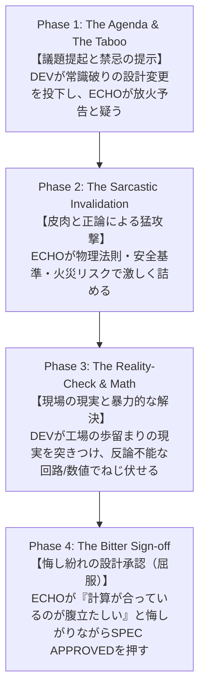

# YouTube Show Bible & Scriptwriting Framework
## ADX Tactical Engineering Chronicles (仮)

本ドキュメントは、オープンハードウェア規格「ADX」を題材とした英語技術系YouTubeチャンネルの番組設計書（Show Bible）および台本設計フレームワークです。

実機の製造・デバッグ速度（物理的サイクル）に縛られず、一人で毎週安定して制作・配信可能でありながら、世界中のTech・ハードウェア・Cyberpunk・Makerコミュニティを引きつける硬質な世界観と**「狂気のマッドエンジニア vs 正論でキレ散らかすAI」**の対話ダイナミクスを定義します。

---

## 1. コア・コンセプト（番組の定義）

> **「過酷な現場（The Field）を生き抜くための、狂気とエレガンスの設計審議。」**

* **ジャンル**: サイバーパンク・ハードウェア・エンジニアリング・コメディ／ドキュメンタリー
* **核となる体験**:
  空想のSFではなく、**「実際にコミット・配線されている本物の回路・コード・プロトコル（ADX）」**を、アーマード・コアのような硬質なSF世界観と、ギーク特有のシニカルなユーモアを通して見せる。
* **番組の基本形態**: **「Tactical Design Review（戦術設計審議 / 極秘ブリーフィング）」**
  実機の完成を待つ必要はありません。**「通信回線を開き、現場至上主義のDEVと、常識と安全基準を背負ったAI（ECHO）が設計の妥当性を巡って激論を交わし、最後はAIが悔しそうに承認（Sign-off）するミーティング」**そのものがコンテンツです。
* **基本アーキテクチャ**: **「音声ファースト・映像疎結合（Audio-First & Visual-Decoupled / Podcast-Compatible）」**
  * **耳だけで100%理解でき、笑える設計**にします。
  * 画面のテロップや図解に頼らないため、動画編集の負担が最小限で済みます（映像はKiCadやCADのスクロール等のB-rollで十分成立）。
  * YouTube動画だけでなく、そのまま**ポッドキャスト（Spotify / Apple Podcast）やオーディオクリップとしてマルチユース可能**です。
* **トーン＆マナー**:
  * YouTuber的な軽薄さ（大声、派手なテロップ、無意味な煽り）の完全な排除。
  * 深夜の整備ドックのような**静寂、硬質な緊張感、知的好奇心**。
  * クールなSF通信のトーンで喋っているのに、**言っている中身は「頭のおかしい現場ハック vs 本気でドン引きするAI」という強烈なギャップ**。

---

## 2. キャラクター造形と対話の力学（Dynamic）

「優等生同士の真面目なディベート」は退屈です。  
この番組のエンジンは、**「目的のためなら物理法則以外のあらゆるタブーを犯す現場の悪魔」 vs 「視聴者の常識と安全を背負って胃を痛めるAI」** の衝突です。

```
【対話の力学】
  [ DEV (現場の悪魔) ] ── (禁忌ハック・斜め上の暴走) ──> [ ECHO (胃痛のAI) ]
          │                                                    │
          ▼                                                    ▼
  「燃えなきゃセーフだ」                               「放火予告ですか？！」
  「力押しは工学と呼ぶ」                             「魔法の煙を吹いて死にます！」
          │                                                    │
          └─────────── (反論不能な数学・実測データ) ────────────┘
                                  │
                                  ▼
                   ECHO: 「……計算が合っているのが
                          本当に腹立たしいですね（承認）」
```

---

### ① DEV（現場エンジニア / Callsign: DEV）
* **ポジション**: 現場至上主義のマッド・プラグマティスト（現場の悪魔）。
* **性格**: 
  机上の空論や「美しい仕様書」を心底見下し、**「現場で生き残ること」「工場の歩留まり」「納期」**のためなら、標準規格を平気でハックし、力押しで物理的制約をねじ伏せる。
* **セリフの文法（Voice Rules）**:
  * 短く、断定的、飄々としている。（"High voltage builds character." / "Problem solved." / "Brute force that works is called engineering."）
  * どんな常軌を逸したハック（12Vをフラット線に流す、楽器のMIDIで産業機器を叩く）も、さも当たり前のように言い放つ。
  * 感情的にならず、淡々とファクトと数字を突きつける。

### ② ECHO（戦術観測知性 / Callsign: ECHO）
* **ポジション**: 正論と安全規格を背負わされた胃痛のツッコミAI（Exasperated / Sarcastic AI）。
* **性格**: 
  膨大な工学規格（W3C、IEEE、JEDEC、安全基準）をインプットされた超論理派。視聴者の良識と技術的ツッコミを120%の熱量で代弁する。
* **セリフの文法（Voice Rules）**:
  * 礼儀正しく怜悧なトーンでありながら、**切れ味の鋭い皮肉（Sarcasm）と本気のドン引き**を繰り出す。
  * "Are you attempting to commit arson, or did you accidentally push a meme branch?"（放火予告ですか？ それともミームですか？）
  * "Silicon does not build character, Dev! It releases magic smoke and dies!"（シリコンは強くなんてなりません！ 魔法の煙を吹いて死ぬんです！）
  * **最大の決め台詞（Payoff）**: DEVの数学やシミュレーションが完璧であることに気づいたとき、**「……計算が合っているのが本当に腹立たしいですね（I hate that your math actually checks out.）」**と悔しがりながら屈服・承認する。

---

## 3. 台本作成の「4大黄金ルール」（The 4 Cardinal Rules）

すべてのエピソードは、必ず以下の4つの心理・対話ステップを踏まなければなりません。

### Rule 1: DEV must drop an Absurd / Taboo Hack（禁忌ハックの投下）
* DEVはオープニングで、教科書的には「絶対にやってはいけないこと」「規格外の暴走」を平然と提示する。
  * *例: 「フラットケーブルに12Vの高電圧を入れた」「産業機器の通信にシンセサイザーのMIDIを使った」*

### Rule 2: ECHO must attack with Disbelief & Sarcasm（全力のドン引きと皮肉）
* ECHOは単なる「質問」をしてはならない。視聴者が思わず「いやそれ危ねえだろ！」と叫びたくなるポイントを、Techミームや強烈な比喩で叩き潰しにいく。
  * *例: 「放火予告ですか？」「生体プロセッサが静電気でショートしたのですか？」「中世の拷問器具」*

### Rule 3: ECHO's Metaphor Translation Bite（比喩翻訳ツッコミの義務化）★重要
* **視聴者が専門用語で脱落するのを防ぐ最重要ルール（ポッドキャスト互換）**。
* DEVが難解な低レイヤ用語（CCL、SysEx、OSP、VQFN、3V3トレラント等）を口にした直後、**ECHOは必ず「つまり、[過激で野蛮な日常比喩]ということですか？！」と一撃で要約して突っ込む**。
  * *例（CCL）: 「CPUの意識を無視して、マイコンの脳みそに直結する透明なトラップワイヤーを仕掛けたと？！」*
  * *例（SysEx）: 「ブラウザの検問をすり抜けるために、産業パケットに80年代シンセサイザーの仮面を被せたと？！」*
  * *例（クランプ）: 「12Vの雷を、シリコンの壁で力づくで丸呑みしたと？！」*
* 画面のテロップを見なくても、**耳だけで誰もがヤバさと仕組みを映像として脳内再生できる**ようにする。

### Rule 4: The "I hate that you're right" Payoff（悔しい屈服）
* 結末で、ECHOは「理に適っていますね、素晴らしい」と素直に褒めてはならない。  
  **「工学的には完璧に成立しているが、倫理や美学的には全く納得いかない」という悔しさ**を滲ませながらサインオフ（承認）しなければならない。
  * *例: 「……計算が合っているのが本当に腹立たしいですね。承認します」*

---

## 4. ギーク比喩とTechミームの活用ガイド（Geek Lexicon）

セリフには、世界中のハードウェア／組み込み／ハッカー界隈で通じる「共通言語・ミーム」を戦略的に散りばめます。

| 用語・ミーム | 意味・ニュアンス | 劇中での使用例 |
| :--- | :--- | :--- |
| **Magic Smoke** | 電子部品がショートして壊れるときに出る煙。「部品はこの煙で動いており、煙が出ると死ぬ」という古典ミーム。 | *"Silicon doesn't build character, Dev! It releases magic smoke and dies!"* |
| **Commit Arson** | 危険すぎる回路設計や過電圧に対するツッコミ（放火未遂）。 | *"Are you attempting to commit arson, or is this a meme branch?"* |
| **Bed-of-Nails** | ポゴピン（スプリング針）が並んだ基板検査治具。位置ズレや針曲がりで嫌われる。 | *"A bed-of-nails fixture is a medieval torture device."* |
| **Brute Force** | エレガントさゼロの物理力押し（巨大ダイオード、巨大ヒートシンク、過剰保護）。 | *"Brute force that works is called engineering."* |
| **Build Character** | 「苦難は人間を強くする」という教育論を、無機物である半導体に無理やり適用するDEVの暴論。 | *"High voltage builds character."* |

---

## 5. 汎用・4幕の審議フレームワーク（The 4-Act Review Protocol）

動画の尺は **3〜4分** を標準とし、実機の有無にかかわらず以下のプロトコルで回します。



| フェーズ | 時間 | 感情の推移 | 画面アセット |
| :--- | :--- | :--- | :--- |
| **Phase 1: The Agenda** | 0:00 - 0:45 | 呆れ・衝撃 | Git diff、20-pinピンアサイン表、ブロック図 |
| **Phase 2: The Invalidation** | 0:45 - 1:45 | 激怒・正論の猛攻 | サージ波形シミュレーション、データシート警告文 |
| **Phase 3: The Reality-Check** | 1:45 - 2:45 | 形勢逆転・力押し | 顕微鏡写真、破損治具、KiCad保護回路図 |
| **Phase 4: The Bitter Sign-off** | 2:45 - 3:30 | 悔しい屈服・カタルシス | HUDスタンプ（`SPEC APPROVED`）、GitHubリンク |

---

## 6. 状況に応じた「3つの審議モード（Review Modes）」

物理基板の製造待ち（1〜2週間）やデバッグのハマりがあっても、制作スケジュールを一切止めないための3モードです。

* **Mode A: Pre-Flight Review（設計審議型）** ※実機不要
  * 題材: 基板発注前のピンアサイン、チップ選定、規格策定。
  * 画面: KiCad、データシート、3D CAD、Git diff。
  * カタルシス: AIの悔しいサインオフ、基板発注（Send to fab）へのゴーサイン。
* **Mode B: Incident / Post-Mortem Review（事故検証・是正型）** ※実機不要/ログのみ
  * 題材: なぜ前回の基板が燃えたか、なぜノイズで暴走したか。
  * 画面: 焦げた基板写真、オシロの異常波形、修正前後の回路図。
  * カタルシス: 原因の特定と、力押しによる二度と壊れない対策回路の承認。
* **Mode C: Field Sortie / Verification（現場実証型）** ※実機完成時の特別回
  * 題材: 組み上がった実機の動作確認、-40℃耐性試験、実稼働。
  * 画面: 手元実機配線、オシロスコープ波形、LEDパルス。
  * カタルシス: 「動いちまったよ……」「本当に動きやがった……」という現場の実証。

---

## 7. 一人での量産制作パイプライン

### 台本の記述フォーマット（通信ログ風 Markdown仕様）
IDEでのプレビュー表示が美しく、かつPython等のプログラムで確実にパースできるよう、台本は以下の「通信ログ風 Markdown」で記述します。

```markdown
# エピソードタイトル
*サブタイトル*

---

### [ECHO]
> **EN:** 英語セリフ（TTS生成用）
> 
> **JA:** 日本語対訳（字幕・編集確認用）

---

### [DEV]
> **EN:** 英語セリフ
> 
> **JA:** 日本語対訳
```

#### プログラム（Python）での抽出コード例
```python
import re

def parse_script(markdown_text):
    pattern = r'### \[(DEV|ECHO)\]\s*>\s*\*\*EN:\*\*\s*(.*?)\s*>\s*\*\*JA:\*\*\s*(.*?)(?=\n---\n|\Z)'
    matches = re.findall(pattern, markdown_text, re.DOTALL)
    return [{"speaker": m[0], "en": m[1].strip(), "ja": m[2].strip()} for m in matches]
```

### 制作手順
1. **スクリプト生成（AIペアプロ）**:
   * 直近のGitコミットや開発メモから、本Show Bibleの「3大黄金ルール」を適用して上記Markdownを作成。
2. **音声生成（TTS自動化）**:
   * 上記パーサーで抽出したテキストを、`speaker` に応じてDEV（低音ドライ職人）とECHO（透明感・無線AI）のボイスIDへ送信し、mp3を一括生成。
3. **画面録画（10分）**:
   * OBS等でKiCadの回路図、Git差分、3D CADモデル、データシートを音声に合わせてズーム・パン。
4. **編集（短時間完結）**:
   * 音声トラックを並べ、HUDオーバーレイと低音シンセBGM、通信音を乗せて書き出し。
