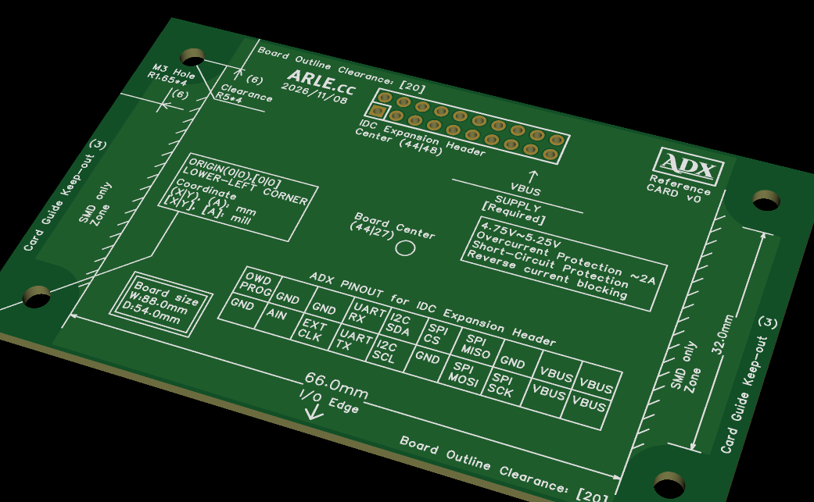

<!--
Copyright (c) 2026 ADX Project Contributors
SPDX-License-Identifier: CC-BY-4.0
-->

# 8854 Form Factor Specification

[ **English** | [日本語 (../ja/8854_formfactor.md)](../ja/8854_formfactor.md) ]



## Overview

The **8854 Form Factor** is the next-generation standard physical profile for the ADX modular hardware ecosystem. It optimizes dimensional alignment between PCB CAD (mil-based) and mechanical enclosure CAD (mm-based), while dramatically enhancing **mass-production panelization (straight V-scoring)** and **enclosure assembly (DFA with slide-in snap-fit compatibility)**.

Key advancements from the legacy 8748 standard ($87.0\,\text{mm} \times 48.0\,\text{mm}$) include the adoption of vertical IDC connectors, omission of C3 chamfers in favor of a true rectangular profile for cost-effective V-scoring, and the introduction of a bottom-side SMD-only zone for seamless slide-in mechanical integration.

---

## 1. Key Advancements from the 8748 Standard

1. **Vertical IDC Expansion Header**:
   - Replaced horizontal right-angle IDC ejector headers with vertical box headers. Eliminates connector overhang beyond the PCB boundary; while board depth increases to 54 mm, the total enclosure depth (including cabling clearance) is significantly reduced.
2. **True Rectangular Profile for Straight V-Scoring**:
   - Replaced C3 corner chamfers with C0 (sharp right angles), allowing continuous full-pass **V-cut (V-scoring)** across the panel. Eliminates mouse-bite tabs, reducing milling costs and deburring labor.
3. **Optimized Panelization ($2 \times 3 = 6\,\text{pcs}$) & Cognitive Ergonomics (Miller's Law)**:
   - Panel size with 5 mm side rails: **$186.0\,\text{mm} \times 162.0\,\text{mm}$**, landing directly in the sweet spot ($150 \sim 200\,\text{mm}$) of fab services like JLCPCB.
   - Batch size of **6 units** respects Miller's Law (Magical Number $7 \pm 2$), minimizing human error during post-SMT optical inspection, electrical testing, and part handling.
4. **Bottom-Side SMD-Only Zones for Slide-In Enclosures**:
   - The underside outside the central 66.0 mm I/O Edge is designated as **SMD Only (no through-hole pin protrusions)**. Enclosure slide rails and bottom snap-fit latches slide smoothly under the board without mechanical snagging.
5. **Enhanced Mechanical Margin**:
   - Screw hole center moved from 5.0 mm to **6.0 mm** from board edges. Ensures a full **1.0 mm solid PCB margin** outside the $\Phi 10.0\,\text{mm}$ screw/washer keep-out boundary.

---

## 2. Mechanical Specification

Dimensional requirements for mechanical designers (3D CAD, sheet metal, CNC machining, 3D printing):

* **Board Outline Dimensions:** `88.0 mm × 54.0 mm`
* **Corner Treatment:** `C0` (Right angles, no chamfer; optimized for straight V-scoring)
* **Mounting Hole Pitch:** `76.0 mm × 42.0 mm`
* **Mounting Hole Edge Margin:** `6.0 mm` from board edges
* **Hole Diameter (Clearance):** `Φ3.3 mm` (NPTH, standard M3 clearance)
* **Mounting Keep-out (Washer Clearance):** Radius `5.0 mm` (`Φ10.0 mm`, centered on screw hole)
* **I/O Edge Span:** `66.0 mm` (centered on bottom edge, $X = 11.0 \sim 77.0\,\text{mm}$)
* **Card Guide Keep-out:** `3.0 mm` strip along left and right side edges
* **Bottom SMD-Only Zone:** Underside outside the 66.0 mm I/O Edge (no THT leads permitted)
* **Outline Trace Clearance:** `20 mil` (approx. `0.508 mm`) along top and bottom long edges

> **Mechanical Design Guidelines:**
> Place mounting bosses at `76.0 mm × 42.0 mm`. Enclosure guide rails and snap-fit latches can slide directly into the 11 mm wide SMD-only clearance areas on both sides beneath the board.

---

## 3. Electrical Specification

Dimensional definitions for PCB designers (KiCad, Altium, EasyEDA Pro, etc.) in standard mil units:

* **Board Outline (Edge.Cuts):** `3465 mil × 2126 mil`
* **Origin:** Lower-left corner `(0, 0) mil` / `(0.0, 0.0) mm`
* **Mounting Hole Centers:**
  - Lower-left: `[236, 236] mil` (`(6.0, 6.0) mm`)
  - Upper-left: `[236, 1890] mil` (`(6.0, 48.0) mm`)
  - Lower-right: `[3228, 236] mil` (`(82.0, 6.0) mm`)
  - Upper-right: `[3228, 1890] mil` (`(82.0, 48.0) mm`)
* **Mounting Hole Pitch:** `2992 mil × 1654 mil`
* **Drill Diameters:**
  - Mounting Holes (NPTH): `130 mil` (approx. 3.30 mm)
  - 20-Pin Bus (PTH): `43 mil` (approx. 1.10 mm)
* **20-Pin IDC Header Center:** `(44.0, 48.0) mm` / `[1732, 1890] mil` (centered on long edge, 6.0 mm from top edge)
* **Trace Clearance to Edge:** `20 mil` from upper and lower board edges
* **Recommended Grid:** `100 mil` or `50 mil`

---

## 4. 20-Pin IDC Expansion Header Interface

The 8854 Form Factor integrates the standardized vertical box header in full compliance with the [ADX 20-Pin Bus Specification (SSOT)](../spec/ADX_PINOUT.md).

### 4.1 Header Pinout (Top View)
```
[Upper Row (Odd / PROG side)]
OWD/PROG | GND | GND     | UART_RX | I2C_SDA | SPI_CS | SPI_MISO | GND     | VBUS | VBUS

[Lower Row (Even / AIN side)]
GND      | AIN | EXT_CLK | UART_TX | I2C_SCL | GND    | SPI_MOSI | SPI_SCK | VBUS | VBUS
```

### 4.2 Power Sourcing Requirements (VBUS Supply)
* **Supply Voltage**: `4.75 V ~ 5.25 V`
* **Mandatory Protection**:
  - Overcurrent Protection ($\approx 2\,\text{A}$)
  - Short-Circuit Protection
  - Reverse Current Blocking (Schottky barrier diode or ideal diode controller)

---

## 5. Unit Precision & Theoretical Tolerances

Theoretical rounding error between metric and mil definitions is under 12 microns, fully absorbed within standard PCB manufacturing variations ($\pm 0.1 \sim 0.2\,\text{mm}$) and M3 clearance hole margins.

| Measurement | Metric Nominal | Mil Equivalent | Converted Metric | Theoretical Error | Remarks |
| :--- | :--- | :--- | :--- | :--- | :--- |
| **X-axis Outline** | 88.0 mm | 3465 mil | 88.011 mm | `+0.011 mm` (+11 μm) | Negligible in fabrication |
| **Y-axis Outline** | 54.0 mm | 2126 mil | 54.000 mm | `+0.000 mm` (0 μm) | Exact alignment |
| **X-axis Pitch** | 76.0 mm | 2992 mil | 75.997 mm | `-0.003 mm` (-3 μm) | Absorbed in M3 clearance |
| **Y-axis Pitch** | 42.0 mm | 1654 mil | 42.012 mm | `+0.012 mm` (+12 μm) | High precision |
| **Hole Edge Margin**| 6.0 mm | 236 mil | 5.994 mm | `-0.006 mm` (-6 μm) | Measured from edges |

---

## 6. Manufacturing & DFM Panelization Guidelines

Standard panelization configuration for production orders (e.g. JLCPCB):

* **Panel Matrix:** 2 columns × 3 rows (6 pcs per panel)
* **Edge Rails (Break-away tabs):** 5.0 mm on each long edge (10.0 mm total)
* **Panel Overall Dimensions:** **$186.0\,\text{mm} \times 162.0\,\text{mm}$**
* **Separation Method:** V-Scoring (continuous straight V-cut)
* **Fiducials:** 2 to 4 optical markers on panel rails ($\Phi 1.0\,\text{mm}$ pad, $\Phi 2.0\,\text{mm}$ mask opening)
* **Tooling Holes:** $\Phi 1.152\,\text{mm}$ or $\Phi 2.0\,\text{mm}$ locating holes at panel corners

