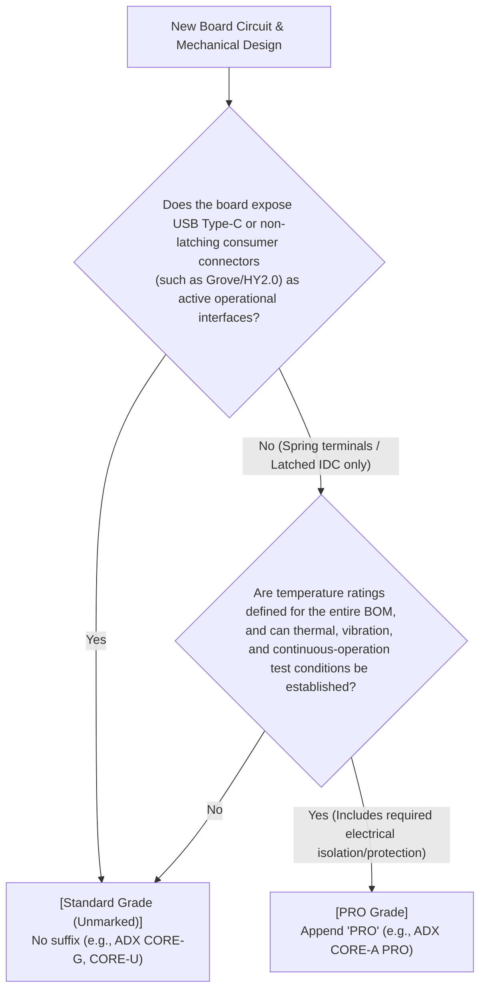

<!--
Copyright (c) 2026 ADX Project Contributors
SPDX-License-Identifier: CC-BY-4.0
-->

# ADX Hardware Naming Conventions & Grade Classification

[ **English** | [日本語 (../ja/hardware_naming_rules.md)](../ja/hardware_naming_rules.md) ]

This document defines the official product naming syntax and grade classification standards for hardware products (boards, modules, daughtercards) in the ADX ecosystem. It establishes the clear distinction between **"Standard Grade (Unmarked: Workbench & Prototyping)"** and **"`PRO` Grade (Field / Industrial: Testable & Deployment-Ready)"**.

---

## 1. Background & Philosophy

ADX aims to bridge the gap between "the accessible developer experience of Arduino" and "reliable physical deployment in real-world enclosures."

However, when designing boards for accessible consumer PCBA manufacturing, there is a fundamental engineering tradeoff between **"the convenience of consumer desktop connectors (such as USB Type-C and Grove)"** and **"the mechanical/electrical testability required to define strict industrial ratings (thermal, vibration, and continuous load)."**

- **Workbench & Prototyping Models with USB Type-C / Grove (Unmarked / Standard):**
  Allow instant development with a single USB cable and direct connection to consumer ecosystems such as M5Unit and Grove. Because USB Type-C and compact friction-fit connectors are inherently non-latching and designed for manual plugging/unplugging, guaranteeing board-wide industrial vibration and continuous-deployment ratings is structurally impractical.
- **Field-Deployable Models Built Exclusively with Rugged Primitives (`PRO`):**
  By combining mechanically/electrically robust components—such as push-in spring clamp terminals, latched IDC box headers, and isolated RS-485—boards remain affordable to manufacture via standard PCBA while achieving genuine **testability and rated field reliability**.

Rather than forcing both goals onto a single compromised board, ADX adopts a two-tier portfolio: **prototype effortlessly on the workbench with Standard (unmarked) boards, then migrate your code and 20-pin CARD modules seamlessly onto `PRO` boards for field deployment.**

---

## 2. Naming Structure

Official ADX hardware model numbers follow this syntax:

```text
ADX [FAMILY]-[TYPE] [GRADE]
```

### Syntax Elements

| Element | Meaning | Definitions & Examples |
| :--- | :--- | :--- |
| **`ADX`** | Brand / Platform Prefix | Fixed prefix for all official ADX hardware. |
| **`[FAMILY]`** | Board Category / Form Factor | • `CORE`: Main MCU processor board (8854 / 8748 Form Factor)<br/>• `CARD`: Expansion add-on card (8854 / 8748 Form Factor)<br/>• `PWR`: Power supply / distribution module<br/>• `BASE`: Backplane / baseboard carrier |
| **`[TYPE]`** | Function & Architecture | • `G`: Grove / M5Unit focused single Type-C model<br/>• `U`: Standard USB development model<br/>• `A` / `A24`: Isolated RS-485 field edge model<br/>• `D`: Development / Debug (Internal R&D testbed)<br/>• `RELAY`: Relay output card<br/>• `DIO`: Digital I/O card |
| **`[GRADE]`** | **Target Domain & Rating Grade** | • **(Unmarked)**: **Standard Grade (Workbench, Prototyping & General Use)**<br/>• **`PRO`**: **PRO Grade (Field / Industrial Deployment, Rated & Testable)** |

---

## 3. Grade Classification Decision Tree

When a designer develops a new board, its grade is assigned according to the following objective criteria:



### 3.1 Standard Grade (Unmarked / No Suffix)

- **Definition:** Standard models optimized for workbench prototyping, education, hobbyist use, M5Unit / Grove integration, and general light-duty applications.
- **Design Position:**
  1. **Developer Experience & Cost Efficiency:** Permits USB Type-C direct PC connection and consumer ecosystems such as Grove (HY2.0).
  2. **Baseline Safety Protections:** Incorporates eFuse overcurrent limiting, ESD protection, and back-feed prevention for safe everyday workbench handling.
  3. **Scope Exclusion:** Due to consumer connector mechanics, these boards are explicitly outside the scope of industrial vibration or long-term continuous field-rating certifications.

### 3.2 PRO Grade (`PRO` Suffix)

- **Definition:** Field-ready industrial tier engineered for **full testability** inside control cabinets, machinery, and permanent installations.
- **Mandatory Requirements:**
  1. **No Consumer USB Bottlenecks:** USB Type-C is not exposed as an always-on operational power or communication interface (USB-less, or strictly non-exposed maintenance-only service access).
  2. **Mechanical Robustness:** Uses only connectors with well-defined retention and environmental specs, such as push-in spring clamp terminals and latched/ejected IDC box headers.
  3. **Electrical Isolation & Safety:** Incorporates galvanic isolation (e.g., isolated RS-485, isolated power boundaries) to prevent cascading destruction from wiring faults, ground loops, or surges.
  4. **Complete BOM & Test Definition:** Every BOM component has a verified operating temperature rating, enabling formal thermal, vibration, and continuous-load qualification specs.

---

## 4. Part Number Examples

| Part Number | Grade | Key Interfaces | Primary Applications & Target Audience |
| :--- | :--- | :--- | :--- |
| **`ADX CORE-G`** | Standard (Unmarked) | 1× USB Type-C / 3× Grove (5V M5Unit) | **Grove / M5Unit Prototyping Core.** Cost-effective entry board for workbench development and CARD evaluation. |
| **`ADX CORE-U`** | Standard (Unmarked) | Dual USB Type-C / Expansion I/O | **Standard USB Core.** Bench development and Arduino IDE workflow. |
| **`ADX CORE-A PRO`** | **`PRO`** | Isolated RS-485 / Spring Terminals / 20P IDC | **Field-Ready Edge Node.** USB-less industrial-temp design with definable qualification test conditions. |
| **`ADX CORE-A24 PRO`** | **`PRO`** | Isolated DC24V / Isolated RS-485 / Terminals | **Control-Panel Edge Node.** Direct DC24V industrial power integration. |
| **`ADX CARD-RELAY`** | Standard (Unmarked) | 20P IDC Bus / Standard Terminals | General-purpose relay expansion card for bench evaluation. |
| **`ADX CARD-RELAY PRO`** | **`PRO`** | 20P Latched IDC / Isolated Rated Terminals | Industrial relay card qualified for continuous rated field operation. |

> **Note on Internal R&D and Legacy Boards:**  
> Dedicated internal R&D/bootloader testbeds (e.g., `ADX Core-D`) and archived exploratory designs (e.g., `CORE-S`) fall outside the two-tier commercial/open-standard classification.

---

## 5. Open Hardware Policy & License

All ADX hardware design files (schematics, PCB layout, BOM, fabrication outputs) are published under the CERN-OHL-P-v2 license. Users fabricating or deploying boards from source files are responsible for verifying that their operating environment matches the board's designated grade (Standard workbench use vs. `PRO` rated conditions).

---

## 6. License

This specification is licensed under the [Creative Commons Attribution 4.0 International License (CC-BY-4.0)](../../LICENSES/CC-BY-4.0.txt).
