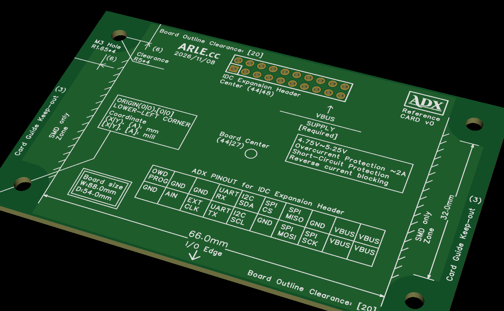

<!--
Copyright (c) 2026 ADX Project Contributors
SPDX-License-Identifier: CC-BY-4.0
-->

# 8854 Form Factor 仕様書 (8854 Form Factor Specification)

[ English (../en/8854_formfactor.md) | **日本語** ]



## 概要 (Overview)

「**8854 Form Factor**」は、ADXエコシステムにおける次世代の標準ハードウェア外形規格です。基板設計（mil単位）と筐体・メカ設計（mm単位）の高精度な寸法整合性を確保しつつ、**量産面付け（Vカット加工）** と **スロットイン筐体への組立性（DFA）** を極限まで高めた設計となっています。

旧「8748規格（87.0 mm × 48.0 mm）」からの主要な進化点として、コネクタの垂直実装化（Vertical IDC化）、Vカット加工を可能にする完全矩形化、および筐体スナップフィット爪を潜り込ませる下面SMD Onlyゾーンの導入が図られています。

---

## 1. 8748規格からの主な進化点

1. **コネクタの垂直実装化 (Vertical IDC)**:
   * 水平引き出し型のライトアングルIDCからバーティカルIDCヘッダーへ移行。コネクタの基板外張り出しをゼロ化し、奥行き54mmへ拡張しつつも、ケーブリングを含めた機器全体の占有奥行きはむしろ縮小。
2. **完全矩形化による全周ストレートVカット対応**:
   * C3面取りを廃止（C0）し、外形ルーター加工＋タブ割りから **ストレートVカット（V-Scoring）** に対応。基板端バリを防止し、面付け製造コストを削減。
3. **高効率パネル面付け（2×3 = 6pcs）とマジカルナンバー7**:
   * 捨て基板（両端各5mm）を含めて **186 mm × 162 mm** となり、JLCPCB等の標準適正パネル寸法（150〜200mm）に適合。
   * 作業単位を「6個」とすることで、短期記憶・瞬間把握の限界（Millerの法則: $7 \pm 2$）の範囲内に収まり、SMT後の目視検査やピッキング時のヒューマンエラーを低減。
4. **下面SMD Onlyゾーンとスロットイン対応**:
   * 中央66.0 mmのI/O Edge外側下面を「スルーホール（THT）ピン突出禁止（SMD Only）」と規定。筐体のスライドレールや底面スナップフィット爪が干渉なくスムーズにスライド可能。
5. **ネジ穴マージンの拡大**:
   * ネジ穴中心を四隅端から **6.0 mm** に配置。Φ10.0 mm（半径5.0 mm）の座金・スペーサー禁止円を確保しても、外形端との間に **1.0 mmの肉厚** を確保。

---

## 2. メカニカル仕様 (Mechanical Specification)

筐体設計（3D CAD、板金加工、CNC切削、3Dプリント）を行うメカ設計者向けの寸法定義です。

* **基板外形寸法 (Board Outline):** `88.0 mm × 54.0 mm`
* **角部加工 (Corner Treatment):** `C0`（直角、面取りなし。ストレートVカット対応）
* **取付穴ピッチ (Mounting Hole Pitch):** `76.0 mm × 42.0 mm`
* **取付穴マージン (Hole Margin):** 四隅の端から `6.0 mm`
* **取付穴径 (Clearance Hole):** `Φ3.3 mm`（M3ネジ対応 NPTH）
* **取付穴座面クリアランス (Keep-out):** 中心から半径 `5.0 mm`（`Φ10.0 mm`、M3ワッシャー・スペーサー領域）
* **I/O Edge 有効長:** `66.0 mm`（長辺中央、X = 11.0 mm 〜 77.0 mm）
* **カードガイドキープアウト (Card Guide):** 左右端から `3.0 mm` 幅（スロットインレール領域）
* **下面SMD Onlyゾーン:** I/O Edge外側の下面領域（THTリード突出禁止）
* **長辺クリアランス:** 上下長辺に沿って `20 mil`（約 `0.508 mm`）のパターン禁止帯

> **メカ設計ガイドライン:**
> ボス配置は `76.0 mm × 42.0 mm` でモデリングしてください。筐体のスナップフィットやガイドレールは、左右各11mm幅のSMD Onlyゾーン下部にスライド進入させることが可能です。

---

## 3. エレクトリカル仕様 (Electrical Specification)

基板CAD（KiCad、Altium、EasyEDA Pro等）で設計を行うエレキ設計者向けの寸法定義です。

* **基板外形 (Edge.Cuts):** `3465 mil × 2126 mil`
* **原点 (Origin):** 基板左下角 `(0, 0) mil` / `(0.0, 0.0) mm`
* **ネジ穴中心座標:**
  - 左下: `[236, 236] mil` (`(6.0, 6.0) mm`)
  - 左上: `[236, 1890] mil` (`(6.0, 48.0) mm`)
  - 右下: `[3228, 236] mil` (`(82.0, 6.0) mm`)
  - 右上: `[3228, 1890] mil` (`(82.0, 48.0) mm`)
* **ネジ穴ピッチ:** `2992 mil × 1654 mil`
* **ドリル径:**
  - 取付穴 (NPTH): `130 mil` (約 3.30 mm)
  - 20-Pin バス (PTH): `43 mil` (約 1.10 mm)
* **20-Pin IDC バス中心座標:** `(44.0, 48.0) mm` / `[1732, 1890] mil`（長辺中央、上端から6.0mm）
* **長辺配線禁止マージン:** 長辺外形線から `20 mil`
* **推奨コンポーネントグリッド:** `100 mil` または `50 mil`

---

## 4. 20-Pin IDC Expansion Header 配置と電源要件

本フォームファクタは [ADX 20-Pin Bus Specification (SSOT)](../spec/ADX_PINOUT.md) に完全準拠したバーティカルIDCヘッダーを標準搭載します。

### 4.1 ピン配置 (Top View)
```
[上列 (奇数/PROG側)]
OWD/PROG | GND | GND     | UART_RX | I2C_SDA | SPI_CS | SPI_MISO | GND     | VBUS | VBUS

[下列 (偶数/AIN側)]
GND      | AIN | EXT_CLK | UART_TX | I2C_SCL | GND    | SPI_MOSI | SPI_SCK | VBUS | VBUS
```

### 4.2 電源供給仕様 (VBUS Supply)
* **供給電圧**: `4.75 V 〜 5.25 V`
* **必須保護機能**:
  - 過電流保護 (Overcurrent Protection $\approx 2\,\text{A}$)
  - 短絡保護 (Short-Circuit Protection)
  - 逆流防止 (Reverse current blocking: ショットキーまたは理想ダイオード)

---

## 5. 単位換算と理論公差 (Precision & Tolerances)

本規格では、mil単位とmm単位の相互換算における丸め誤差を12μm未満に抑えており、一般的な基板製造公差（±0.1〜0.2 mm）やM3ネジ穴クリアランス（約0.3 mm）に完全に吸収されます。

| 測定箇所 | mm名目値 | mil換算値 | 実寸法換算 | 理論誤差 | 備考 |
| :--- | :--- | :--- | :--- | :--- | :--- |
| **X軸 外形** | 88.0 mm | 3465 mil | 88.011 mm | `+0.011 mm` (+11 μm) | 実用上無視できる極小値 |
| **Y軸 外形** | 54.0 mm | 2126 mil | 54.000 mm | `+0.000 mm` (0 μm) | 完全一致 |
| **X軸 ピッチ** | 76.0 mm | 2992 mil | 75.997 mm | `-0.003 mm` (-3 μm) | M3穴公差内で完全吸収 |
| **Y軸 ピッチ** | 42.0 mm | 1654 mil | 42.012 mm | `+0.012 mm` (+12 μm) | 設計値と高精度に一致 |
| **ネジ穴マージン**| 6.0 mm | 236 mil | 5.994 mm | `-0.006 mm` (-6 μm) | 外形基準 |

---

## 6. パネル面付けガイドライン (DFM / Panelization)

JLCPCB等の量産発注時は、以下の面付け構成を標準とします：

* **面付け構成:** 2列 × 3行（計 6 pcs / 1 Panel）
* **捨て基板 (Edge Rails):** 長辺両端に各 5.0 mm 幅（計 10.0 mm 追加）
* **仕上がりパネル外形:** **$186.0\,\text{mm} \times 162.0\,\text{mm}$**
* **分割方式:** Vカット加工（V-Scoring、通し刃加工）
* **アライメントマーク・フィデューシャル:** 捨て基板の対角2〜4箇所に配置（$\Phi 1.0\,\text{mm}$、クリアランス $\Phi 2.0\,\text{mm}$）
* **ツーリングホール:** 捨て基板四隅に $\Phi 1.152\,\text{mm}$ または $\Phi 2.0\,\text{mm}$ の位置決め穴を配置

