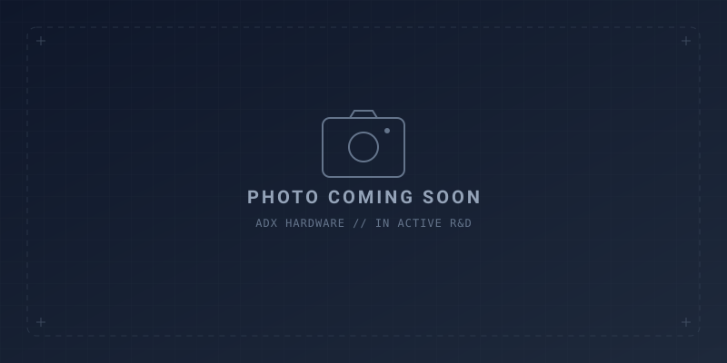

<!--
Copyright (c) 2026 ADX Project Contributors
SPDX-License-Identifier: CC-BY-4.0
-->

# ADX (Advanced Devices eXtended)

<p align="center">
  <strong>[ <a href="../../README.md">English</a> | 日本語 ]</strong><br>
  <a href="https://arle.cc">🌐 <strong>公式ブランドサイト (ARLE.cc)</strong></a> &nbsp;|&nbsp;
  <a href="https://hackaday.io/project/205547-adx-enclosure-native-modular-hardware-standard">🛠 <strong>Hackaday.io プロジェクト</strong></a>
</p>

<p align="center">
  
</p>

### *はたらくArduino (The Working Arduino)*
> **Arduinoよりちょっとタフで、箱にいれやすい。あなたのスケッチを現場で動かすためのボード。**

**ADX** は、グローバルハードウェアブランド **[ARLE.cc](https://arle.cc)**（長崎・佐世保の「古川企画」発）が開発するオープンハードウェアのモジュラーエコシステムです。ブレッドボードの上で作った電子工作プロジェクトを実際の暮らしや現場の空間へ連れ出し、ケースに収めて安心して長く動かし続けるために生まれました。

---

## 目的別クイックナビゲーション (Quick Navigation)

あなたのやりたいことに合わせて、最適なドキュメントへご案内します：

| やりたいこと | 主なドキュメント | リンク |
| :--- | :--- | :--- |
| 🚀 **USB でサクッと動かしたい** | 標準 USB Core ボード CORE-U の構想と仕様 | [CORE-U 技術仕様案](../../hardware/CORE-U/spec_proposal.md) |
| 🛡 **産業用DC24V・絶縁RS-485端末を作りたい** | 現場向けエッジ端末 CORE-A24（構想・計画中） | [CORE-A24 構想](../../hardware/README.md#11-core-シリーズ-メインmcuボード) |
| 🔌 **拡張基板 (CARD) を作りたい** | 共通 20ピンバスの厳密なピン定義と設計ルール | [ADX 20ピンバス仕様書 (SSOT)](../spec/ADX_PINOUT.md) |
| 📖 **ピン配置の設計思想を知りたい** | 産業盤配線トポロジー適合やシールド構造の解説 | [ADX Pinout 設計・解説ガイド](ADX_pinout.md) |
| 📦 **ケースを設計・3Dプリントしたい** | 8748 外形寸法、ネジ穴位置、レールマージン | [8748 フォームファクタ仕様書](8748_formfactor.md) |

---

## 1. 概要：机の上から、実際の設置場所へ

ブレッドボードの上で回路を組み立てて動かすのはとても楽しい体験です。

しかし、そのスケッチを**部屋の隅、ガレージ、店舗のディスプレイ、家庭菜園の棚などに実際に置いて長く動かそうとしたとき**、多くの人が次のような物理的な困りごとに直面します：

1. **固定しづらい**: 取付穴の周囲に余裕がなく、M3ネジを締め込むと基板パターンを削りそうになる。
2. **箱に入らない**: 前後左右から線が飛び出していて、ケースの穴あけ加工が難しくフタが閉まらない。
3. **配線が抜けやすい**: ブレッドボード用のジャンパ線だと、ちょっとした振動や引っ掛かりで抜けてしまう。
4. **現場での手直しが億劫**: ちょっとコードを直したいだけなのに、設置場所まで重いノートPCを抱えていくのが大変。

**ADXは、この課題に対して「はたらくArduino (The Working Arduino)」という等身大の考え方でアプローチします。**  
高価で大げさな産業用PLCではなく、誰もが親しんできたArduinoの良さをそのままに、「ちょっとタフで、箱にいれやすい」相棒として設計されています。

---

## 2. 共通の土台：ADX オープンハードウェア規格

ADXの土台となるのは、マイコンやモジュールが様々なケースに無理なく収まるように設計された、オープンな物理規格です。

```text
       ════════════════════════════════════════════════════════════════════
                         【 ADX ハードウェア規格体系 】
         ・8748 フォームファクタ (87.0 mm × 48.0 mm 外形)
         ・四隅の M3 取付穴 ＆ Φ5.0 mm ワッシャークリアランス
         ・レール滑り込み（スロットイン）や爪留め（スナップフィット）用の掴み幅
         ・単一の「I/F辺」に外部配線を集約（加工面が1面で完結）
         ・ADX Pinout v4.0 (底面大電流電源、最外端GND、3.3V ネイティブ GPIO)
       ════════════════════════════════════════════════════════════════════
                                       │
            ┌──────────────────────────┴──────────────────────────┐
            ▼                                                     ▼
   【 メイン Core シリーズ 】                            【 モジュール式 CARD群 】
     ・ADX CORE-U   (標準 USB / ATtiny1616 / 筐体フレンドリー)            ADX CARD エコシステム
     ・ADX CORE-A24 (産業 DC24V ＆ 絶縁 RS-485 / 構想中)                 ・Prototyping CARD (試作基板)
     ・デュアル Type-C または 絶縁スプリング端子台                        ・Power CARD (電源受電)
     ・20P IDC 治具による出荷時自動検査・書込                             ・3Dプリント用ケース / マウントSTL
```

### 2.1 8748 フォームファクタと確実なネジ固定
- **外形寸法**: `87.0 mm × 48.0 mm`。
- **M3 ネジ止めスペース**: 四隅のM3ネジ穴（`77.0 mm × 38.0 mm` ピッチ）の周囲に、**Φ5.0 mm のゆとりあるワッシャークリアランス**を確保。ネジの頭や座金をしっかり締め込んでも、パターンを痛めません。
- **外形部掴み幅（エッジマージン）**: 基板の外周に部品を配置しないクリアランスを設けており、ケースのレールへの**スロットイン（滑り込み固定）**や、3Dプリント爪による**スナップフィット**に対応します。
- *詳細仕様*: [8748 フォームファクタ仕様書](8748_formfactor.md)

### 2.2 I/F辺の集約によるケース加工の単純化
外部配線と接続する端子部は、**基板の単一の一辺（I/F辺）に集約**されています。  
コネクタが四方八方に飛び出さないため、ケースの開口加工や3Dプリントケースのフタ設計が「1面だけ」で完結します。

### 2.3 共通 20ピンバス (ADX-BUS-SPEC-v4.0)
Core ボードと拡張 CARD は、標準の 2×10ピン IDC コネクタでシームレスに結合します：
- **産業盤トポロジー適合・底面大電流電源 (`VBUS`: Pins 17〜20)**:  
  制御盤の配線原則（弱電上部・強電下部）に一致させ、前面電源端子台へ直進配線（基板内信号交差全廃）。副次的に縦型スロット時の落線混触も防止。$2 \times 2$ ベタパターンで最大 **2A〜3A 連続** を供給。
- **保護境界壁 (`Pin 16: GND`)**:  
  VBUS の直上に GND を配置し、フラットケーブル圧接ズレ時の信号線破損を防止。
- **最外端ガード ＆ AIN コプレーナ保護 (`Pins 1〜4`)**:  
  外周の Pin 1 (GND) と Pin 4 (GND) で微弱な Pin 3 (AIN) を挟み込み、高周波ノイズを遮断。
- **システムプログラミング＆デバッグ (`Pins 2 & 5`)**:  
  治具 IDC ヘッダー 1 本で 1線(UPDI)〜2線(SDI) 自動書込・検査を完結。
- **3.3V ネイティブ統一**:  
  全デジタル信号（UART, I2C, SPI）を **3.3V LVCMOS** に統一。
- *詳細仕様 (SSOT)*: [ADX 20ピンバス仕様書 (英語)](../spec/ADX_PINOUT.md) | [設計解説ガイド (日本語)](ADX_pinout.md)

---

## 3. Core ボードラインナップ

用途と環境に応じて、最適な Core ボードを選択できます：

1. **[ADX CORE-U](../../hardware/CORE-U/spec_proposal.md) (標準 USB Core / Production)**:
   - **MCU**: Microchip ATtiny1616-MNR (8-bit AVR 3.3V 10MHz, Flash 16KB, SRAM 2KB)
   - **特徴**: 筐体フレンドリー設計（ボタン操作一切不要）、デュアル Type-C（給電専用 5V2A ＋ 通信専用）、CH342K デュアル UART（Port 1: SerialUPDI / Port 2: Serial モニタ）、Arduino IDE 1.8系 × megaTinyCore 完全対応。
2. **ADX CORE-A24 (産業向けエッジ端末 / 構想・計画中)**:
   - **MCU**: Microchip ATtiny1616-MNR (8-bit 10MHz, 極小自己発熱)
   - **特徴**: -40℃〜+105℃ 耐熱部品、2500V 絶縁 RS-485、スプリング端子台、産業用DC24V電源入力。（旧 CORE-A5 の後継発展機）。
3. **ADX CORE-A5 (アーカイブ)**:
   - 旧現場向けモデル。CORE-A24 への移行に伴いアーカイブ化（[仕様書](../../hardware/archive/CORE-A5/spec_study.md)）。

---

## 4. ブランド ＆ ガバナンス (Brand & Governance)

- **ブランド ＆ 製造元**: **[ARLE.cc](https://arle.cc)** — 現場生まれのタフなオープンハードウェアを生み出すグローバルメーカーブランド。
- **エンジニアリング母体**: **古川企画 (Furukawa Kikaku)** — 日本・長崎県佐世保市を拠点とする組込システム開発ファーム（[furukawakikaku.jp](https://furukawakikaku.jp)）。
- **ライセンス体系 (Tri-License)**:
  - **ハードウェア設計データ**: [CERN-OHL-P-v2](../../LICENSES/CERN-OHL-P-2.0.txt) (Strongly Reciprocal)
  - **ファームウェア ＆ ソフトウェア**: [MIT License](../../LICENSES/MIT.txt)
  - **ドキュメント ＆ 規格仕様書**: [CC-BY-4.0](../../LICENSES/CC-BY-4.0.txt)
