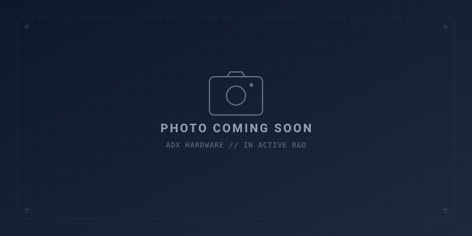

<!--
Copyright (c) 2026 ADX Project Contributors
SPDX-License-Identifier: CC-BY-4.0
-->

# ADX (Advanced Devices eXtended)

<p align="center">
  <strong>[ <a href="../../README.md">English</a> | 日本語 ]</strong><br>
  <a href="https://arle.cc">🌐 <strong>公式ブランドサイト (ARLE.cc)</strong></a> &nbsp;|&nbsp;
  <a href="https://hackaday.io/project/205547-adx-enclosure-native-modular-hardware-standard">🛠 <strong>Hackaday.io プロジェクト</strong></a>
</p>

<p align="center">
  
</p>

### *はたらくArduino (The Working Arduino)*
> **Arduinoよりちょっとタフで、箱にいれやすい。あなたのスケッチを現場で動かすためのボード。**

**ADX** は、グローバルハードウェアブランド **[ARLE.cc](https://arle.cc)**（長崎・佐世保の「古川企画」発）が開発するオープンハードウェアのモジュラーエコシステムです。ブレッドボードの上で作った電子工作プロジェクトを実際の暮らしや現場の空間へ連れ出し、ケースに収めて安心して長く動かし続けるために生まれました。

---

## 目的別クイックナビゲーション (Quick Navigation)

あなたのやりたいことに合わせて、最適なドキュメントへご案内します：

| やりたいこと | 主なドキュメント | リンク |
| :--- | :--- | :--- |
| 🚀 **フラッグシップ CORE-U で開発・現場投入したい** | 3 Mode（`-40〜+85℃` 理論仕様）フラッグシップ仕様書 | [CORE-U (rev6) 技術仕様書](../../hardware/CORE-U/rev6/spec.md) |
| 🔌 **拡張基板 (CARD) を作りたい** | 共通 20ピンバス（`v5.0`）の厳密なピン定義と設計ルール | [ADX 20ピンバス仕様書 (SSOT: v5.0)](../spec/ADX_PINOUT.md) |
| 📖 **ピン配置の設計思想を知りたい** | 産業盤配線トポロジー・両側 GND シールド・`UART_DE` 解説 | [ADX Pinout 設計・解説ガイド](ADX_pinout.md) |
| 📦 **ケースを設計・3Dプリントしたい** | 8858 外形寸法、ネジ穴位置、レールマージン、光学マーカー | [8858 フォームファクタ仕様書（正式 α 版）](8858_formfactor.md) |

---

## 1. 概要：机の上から、実際の設置場所へ

ブレッドボードの上で回路を組み立てて動かすのはとても楽しい体験です。

しかし、そのスケッチを**部屋の隅、ガレージ、店舗のディスプレイ、家庭菜園の棚などに実際に置いて長く動かそうとしたとき**、多くの人が次のような物理的な困りごとに直面します：

1. **固定しづらい**: 取付穴の周囲に余裕がなく、M3ネジを締め込むと基板パターンを削りそうになる。
2. **箱に入らない**: 前後左右から線が飛び出していて、ケースの穴あけ加工が難しくフタが閉まらない。
3. **配線が抜けやすい**: ブレッドボード用のジャンパ線だと、ちょっとした振動や引っ掛かりで抜けてしまう。
4. **現場での手直しが億劫**: ちょっとコードを直したいだけなのに、設置場所まで重いノートPCを抱えていくのが大変。

**ADXは、この課題に対して「はたらくArduino (The Working Arduino)」という等身大の考え方でアプローチします。**  
高価で大げさな産業用PLCではなく、誰もが親しんできたArduinoの良さをそのままに、「ちょっとタフで、箱にいれやすい」相棒として設計されています。

---

## 2. 共通の土台：ADX オープンハードウェア規格

ADXの土台となるのは、マイコンやモジュールが様々なケースに無理なく収まるように設計された、オープンな物理規格です。

```text
       ════════════════════════════════════════════════════════════════════
                         【 ADX ハードウェア規格体系 】
         ・8858 フォームファクタ (88.0 mm × 58.0 mm 外形 / 正式 α 版・V カット対応)
         ・四隅の M3 取付穴 (76.0 × 46.0 mm ピッチ) ＆ Φ10.0 mm 座面クリアランス
         ・左右 3.0 mm カードガイド ＆ 下面 SMD Only ゾーン（縦挿し・スナップフィット対応）
         ・単一の「I/O Edge (66.0 mm)」に外部配線を集約（加工面が 1 面で完結）
         ・ADX Pinout v5.0 (P01〜P11 抽象ピン表記、専用 UART_DE、底面 VBUS、3.3V)
       ════════════════════════════════════════════════════════════════════
                                       │
            ┌──────────────────────────┴──────────────────────────┐
            ▼                                                     ▼
   【 フラッグシップ Core 】                             【 モジュール式 CARD群 】
     ・ADX CORE-U (rev6 フラッグシップ / ATtiny1616 / 3 Mode)        ADX CARD エコシステム
       - Full embedded mode (-40〜+85℃ 理論仕様)＋ラッチ付 IDC       ・絶縁 RS-485 / LIN CARD
       - USB-COM 非接続時 CH342K 完全 0mW 遮断（オンボード UPDI）     ・絶縁 24V / 48V 電源 CARD
       - AI 電力観測（V/I/W）＋ 3 Mode 自己認識・深睡眠起床          ・Reference / Proto CARD・筐体 STL
```

### 2.1 8858 フォームファクタ（正式 α 版）と確実なネジ固定
- **外形寸法**: `88.0 mm × 58.0 mm`（`3465 mil × 2283 mil`、縦横比 `1.52 : 1`）。200mm 角安全圏で 2×3 = 6 面付け（4 辺 5mm レール込み `186 × 184 mm`）のほぼ完全正方形パネライズに対応します。
- **M3 ネジ止めスペース**: 四隅の M3 ネジ穴（`76.0 mm × 46.0 mm` ピッチ、四隅から `6.0 mm`）の周囲に、**Φ10.0 mm（R = 5.0 mm）のゆとりある座面クリアランス**を確保。ネジ頭や座金をしっかり締め込んでもパターンを痛めず、外周に 1.0 mm の肉厚を残します。
- **スロットイン＆自動検査対応**: 左右 3.0 mm のカードガイド領域と下面 **SMD Only ゾーン**（`36.0 × 8.0 mm × 2`）により、PLC 型縦挿しラックや 3D プリント爪による **スナップフィット固定** に対応。さらに四隅 `M1〜M4`（ピッチ `76.0 × 30.0 mm`）のキラル光学マーカー規格を統合しています。
- *詳細仕様*: [8858 フォームファクタ仕様書（正式 α 版）](8858_formfactor.md) *(旧規格: [8854](8854_formfactor.md) / [8748](8748_formfactor.md))*

### 2.2 I/F辺の集約によるケース加工の単純化
外部配線と接続する端子部は、**基板の単一の一辺（I/F辺）に集約**されています。  
コネクタが四方八方に飛び出さないため、ケースの開口加工や3Dプリントケースのフタ設計が「1面だけ」で完結します。

### 2.3 共通 20ピンバス (ADX-BUS-SPEC-v5.0)
Core ボードと拡張 CARD は、標準の 2×10ピン IDC コネクタでシームレスに結合します：
- **MCU 非依存の論理ピン ID (`P01`〜`P11`)**:  
  電源（`GND`/`VBUS`）を除く 11 本すべてを例外のない役割中立の **`P01`〜`P11`** として抽象化。コード上は衝突安全な `ADX_P01`〜`ADX_P11` およびエイリアス（`ADX_AIN`, `ADX_DE`, `ADX_TX`, `ADX_CS` 等）で統一。
- **産業盤トポロジー適合・底面大電流電源 (`VBUS`: Pins 17〜20)**:  
  制御盤の配線原則（弱電上部・強電下部）に一致させ、前面電源端子台へ直進配線（基板内信号交差全廃）。$2 \times 2$ ベタパターンで **`4.5V〜5.5V`（`5V ±10%` 全基板耐性 MUST）**・最大 **2A〜3A 連続** の双方向給受電に対応。
- **保護境界壁 (`Pin 16: GND`)**:  
  VBUS の直上に GND を配置し、フラットケーブル圧接ズレ時の信号線破損を防止。
- **連続奇数 GND ガード (`Pins 1, 3, 5: GND`)**:  
  `P01`（Pin 2: `AIN`）を Pin 1 & 3 (`GND`) で、`P02`（Pin 4: `EXTCLK`）を Pin 3 & 5 (`GND`) で完全サンドイッチ保護。
- **3 線フィールド UART ＆ 専用 RS-485 方向制御 (`P03`〜`P05` / Pins 6〜8)**:  
  Pin 6 に **`P03`（`UART_DE / XDIR`、Card 側プルダウン必須）** を新設し、RS-485/LIN・I2C（`P06`〜`P07`）・SPI（`P08`〜`P11`）の全同時稼働を実現。
- **書込線のバス非露出（Core 側自己完結）**:  
  UPDI / SWD 等の書込線をリボンケーブルから除外して HV ノイズ・誤リセット経路を絶ち、各 Core ボード上で自己完結。
- **3.3V ネイティブ統一**:  
  全 11 信号（`P01`〜`P11`）を **3.3V LVCMOS** に統一。
- *詳細仕様 (SSOT)*: [ADX 20ピンバス仕様書 (英語 v5.0)](../spec/ADX_PINOUT.md) | [設計解説ガイド (日本語)](ADX_pinout.md)

---

## 3. Core ボードラインナップ

1. **[ADX CORE-U (rev6)](../../hardware/CORE-U/rev6/spec.md)（ADX フラッグシップ Core）**:
   - **MCU**: Microchip ATtiny1616-MNR（8-bit AVR 3.3V 10MHz, Flash 16KB, SRAM 2KB, `-40〜+105℃` 品）
   - **特徴**: 3 Mode 運用（`Full embedded mode` 理論仕様 `-40℃〜+85℃`・ラッチ付 THT IDC・`CH342K` 非接続時完全 0mW 遮断）、デュアル Type-C（給電 5V/2A ＋ 独立 UPDI/UART）、AI 電力観測（V/I/W）、`PB5` による 3 Mode 自己認識＆深睡眠起床、`PB4` ハード PWM ステータス灯。絶縁 RS-485 や絶縁 24V/48V 電源は拡張 CARD 側で自由に組み合わせ可能。
2. **付加価値型派生ボード（旧 `CORE-A5` 等・アーカイブ参照）**:
   - 絶縁 RS-485 統合型などの特化ボードは主軸ではなく派生カテゴリ（Arduino ROMEO 相当）として位置づけ（[旧 CORE-A5 仕様書](../../hardware/archive/CORE-A5/spec_study.md)）。

---

## 4. ブランド ＆ ガバナンス (Brand & Governance)

- **ブランド ＆ 製造元**: **[ARLE.cc](https://arle.cc)** — 現場生まれのタフなオープンハードウェアを生み出すグローバルメーカーブランド。
- **エンジニアリング母体**: **古川企画 (Furukawa Kikaku)** — 日本・長崎県佐世保市を拠点とする組込システム開発ファーム（[furukawakikaku.jp](https://furukawakikaku.jp)）。
- **ライセンス体系 (Tri-License)**:
  - **ハードウェア設計データ**: [CERN-OHL-P-v2](../../LICENSES/CERN-OHL-P-2.0.txt) (Strongly Reciprocal)
  - **ファームウェア ＆ ソフトウェア**: [MIT License](../../LICENSES/MIT.txt)
  - **ドキュメント ＆ 規格仕様書**: [CC-BY-4.0](../../LICENSES/CC-BY-4.0.txt)
