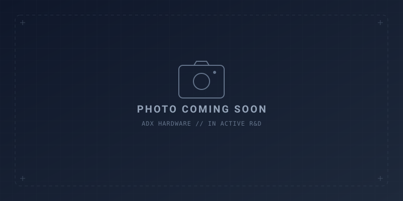

<!--
Copyright (c) 2026 ADX Project Contributors
SPDX-License-Identifier: CC-BY-4.0
-->

# ADX (Advanced Devices eXtended)

[ English (../../README.md) | **日本語** ]

<p align="center">
  
</p>

### *はたらくArduino (The Working Arduino)*
> **Arduinoよりちょっとタフで、箱にいれやすい。あなたのスケッチを現場で動かすためのボード。**

**ADX** は、ブレッドボードの上で作った電子工作プロジェクトを実際の暮らしや現場の空間へ連れ出し、ケースに収めて安心して長く動かし続けるために生まれたオープンハードウェアのモジュラーエコシステムです。

---

## 目的別クイックナビゲーション (Quick Navigation)

あなたのやりたいことに合わせて、最適なドキュメントへご案内します：

| やりたいこと | 主なドキュメント | リンク |
| :--- | :--- | :--- |
| 🚀 **まずスケッチを動かしたい** | Arduino IDE ＆ megaTinyCore の環境構築ガイド | [Arduino 開発ガイド](#4-arduino-ide-での親しみやすさ) |
| 🛠 **ハードウェア回路・仕様を見たい** | 最新 CORE-A5 の詳細回路、BOM、見積もり | [CORE-A5 仕様検討書](../../hardware/CORE-A5/spec_study.md) |
| 🔌 **オリジナルの拡張基板 (CARD) を作りたい** | 共通 20ピンバスの厳密なピン定義と設計ルール | [ADX 20ピンバス仕様書 (SSOT)](../spec/ADX_PINOUT.md) |
| 📦 **ケースを設計・3Dプリントしたい** | 8748 外形寸法、ネジ穴位置、レールマージン | [8748 フォームファクタ仕様書](8748_formfactor.md) |

---

## 1. 概要：机の上から、実際の設置場所へ

ブレッドボードの上で回路を組み立てて動かすのはとても楽しい体験です。

しかし、そのスケッチを**部屋の隅、ガレージ、店舗のディスプレイ、家庭菜園の棚などに実際に置いて長く動かそうとしたとき**、多くの人が次のような物理的な困りごとに直面します：

1. **固定しづらい**: 取付穴の周囲に余裕がなく、M3ネジを締め込むと基板パターンを削りそうになる。
2. **箱に入らない**: 前後左右から線が飛び出していて、ケースの穴あけ加工が難しくフタが閉まらない。
3. **配線が抜けやすい**: ブレッドボード用のジャンパ線だと、ちょっとした振動や引っ掛かりで抜けてしまう。
4. **現場での手直しが億劫**: ちょっとコードを直したいだけなのに、設置場所まで重いノートPCを抱えていくのが大変。

**ADXは、この課題に対して「はたらくArduino (The Working Arduino)」という等身大の考え方でアプローチします。**  
高価で大げさな産業用PLCではなく、誰もが親しんできたArduinoの良さをそのままに、「ちょっとタフで、箱にいれやすい」相棒として設計されています。

---

## 2. 共通の土台：ADX オープンハードウェア規格

ADXの土台となるのは、マイコンやモジュールが様々なケースに無理なく収まるように設計された、オープンな物理規格です。

```text
       ════════════════════════════════════════════════════════════════════
                         【 ADX ハードウェア規格体系 】
         ・8748 フォームファクタ (87.0 mm × 48.0 mm 外形)
         ・四隅の M3 取付穴 ＆ Φ5.0 mm ワッシャークリアランス
         ・レール滑り込み（スロットイン）や爪留め（スナップフィット）用の掴み幅
         ・単一の「I/F辺」に外部配線を集約（加工面が1面で完結）
         ・20ピン共通バス (VBUS, GND, 3.3V ネイティブ GPIO)
       ════════════════════════════════════════════════════════════════════
                                       │
            ┌──────────────────────────┴──────────────────────────┐
            ▼                                                     ▼
   【 現場で動かすメイン基板 】                          【 モジュール式 CARD群 】
     ADX CORE-A5                                           ADX CARD エコシステム
     ・現場特化の重装甲スレーブ (-40℃〜+105℃)              ・Prototyping CARD (試作基板)
     ・スプリング端子台 (5VIN & RS-485)                    ・Power CARD (電源受電)
     ・2500V 完全絶縁 ＆ CCL 自律 OTW リセット             ・3Dプリント用ケース / マウントSTL
```

### 2.1 8748 フォームファクタと確実なネジ固定
- **外形寸法**: `87.0 mm × 48.0 mm`。
- **M3 ネジ止めスペース**: 四隅のM3ネジ穴（`77.0 mm × 38.0 mm` ピッチ）の周囲に、**Φ5.0 mm のゆとりあるワッシャークリアランス**を確保。ネジの頭や座金をしっかり締め込んでも、パターンを痛めません。
- **外形部掴み幅（エッジマージン）**: 基板の外周に部品を配置しないクリアランスを設けており、ケースのレールへの**スロットイン（滑り込み固定）**や、3Dプリント爪による**スナップフィット**に対応します。
- *詳細仕様*: [8748 フォームファクタ仕様書](8748_formfactor.md)

### 2.2 I/F辺の集約によるケース加工の単純化
外部配線と接続する端子部は、**基板の単一の一辺（I/F辺）に集約**されています。  
コネクタが四方八方に飛び出さないため、ケースの開口加工や3Dプリントケースのフタ設計が「1面だけ」で完結します。

### 2.3 共通 20ピンバス (VBUS 幹線 ＆ 3.3V ネイティブ GPIO)
Core ボードと拡張 CARD は、標準の 2×10ピン IDC コネクタでシームレスに結合します：
- **`VBUS` 電源幹線**: 4ピン（Pins 1〜4）で最大 **2.0A 連続** の双方向給受電（$4.5\text{V} \sim 5.0\text{V}$）をサポート。
- **短絡防止アイソレーション**: Pin 5 を `N.C.`（未接続）とし、リボンケーブル圧接不良による電源-信号間ショート事故を物理的に遮断。
- **3.3V ネイティブ統一**: 全デジタル信号（UART, I2C, SPI, GPIO）を **3.3V LVCMOS** に統一。拡張基板側にレベルシフタを積む必要がありません。
- **柔軟な配置**: 基板同士の上下スタックだけでなく、市販の**フラットIDCリボンケーブル**による横並び配置など、ケース形状に合わせた自由なレイアウトが可能です。
- *詳細仕様*: [ADX 20ピンバス仕様書 (SSOT)](../spec/ADX_PINOUT.md) | [設計解説ガイド](ADX_pinout.md)

---

## 3. 現行主力コアボード：ADX CORE-A5

**ADX CORE-A5** は、過酷な現場で長期メンテナンスフリーで稼働し続けるために生まれた、量産プロダクション対応のエッジスレーブ端末です。

```text
┌────────────────────────────────────────────────────────────────────────┐
│             【 ADX CORE-A5 】(高耐環境・高信頼性エッジスレーブ)         │
│  - 主MCU: Microchip ATtiny1616-MNR (3.3V @ 10MHz / 自己発熱ほぼゼロ)    │
│  - 動作温度: -40℃ 〜 +105℃ フル保証 (Industrial / Automotive Grade)    │
│  - 電源受電: 前面 5VIN スプリング端子台 (SY6280 短絡・過電流・逆流保護)│
│  - 通信部: 2500V 完全絶縁 RS-485 (Mornsun TDA51S485HC, 最大 500kbps)   │
│  - OTW 書込: CCL (内蔵ロジック) Break 自律検知による遠隔ブートローダー │
│  - 外形規格: 8748 フォームファクタ ＋ 20ピン IDC 拡張バス              │
└────────────────────────────────────────────────────────────────────────┘
```

- **プッシュイン式スプリング端子台**: 前面に 5.08mm ピッチ端子台（DORABO DB142R）を採用。電線を差し込むだけで確実に留まり、長期間の強い振動でも絶対に緩みません。
- **単体 5VIN 現場受電**: 前面端子台から 5V を直接受電して単体動作可能。さらにスタックされた Power CARD からの `VBUS` 受電にも自動対応します。
- **CCL 自律監視による電線経由書き換え (OTW)**: 市販の安価な USB-RS485 ドングルから送出される Break 信号を MCU の内蔵ロジック（CCL）が自律検知し、安全にブートローダーへリブート。盤の蓋を開けずにファームウェアを更新できます。
- *仕様詳細*: [CORE-A5 仕様検討書](../../hardware/CORE-A5/spec_study.md) | [基本構想書](../../hardware/CORE-A5/concept.md)

---

## 4. Arduino IDE での親しみやすさ

特別な専用ツールや難解な PLC 言語を新しく覚える必要はありません。

- **慣れ親しんだスケッチ**: 普段使いの Arduino 言語やライブラリ（**`megaTinyCore`**）を使って直感的に開発できます。
- **起動遅延ゼロ (0ms)**: 電源投入時は Arduino 特有の起動待ちがなく、**0ミリ秒で即座にスケッチが起動** します。
- **ピンマッピング詳細**: タイマー出力、PWM チャンネル、PORTMUX 設定の詳細は [ATtiny1616 ハードウェアマッピング](../spec/mcu_mapping/attiny1616.md) を参照してください。

---

## 5. モジュール式 CARD エコシステム

同じ 8748 外形を持つ拡張 CARD を繋ぐことで、目的に応じて機能を拡張できます：

- **Prototyping CARD**: 20ピンバスの信号を引き出したユニバーサル試作基板。自作回路をきれいに固定できます。([仕様書](../../hardware/CARD/Prototyping/proposal.md))
- **Power CARD 群**: 現場の DC 12V/24V 電源をトランス絶縁降圧するカードや、乾電池バッテリーカード。
- **オープン 3D プリント STL**: DINレールマウント、卓上ケース、スナップフィット筐体の 3D データを順次公開。

---

## 6. オープンハードウェア規格 ＆ サイトマップ (Sitemap)

すべての回路設計、寸法、仕様はオープンソースとして公開・更新しています：

- **基本規格 (SSOT)**:
  - **ADX 20ピンバス仕様書**: [docs/spec/ADX_PINOUT.md](../spec/ADX_PINOUT.md)
  - **8748 フォームファクタ仕様書**: [docs/ja/8748_formfactor.md](8748_formfactor.md) | [English (docs/en/8748_formfactor.md)](../en/8748_formfactor.md)
- **設計・解説ガイド**:
  - **ADX Pinout 設計・解説ガイド**: [docs/ja/ADX_pinout.md](ADX_pinout.md) | [English (docs/en/ADX_pinout.md)](../en/ADX_pinout.md)
  - **ATtiny1616 ハードウェアマッピング**: [docs/spec/mcu_mapping/attiny1616.md](../spec/mcu_mapping/attiny1616.md)
- **アクティブハードウェア**:
  - **ADX CORE-A5 コントローラー**: [hardware/CORE-A5/spec_study.md](../../hardware/CORE-A5/spec_study.md) | [concept.md](../../hardware/CORE-A5/concept.md)
  - **CARD モジュール**: [hardware/CARD/Prototyping/proposal.md](../../hardware/CARD/Prototyping/proposal.md)
- **ハードウェアラインナップ一覧**: [hardware/README.md](../../hardware/README.md)
