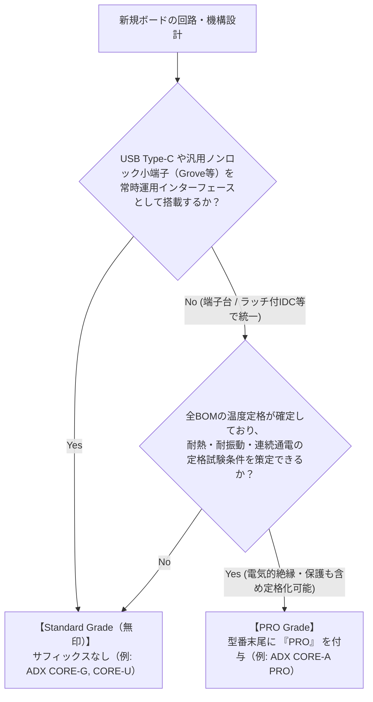

<!--
Copyright (c) 2026 ADX Project Contributors
SPDX-License-Identifier: CC-BY-4.0
-->

# ADX ハードウェア命名規則・グレード分類基準 (Hardware Naming Conventions & Grade Classification)

[ English (../en/hardware_naming_rules.md) | **日本語** ]

本ドキュメントは、ADXエコシステムにおけるハードウェア製品（基板・モジュール等）の命名規則、および **「無印（Standard：卓上開発・プロトタイピンググレード）」** と **「`PRO`（Field / Industrial：業務用・定格試験保証グレード）」** の分類基準を定義する公式仕様書です。

---

## 1. 背景と目的

ADXは「Arduinoのような開発の自由度」と「実機組込・現場常設の信頼性」の両立を目指しています。

しかし、民生製造環境（汎用PCBA）を前提にボードを設計する場合、**「USB Type-C や Grove のような民生・卓上向けコネクタの手軽さ」** と **「業務用として耐熱・耐振動・連続通電の定格試験条件を厳密に策定できる物理的・電気的堅牢性」** には根本的なトレードオフが存在します。

- **USB Type-C 等を搭載する卓上・試作モデル（無印）**:
  PC とケーブル1本で即座に開発・実験でき、M5Unit / Grove 等の民生エコシステムとも直結できます。一方で、USB コネクタや汎用小コネクタはノンロックかつ規格上の抜き差し前提構造であるため、振動・常設稼働の業務用定格試験をボード全体で保証することには構造的な限界があります。
- **物理・電気的に堅牢な要素のみで構成する現場モデル（`PRO`）**:
  スプリングクランプ端子、ラッチ付き IDC ボックスヘッダ、絶縁 RS-485 など、規格と保持力が明確な部品のみで構成することで、安価な民生PCBA製造でありながら **業務用に耐える定格試験可能性（Testability）** を成立させます。

ADXでは、この2つを無理に1つの物差しで混ぜるのではなく、**「無印で手軽に試作・開発し、そのまま共通 20P バス（CARD）資産ごと `PRO` へ載せ替えて現場投入する」** 2層ポートフォリオを採用します。

この境界をユーザーと設計者の双方に直感的かつ明確に伝えるため、本命名規則を定めます。

---

## 2. 命名フォーマット (Naming Structure)

ADXのハードウェア型番は、以下のフォーマットで統一されます：

```text
ADX [FAMILY]-[TYPE] [GRADE]
```

### 構文要素の定義

| 要素 | 意味 | 規定内容・代表例 |
| :--- | :--- | :--- |
| **`ADX`** | ブランド・規格名 | すべての公式ハードウェアの接頭辞 |
| **`[FAMILY]`** | ボードカテゴリ / フォームファクタ | ・`CORE`: メインプロセッサ基板（8854 / 8748 フォームファクタ）<br/>・`CARD`: 拡張アドオン基板（8854 / 8748 フォームファクタ）<br/>・`PWR`: 電源供給・配電ユニット<br/>・`BASE`: バックプレーン / ベースボード |
| **`[TYPE]`** | 機能・アーキテクチャ | ・`G`: Grove / M5Unit 特化・1本 Type-C モデル<br/>・`U`: USB 標準開発モデル<br/>・`A` / `A24`: 絶縁 RS-485 搭載 現場エッジモデル<br/>・`D`: Development / Debug（開発・評価用）<br/>・`RELAY`: リレー出力カード<br/>・`DIO`: デジタル入出力カード |
| **`[GRADE]`** | **適用領域・保証グレード** | ・**（無印）**: **Standard Grade（卓上開発・プロトタイピング・汎用向け）**<br/>・**`PRO`**: **PRO Grade（業務用・現場常設・定格試験保証）** |

---

## 3. グレード分類基準 (Grade Classification)

設計者が新しい基板を開発した際、どちらのグレードに属するかは以下の客観的基準に基づいて判定されます。



### 3.1 Standard Grade（無印・サフィックスなし）

- **定義**: 机上でのプロトタイピング、教育・ホビー、M5Unit / Grove 連携、および軽負荷の一般用途に最適化された標準モデル。
- **設計上の位置づけ**:
  1. **開発体験とコストの優先**: USB Type-C によるPC直結開発や、Grove（HY2.0）等の汎用エコシステムとの接続性を許容します。
  2. **基本的な安全保護**: eFuse（過電流保護）、ESD 保護、逆流防止等のフェイルセーフを備え、机上および通常の利用範囲で安全に扱えること。
  3. **試験可能性の割り切り**: 民生コネクタの特性上、産業現場の常設稼働を前提とした耐振動試験・長期連続定格試験の保証対象外とします。

### 3.2 PRO Grade（`PRO` 付与型）

- **定義**: 制御盤、設備組込、屋外・工場などの現場常設に耐える **「試験可能性（Testability）」** を満たした業務用上位グレード。
- **必須要件**:
  1. **民生USBボトルネックの排除**: USB Type-C 等を常時通電・常時通信の運用ポートとして露出させない（USBレス、またはメンテ時のみ使用する非露出サービス用途に限定）。
  2. **物理的堅牢性**: スプリングクランプ端子台、ラッチ（イジェクタ）付き IDC ボックスヘッダ等、規格と保持力が明確な接続方式のみを採用する。
  3. **電気的安全性・絶縁**: 絶縁 RS-485 や電源分離など、誤配線・電位差・サージによる連鎖破壊（Cascading Destruction）を防止する構造を備える。
  4. **BOM・試験条件の完全定義**: 搭載部品すべての動作温度定格を明示し、動作周囲温度（ディレーティング含む）・連続通電・耐振動の試験条件を策定できること。

---

## 4. 命名・適用実例

| 型番 | グレード | 主なインターフェース | 主な用途・ターゲット |
| :--- | :--- | :--- | :--- |
| **`ADX CORE-G`** | 無印 (Standard) | USB Type-C ×1 / Grove (5V M5Unit対応) ×3 | **Grove / M5Unit 特化・最安プロトタイピング機。** 机上開発・試作・CARD検証の入口。 |
| **`ADX CORE-U`** | 無印 (Standard) | デュアル USB Type-C / 拡張ポート | **標準 USB 開発ボード。** Arduino IDE 等での卓上開発・ベンチ評価向け。 |
| **`ADX CORE-A PRO`** | **`PRO`** | 絶縁 RS-485 / スプリング端子台 / 20P IDC | **現場常設エッジ端末。** -40℃〜+105℃系部品・USBレス・定格試験策定済みの業務用モデル。 |
| **`ADX CORE-A24 PRO`** | **`PRO`** | DC24V 絶縁電源 / 絶縁 RS-485 / 端子台 | **産業制御盤向け次世代モデル。** 工場・設備の DC24V 電源環境に直結可能。 |
| **`ADX CARD-RELAY`** | 無印 (Standard) | 20P IDC バス / 汎用端子 | 一般評価・卓上試作向けリレー拡張カード。 |
| **`ADX CARD-RELAY PRO`** | **`PRO`** | 20P ラッチ付 IDC / 絶縁・定格明記端子台 | 設備組込・連続通電定格を満たす業務用リレー拡張カード。 |

> **補足（旧分類・開発中モデルについて）:**  
> 内部評価・ファームウェア検証用の専用ボード（`ADX Core-D` 等）や、試作アーカイブ（`CORE-S` 等）は上記2区分とは別枠の R&D / Archive として扱います。

---

## 5. 免責とオープンハードウェア運用

ADXのハードウェア設計データ（回路図、アートワーク、BOM、製造データ等）は、CERN-OHL-P-v2 ライセンスに基づき公開されます。  
設計データをもとに第三者が独自に製造・組込・運用を行う場合は、各製品の定格仕様および適用範囲（無印の卓上・試作用途か、`PRO` の定格試験条件の範囲内か）を確認のうえ利用するものとします。
