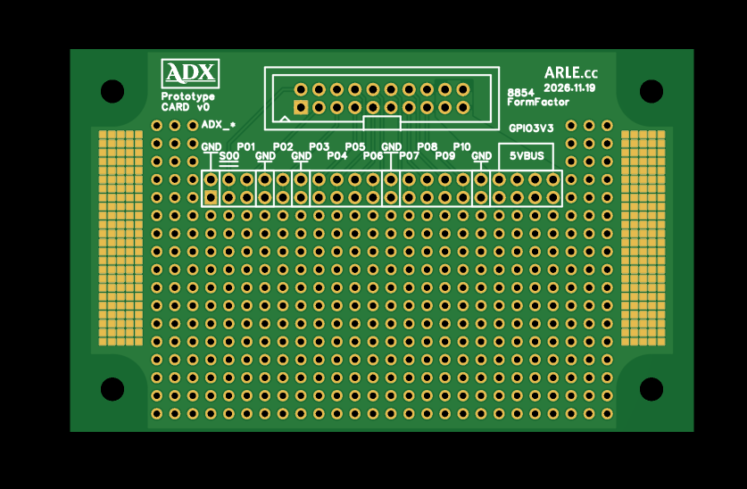

<!--
Copyright (c) 2026 ADX Project Contributors
SPDX-License-Identifier: CERN-OHL-P-2.0
-->

# ADX Prototype CARD 仕様書 (v0)

- **文書バージョン**: v0.1 (Draft)
- **対象リビジョン**: v0
- **更新日**: 2026-11-19
- **グレード**: Standard Grade（無印：卓上開発・プロトタイピング向け）
- **ステータス**: 設計完了 / ガーバー生成済（`v0`: 旧 `8854` ＋ 旧 `ADX-BUS-SPEC-v4.2` 準拠実績）
- **製造データ**: [`data/Gerber_PCB1_2026-11-19.zip`](data/Gerber_PCB1_2026-11-19.zip) / [`data/Netlist_PCB1_2026-11-19.net`](data/Netlist_PCB1_2026-11-19.net)
- **基板外観図**: [`data/adx_prototype_card_v0.png`](data/adx_prototype_card_v0.png)

> [!WARNING]
> **バス規格バージョン注記（`v0` = 旧 `8854 / v4.2` 履歴保全 ／ `v5.0` は次期 `v1` タスク）**:  
> 本書および `Gerber_PCB1_2026-11-19.zip` は **旧 `8854 Form Factor` ＋ 旧 `ADX-BUS-SPEC-v4.2` 準拠の `v0` 試作実績** として履歴保全しています。最新の **[`ADX-BUS-SPEC-v5.0`](../../../docs/spec/ADX_PINOUT.md)** とは Pins 3〜6 の信号/GND 配置が電気的に非互換のため、`v5.0` 基板（CORE-U rev6 等）との混在接続は避けてください。`8858 + ADX-BUS-SPEC-v5.0` 準拠の改訂は別ハードウェアタスクとして次期 **`Prototype CARD v1`** で実施予定です。

---

## 1. 概要 (Overview)

**ADX Prototype CARD** は、ADX 規格の拡張カードを素早く試作・検証するためのユニバーサルエリアを備えたプロトタイピング拡張カードです。

外形・取付穴・キープアウトは **[8854 Form Factor](../../../docs/ja/8854_formfactor.md)**、20 ピン拡張バスは **[ADX 20-Pin Bus Specification (`ADX-BUS-SPEC-v4.2`)](../../../docs/spec/ADX_PINOUT.md)**（日本語解説: [ADX Pinout 設計ガイド](../../../docs/ja/ADX_pinout.md)）に完全準拠しています。

### 主な特徴

1. **2×20P バス引き出しブレイクアウト (`H1`)**:
   - 20P IDC 拡張バスの全 20 線を芯線順（Pin 1〜20）に並べ、1 信号あたり **2 列分（縦 2 穴ペア）** 引き出しています。
   - シルクには `ADX-BUS-SPEC-v4.2` 準拠の論理ピン ID（`S00`, `P01`〜`P10`）および `GND`, `5VBUS`, `GPIO3V3`, `ADX_*` を記載しています。
2. **THT / SMD デュアル・ユニバーサルエリア**:
   - **THT エリア**: 中央 66 mm ゾーンに 2.54 mm ピッチで `12×26 + (5×3)×2`（計 342 穴）を配置。
   - **SMD エリア**: 8854 フォームファクタの下面 THT 禁止領域（ボード左右の SMD Only ゾーン）を活かし、表面専用・1.27 mm ピッチで `(24×5)×2`（計 240 パッド）を配置。
3. **ノイズ耐性・大電流対応のアートワーク**:
   - 表裏両面に GND ベタプレーンを配置（信号配線はすべて表面で完結し、裏面は連続 GND プレーン）。
   - `5VBUS`（IDC Pins 17〜20 → `H1` 8 穴）を太いベタ銅箔で直結。
4. **低コストな ENIG ベアボード量産性**:
   - 8854 標準の 2×3（6 pcs / Panel）V カット面付けに対応し、ENIG 仕上げのベアボード 120 枚ロットで **1 枚あたり約 $0.97**（送料込み）の低原価を実現しています。

---

## 2. メカニカル・基板仕様 (Mechanical & PCB Specification)

| 項目 | 仕様 | 備考 |
| :--- | :--- | :--- |
| **フォームファクタ** | **8854 Form Factor** | `88.0 mm × 54.0 mm`、角部 C0（直角・ストレート V カット対応） |
| **取付穴 (NPTH)** | `Φ3.30 mm` × 4 箇所（M3 対応） | ピッチ `76.0 mm × 42.0 mm`（四隅から `6.0 mm`） |
| **取付穴座標 (X, Y)** | `(6, 6)`, `(6, 48)`, `(82, 6)`, `(82, 48) mm` | 原点は基板左下角、座面クリアランス `R = 5.0 mm`（`Φ10.0 mm`） |
| **20P IDC 中心座標 (`U1`)** | **`(44.0, 47.0) mm`** | 8854 規格標準（長辺中央、上端から `7.0 mm`） |
| **カードガイド余白** | 左右各 `3.0 mm` 以上 | ガーバー実測銅箔マージン `3.10 mm` |
| **長辺クリアランス** | 上下各 `20 mil (0.508 mm)` 以上 | ガーバー実測銅箔マージン `0.60 mm` |
| **層数・銅箔構成** | 2 層（両面 GND ベタ + 表面 `5VBUS` ベタ） | 全信号配線は表面のみ |
| **推奨表面処理** | **ENIG**（無電解ニッケル置換金めっき） | 酸化しにくく長期保管・手ハンダ・SMD 実装に好適 |

---

## 3. ユニバーサルエリア詳細 (Universal Prototyping Area)

### 3.1 THT ユニバーサルエリア（スルーホール）

- **ピッチ**: `2.54 mm`（100 mil）
- **配列・総穴数**: **`12×26 + (5×3)×2`** ＝ **計 342 穴**（全ランド電気的独立）
  - 下部メインエリア: `12 行 × 26 列`（312 穴）
  - 左右サイドエリア（`H1` 真横の 2 行 + 上側 3 行）: `5 行 × 3 列 × 左右 2 箇所`（30 穴）
- **ドリル径 / パッド径**: `Φ0.91 mm`（36 mil） / `Φ1.52 mm`（60 mil）
- **配置範囲**: `X = 12.25 〜 75.75 mm`（8854 の中央 `66.0 mm` ゾーン内に完全収容）

### 3.2 SMD ユニバーサルエリア（表面専用）

- **ピッチ**: `1.27 mm`（50 mil）
- **配列・総パッド数**: **`(24×5)×2`** ＝ **計 240 パッド**（左右各 `5 列 × 24 行 = 120 パッド`、全ランド独立）
- **パッド寸法**: 約 `0.89 mm × 0.89 mm`（35 mil 角丸矩形、隣接ギャップ約 `0.38 mm`）
- **実装面**: **表面（Top Layer）のみ**
- **配置範囲**: 左 `X = 4.63 〜 9.71 mm`、右 `X = 78.29 〜 83.37 mm`（`Y = 12.71 〜 41.92 mm`）
  - 8854 フォームファクタの **下面 SMD Only ゾーン（THT リード突出禁止領域）** を活用しつつ、左右 `3.0 mm` のカードガイド領域および四隅の `Φ10.0 mm` ネジ座面クリアランスを完全に回避しています（最寄りパッド端まで最小約 `5.53 mm`）。

> 裏面シルク（`Gerber_BottomSilkscreenLayer.GBO`）にも、各エリアのピッチおよび配列数（`THT Universal / Pitch: 2.54mm / 12x26+(5x3)x2` および `SMD Universal / Pitch: 1.27mm / 24x5x2`）を印字しています。

---

## 4. 20P 拡張バス & 2×20P 引き出し部 (`U1` / `H1`)

### 4.1 実装部品・リファレンスフットプリント

本基板は原則として **ベアボード（PCB のみ）** で製造・供給し、必要に応じて以下の標準部品を実装します。

| Designator | 役割 | フットプリント / 穴径 | 参考部品（ネットリスト記載） | 備考 |
| :---: | :--- | :--- | :--- | :--- |
| **`U1`** | 20P ADX 拡張バスコネクタ | 2×10P, 2.54 mm, `Φ1.10 mm` | CONNFLY `DS1013-20SSiB1-B-0` (LCSC: `C109406`) | 20P バーティカル IDC ボックスヘッダー |
| **`H1`** | バス信号引き出し（ブレイクアウト） | 2×20P, 2.54 mm, `Φ1.10 mm` | 汎用 2×20P ピンヘッダ等（基本未実装） | 1 信号あたり縦 2 穴ペアで配線・プローブ両用可 |

### 4.2 `H1`（2×20P）ピン配列一覧（Top View・左から右）

`U1`（20P IDC ヘッダー）の全 20 ピンをリボンケーブル芯線順（1〜20）に並べ、各列の上下 2 穴（奇数ピン＝下段、偶数ピン＝上段）を共通接続しています。

| 列 (左→右) | `H1` ピン (下 / 上) | 対応 IDC Pin (`U1`) | 表面シルク | ネット名 (`v4.2`) | 標準バス機能 / 備考 |
| :---: | :---: | :---: | :---: | :--- | :--- |
| **1** | 1 / 2 | Pin 1 | `GND` | `GND` | 最外端シールド / 0V リターン（両面 GND ベタ接続） |
| **2** | 3 / 4 | Pin 2 | **`S00`** *(二重下線)* | `S00/OWD` | **システム専用（UPDI / SWDIO）※通常カードは N.C. 推奨** |
| **3** | 5 / 6 | Pin 3 | `P01` | `P01/AIN` | アナログ入力 (ADC) / 3.3V GPIO |
| **4** | 7 / 8 | Pin 4 | `GND` | `GND` | `P01` / `P02` 間シールド GND |
| **5** | 9 / 10 | Pin 5 | `P02` | `P02/EXTCLK` | 外部クロック / `SWCLK` / 3.3V GPIO（※2線デバッグ併用時注意） |
| **6** | 11 / 12 | Pin 6 | `GND` | `GND` | クロック / 通信間シールド GND |
| **7** | 13 / 14 | Pin 7 | `P03` | `P03/TX` | UART TX / 3.3V GPIO |
| **8** | 15 / 16 | Pin 8 | `P04` | `P04/RX` | UART RX / 3.3V GPIO |
| **9** | 17 / 18 | Pin 9 | `P05` | `P05/SCL` | I2C SCL (3.3V Open-Drain, PU 要) / 3.3V GPIO |
| **10** | 19 / 20 | Pin 10 | `P06` | `P06/SDA` | I2C SDA (3.3V Open-Drain, PU 要) / 3.3V GPIO |
| **11** | 21 / 22 | Pin 11 | `GND` | `GND` | I2C / SPI 境界シールド GND |
| **12** | 23 / 24 | Pin 12 | `P07` | `P07/CS` | SPI CS / 3.3V GPIO |
| **13** | 25 / 26 | Pin 13 | `P08` | `P08/MOSI` | SPI MOSI / 3.3V GPIO |
| **14** | 27 / 28 | Pin 14 | `P09` | `P09/MISO` | SPI MISO / 3.3V GPIO |
| **15** | 29 / 30 | Pin 15 | `P10` | `P10/SCK` | SPI SCK / 3.3V GPIO |
| **16** | 31 / 32 | Pin 16 | `GND` | `GND` | `VBUS` 短絡防止防火壁 GND |
| **17〜20** | 33〜40 (8 穴共通) | Pins 17〜20 | **`5VBUS`** *(枠囲み)* | `VBUS_PROT` | 5V 主電源幹線（4.5〜5.25V, 最大 2〜3A、表面ベタ銅箔接続） |

- 表面左上に **`ADX_*`**（ファームウェア側の `ADX_P01`〜`ADX_P10` 論理マクロ表記への誘導）、`5VBUS` 直上に **`GPIO3V3`**（I/O ロジック電圧が 3.3V である旨の注意喚起）を印字しています。

---

## 5. 設計・使用上の注意事項 (Design & Usage Notes)

1. **電源電圧 (`5VBUS`) と 3.3V ロジックの分離（PoL 原則）**:
   - 20P バスから供給される電源は **`5VBUS`（公称 5.0V）のみ**であり、3.3V 電源は供給されません。
   - 一方、`P01`〜`P10` のデジタル I/O はすべて **3.3V LVCMOS** です。カード上で 3.3V 電源が必要な場合は、`5VBUS` から LDO 等でローカル降圧してください。`5VBUS` を GPIO ピンへ直接印加しないようご注意ください。
2. **`S00`（Pin 2 / `OWD`）の取り扱い**:
   - ADX 規格（[ADX_PINOUT.md](../../../docs/spec/ADX_PINOUT.md)）では、一般拡張カードは `S00` を未接続（N.C.）とすることが必須（【MUST】）です。
   - 本カードではデバッグ・プローブ用途を想定して `H1` へ引き出していますが（シルクで二重下線強調）、通常の試作回路やプルダウン・タクトスイッチ等を `S00` へ直結しないでください。
3. **`P02`（Pin 5 / `EXTCLK` / `SWCLK`）の取り扱い**:
   - 2 線式デバッグ（SWD）を使用する Core ボードと組み合わせる場合、`P02` に回路を接続する際はジャンパピンや 0Ω 抵抗等で切り離し可能にしておくことを推奨します。
4. **Power CARD として試作する場合**:
   - 本カード上の外部電源・電池回路から `5VBUS` へ給電する場合は、[ADX フォームファクタ開発ガイドライン](../../../docs/ja/adx_formfactor_guidelines.md) の【MUST】要件に従い、**逆流阻止回路**および**過電流・短絡保護回路**を必ず組み込んでください。
5. **両面 GND ベタプレーン**:
   - ユニバーサルエリアの表裏周囲にはレジスト被覆された GND ベタプレーンが存在します。基板への追加工（ドリル加工・パターンカット等）を行う際は、GND との短絡にご注意ください。

---

## 6. 製造コスト見積り・想定価格 (Cost Estimate & Pricing)

| 項目 | 内容 |
| :--- | :--- |
| **発注先・形態** | JLCPCB、部品実装なし（PCB のみ／ベアボード）、弊社宛送料込み |
| **製造仕様・ロット** | **ENIG**、6 pcs / 1 Panel（2×3 面付け）、20 Panel ＝ **計 120 pcs** |
| **製造総額** | **$116.55** |
| **1 枚あたり原価** | **$0.97 / pcs** |
| **想定販売価格（4 倍算）** | **$3.88 / pcs** |

> [!NOTE]
> 本製品は低価格製品につき、梱包・出荷作業・決済手数料等の固定コスト比率が高くなるため、最終的な販売価格設定においては 4 倍算より多くの価格マージンを必要とする可能性があります。

---

## 7. 製造・ガーバー検証情報 (Gerber Verification)

同梱ガーバー（[`data/Gerber_PCB1_2026-11-19.zip`](data/Gerber_PCB1_2026-11-19.zip)）の主要レイヤーおよび検証値：

| ファイル名 | 役割 | 検証結果 |
| :--- | :--- | :--- |
| `Gerber_BoardOutlineLayer.GKO` | 外形線 | `88.000 × 54.000 mm` 完全矩形（C0） |
| `Drill_NPTH_Through.DRL` | 取付穴 | `Φ3.30 mm` × 4 穴、ピッチ `76.0 × 42.0 mm`（四隅から `6.0 mm`） |
| `Drill_PTH_Through.DRL` | スルーホール | `Φ0.9144 mm` × 342 穴（THT ユニバーサル）、`Φ1.10 mm` × 60 穴（`U1`: 20 + `H1`: 40） |
| `Gerber_TopPasteMaskLayer.GTP` | SMD パッド | 240 パッド（`(24×5)×2`、1.27 mm ピッチ、表面のみ） |
| `Gerber_TopLayer.GTL` / `BottomLayer.GBL` | 銅箔パターン | 両面 GND ベタ（左右余白 `3.10 mm`、上下余白 `0.60 mm`）、表面 `5VBUS` ベタ、裏面は連続 GND プレーン |
| `Gerber_TopSilkscreenLayer.GTO` | 表面シルク | `ADX Prototype CARD v0`, `8854 FormFactor`, `ADX_*`, `GPIO3V3`, `S00`, `P01`〜`P10`, `GND`, `5VBUS` |
| `Gerber_BottomSilkscreenLayer.GBO` | 裏面シルク | `THT Universal / Pitch: 2.54mm / 12x26+(5x3)x2`, `SMD Universal / Pitch: 1.27mm / 24x5x2` |
| `FlyingProbeTesting.json` | 導通検査定義 | `U1` 20 ピン ↔ `H1` 40 ピン、`ADX-BUS-SPEC-v4.2` 論理ネット名で完全一致 |
