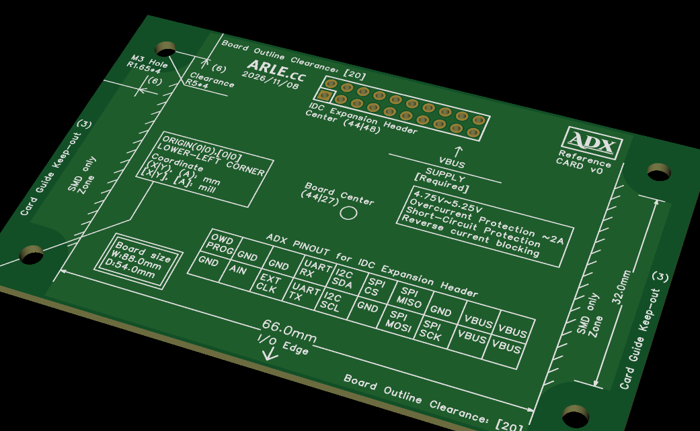

<!--
Copyright (c) 2026 ADX Project Contributors
SPDX-License-Identifier: CC-BY-4.0
-->

# ADX Reference CARD v0 仕様書

- **文書バージョン**: v0.1 (Draft)
- **更新日**: 2026-11-09
- **ステータス**: リファレンス設計完了 / ガーバー生成済
- **製造データ**: [`data/Gerber_PCB1_2026-11-09.zip`](data/Gerber_PCB1_2026-11-09.zip)
- **基板外観図**: [`docs/blog/images/reference_card_v0_20261109.png`](../../../docs/blog/images/reference_card_v0_20261109.png)



---

## 1. 概要 (Overview)

「ADX Reference CARD v0」は、ADXの次世代標準ハードウェア外形規格 **「8854 Form Factor」** の物理寸法、キープアウト領域、配線禁止マージン、および 20-Pin IDC Expansion Header の標準配置を物理基板上に直接シルク印刷で視覚化した公式リファレンスボードです。

旧来の「8748規格（87.0 mm × 48.0 mm）」からのフィードバックと現場量産性（DFM: Design for Manufacturability）、筐体組込性（DFA: Design for Assembly）の改善結果を統合しています。

---

## 2. 8748規格からの主な改訂点

| 項目 | 旧 8748 規格 | 新 8854 規格 (本ボード) | 改訂の背景・メリット |
| :--- | :--- | :--- | :--- |
| **外形寸法** | 87.0 mm × 48.0 mm | **88.0 mm × 54.0 mm** | Vertical IDC化に伴い、基板外飛び出しをゼロ化。奥行の実質フットプリントはむしろ縮小。 |
| **角部加工** | C3 面取り (3mm×45°) | **C0 (直角・完全矩形)** | C3面取りによるVカット不能問題を解消。全方向ストレートVカット加工によるパネル製造に対応。 |
| **パネル面付け** | 規定なし / タブ加工 | **2 × 3 (6 pcs / 1 Panel)** | 捨て基板含め **186 mm × 162 mm**。JLCPCBの最適パネル寸法（150〜200mm）に完全合致。 |
| **作業単位** | - | **6 個（マジカルナンバー7以下）** | 検査・通電テスト・ピッキング時の認知負荷を低減し、ヒューマンエラーを抑止。 |
| **ネジ穴中心** | 四隅から 5.0 mm | **四隅から 6.0 mm** | Φ10mm（半径5mm）の座金・スペーサー禁止円を確保しても、外周端に **1.0 mmの肉厚** が残る。 |
| **取付穴ピッチ** | 77.0 mm × 38.0 mm | **76.0 mm × 42.0 mm** | M3ネジ（Φ3.3mm NPTH）4箇所。 |
| **下面スライド** | 規定なし | **SMD Only ゾーン定義** | 中央66mm I/O辺の外側下面をSMD Onlyとし、筐体レールやスナップフィット爪の潜り込みを許容。 |
| **外形クリアランス** | 規定なし | **長辺側 20 mil (0.508 mm)** | Vカット加工時のバリ・短絡防止およびレール絶縁マージン。 |

---

## 3. メカニカル詳細仕様 (Mechanical Details)

### 3.1 座標系・外形
- **原点 (Origin)**: 基板左下角 $(0.0, 0.0)\,\text{mm} \quad [0, 0]\,\text{mil}$
- **外形寸法**: $W = 88.0\,\text{mm}$ (3465 mil), $D = 54.0\,\text{mm}$ (2126 mil)
- **基板中心 (Board Center)**: $(44.0, 27.0)\,\text{mm}$

### 3.2 取付穴 (Mounting Holes)
- **穴種別**: NPTH（非メッキスルーホール）
- **穴径**: $\Phi 3.30\,\text{mm}$（半径 $R = 1.65\,\text{mm}$、M3ネジ適合）
- **配置座標 (X, Y)**:
  - 左下: $(6.0, 6.0)\,\text{mm}$
  - 左上: $(6.0, 48.0)\,\text{mm}$
  - 右下: $(82.0, 6.0)\,\text{mm}$
  - 右上: $(82.0, 48.0)\,\text{mm}$
- **取付穴ピッチ**: $76.0\,\text{mm} \times 42.0\,\text{mm}$
- **座面クリアランス**: ネジ中心から半径 $R = 5.0\,\text{mm}$（$\Phi 10.0\,\text{mm}$）。M3ワッシャー、スプリングワッシャー、樹脂スペーサーの干渉を禁止。

### 3.3 キープアウトおよび機能領域
- **長辺クリアランス (Board Outline Clearance)**:
  - 上長辺および下長辺に沿って **20 mil (0.508 mm)** のパターン禁止帯を確保。
- **カードガイドキープアウト (Card Guide Keep-out)**:
  - 左右の短辺から **3.0 mm** の帯状エリア（スロットインガイドレール用）。
- **I/O Edge**:
  - 下面中央 **66.0 mm**（$X = 11.0 \sim 77.0\,\text{mm}$）を外部インターフェース（端子台、コネクタ等）の配置領域とする。
- **SMD Only ゾーン (下面)**:
  - ネジ穴クリアランス円から $X = 11.0\,\text{mm}$（I/O Edge端）および上辺を結ぶ外側領域の下面は **スルーホール（THT）ピン突出禁止**。
  - 筐体底面のスナップフィット爪やレールがスムーズにスライド挿入可能。

---

## 4. 20-Pin IDC Expansion Header 仕様

### 4.1 コネクタ配置
- **形式**: $2 \times 10$ ピン 2.54 mm ピッチ バーティカル IDC ボックスヘッダー
- **中心座標**: **$(44.0, 48.0)\,\text{mm}$**（基板長辺88mmの完全センター、上端から6.0mm）
- **ドリル径**: $\Phi 1.10\,\text{mm}$（PTH）

### 4.2 電源供給仕様 (VBUS Supply)
- **推奨電圧範囲**: $4.75\,\text{V} \sim 5.25\,\text{V}$
- **保護回路要件**:
  - 過電流保護 (Overcurrent Protection $\approx 2\,\text{A}$)
  - 短絡保護 (Short-Circuit Protection)
  - 逆流防止 (Reverse Current Blocking)

### 4.3 ピン配置シルク表記 (ADX PINOUT)

```
[上列 (奇数/PROG側)]
OWD/PROG | GND | GND     | UART_RX | I2C_SDA | SPI_CS | SPI_MISO | GND     | VBUS | VBUS

[下列 (偶数/AIN側)]
GND      | AIN | EXT_CLK | UART_TX | I2C_SCL | GND    | SPI_MOSI | SPI_SCK | VBUS | VBUS
```

---

## 5. 製造・ガーバー検証情報

同梱のガーバーファイル（`data/Gerber_PCB1_2026-11-09.zip`）の構成および検証値：

| レイヤーファイル | 役割 | 検証結果 |
| :--- | :--- | :--- |
| `Gerber_BoardOutlineLayer.GKO` | 外形線 | $88.0 \times 54.0\,\text{mm}$ 完全矩形 |
| `Drill_NPTH_Through.DRL` | 取付穴 | $\Phi 3.3\,\text{mm}$ × 4穴、ピッチ $76 \times 42\,\text{mm}$ |
| `Drill_PTH_Through.DRL` | IDCヘッダー | $\Phi 1.1\,\text{mm}$ × 20穴、ピッチ 2.54mm、中心 $(44.0, 48.0)$ |
| `Gerber_TopSilkscreenLayer.GTO` | 表面シルク | 各種寸法・ピンアサイン・クリアランス明記 |
| `How-to-order-PCB.txt` | 発注ガイド | EasyEDA Pro 標準ガーバー出力準拠 |
