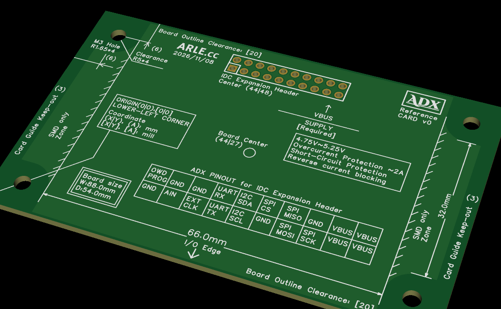

<!--
Copyright (c) 2026 ADX Project Contributors
SPDX-License-Identifier: CC-BY-4.0
-->

# ADX Reference CARD v0 仕様書

- **文書バージョン**: v0.2 (Draft)
- **更新日**: 2026-11-20
- **ステータス**: 設計改訂中 / 検証用ガーバー生成済（光学マーカー規格策定中）
- **製造データ（検証版）**: [`data/Gerber_PCB1_2026-11-20 (2).zip`](data/Gerber_PCB1_2026-11-20%20%282%29.zip) *(※光学マーカー試作を含むドラフト版)*
- **基板外観図（旧 2026-11-09 版）**: [`docs/blog/images/reference_card_v0_20261109.png`](../../../docs/blog/images/reference_card_v0_20261109.png) *(※次期確定ガーバー出力時に更新予定)*



---

## 1. 概要 (Overview)

「ADX Reference CARD v0」は、ADX の次世代標準ハードウェア外形規格 **「8854 Form Factor」**（[仕様書](../../../docs/ja/8854_formfactor.md)）の物理寸法、キープアウト領域、配線禁止マージン、および `ADX-BUS-SPEC-v4.2`（[SSOT](../../../docs/spec/ADX_PINOUT.md)）準拠の 20-Pin IDC Expansion Header 標準配置を物理基板上に直接シルク印刷で視覚化した公式リファレンスボードです。

旧来の「8748規格（87.0 mm × 48.0 mm）」からのフィードバックと現場量産性（DFM: Design for Manufacturability）、筐体組込性（DFA: Design for Assembly）の改善結果を統合しており、さらに PCBA 製造後のオープンソース自動検査を見据えた**光学アライメントマーカー規格の実験・リファレンス検証機**としての役割も担います。

---

## 2. 8748規格からの主な改訂点

| 項目 | 旧 8748 規格 | 新 8854 規格 (本ボード) | 改訂の背景・メリット |
| :--- | :--- | :--- | :--- |
| **外形寸法** | 87.0 mm × 48.0 mm | **88.0 mm × 54.0 mm** | Vertical IDC 化に伴い、基板外飛び出しをゼロ化。奥行の実質フットプリントはむしろ縮小。 |
| **角部加工** | C3 面取り (3mm×45°) | **C0 (直角・完全矩形)** | C3 面取りによる V カット不能問題を解消。全方向ストレート V カット加工によるパネル製造に対応。 |
| **パネル面付け** | 規定なし / タブ加工 | **2 × 3 (6 pcs / 1 Panel)** | 捨て基板含め **186 mm × 162 mm**。JLCPCB の最適パネル寸法（150〜200mm）に完全合致。 |
| **作業単位** | - | **6 個（マジカルナンバー7以下）** | 検査・通電テスト・ピッキング時の認知負荷を低減し、ヒューマンエラーを抑止。 |
| **ネジ穴中心** | 四隅から 5.0 mm | **四隅から 6.0 mm** | Φ10mm（半径5mm）の座金・スペーサー禁止円を確保しても、外周端に **1.0 mmの肉厚** が残る。 |
| **取付穴ピッチ** | 77.0 mm × 38.0 mm | **76.0 mm × 42.0 mm** | M3 ネジ（Φ3.3mm NPTH）4箇所。 |
| **下面スライド** | 規定なし | **SMD Only ゾーン定義** | 中央 66mm I/O 辺の外側下面を SMD Only とし、筐体レールやスナップフィット爪の潜り込みを許容。 |
| **外形クリアランス** | 規定なし | **長辺側 20 mil (0.508 mm)** | V カット加工時のバリ・短絡防止およびレール絶縁マージン。 |

---

## 3. メカニカル詳細仕様 (Mechanical Details)

### 3.1 座標系・外形
- **原点 (Origin)**: 基板左下角 $(0.0, 0.0)\,\text{mm} \quad [0, 0]\,\text{mil}$
- **外形寸法**: $W = 88.0\,\text{mm}$ (3465 mil), $D = 54.0\,\text{mm}$ (2126 mil)
- **基板中心 (Board Center)**: $(44.0, 27.0)\,\text{mm}$（2026-11-20 版で中心円へ十字クロスヘアを追加）

### 3.2 取付穴 (Mounting Holes)
- **穴種別**: NPTH（非メッキスルーホール）
- **穴径**: $\Phi 3.30\,\text{mm}$（半径 $R = 1.65\,\text{mm}$、M3 ネジ適合）
- **配置座標 (X, Y)**:
  - 左下: $(6.0, 6.0)\,\text{mm}$
  - 左上: $(6.0, 48.0)\,\text{mm}$
  - 右下: $(82.0, 6.0)\,\text{mm}$
  - 右上: $(82.0, 48.0)\,\text{mm}$
- **取付穴ピッチ**: $76.0\,\text{mm} \times 42.0\,\text{mm}$
- **座面クリアランス**: ネジ中心から半径 $R = 5.0\,\text{mm}$（$\Phi 10.0\,\text{mm}$）。M3 ワッシャー、スプリングワッシャー、樹脂スペーサーの干渉を禁止。

### 3.3 キープアウトおよび機能領域
- **長辺クリアランス (Board Outline Clearance)**:
  - 上長辺および下長辺に沿って **20 mil (0.508 mm)** のパターン禁止帯を確保。
- **カードガイドキープアウト (Card Guide Keep-out)**:
  - 左右の短辺から **3.0 mm** の帯状エリア（スロットインガイドレール用）。
- **I/O Edge**:
  - 下面中央 **66.0 mm**（$X = 11.0 \sim 77.0\,\text{mm}$）を外部インターフェース（端子台、コネクタ等）の配置領域とする。
- **SMD Only ゾーン (下面)**:
  - 左右の $X = 3.0 \sim 11.0\,\text{mm}$ および $X = 77.0 \sim 85.0\,\text{mm}$、$Y = 11.0 \sim 43.0\,\text{mm}$（幅 $8.0\,\text{mm} \times$ 高さ $32.0\,\text{mm} \times 2$）の外側領域の下面は **スルーホール（THT）ピン突出禁止**。
  - 筐体底面のスナップフィット爪やレールがスムーズにスライド挿入可能。
  - ※ 上下端 4 隅（各 $6.0 \times 6.0\,\text{mm}$）を任意光学マーカー領域（Optional Marker Area）として予約する規格提案については、第 6 章を参照。

---

## 4. 20-Pin IDC Expansion Header 仕様

### 4.1 コネクタ配置
- **形式**: $2 \times 10$ ピン 2.54 mm ピッチ バーティカル IDC ボックスヘッダー
- **8854 規格標準 中心座標**: **$(44.0, 47.0)\,\text{mm}$**（基板長辺 88 mm の完全センター、上端から 7.0 mm。SMD 型ヘッダーの基板端マージン確保および THT 型での余裕拡大のため標準化）
  - **2026-11-20 検証版ガーバーにて標準座標 $(44.0, 47.0)\,\text{mm}$ へ移行完了**（旧 2026-11-09 版の初期座標 $(44.0, 48.0)\,\text{mm}$ から 1.0 mm シフト）。
  - 表面シルクには `Pitch: 2.54mm`、`Center (44|47)`、および Pins 17–20（`VBUS` 4 ピン）を識別する白枠を追加済み。
- **ドリル径**: $\Phi 1.10\,\text{mm}$（PTH）

### 4.2 電源供給仕様 (VBUS Supply)
- **推奨電圧範囲**: $4.75\,\text{V} \sim 5.25\,\text{V}$
- **保護回路要件**:
  - 過電流保護 (Overcurrent Protection $\approx 2\,\text{A}$)
  - 短絡保護 (Short-Circuit Protection)
  - 逆流防止 (Reverse Current Blocking)

### 4.3 ピン配置シルク表記 (ADX PINOUT / `ADX-BUS-SPEC-v4.2` 対応)

2026-11-20 検証版ガーバーにて、`ADX-BUS-SPEC-v4.2` の論理ピン ID（`Virtual pin No.` / `ADX_*` / `S00`, `P01`〜`P10`）、`(GPIO 3V3)` 二重下線、`5V VBUS`、および `GND` セル識別ラインをシルクへ反映完了しています。

```text
[上列 (偶数ピン / PROG 側: Pins 2, 4, ..., 20)]
S00 (OWD/PROG) | GND | GND         | P04 (UART_RX) | P06 (I2C_SDA) | P07 (SPI_CS)   | P09 (SPI_MISO) | GND           | 5V VBUS | 5V VBUS

[下列 (奇数ピン / Pin 1・AIN 側: Pins 1, 3, ..., 19)]
GND            | P01 (AIN) | P02 (EXT_CLK) | P03 (UART_TX) | P05 (I2C_SCL) | GND            | P08 (SPI_MOSI) | P10 (SPI_SCK) | 5V VBUS | 5V VBUS
```

> ※ `S00`（Pin 2 / `OWD`）は一般拡張カードでは未接続（N.C.）が規格要件ですが、ADX はオープンソース規格でありデバッグ治具や特殊用途での活用を想定し、リファレンス基板のシルク表上にも `ADX_*` 系列と並べて明示しています。

---

## 5. 製造・ガーバー検証情報

現行の検証用ガーバー（[`data/Gerber_PCB1_2026-11-20 (2).zip`](data/Gerber_PCB1_2026-11-20%20%282%29.zip) / EasyEDA Pro v4.1.105 出力）の構成および実測検証結果：

| レイヤーファイル | 役割 | 実測・検証結果 | 判定 |
| :--- | :--- | :--- | :---: |
| `Gerber_BoardOutlineLayer.GKO` | 外形線 | $88.000 \times 54.000\,\text{mm}$ 完全矩形、原点 $(0, 0)$ | OK |
| `Drill_NPTH_Through.DRL` | 取付穴 | $\Phi 3.30\,\text{mm}$ × 4 穴、ピッチ $76.0 \times 42.0\,\text{mm}$ | OK |
| `Drill_PTH_Through.DRL` | IDC ヘッダー | $\Phi 1.100\,\text{mm}$ × 20 穴、ピッチ $2.540\,\text{mm}$、中心 **$(44.000, 47.000)\,\text{mm}$** | OK |
| `Gerber_TopLayer.GTL` / `Gerber_BottomLayer.GBL` | 銅箔パターン | 表裏 GND ベタ。上下端クリアランス約 $0.51\,\text{mm}$ (20 mil)、左右端約 $3.00\,\text{mm}$、M3 座面抜き $R = 5.00\,\text{mm}$。GND 5 ピン（1, 4, 6, 11, 16）サーマル接続、他 15 ピン絶縁（クリアランス約 $0.24\,\text{mm}$） | OK（※1） |
| `Gerber_TopSolderMaskLayer.GTS` / `GBS` | ソルダーマスク | IDC 20 ピン開口正常。**試作 Alignment Mark 2 箇所には開口なし**（※1） | 要改訂（※1） |
| `Gerber_TopSilkscreenLayer.GTO` | 表面シルク | `v4.2` 論理ピン ID 100% 整合、`mil` 誤記修正済、パッド上シルク干渉 **0 件**。`Board Center` 十字線・`8854 Form factor` 追記済 | OK（※1） |
| `FlyingProbeTesting.json` | 検査ネット情報 | 旧版に存在した重複パッド（`PAD1`〜`PAD5`）を解消し `H1` 単体（20 ピン）へ整理済 | OK |
| `How-to-order-PCB.txt` | 発注ガイド | EasyEDA Pro 標準ガーバー出力準拠 | OK |

> **※1 試作 Alignment Mark に関する検証所見（次章の規格提案へ発展）**:  
> 本検証版では自動検査向け Alignment Mark の試作として、Top 銅箔層に $\Phi 2.005\,\text{mm}$ の円（周囲 GND 抜き $\Phi 6.0\,\text{mm}$、専有 $8 \times 8\,\text{mm}$、ソルダーマスク開口なし）を $(81.0, 39.0)$ と $(7.0, 16.0)$ の 2 箇所へ試験配置しました。しかし第 6 章の検討結果により、本試作方式は製造・光学認識・専有面積の面で課題が明らかとなったため、次期ガーバーでは下記提案の**シルクベース光学マーカー規格**へ置き換える方針とします。

---

## 6. 今後の課題と ADX STANDARD への提案：光学アライメント＆ボード ID マーカー規格

本リファレンスボードの検証を通じて浮上した、**PCBA 製造後の自動検査工程（外観・LED 点灯・通電・プロービング等）をオープンソースで誰でも安価に自動化するための光学マーカー規格**について、課題整理と ADX STANDARD（8854 Form Factor / [開発ガイドライン](../../../docs/ja/adx_formfactor_guidelines.md)）への改訂提案を以下にまとめます。

### 6.1 設計前提と制約条件

従来の SMT 実装工程向けフィデューシャル規格をそのまま転用するのではなく、ADX エコシステム固有の以下の前提から要件を逆算します。

1. **目的は「PCBA 製造後の検査自動化」**（SMT マウンタ用ではない）:
   - パネル面付けの捨て基板に置かれるフィデューシャルは V カット分割後に失われるため、個片ボード内の固定座標に標準基準を持つことで、全 CORE / CARD 共通の自動検査プログラム・治具を再利用可能にする。
2. **OSP（水溶性プリフラックス）表面処理が前提**:
   - 低コスト量産のため ENIG ではなく OSP を前提とする。OSP 基板でペーストを塗らずに露出させた銅パッドは、リフロー熱および経年で酸化・変色し光学コントラストが著しく低下する。
3. **四隅 M3 取付穴への非依存**:
   - M3 取付穴は検査レーン機材・クランプ・ガイドピン等でホールドされカメラから遮蔽（オクルージョン）される可能性があるため、M3 穴とは独立した光学基準を確保する。
4. **オープンソース汎用性（安価カメラ・任意レジスト色・低機械精度）**:
   - 3D プリンタ治具や市販 USB カメラ（720p/1080p）＋ OpenCV 等の環境では機械側公差が $\pm 0.5 \sim 1.0\,\text{mm}$ 程度となるため、**シルク印刷の位置精度（$\pm 0.15 \sim 0.25\,\text{mm}$）で要求精度を十分に満たす**。
   - 一方で、データ量や微小寸法を攻めるよりも、**読み取り確実性（耐ノイズ・耐照明ムラ・全レジスト色対応・裸基板/PCBA 共通）** を最優先とする。

### 6.2 試作検証（`2026-11-20 (2)` 版）で明らかになった課題

| 課題領域 | 試作実装で露見した問題点 |
| :--- | :--- |
| **光学コントラスト & 色依存** | OSP 酸化回避のためレジスト開口なしの「レジスト越し銅箔（明緑 vs 暗緑）」とした結果、輝度差が弱く照明の正反射に極めて弱い。さらに**緑以外のレジスト色（黒・マットブラック・白・青等）では検出不能**となる。 |
| **面積コストの肥大化** | 弱いコントラストを補うために銅箔 $\Phi 2.0\,\text{mm}$・GND 抜き $\Phi 6.0\,\text{mm}$・専有 $8 \times 8\,\text{mm}$（計 $128\,\text{mm}^2$）まで大型化し、88 × 54 mm 基板の銅箔・部品レイアウト自由度を大きく圧迫した。 |
| **2 点同一マークの回転曖昧性** | 同一形状のマーク 2 点のみでは、治具拘束なしのポン置き撮影時に 0° と 180° をマーク単体で数学的に区別できない。また、対称点 $(7, 15)$ に対する $1.0\,\text{mm}$ のオフセット（$(7, 16)$）は探索ウィンドウ内で誤通過するリスクがある。 |
| **シルク干渉** | `Mark_2` 上辺のシルク区切り線（$Y = 19.0\,\text{mm}$）がクリアランス円外周へ $0.076\,\text{mm}$ 食い込んでおり、誤検出要因となる。 |

### 6.3 ADX STANDARD（8854 規格）への提案：二層構造の光学マーカー規格

ADX の RFC 2119 要件レベル（[adx_formfactor_guidelines.md](../../../docs/ja/adx_formfactor_guidelines.md)）に整合させ、**「どこをマーカー領域として予約するか（空間規格）」** と **「何を配置するか（公式プロファイル）」** を明確に分離して定義することを提案します。

#### Layer 1: 空間規格 — Optional Marker Area（8854 Standard / `【MAY】`）

左右の `SMD only Zone`（幅 $8.0\,\text{mm} \times$ 高さ $32.0\,\text{mm}$：$Y = 11.0 \sim 43.0\,\text{mm}$）の上下端 4 隅に、各 **$6.0 \times 6.0\,\text{mm}$** の **Optional Marker Area** を予約します。

| エリア ID | 中心座標 $(X, Y)$ | 予約範囲 ($6.0 \times 6.0\,\text{mm}$) | Official Profile 配置 |
| :---: | :---: | :---: | :--- |
| **`M1`（左上）** | $(7.0, 40.0)\,\text{mm}$ | $X = 4.0 \sim 10.0,\; Y = 37.0 \sim 43.0$ | ブルズアイ (`◎`) |
| **`M2`（右上）** | $(81.0, 40.0)\,\text{mm}$ | $X = 78.0 \sim 84.0,\; Y = 37.0 \sim 43.0$ | ブルズアイ (`◎`) |
| **`M3`（左下）** | $(7.0, 14.0)\,\text{mm}$ | $X = 4.0 \sim 10.0,\; Y = 11.0 \sim 17.0$ | ブルズアイ (`◎`) |
| **`M4`（右下）** | $(81.0, 14.0)\,\text{mm}$ | $X = 78.0 \sim 84.0,\; Y = 11.0 \sim 17.0$ | DataMatrix `10×10`（反転シルク） |

- **完全対称グリッド**: 基板中心 $(44.0, 27.0)\,\text{mm}$ に対しちょうど $(\pm 37.0, \pm 13.0)\,\text{mm}$（ピッチ **$74.0 \times 26.0\,\text{mm}$**）の整数 mm 座標。
- **既存キープアウトとの完全整合**: 上下端は M3 座面クリアランス（$Y = 11.0 / 43.0\,\text{mm}$）の内側に隙間なく収まり、左右端はカードガイド（$X = 3.0 / 85.0\,\text{mm}$）および中央 66 mm 領域（$X = 11.0 / 77.0\,\text{mm}$）からそれぞれ $1.0\,\text{mm}$ の余裕を確保。
- **残余 `SMD only Zone`**: 上下各 $6.0\,\text{mm}$ を除いた中央 **$H = 20.0\,\text{mm} \times W = 8.0\,\text{mm} \times 2$**（$6 + 20 + 6 = 32\,\text{mm}$）。
- **Optional 性と設計自由度**:
  - 部品密度の高いカードやDIY基板ではマーカー配置を省略可（`【MAY】`）。
  - 公式プロファイルはシルクのみで構成されるため、**真下の銅箔・GND ベタ・配線は全 $32.0 \times 8.0\,\text{mm}$ にわたり一切制限されない**。
  - ENIG ラインで高精度銅箔フィデューシャルを使いたいサードパーティ基板でも、同一の $6.0 \times 6.0\,\text{mm}$ 枠内に収めることで空間互換を維持できる。

#### Layer 2: 公式標準プロファイル — Official Optical Profile（公式ボード / `【SHOULD】`）

ADX 公式ボード（Official Grade）では、上記 4 領域の **Top 面シルク層** に以下を配置することを標準とします（OSP 完全耐性・全レジスト色対応・マット拡散反射により安価カメラ＆一般照明で安定認識・真下は一様な GND ベタ推奨）。

1. **アライメントターゲット：`M1`〜`M3` に ブルズアイ（同心円 `◎`）× 3**
   - **寸法（本体 $\Phi 4.0\,\text{mm}$ ＋ 周囲余白 $1.0\,\text{mm}$ ＝ $6.0 \times 6.0\,\text{mm}$）**:
     - 中心白ドット: 塗りつぶし円 **$\Phi 1.2\,\text{mm}$**
     - 空白リング（レジスト地）: 幅 **$0.90\,\text{mm}$**（$\Phi 1.2 \sim 3.0\,\text{mm}$）
     - 外周白リング: 外径 **$\Phi 4.0\,\text{mm}$**（中心径 $\Phi 3.50\,\text{mm}$ / 線幅 **$0.50\,\text{mm}$**）
     - クリアランス: $6.0 \times 6.0\,\text{mm}$ 枠内は他シルク文字・線・実装部品禁止
   - **工学的メリット**:
     - 入れ子の 2 重円＋重心一致で検出するため、基板上の他シルク・パッド・部品との誤検出がほぼゼロ。
     - 3 点が横 $74.0\,\text{mm} \times$ 縦 $26.0\,\text{mm}$ の**不等辺直角三角形**を成すため、治具なしポン置きでも 3 点だけで **0°〜360° 回転・表裏・カメラ傾き（アフィン変換）が一意に確定**する。

2. **ボード識別マーカー：`M4` に DataMatrix ECC200（`10×10`・反転シルク）× 1**
   - **規格・寸法（本体 $4.0 \times 4.0\,\text{mm}$ ＋ クワイエットゾーン $1.0\,\text{mm}$ ＝ $6.0 \times 6.0\,\text{mm}$）**:
     - シンボル: **DataMatrix ECC200 / `10 × 10` セル**（データ 3 バイト＋誤り訂正 5 バイト）
     - セルサイズ: **$0.40 \times 0.40\,\text{mm}$**（本体 $4.0 \times 4.0\,\text{mm}$、周囲 QZ $1.0\,\text{mm}$ ＝ 2.5 セル相当の余裕。※さらに太さを優先する場合は $0.45\,\text{mm/cell}$・本体 $4.5\,\text{mm}$・QZ $0.75\,\text{mm}$ も許容）
     - 極性: **反転シルク（Light-on-Dark）** — 暗色レジスト（緑・黒・青等）上にデータモジュールを白シルクで印刷し、検査ソフト側で反転認識（`zxing-cpp` 等で自動対応）。白レジスト基板では黒シルク（通常極性）となる。
     - 向き: L 字の実線ファインダを **左辺・下辺（正位置）** に統一。
   - **データ設計思想（読み取り確実性優先＋テーブル変換分離）**:
     - シルクに型番文字列を直接詰め込むのではなく、**`10 × 10` の数字専用圧縮（最大 6 桁＝100 万通り）** で読み取り確実性を最大化し、型番名や検査レシピへの解決は検査コンピュータ側の参照テーブルで行う責務分離とする。

### 6.4 今後の検討・検証課題 (Open Issues & Roadmap)

本提案を ADX STANDARD として正式採択するまでに、以下の項目を順次詰めて検証します。

1. **6 桁 Board ID 採番規約とレジストリ設計**:
   - 例：`[カテゴリ 1 桁][ボード番号 3 桁][リビジョン 2 桁]`（`000000` = Reference CARD v0、`1xxx` = CORE 系、`2xxx` = CARD 系、`9xxxxx` = サードパーティ・DIY 自由帯）のような体系を策定し、リポジトリ内に機械可読な ID テーブル（JSON/YAML）を設けるか検討する。
2. **次期リファレンスボードでの実機ベンチマーク**:
   - 現行 `Gerber_PCB1_2026-11-20 (2).zip` の銅箔試作マークを削除し、提案仕様（ブルズアイ × 3 ＋ 反転 `10×10` DataMatrix × 1）を実装した確定版ガーバーを作成（ファイル名の `(2)` も整理）。
   - OSP 仕上げの実基板（可能なら緑レジスト・黒レジスト等複数色）で、安価な USB カメラ（720p/1080p）＋ OpenCV / `zxing-cpp` による検出率・位置精度・照明耐性を実測検証する。
3. **両面実装基板（Bottom 面）での拡張方針**:
   - 裏面にも部品を載せるカードで裏面自動検査を行う場合、下面スライドレール・スナップフィット爪との擦れや干渉を避けた裏面マーカー配置を定義する必要があるか検討する。
4. **上位規格書・ドキュメントへの正式反映**:
   - 実機検証完了後、[8854 Form Factor 仕様書（日本語）](../../../docs/ja/8854_formfactor.md)・[（英語）](../../../docs/en/8854_formfactor.md) および [ADX ハードウェア開発ガイドライン](../../../docs/ja/adx_formfactor_guidelines.md) へ正式に統合し、本仕様書および外観図を v1.0 相当へ更新する。
