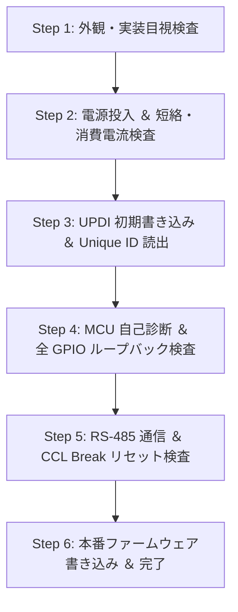

<!--
Copyright (c) 2026 ADX Project Contributors
SPDX-License-Identifier: CC-BY-4.0
-->

# ADX CORE-A5 (rev1) 製造・出荷検査仕様書 (Factory Test Specification)

**対象製品**: ADX CORE-A5 rev1  
**搭載 MCU**: Microchip ATtiny1616-MNR (QFN-20)  
**基板仕様**: 8748 フォームファクタ、OSP 表面処理、両面実装  
**準拠規格**: ADX 20-Pin Bus Specification v3.0 (`ADX_PINOUT.md`)  

---

## 1. 検査方針と前提条件

1. **OSP 表面保護の維持 (No Test Pads)**:
   - 銅箔の酸化およびポゴピン接触不良を防止するため、基板上にむき出しのテストパッドは一切設けない。
   - すべての電気検査、ファームウェア書き込み、機能検証は、基板上の正規コネクタ（**前面端子台** および **ADX 20P IDC コネクタ P2**）を経由して実施する。
2. **自動合否判定 (Self-Diagnostic Testing)**:
   - 検査治具と 20P コネクタ（Pins 11, 12 UART）を接続し、MCU 内部テストファームウェアによる自己診断と PC 治具ソフトウェアによる自動判定を行う。
3. **3.3V 電源の内部測定**:
   - 20P バス上に 3.3V パワーピンは配電されていないため、オンボード 3.3V LDO 出力電圧は **ATtiny1616 内蔵 ADC（1.1V バンドギャップ基準）による自己測定** で検証する。

---

## 2. 検査環境と治具構成 (Test Fixture Setup)

```text
                           【 CORE-A5 出荷検査接続構成 】

   [ プログラマブル直流電源 (5.0V) ]
          │ 5.0V DC (電流モニタ付き)
          ▼
   ┌──────────────────┐
   │ 前面 5VIN 端子台  │
   │ (CN1 / DB142R)   │
   ├──────────────────┤           ┌────────────────────────────────────────┐
   │ 前面 RS-485 端子台│ ◀───────▶ │ PC 側 USB-RS485 ドングル (Break 送出可) │
   │ (CN4/5 / DB142R) │ (A, B)    └────────────────────────────────────────┘
   │                  │
   │   ADX CORE-A5    │
   │    (被測定物)     │
   │                  │
   │ 20P IDC 拡張バス │           ┌────────────────────────────────────────┐
   │ (P2 / 2×10P)     │ ◀───────▶ │ 自動検査治具 (Test Fixture Backplane)    │
   └────────┬─────────┘           │                                        │
            │                     │  - Pin 6: UPDI ライター (SerialUPDI)   │
            │ (20P IDC ケーブル)   │  - Pins 11, 12: PC 側 USB-UART (3.3V)   │
            └─────────────────────│  - Pins 16〜19: SPI ループバック結線   │
                                  │  - Pins 13, 14: I2C プルアップ (4.7kΩ) │
                                  │  - Pin 9 ➜ Pin 7: EXTCLK ➜ AIN 配線    │
                                  └────────────────────────────────────────┘
```

### 治具側内部配線（20P ソケット側）
- **Pin 1〜4 (`VBUS`)**: 治具側電圧モニタ（ADC / マルチメータ入力）
- **Pin 5, 8, 10, 15, 20 (`GND`)**: 治具側共通グランド
- **Pin 6 (`SYS_RST / PROG`)**: USB-SerialUPDI プログラマ（UPDI 信号線）
- **Pin 7 (`AIN`)**: Pin 9 (`EXTCLK`) と治具内で結線（PWM / パルスループバック用）
- **Pin 11 (`UART_TX`)**: USB-UART 受信端子 (RXD, 3.3V LVCMOS)
- **Pin 12 (`UART_RX`)**: USB-UART 送信端子 (TXD, 3.3V LVCMOS)
- **Pin 13 (`I2C_SCL`) / Pin 14 (`I2C_SDA`)**: 3.3V 4.7kΩ プルアップ抵抗
- **Pin 17 (`SPI_MOSI`)**: Pin 18 (`SPI_MISO`) と治具内で直結（SPI ループバック用）
- **Pin 16 (`SPI_CS`) / Pin 19 (`SPI_SCK`)**: 治具側終端抵抗 / モニタ

---

## 3. 検査工程フロー (Test Procedure)



---

### Step 1: 外観・実装検査 (Visual Inspection)

| 項目 | 検査内容 | 合否判定基準 |
| :--- | :--- | :--- |
| **QFN-20 はんだ付け** | ATtiny1616 (3-MCU) の外周ピンおよびサーマルパッド | ブリッジ、浮き、未はんだ（オープン）なきこと |
| **THT コネクタ** | P2 (20P IDC), CN1 (5VIN), CN4/5 (RS-485) | ピン曲がりなし、スルーホールはんだ充填率 75% 以上 |
| **基板外観** | レジスト剥がれ、OSP 皮膜の変色・キズ | 導体パターンの露出・異物ショートなきこと |

---

### Step 2: 電源投入 ＆ 電流・保護回路検査 (Power & Protection Test)

1. **5VIN 通電・消費電流測定**:
   - 前面 CN1 端子台に **5.00V DC** を印加。
   - **判定基準**:
     - 消費電流 $I_{IN}$ が **$15.0\,\text{mA} \le I_{IN} \le 30.0\,\text{mA}$** の範囲内であること（TDA51S485HC 内部 DCDC 待機電流含む）。
     - $I_{IN} > 45\,\text{mA}$ の場合は過電流・短絡と判定し直ちに遮断。
2. **インジケータ LED (Green) 確認**:
   - U2 の Green LED が常時点灯していることを確認（3.3V LDO 出力 Power-Good）。
3. **SY6280AAC パワースイッチ導通確認**:
   - 20P コネクタ（Pins 1〜4: `VBUS`）の電圧を測定。
   - **判定基準**: $4.85\,\text{V} \le V_{BUS} \le 5.00\,\text{V}$ であること。
4. **逆流保護 (Reverse Current Blocking) 確認**:
   - 前面 CN1 の電源を OFF にし、20P 側（`VBUS`）から 5.00V を逆注入。
   - 前面 CN1 端子台の電圧を測定。
   - **判定基準**: CN1 端子台電圧が **$0.1\,\text{V}$ 以下** であること（SY6280AAC 逆流阻止の確認）。

---

### Step 3: UPDI 初期書き込み ＆ 個体識別 (Flashing & UID Readout)

1. **UPDI 接続**:
   - 20P コネクタ **Pin 6 (`SYS_RST / PROG`)** および **Pin 5 (`GND`)** を経由して ATtiny1616 と UPDI 通信を確立。
2. **Device Signature 検証**:
   - デバイス ID が `0x1E 0x94 0x21` (ATtiny1616) と完全一致すること。
3. **ヒューズ設定 (Fuses Configuration)**:
   - `OSCCFG` = 10 MHz (OSC20M / 2)
   - `BODCFG` = Active 2.7V (Sampled)
   - `SYSCFG0` = RSTPINCFG: UPDI mode
4. **個体固有 ID (SIGROW UID) 取得**:
   - MCU 内蔵の 10 バイト Unique ID（ロット番号・ウェハ座標）を読み出し、検査ログデータベースへシリアル番号として記録。
5. **検査ファームウェア (Diagnostic Firmware) 書き込み**:
   - Flash 領域へ自動診断用テストスケッチを転送。

---

### Step 4: MCU 自己診断 ＆ 全 GPIO 自動検査 (Automated Functional Test)

テストファームウェアが起動すると、`PORTMUX.CTRLB = 0x01`（USART0 を PB2/PB3 に割り当て）を実行し、以下のシーケンスを自動実行して UART（20P Pins 11, 12 / 115200bps）から PC 治具へ結果を返送します。

```text
[PC Fixture] ──▶ "CMD:START_TEST" (Pin 12 RXD)
[CORE-A5]    ──▶ "TEST:VDD=3.298V:PASS"
             ──▶ "TEST:SPI_LOOPBACK:PASS"
             ──▶ "TEST:I2C_BUS:PASS"
             ──▶ "TEST:EXTCLK_AIN:PASS"
             ──▶ "TEST:LED_CYCLE:PASS"
```

1. **3.3V LDO 出力電圧自己測定**:
   - 内蔵 ADC（1.1V バンドギャップ基準）で VDD を逆算測定。
   - **合格範囲**: **$3.20\,\text{V} \le V_{DD} \le 3.40\,\text{V}$**
2. **SPI ループバック検査**:
   - `PC2 (MOSI)` から疑似ランダムデータ（0xAA, 0x55, 0x00, 0xFF）を送信し、`PC1 (MISO)` で一致を受信確認。
3. **I2C バス検査**:
   - `PB0 (SCL)` / `PB1 (SDA)` でバスラインの High レベルおよび ACK ドライブを確認。
4. **EXTCLK ➜ AIN ループバック検査**:
   - `PA3 (EXTCLK)` から 1kHz PWM パルスを出力し、治具内ジャンパー経由で `PA5 (AIN)` の ADC にて High/Low 振幅を検出。
5. **ステータス LED 制御確認**:
   - `PB4 (Red)` ON ➜ 発光色が Yellow（Green + Red）に変化。
   - `PB5 (Blue)` ON ➜ 発光色が White（Green + Red + Blue）に変化。

---

### Step 5: RS-485 絶縁通信 ＆ CCL Break リセット検査 (RS-485 & OTW Test)

1. **RS-485 トランシーバー送受信検査**:
   - テストファームウェアが `PORTMUX.CTRLB = 0x00`（USART0 を PA1/PA2 に復帰）を実行。
   - 前面端子台 CN4/CN5 経由で PC 側 RS-485 ドングルと通信フレームを送受信。
   - **判定基準**: 115200bps でビットエラーなく双方向パケットが疎通すること。
2. **CCL Break リモートリセット検査**:
   - PC 側から RS-485 バスへ 20 bit 相当の Break 信号（連続 LOW）を送出。
   - **判定基準**:
     - ATtiny1616 内蔵 CCL（LUT0）が自律検知し、MCU がハードウェアリセット（SWRST）を発行して再起動すること。
     - 再起動後の `RSTCTRL.RSTFR` レジスタで `SWRF == 1`（ソフトウェアリセットフラグ）が確認できること。

---

### Step 6: 本番ファームウェア書き込み ＆ 出荷設定 (Final Provisioning)

1. **本番ブートローダー書き込み**:
   - 20P Pin 6 (UPDI) から本番用 RS-485 OTW ブートローダー（または初期出荷ファーム）を書き込み。
2. **メモリベリファイ**:
   - 全 Flash 領域のチェックサムを照合。
3. **出荷完了ステータス記録**:
   - PC データベース上に「SIGROW UID」「検査日時」「各項目測定値」「総合判定 PASS」をコミット。
   - 合格証ラベル発行。
