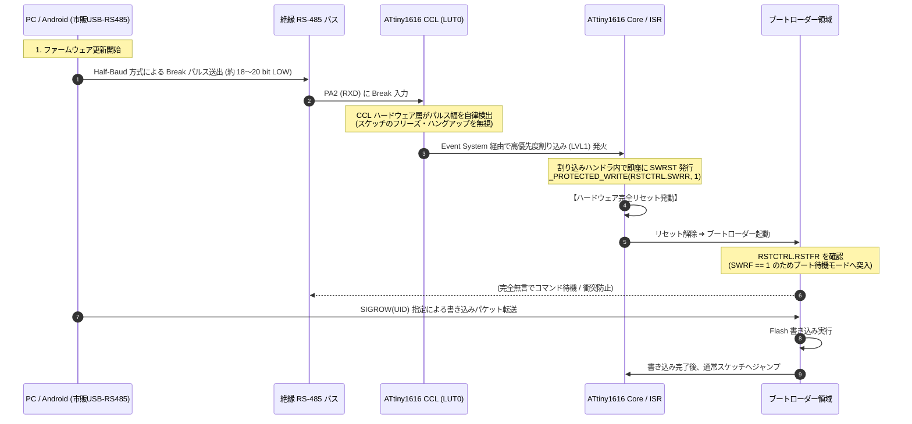

<!--
Copyright (c) 2026 ADX Project Contributors
SPDX-License-Identifier: CC-BY-4.0
-->

# ADX CORE-A5 技術仕様検討書 (Hardware Specification Study)
〜 3.3V ネイティブ GPIO・高耐熱（-40℃〜+105℃）・現場単体受電対応エッジスレーブ 〜

---

## 1. 概要とプロダクト位置づけ (Overview & Positioning)

### 1.1 プロダクト概要
**ADX CORE-A5** は、ADXエコシステムにおける **「高耐環境・大量配備向けエッジスレーブ端末」** の決定版モデルです。
配電盤内、密閉照明灯具、車載機器、屋外制御ボックスなど、**-40℃ 〜 +105℃** の極限環境において長期メンテナンスフリーで安定稼働することを最優先要件として設計されています。

従来の CORE-A (rev1) からの変遷および CORE-R との棲み分けを経て、以下の3大進化を遂げました：
1. **現場単体受電の実現:** 前面に保護回路（短絡/過電流/逆流防止）付きの「5VIN 端子台」を搭載し、POWER CARD なしで単体駆動可能。
2. **3.3V ネイティブ GPIO への移行:** 内部に 3.3V LDO を搭載し、MCU および拡張バス（ADX Pinout）を 3.3V ロジックに統一。CORE-R や 3.3V 系 CARD とのシームレスな相互運用性を確保。
3. **CCL 自律監視による BMC レス OTW リセット:** サブMCU（BMC）を全廃し、ATtiny1616 内蔵ロジック（CCL）を活用して市販の安価な USB-RS485 ドングルから現場一括リセット・書き込みを実現。

### 1.2 ADX コア製品ポートフォリオにおける棲み分け

| 項目 | **ADX CORE-A5** (現場の重装甲スレーブ) | **ADX CORE-R** (現場の頭脳・マスター) |
| :--- | :--- | :--- |
| **主 MCU** | **Microchip ATtiny1616-MNR** (8-bit / 3.3V / 10MHz) | **Raspberry Pi RP2040** (32-bit Dual / 3.3V / 133MHz) |
| **動作温度範囲** | **-40℃ 〜 +105℃** (Industrial / Automotive Grade) | **-20℃ 〜 +85℃** (通常産業・プロユース) |
| **販売想定価格** | **$22.00 USD クラス** (PCBA製造原価 約 $5.53 USD) | **約 $28.00 USD クラス** (PCBA原価 約 $7.24 USD) |
| **拡張バス論理** | **3.3V ネイティブ** (ADX Pinout 準拠) | **3.3V ネイティブ** (ADX Pinout 準拠) |
| **主な役割** | ・DMX512 / Modbus / 独自通信エッジ端末<br>・センサー収集、接点入出力、PWM制御<br>・過酷環境下の高信頼性不沈ノード | ・フィールドネットワークマスター / ゲートウェイ<br>・現場スマートプローブ / 簡易ロジアナ<br>・PC連携・高速演算処理 |

> [!NOTE]
> **処理能力と耐熱性のトレードオフの割り切り:**  
> 高度な浮動小数点演算やPC連携・USB通信が必要な場合は CORE-R / ESP32 が担当し、CORE-A5 は -40℃〜+105℃ の耐環境性と低消費電力・低発熱（自己発熱ゼロ）に特化します。

---

## 2. 基本電気仕様 (Electrical Specifications)

| 項目 | 定格 / 仕様 | 備考 |
| :--- | :--- | :--- |
| **主電源入力 (5VIN)** | **5.0V DC** (±10%) | 前面 DB142R-5.08 2P スプリング端子台より受電 |
| **電源保護機能** | 短絡保護、過電流保護、逆接保護、逆流防止 | Silergy SY6280AAC パワーディストリビューションスイッチ搭載 |
| **システム幹線電源 (VSYS)** | **約 4.5V 〜 5.0V DC** | 20P 拡張バス (Pins 1〜4) 幹線。受電・給電の双方向対応 |
| **内部ロジック電圧** | **3.3V DC** (MCU, GPIO, 内部ペリフェラル) | オンボード Microne ME6211C33M5G-N (500mA LDO) により生成 |
| **拡張バス論理電圧** | **3.3V LVCMOS 準拠** | レベルシフタ不要、MCU ネイティブ直結 |
| **MCU 動作周波数** | **10 MHz** (内部高精度オシレータ) | 3.3V 駆動時 Safe Operating Area 保証、自己発熱極小 |
| **RS-485 絶縁耐圧** | **2500 VDC** ガルバニック絶縁 | Mornsun TDA51S485HC (絶縁電源内蔵、最大 500kbps) |
| **動作保証温度範囲** | **-40℃ 〜 +105℃** | 全搭載部品（半導体・受動素子・端子台）規格完全準拠 |
| **消費電流 (通常動作)** | 約 15mA 〜 25mA @ 5.0V | 絶縁トランシーバー消費電力を含む |
| **外形寸法** | **87.0 mm × 48.0 mm** | ADX 8748 フォームファクタ準拠 |

---

## 3. システム・アーキテクチャ ＆ 回路ブロック (System Architecture)

```text
                               【 ADX CORE-A5 回路ブロック図 】

  [ 前面 5VIN 端子台 ] (DB142R-5.08 2P)
          │ 5.0V
          ▼
     [ ⚡ SY6280AAC パワースイッチ ⚡ ]
     ・短絡保護 / 過電流保護 (最大2A)
     ・逆流防止 (Reverse Current Blocking)
     ・逆接保護
          │
          ├───────────────────────────────────────────────────────┐
          │                                                       │
          ▼                                                       ▼
     【 VSYS 幹線 (4.5V〜5.0V) 】                       [ ⚡ TDA51S485HC ⚡ ]
          │                                            (2500V 絶縁トランシーバ)
          ├─▶ 20P 拡張バス (Pins 1〜4: CARDへ給電/受電)          │
          │                                                    │ A, B, GND_ISO
          ▼                                                    ▼
     [ ME6211C33M5G-N (3.3V 500mA LDO) ]              [ 前面 RS-485 端子台 ]
          │                                           (DB142R-5.08 2P×2: 4極)
          ├─▶ 3色車載LED (Green: 3.3V Power-Good 常時点灯)
          │
          ▼ 3.3V ネイティブ電源
   ┌────────────────────────────────────────────────────────────────────────┐
   │ Microchip ATtiny1616-MNR (QFN-20 / 3.3V / 10MHz)                       │
   │                                                                        │
   │  - PA2 (RXD) ──▶ CCL LUT0-IN2 直結 (Half-Baud Break 自律監視)           │
   │  - PA1 (TXD), PA4 (XDIR/DE), PA7 (RE_) ──▶ RS-485 制御                 │
   │  - PB4 (Red LED), PB5 (Blue LED) ──▶ 状態・通信インジケータ            │
   │  - PA0 (UPDI) ──▶ オンボード THT 書き込み・デバッグ端子                 │
   └───────┬────────────────────────────────────────────────────────────────┘
           │
           │ (3.3V LVCMOS ネイティブ信号 / レベルシフタ全廃)
           ▼
    ADX 20P 拡張バス (Pins 6〜19: 3.3V ネイティブ GPIO)
```

### 3.1 電源保護 ＆ バスマネジメント (Power Architecture)
1. **前面 5VIN 給電時の保護:**
   - 高機能ハイサイドスイッチ **SY6280AAC**（SOT-23-5, $R_{DS(on)} = 80\,\text{m}\Omega$）を搭載。
   - 万一の配線ミスや短絡事故が発生しても、内部および拡張CARDを瞬時に保護。
   - 逆流防止回路（Reverse Current Blocking）により、拡張バス（Pins 1〜4）から別の電源が印加されても端子台側へ逆流しません。
2. **POWER CARD スタック時の受電:**
   - 現場で POWER CARD（DC 12V/24V 絶縁受電）をスタックした場合は、拡張バス（Pins 1〜4）の VSYS を経由して CORE-A5 内部の LDO およびトランシーバーへ電力を供給可能です。
3. **3.3V 内部給電:**
   - 車載・産業耐熱（-40℃〜+150℃）対応の LDO **ME6211C33M5G-N** により、低ノイズな 3.3V ロジック電源を MCU および CARD バスへ供給します。

### 3.2 インジケータ LED 仕様 (車載耐熱 3色 LED)
前面に車載グレード（-40℃〜+110℃）の高信頼性フルカラー LED **HVRTB-3433EPX** を搭載します。

- **Green（緑）: 3.3V LDO 出力直結（Power-Good 表示）**
  - 電源投入および LDO の正常出力をハードウェアレベルで常時表示。
- **Red（赤）/ Blue（青）: MCU GPIO 制御**
  - `PB4`: Red LED 制御（Active HIGH）
  - `PB5`: Blue LED 制御（Active HIGH）
- **表現可能なステータスカラー:**
  - **Green (常時点灯):** スタンバイ / 通常通電
  - **Yellow (Green + Red):** 警告 / BUSY / フラッシュ書き込み中
  - **Cyan (Green + Blue):** 正常通信中 / パケット受信
  - **White (Green + Red + Blue):** 初期化中 / 重大システムアラート

---

## 4. ファームウェア書き込み ＆ OTW リセット仕様 (Bootloader Architecture)

### 4.1 プログラミング経路
1. **UPDI 端子 (PA0):**
   - 基板上のスルーホール（THT）端子として引き出し。
   - 製造時の初期ブートローダー書き込みおよび詳細デバッグに使用。
2. **RS-485 OTW (Over-The-Wire):**
   - 現場導入後および通常運用時のファームウェア更新に使用。
   - 一般的な市販 USB-RS485 ドングルおよび PC / Android 端末からの直接書き込みに対応。

### 4.2 CCL 自律監視によるリモートリセットシーケンス
外部のサブマイコン（BMC）を使用せず、ATtiny1616 内蔵の **CCL (Configurable Custom Logic)** と **Event System**、**高優先度割り込み** を組み合わせた決定論的リセットを実現します。



### 4.3 起動モード判定ロジック (`RSTCTRL.RSTFR`)
BMC による物理ピン操作を不要化し、MCU 内部のリセット要因レジスタで起動モードを完全分離します。

```c
void init_boot_check(void) {
    uint8_t reset_cause = RSTCTRL.RSTFR;
    RSTCTRL.RSTFR = 0xFF; // フラグクリア

    if (reset_cause & RSTCTRL_PORF_bm) {
        // 通常の現場電源投入時: 遅延なしで即座にスケッチへジャンプ (起動時間 0ms)
        start_user_application();
    } else if (reset_cause & RSTCTRL_SWRF_bm) {
        // RS-485 CCL Break による再起動時: ブートローダーモード待機
        run_rs485_bootloader();
    } else {
        // WDT等のフェイルセーフ再起動
        start_user_application();
    }
}
```

### 4.4 マルチドロップバス衝突防止 (Collision Avoidance)
同一の RS-485 バス上に複数台の CORE-A5 が接続されている場合：
1. Break 信号により**全ノードが一斉にブートローダーモードへ突入**します。
2. ブートローダー起動直後は**全ノードが送信禁止（無言・リッスンオンリー）**を維持します。
3. ホスト側から各個体の **SIGROW (Device Unique ID / シリアル番号)** を指定したフレームが届いたノードのみが応答（ACK）を返し、書き込みシーケンスを進行します。

---

## 5. 主要部品選定一覧 (Bill of Materials)

CAD ネットリスト（`Netlist_PCB1_2026-10-16.enet`）に基づく確定主要コンポーネント一覧です。すべての主要部品は **-40℃ 〜 +105℃（以上）** の産業・車載グレード品で統一されています。

| 記号 | 部品機能 | 採用型番 | メーカー | 定格温度 | LCSC 部品番号 | 特徴・選定理由 |
| :--- | :--- | :--- | :--- | :---: | :---: | :--- |
| **3-MCU** | メイン MCU | **ATTINY1616-MNR** (QFN-20) | Microchip | -40℃〜+105℃ | C507118 | 3.3V/10MHz, CCL内蔵, 低自己発熱 |
| **U1** | 絶縁 RS-485 | **TDA51S485HC** (SOIC-16) | YLPTEC (易川) | -40℃〜+105℃ | C49242252 | 2500VDC 絶縁, DCDC内蔵, 省面積 |
| **U4** | パワースイッチ | **SY6280AAC** (SOT-23-5) | Silergy (矽力杰) | -40℃〜+125℃ | C55136 | 2A 短絡・過電流保護, 逆流防止, 低 $R_{DS}$ |
| **LDO1**| 3.3V LDO | **ME6211C33M5G-N** (SOT-23-5) | Microne (微盟) | -40℃〜+150℃ | C82942 | 3.3V 500mA, 高PSRR, 超耐熱 |
| **U2** | 車載 3色 LED | **HVRTB-3433EPX** (SMD-6P) | Honglitronic | -40℃〜+110℃ | C5246356 | 車載規格 (AEC-Q 準拠クラス), 高輝度 |
| **CN1** | 5VIN 端子台 | **DB142R-5.08-2P-GN** (2P) | DORABO (地博) | -40℃〜+105℃ | C2898709 | スプリングクランプ式, 耐振動, 10A定格 |
| **CN4,5**| RS-485 端子台 | **DB142R-5.08-2P-GN** (2P×2) | DORABO (地博) | -40℃〜+105℃ | C2898709 | スプリングクランプ式, 耐振動, 4極 |
| **P1** | 拡張 IDC バス | **2.54-2*10P 弯简牛** (2×10P) | BOOMELE (博穆) | -40℃〜+105℃ | C9144 | ADX Pinout 準拠, ラッチ対応ボックスヘッダー |

---

## 6. 今後の検証・確定検討項目 (Next Action Items)

1. **CCL Break 検出ロジックの実機検証:**
   - 市販 USB-RS485 ドングルから Half-Baud（9600bps 0x00 送出等）を発行した際、CCL (LUT0) ➜ Event System ➜ LVL1 割り込みが確実に動作するパルス幅・フィルタ設定の最適化。
2. **RS-485 ブートローダーのフットプリント最適化:**
   - SIGROW 判定 ＋ ハードウェア自動方向制御（XDIR/PA4）＋ Flash ページ書き込みルーチンを **1KB 以内** に収めるコード設計。
3. **RS-485 受信レベル整合（5V ➜ 3.3V）:**
   - 絶縁トランシーバー TDA51S485HC の RO（受信出力）ピンが 5V 出力となる場合、3.3V 駆動の MCU PA2 ピンへの入力保護（分圧抵抗またはクランプダイオード）の実装有無の最終確認。
4. **前面パネル・ケース開口部（48mm幅）のクリアランス確認:**
   - DB142R-5.08 2P 端子台 × 3 個（計6極、幅約 30.5mm〜33mm）の前面配置と、8748 エンクロージャの嵌合・操作性の確認。
