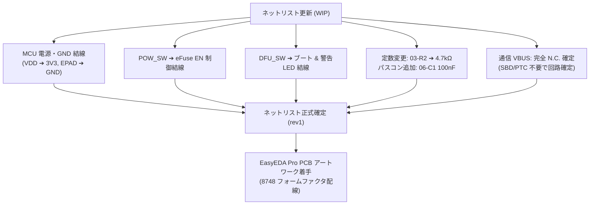

<!--
Copyright (c) 2026 ADX Project Contributors
SPDX-License-Identifier: CC-BY-4.0
-->

# ADX CORE-CX5 (rev1) ネットリスト進捗・評価および課題整理書
(ADX CORE-CX5 rev1 Netlist Review & Next Tasks)

- **対象ファイル**: [`hardware/CORE-CX5/rev1/adx_core-cx5_rev1-wip.enet`](adx_core-cx5_rev1-wip.enet) (EasyEDA Pro 形式)
- **リビジョン**: rev1 WIP (Work In Progress)
- **評価実施日**: 2026-11-03
- **参照仕様**:
  - [ADX CORE-CX5 ハードウェア構想書](../concept.md)
  - [ADX CORE-CX5 rev1 ハードウェア配線・ピンアサイン検討書](pinout_study.md)
  - [ADX 20-Pin Bus Specification v4.1](../../../docs/spec/ADX_PINOUT.md)

---

## 1. エグゼクティブサマリー (Executive Summary)

rev0（主要部品の仮配置段階）から大幅に進化し、**回路ブロックごとの体系化（`01-`〜`06-` プレフィックス付与）**、**受動素子の定数設計**、および **ADX 20-Pin バス仕様との完全な信号結線** が達成されています。
産業用コントローラとしての堅牢性と、デュアル Type-C ポートによる物理分離アーキテクチャの骨格が非常に美しく形成されています。

---

## 2. 回路ブロック別の実装進捗と技術評価

```text
［01: 通信 Type-C］── [D+/D-] ──➔［USB_Serge (ESD)］──➔［06: MCU (PC16/PC17)］
   (16P, 5.1k Rd)
［02: 電源 Type-C］──➔［02: TVS/Cap］──➔［03: eFuse (SY6280)］──➔ VBUS_PROT
   (6P, 5.1k Rd)                                  │                   │
                                          [POW_SW: EN制御]      ├─➔［04: LDO (ME6211)］──➔ 3V3 ──➔［06: MCU］
                                                                └─➔［05: ADX 20P Bus (Pins 17-20)］
```

| ブロック | 主要コンポーネント | 実装進捗・評価 | 技術的ハイライトと確認事項 |
| :--- | :--- | :---: | :--- |
| **01: 通信 USB** | `01-USB_Com` (16P Type-C)<br>`01-R1`, `01-R2` (5.1kΩ)<br>`USB_Serge` (USBLC6-2SC6) | **良好**<br>(一部未結線) | ・CC1/CC2 に独立 5.1kΩ (Rd) を実装、Type-C 規格に完全適合。<br>・D+/D- は ESD 保護 IC 経由で MCU (PC16/PC17) へ接続済。<br>・**【WIP】** VBUS ピン（A4, A9, B4, B9）が未接続（卓上給電ライン未実装）。 |
| **02: 電源 USB** | `02-USB_Pow` (6P Type-C)<br>`02-R1`, `02-R2` (5.1kΩ)<br>`02_TVS` (SMF5.0CA-MS)<br>`02-C1` (10µF), `02-C2` (100nF) | **完了** | ・大電流受電用 6P Type-C の CC ピンにも 5.1kΩ 完備。<br>・双方向 TVS（5Vクランプ）とバルク＋高周波パスコンによる堅牢なサージ保護。 |
| **03: 電子ヒューズ** | `03_eFuse` (SY6280AAC)<br>`03-R1` (10kΩ: ENプルアップ)<br>`03-R2` (6.8kΩ: ISET)<br>`03-C1` (10µF) | **良好**<br>(定数調整要) | ・PTC ヒューズに代わり、低オン抵抗（80mΩ）・自動復帰の eFuse を採用。<br>・現状 $R_{\text{SET}} = 6.8\,\text{k}\Omega$（1.0A 制限）のため、後述の通り 1.5A〜2.0A へ変更推奨。 |
| **04: 3.3V LDO** | `04-LDO` (ME6211C33M5G-N)<br>`04-C1` (10µF), `04-C3` (100nF)<br>`04-C2` (10µF), `04-C4` (100nF) | **完了** | ・入力側・出力側ともに 10µF (0603) ＋ 100nF (0402) のパラレル構成。<br>・LDO 自身のリプル除去および発振防止設計として理想的。 |
| **05: 拡張バス** | `05-ADX_exHeader`<br>(2.54mm 2×10P 簡牛) | **完了** | ・`pinout_study.md` の確定ピンアサインと 100% 整合。<br>・Pins 2&5 (SDI), Pin 3 (AIN), Pins 7-10 (UART/I2C), Pins 12-15 (SPI), Pins 17-20 (大電流 VBUS)。 |
| **06: メイン MCU** | `06-MCU` (CH32X035G8U6) | **良好**<br>(電源未結線) | ・全バス信号線および内蔵 USB PHY への配線完了。<br>・**【WIP】** Pin 2 (VDD) および Pin 29 (EPAD/GND) が未接続。 |
| **スイッチ類** | `DFU_SW` (HX PS5.8x5.8-6P CC)<br>`POW_SW` (HX PS5.8x5.8-6P CC) | **未配線** | ・両スイッチとも 6 ピンすべて net: "" の状態。次項にて制御トポロジーを定義。 |

---

## 3. 合意された設計方針と今後の課題解決策

### 課題 ①: DFU_SW の仕様と UX（オルタネイト ＋ 直結警告 LED）
- **背景と課題**:
  一般的なマイコン開発ボード（Raspberry Pi Pico 等）のモメンタリ方式は、BOOT ボタンを押しながらケーブルを挿す必要があり、両手が塞がる。
- **決定方針**:
  **オルタネイト（自锁: `HX PS5.8x5.8-6P CC`）を採用** し、片手で事前に「DFU 待機状態」へセット可能とする。
- **戻し忘れ（誤動作）防止策**:
  当該スイッチは **DPDT（2回路2接点）** であるため、接点を以下のように分離活用する：
  1. **回路 1 (Pins 1–3)**: MCU ブートピン制御（PC17 / UDP の 3.3V プルアップ、または PC0）
  2. **回路 2 (Pins 4–6)**: **超高輝度赤 LED（`01-LED_DFU`）の直結ハードウェア点灯**
     - スイッチがロック（押し込み）されている間は、MCU の状態に関わらず物理的に赤 LED が眩しく点灯。「戻し忘れ」を視覚的に 100% 警告する。

---

### 課題 ②: POW_SW による eFuse EN ピン制御
- **背景と課題**:
  大電流（1〜2A）の VBUS 主電源ラインをメカニカルスイッチで直接トグルすると、接点抵抗による電圧降下や火花（アーク）によるスイッチ劣化を招く。
- **決定方針**:
  `03_eFuse` (SY6280AAC) の **Pin 4 (EN: Active High)** を `POW_SW` で制御する。
- **回路トポロジー**:
  - `03-R1`（10kΩ）で `USB_VBUS` から EN ピンをプルアップ。
  - `POW_SW` の接点を **EN ピン と GND の間** に接続。
  - **効果**: スイッチに流れる電流はわずか $0.5\,\text{mA}$ となり、接点寿命が飛躍的に向上。SY6280AAC のソフトスタート機能により、突入電流も自動的に防止される。

---

### 課題 ③: eFuse 電流制限値の引き上げ（1.5A 〜 2.0A）
- **背景と課題**:
  現在の `03-R2`（$6.8\,\text{k}\Omega$）は電流制限が $1.0\,\text{A}$ となっており、拡張 Card 側の負荷（サーボや大電流アクチュエータ等）に対してマージンが小さい。
- **決定方針**:
  $I_{\text{LIM}} = \frac{6800}{R_{\text{SET}}}$ に基づき、`03-R2` を以下の推奨値に変更する：
  - **推奨案**: **$4.7\,\text{k}\Omega$（約 $1.45\,\text{A}$ 制限）**
    - 発熱わずか $0.17\,\text{W}$、放熱マージンが最も大きく安全。
  - **大電流案**: **$3.6\,\text{k}\Omega$（約 $1.89\,\text{A}$ 制限）** または **$3.3\,\text{k}\Omega$（約 $2.06\,\text{A}$ 制限）**
    - 2A 付近までガッツリ給電可能（SY6280AAC 定格内）。

---

### 課題 ④: MCU 直近パスコン（06-C1）の新設
- **背景（電気的理由）**:
  LDO 側のコンデンサ（`04-C2`, `04-C4`）は「LDO 自身の発振防止（位相補償）」のために LDO の真横に必須。
  一方、MCU は 48MHz 動作に伴い数ナノ秒単位の急激な過渡電流パルスを要求するため、配線インダクタンス（約 $1\,\text{nH/mm}$）による電圧サグを防止する「ローカルなエネルギーバッファ」が MCU の真横に不可欠。
- **決定方針**:
  - **`06-C1`（100nF / 0402 または 0603）を新設**。
  - MCU の **Pin 2 (VDD) と Pin 29 (EPAD/GND) の物理的最至近（1〜2mm以内）** に配置・配線する。

---

### 課題 ⑤: 通信用 Type-C（01-USB_Com）の給電トポロジー（完全オミット決定）
- **背景と議論（Arduino と PLC の交差点）**:
  - 一般的なマイコンボード（Raspberry Pi Pico 等）の「USB ケーブル 1 本で開発・給電する（USB One Cable Debug）」スタイルは、システム全体が $5\,\text{V} / 0.5\,\text{A} = 2.5\,\text{W}$ 未満で収まるホビー用途だからこそ成立している。
  - 実負荷（サーボ、モータ、リレー、センサ Card 等）を駆動する Arduino UNO が、20 年近く 2.1mm DC ジャックをオミットできなかった理由は、**「PC の USB ポートは、実世界を駆動するコントローラの電力供給源としては原理的に不完全である」** ためである。
  - もし通信ポートから MCU 単体に中途半端に給電してしまうと、「通信ケーブルを挿すと MCU は起動して書き込みも成功するが、Card は動かない」という**最も有害な認知的不協和（ソフトウェアのバグを疑って無駄なデバッグ時間を費やす罠）** を生む。
- **決定方針（案 A：完全オミットの正式採用）**:
  - **`01-USB_Com` の VBUS ピン（A4, A9, B4, B9）は「完全未接続（N.C.）」とする**。
  - 給電ライン（SBD、PTC ヒューズ等）は一切配置しない。
  - これにより：
    1. **PC への逆流破損確率が物理的に 0.000%** となり、産業用エッジコントローラとして究極の安全性を獲得。
    2. 電源スイッチ（`POW_SW`）の挙動が 100% 直感的になる（PC 接続有無に関わらず、POW_SW で全電源遮断）。
    3. 開発者は「まず電源を投入する ➔ 次に通信ケーブルを挿す」という、**産業機器として正しい習慣を迷いなく体得** できる。
- **基板シルクによるアフォーダンス設計**:
  - コネクタ直近に以下のシルク印刷を施し、物理的な誤認をゼロにする：
    - `01-USB_Com`: **`COMM (DATA ONLY / NO POWER)`** または 💻 アイコン
    - `02-USB_Pow`: **`POWER (5V 1.5-2A IN)`** または ⚡ アイコン

---

### 課題 ⑥: オンボード LED の追加
[pinout_study.md](pinout_study.md) および上記 DFU 警告仕様に基づき、以下の LED 回路を配置する：
1. **`04-LED_PWR` (Green)**: 3.3V 通電表示（常時点灯）
2. **`01-LED_DFU` (Red)**: DFU_SW 押し込み時警告表示（ハードウェア直結）
3. **`06-LED_USR1` (Amber / Red)**: MCU `PB6` 接続（タイマー PWM / エラー表示用）
4. **`06-LED_USR2` (Blue)**: MCU `PB7` 接続（タイマー PWM / 通信ブレス表示用）

---

## 4. 今後の作業ステップ (Next Action Items)



1. **ネットリスト更新**:
   - `06-MCU` の電源（3V3, GND）配線
   - `POW_SW` と `DFU_SW` の結線
   - `03-R2` の定数変更（$4.7\,\text{k}\Omega$ 等）
   - `06-C1`（100nF）およびオンボード LED の追加（通信 VBUS は N.C. 確定）
2. **PCB レイアウト着手**:
   - 8748 フォームファクタ外形（$87.0\,\text{mm} \times 48.0\,\text{mm}$）および 20-Pin IDC、Type-C 2 系統の端面配置
   - シルク印刷の配置（`COMM (DATA ONLY)` / `POWER (5V IN)`）
   - QFN-28 サーマルビア（EPAD）とベタ GND プレーンの構築

