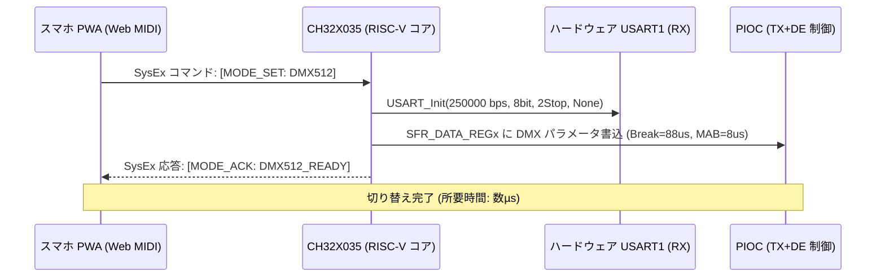
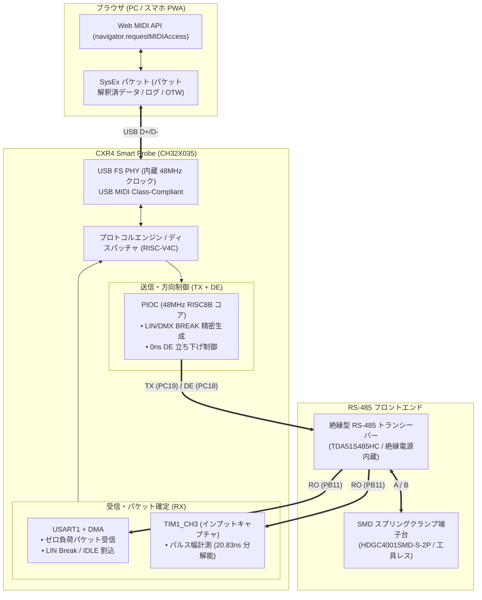

<!--
Copyright (c) 2026 ADX Project Contributors
SPDX-License-Identifier: CC-BY-4.0
-->

# CXR4 Smart Probe ハードウェア構想書
(CXR4 Smart Probe Hardware Concept & Technical Note)

- **ステータス**: DRAFT / 構想検証完了・アーキテクチャ策定
- **対象デバイス**: CXR4 Smart Probe (The Web-Native Isolated RS-485 Debugger)
- **最新改訂日**: 2026-11-04
- **先行検討**: [RPR4 Smart Probe 構想書](../RPR4_Smart_Probe/concept.md)
- **コアMCU**: WCH CH32X035G8U6 (QFN-28)

---

## 1. 構想の背景と RPR4 からの進化

### 1.1 RPR4（RP2040版）での成果と「過剰設計の罠」
ADX システムでは、フィールドネットワークにおける耐ノイズ性と OTW（Over-The-Wire）スケッチ書き換えの信頼性を両立するため、**LIN BREAK 信号を用いたハードウェアフィルタリング** を採用しています。
従来の汎用 USB RS-485 ドングルでは、PC 側 OS のバッファリングやボーレートトリックに依存するため、BREAK 信号の長さにジッタが生じたり、スマホ環境で通信できないという課題がありました。

この課題を解決するため、当初は RP2040 の PIO（Programmable I/O）を活用して RS-485 波形を任意サンプリングする **RPR4 Smart Probe** を検討していました。しかし、構想を深める中で以下の「過剰設計の罠（Over-engineering Trap）」に直面しました：
1. **ロジアナ機能の肥大化とスマホ負荷**:
   - 生波形（数 MHz サンプリング）をそのまま PC やスマホに送ろうとすると、USB 帯域を圧迫し、スマホ（PWA）側でメガバイト級の波形描画エンジンを回す必要が生じ、激しい発熱とバッテリー消費を招く。
   - 現場エンジニアが本当に見たいのは「波形のギザギザ」ではなく、「DMX の各チャンネル値」「Modbus のレジスタ応答」「CRC エラーの有無」という **解釈された意味のあるパケットデータ** である。
2. **部品点数・実装面積・製造コストの壁**:
   - RP2040 は外付け SPI Flash、外付け水晶発振子、電源レギュレータを必要とし、QFN-56 パッケージと相まって基板面積と BOM コストが増大（PCBA 原価で約 \$6、販売価格 20 ドル台後半）。
3. **スマホ（特に iOS）接続の障壁**:
   - Web Serial API や WebUSB API は Android Chrome では動作するものの、iOS Safari では一切サポートされておらず、「現場でスマホから直接繋がる」という UX が iOS ユーザーに対して成立しない。

### 1.2 CXR4 の明確な設計思想：過剰機能のオミットと 3 大プロトコルへの特化
CXR4 では、**「ハイスペックな生波形ロジアナ機能」を完全にオミット** します。
代わりに、**「現場で直面する 3 大 RS-485 プロトコル（LN-485 / DMX512 / Modbus RTU）を完璧に送受信でき、スマホ PWA から 1 タップで即座に切り替えられるスマートプローブ」** へとフォーカスを絞り込みます。

- **1チップ化による圧倒的な小型化・低コスト化**:
  メイン MCU に **WCH CH32X035G8U6**（32-bit RISC-V4C, 48MHz）を採用。Flash 62KB / SRAM 20KB、USB 2.0 Full-Speed PHY、高精度内部発振器（HSI 48MHz、USB クロック自動トリミング対応）を内蔵。外付け Flash・外付け水晶発振子を全廃し、QFN-28（4mm × 4mm）による極薄ペンシル型ドングルを実現。
- **Web MIDI API によるクロスプラットフォーム完全統一（iOS / Android / PC）**:
  USB MIDI Class-Compliant デバイスとして振る舞い、SysEx トンネリングにより iOS Safari も含む全 OS ブラウザからゼロインストールで双方向通信。
- **非対称分担アーキテクチャ（PIOC: TX+DE ＋ ハードウェア USART: RX+DMA）**:
  送信と方向制御を PIOC でナノ秒同期し、受信とパケット解析をハードウェア USART ＋ タイマーに任せることで、外付けオートディレクション回路なしで完全な半二重制御を達成。

---

## 2. 3大技術要素の技術検証結果

### 2.1 USB DFU / ファームウェア書き込み

```text
┌─────────────────────────────────────────────────────────────┐
│                    【 現場・ブラウザ運用 】                   │
│   Web MIDI 接続中 (通常運用モード)                            │
│   ➔ PWA から SysEx パケットでファームウェアを送信             │
│   ➔ IAP (In-Application Programming) で Flash を自己書き換え│
└──────────────────────────────┬──────────────────────────────┘
                               │ (非常時・初期書き込み)
                               ▼
┌─────────────────────────────────────────────────────────────┐
│                 【 オープンソース USB DFU 】                 │
│   Flash 先頭領域に配置した USB DFU ブートローダー           │
│   ➔ WebUSB / WebDFU (Chrome 等) から直接書き込み可能       │
└──────────────────────────────┬──────────────────────────────┘
                               │ (完全文鎮化時)
                               ▼
┌─────────────────────────────────────────────────────────────┐
│                 【 内蔵 ROM ISP ブートローダー 】             │
│   PC17 (UDP) プルアップ起動 ➔ WCH proprietary ISP          │
│   ➔ `wchisp` (CLI) または WCH-LinkUtility で USB 直書き換え │
└─────────────────────────────────────────────────────────────┘
```

1. **内蔵 ROM ブートローダーの特性**:
   - CH32X035 の内蔵 ROM（3KB）は、標準 USB DFU ではなく **WCH 独自 ISP プロトコル**（VID: `1a86:55e0` 等）を採用しています。
   - PC からはオープンソースの `wchisp` コマンドラインツールを用いて USB ケーブル 1 本で書き込み可能です。
2. **Web DFU によるブラウザ書き込みの実現**:
   - Flash メモリの先頭領域にオープンソースの **USB DFU ブートローダー** を組み込むことで、ブラウザ上の Web DFU（WebUSB 経由）からドライバ不要で直接ファームウェアを更新可能となります。
3. **Web MIDI SysEx による OTW アップデート（推奨運用）**:
   - 現場の PWA アプリケーションからは、DFU モードへの切り替えすら不要とし、Web MIDI の SysEx パケットを用いてファームウェアを分割転送・IAP 書き換えするフローを標準とします。

---

### 2.2 Web MIDI API による接続アーキテクチャ

#### なぜ Web Serial / WebUSB ではなく Web MIDI なのか？
* **OS・ブラウザの制約突破**:
  - Web Serial API / WebUSB API：PC（Chrome/Edge）および Android Chrome で動作するが、**iOS Safari ではセキュリティポリシーにより非サポート**。
  - Web MIDI API (`navigator.requestMIDIAccess`)：OS 標準の USB MIDI クラスドライバ（Class-Compliant）で動作するため、Windows, macOS, Linux, Android はもちろん、**iOS 上の Web MIDI 対応ブラウザや PWA ラッパー環境でも動作可能**。
* **SysEx（System Exclusive）シリアルトンネリング**:
  - MIDI の SysEx メッセージ（`0xF0 ... 0xF7`）は可変長バイナリペイロードを転送可能です。
  - RS-485 の受信生データ、送信フレーム、デバッグログ、コンフィギュレーションコマンドをすべて SysEx パケットにカプセル化してブラウザと双方向ストリーミングします。
* **実装実績**:
  - オープンソースの `CH32X035_USBMIDI` ライブラリ（Arduino/C++ 対応）等が存在し、低レイテンシな送受信が実証されています。

---

### 2.3 RS-485 方向制御と非対称分担アーキテクチャ（案A）

#### (1) 方向制御（DE）の課題と「非対称分担」のブレークスルー
RS-485 は半二重（Half-Duplex）通信のため、TX/RX に加えて **DE（Driver Enable）/ /RE（Receiver Enable）** の方向制御ピンが必須です。
PIOC が制御できるピンは `PIOC_IO0`（PC18）と `PIOC_IO1`（PC19）の **2本のみ** です。もし PIOC を「TX と RX」に割り当ててしまうと、DE をメイン CPU（割り込み）で制御せざるを得ず、「送信完了後に DE を落とすのが数µs遅れ、相手スレーブの即座の返信（Fast Turnaround）の頭を自機のドライバが潰す」という RS-485 特有の致命的トラブルを招きます。

そこで CXR4 では、**「PIOC を送信・方向制御（TX ＋ DE）に特化させ、受信（RX）はハードウェア USART1 ＋ DMA ＋ タイマーに任せる」非対称分担アーキテクチャ** を採用します。

```text
［ CH32X035 ］
   PIOC_IO1 (PC19) ─────────➔ TXD (DI)  ──┐
   PIOC_IO0 (PC18) ─────────➔ DE / /RE  ──┼──➔［ 絶縁トランシーバー TDA51S485HC ］
                                          │
   USART1_RX (PB11) ◀──────── RO (RXD)  ──┘
   (兼 TIM1_CH3: パルス幅測定)
```

- **送信時（PIOC 主導）**:
  1. 送信開始時に PIOC が `DE` を HIGH に駆動（送信モード）。
  2. タイマー同期でジッタなく BREAK パルス（LIN: 13bit、DMX: 88µs 等）およびデータフレームを送出。
  3. **最後のストップビットが抜けた「まさにその 1 クロック（20.83ns）」で PIOC が DE を LOW（受信モード）へ即座に戻す**。
  4. 割り込み遅延が原理的にゼロ（0ns）のため、高速返信パケットの頭を絶対に破壊しません。
- **受信時（ハードウェア USART1 ＋ TIM1 主導）**:
  - `PB11` ピンは、デフォルトで **`USART1_RX`** と **`TIM1_CH3`（タイマー1 インプットキャプチャ）** の両方に内部接続されています。
  - 受信パケットは USART1 ＋ DMA で SRAM バッファへ CPU 負荷ゼロで一括転送。
  - 同時に `TIM1_CH3` が立ち上がり／立ち下がりエッジの時間差を 20.83ns 単位で測定し、パルス幅や無通信ギャップを計測。

---

### 2.4 3大プロトコル（LN-485 / DMX512 / Modbus RTU）の送受信と動的切替

CXR4 では、現場で遭遇する 3 大 RS-485 プロトコルの送受信を完全網羅し、スマホ PWA からの 1 タップで動的に切り替えます。

#### (1) 送受信 実現性マトリクス

| プロトコル | 送信メカニズム（PIOC: TX+DE） | 受信メカニズム（USART1: RX+DMA / TIM1） |
| :--- | :--- | :--- |
| **① LN-485**<br/>(ADX標準) | • **13bit 以上の LIN BREAK**: PIOC がタイマーでジッタなく送出<br/>• **DE 制御**: ストップビット直後に 0ns で DE 立ち下げ | • **LIN BREAK 検出**: ハードウェア `USART_IT_LBD` 割込で即検知<br/>• **データ受信**: USART ＋ DMA で全自動受信 |
| **② DMX512**<br/>(舞台・照明) | • **DMX BREAK**: 88µs〜1ms の LOW を送出<br/>• **MAB**: 8µs の HIGH を送出<br/>• **DE 制御**: 最大513バイト送出直後に即 DE 立ち下げ | • **DMX BREAK 検出**: `TIM1_CH3` で 88µs 以上の LOW を計測検知<br/>• **データ受信**: USART を 250kbps/2Stop に設定し DMA 受信 |
| **③ Modbus RTU**<br/>(産業・FA) | • **Fast Response 保護**: 送信完了瞬間に DE 立ち下げ。**相手スレーブの即時返信を破壊しない**<br/>• **CRC-16 付与**: 送信パケット末尾に自動付加 | • **t3.5 ギャップ検出**: `USART_IT_IDLE`（アイドル検出割込）で 3.5 文字の無通信をハード検知しフレーム確定<br/>• **CRC-16 検証**: 受信完了時に自動検証 |

#### (2) ソフトウェア動的切替（Runtime Mode Switching）
スマホ PWA から Web MIDI（SysEx）でモード切替コマンド（例: `SET_MODE: DMX512` や `SET_MODE: MODBUS(19200, EVEN)`）を送信すると、CH32X035 内部で数マイクロ秒で切り替わります：



1. **ハードウェア USART の再初期化**: `USART_Init()` でボーレート、ストップビット、パリティを即時更新。
2. **PIOC のレジスタ書き換え**: PIOC を再ロードすることなく、メイン CPU から PIOC の SFR レジスタ（`SFR_DATA_REG0〜7`）を書き換えるだけで、送出 BREAK 長やビットタイミングを変更。



---

## 3. ハードウェア基本構成と主要部品

### 3.1 仕様概要

| 項目 | 仕様 | 選定理由・備考 |
| :--- | :--- | :--- |
| **メイン MCU** | **WCH CH32X035G8U6** (QFN-28, 4×4mm) | 32-bit RISC-V4C, 48MHz, Flash: 62KB, SRAM: 20KB |
| **USB 物理層** | 内蔵 USB 2.0 Full-Speed PHY | 外付け水晶発振子不要（HSI 自動トリミング） |
| **絶縁 RS-485** | **TDA51S485HC** (SOIC-16) | 絶縁 DC-DC 電源内蔵・5kVrms 絶縁・極薄実装 |
| **方向制御** | **PIOC 直接 DE 制御（非対称分担）** | 0ns 立ち下げ・外付け回路不要で Fast Turnaround 完全保護 |
| **現場結線端子** | **HDGC4001SMD-S-2P** (SMD 4mm ピッチ) | 工具レス・スプリングクランプ（押すだけで芯線挿入） |
| **USB ポート** | **Type-C 16P (通信 ＋ 5V 給電)** | 堅牢なミドルマウントまたはオンボード SMT |
| **保護素子** | 双方向 TVS ダイオード、PTC リセッタブルヒューズ | バスサージ・逆流・過電流保護 |
| **ステータス表示** | 送信 (TX: Amber) / 受信 (RX: Green) / 状態 (Status: Blue) | 高輝度チップ LED |

### 3.2 外形・フォームファクタ構想
* **ペンシル型極薄ドングル**:
  - 幅: 約 14〜16 mm
  - 長さ: 約 45〜55 mm
  - 厚み: コネクタおよび端子台高さに準拠（約 5〜7 mm 程度）
  - TDA51S485HC（SOIC-16, 高さ約 2.6mm）と HDGC4001SMD-S-2P のフル SMD 構成により、全自動 PCBA 実装が可能。

---

## 4. RP2040 (RPR4) と CH32X035 (CXR4) の比較検証

| 比較項目 | RPR4 (RP2040 構想) | CXR4 (CH32X035 構想) | CXR4 の優位性 |
| :--- | :--- | :--- | :--- |
| **MCU 単体コスト** | 約 \$0.80〜1.00 | **約 \$0.35〜0.50** | **コスト半減** |
| **外付け Flash** | 必須 (W25Q16 等: 約 \$0.35) | **不要 (内蔵 62KB)** | 部品点数削減・面積削減 |
| **外付け水晶** | 必須 (12MHz: 約 \$0.15) | **不要 (内蔵 48MHz HSI)** | 部品点数削減・信頼性向上 |
| **パッケージ** | QFN-56 (7mm × 7mm) | **QFN-28 (4mm × 4mm)** | **実装面積 1/3 以下** |
| **製造原価 (PCBA込)** | 約 \$6.02 (150pcs 時) | **約 \$3.80〜4.50 (想定)** | **圧倒的な価格競争力** |
| **ブラウザ接続方式** | Web Serial (iOS 不可) | **Web MIDI SysEx (iOS / Android / PC)** | **現場スマホ UX の完全統一** |
| **ファーム更新** | UF2 / Picoboot | **Web MIDI OTW / Web DFU / wchisp** | シームレスな OTW 更新 |
| **LIN BREAK 生成** | PIO ステートマシン自作 | **USART ハードウェア標準機能** | **ファームウェア開発工数激減** |
| **特殊波形操作** | PIO (8 ステートマシン) | **PIOC (48MHz 単一サイクル RISC)** | DMX 等の特殊タイミングに十分対応 |

---

## 5. 今後の開発ステップ

1. **回路図設計（Schematic）**:
   - CH32X035G8U6 周辺回路（パスコン、CC1/CC2 プルダウン、USB D+/D- 配線）
   - 非対称分担（PIOC_IO1: TX, PIOC_IO0: DE, PB11: RX）ピン接続と絶縁トランシーバー（TDA51S485HC）配線
   - オプション保険としての 0Ω ジャンパ（案D ハイブリッド配線）の配置
   - バス保護回路（TVS、PTC）
2. **基板レイアウト（PCB Layout）**:
   - 極薄ペンシル型ドングル外形の作成（幅 14〜16mm × 長さ 45〜55mm）
   - 面実装スプリング端子台（HDGC4001SMD-S-2P）および Type-C コネクタの配置検証
3. **プロトタイプファームウェア検証**:
   - CH32X035 EVT ボードを用いた USB MIDI 通信テスト
   - Web MIDI API（ブラウザ JavaScript）からの SysEx 送受信ベンチマーク
   - 3大プロトコル（LN-485 / DMX512 / Modbus RTU）の送受信と動的切替テスト

