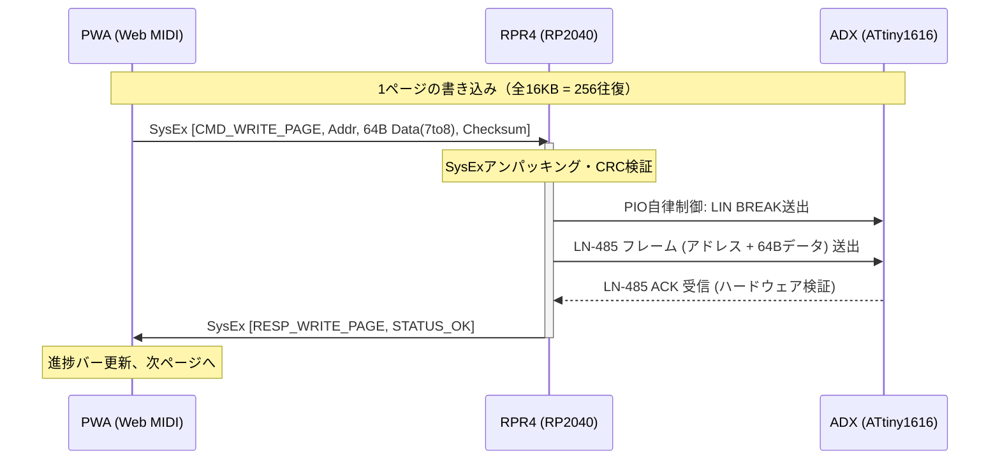

# RPR4 Web MIDI ベース・モデムプロトコル技術検討メモ

## 1. 背景と課題意識

### 1.1 ブラウザ・OSにおける有線ハードウェア通信の締め付け
近年、主要OS（iOS/macOS, Windows, Android）およびWebブラウザ（WebKit, Chromium, Gecko）において、ハードウェアや周辺機器への直接アクセスに対するセキュリティ制限が年々厳格化している。

特にブラウザ環境において：
- **Web Serial API**: Chromium系（PC版）のみの独自機能にとどまり、Firefox/Safariは「セキュリティ上極めて有害（Harmful）」として実装を公式拒絶。Android版Chromeでもデフォルト無効。
- **WebUSB API**: OSのドライバ占有問題やセキュリティ懸念があり、企業向け管理端末（Enterprise Policy）等で一括遮断されるリスクが常に伴う。
- **OSの気まぐれなアップデートリスク**: ChromeやAndroid OSのバージョンアップに伴い、権限プロンプトの厳格化や特定クラス/ベンダーIDのブラックリスト化による「現場ツールの突然死」が構造的リスクとして存在する。

かつて、ブラウザやスマホアプリがマイコンと通信するために「3.5mmマイク・イヤホン端子（音声波形 SoftModem）」をハックした歴史が示すように、**「プラットフォームやブラウザベンダーが都合で勝手に仕様変更できない、歴史的に成熟・保護されたオープン規格」に通信を寄せること**が、現場ツールの長期寿命（10年単位でのサバイバル性）を担保する絶対条件となる。

### 1.2 なぜ「MIDI」なのか？
MIDI（Musical Instrument Digital Interface）は、1983年の規格制定から40年以上にわたり、一切の後方互換性を壊さずに運用され続けている奇跡的なオープン規格である。

1. **不可侵の産業的防波堤**:
   - 世界中の音楽制作、レコーディングスタジオ、ライブコンサート、電子楽器がMIDIに依存している。Apple, Google, Microsoftといえども、自社のOSアップデートでUSB-MIDIの挙動を破壊することは業界構造上許されない。
2. **Apple（iOS）が唯一認めたMFi不要の有線双方向通信**:
   - Appleは有線USBのシリアル通信やraw USB通信に高額なMFi認証（専用認証チップ）を義務付けているが、**USB-MIDI機器だけは「楽器」としてCoreMIDI経由で完全ドライバレス・MFi不要で開放**している。
3. **W3C正式勧告（Web MIDI API）の広範なブラウザ対応**:
   - Web Serialを拒絶したFirefoxも、Web MIDIは公式に標準サポート。
   - Android版Chromeも、Android OS標準のUSB-MIDIホスト機能を介して**Polyfillなしでネイティブ動作**する。

---

## 2. アーキテクチャの再定義：透過型ドングルから「インテリジェント・モデム」へ

### 2.1 透過型（Transparent）ドングルの限界
従来のFTDIやCH340のような「PCからの生バイト列をそのままRS-485に垂れ流すドングル」では、以下の問題が解決できない：
- OSのタスクスケジューリングやUSBの1msフレーム遅延により、LIN BREAK（13bit以上のDominant Low）などのハードウェア精度がマイクロ秒単位で崩れる。
- ホスト側のボーレートトリック挙動がOSや端末ごとに異なり、通信が破綻する。

### 2.2 RPR4の役割＝「プロトコル・モデム（Intelligent Controller）」
RPR4に強力なマイコン（RP2040: デュアルCortex-M0+ ＆ PIO）を搭載している真の価値は、RPR4自身を**独立した「プロトコル・モデム」として動作させる点**にある。

```text
【PC / スマホ（PWA）】
      │
      │ 高レベルコマンド（例:「アドレス0x4000に64B書き込め」）
      │ ※USBの遅延やジッターがあっても影響ゼロ
      ▼
┌────────────────────────────────────────────────────────┐
│ 【RPR4（RP2040 インテリジェント・モデム）】              │
│   ・USB-MIDI SysExメッセージを受信・検証                │
│   ・PIOステートマシンが高精度な物理波形を自律生成          │
│     （マイクロ秒精度のLIN BREAK、Sync、LN-485フレーム）   │
│   ・ATtinyからのACK/NAK受信・ベリファイ・再送を高速完結    │
└────────────────────────────────────────────────────────┘
      │
      │ 決定論的で堅牢なハードウェアRS-485通信（LN-485）
      ▼
【ADXターゲット（ATtiny1616）】
```

この「モデム」という定義により、**上位層（USB伝送路）と物理層（現場のRS-485）の責務が完全分離**される：
- **ホスト ⇔ RPR4**: 短距離USB。ハードウェアCRCと自動再送を備えた、絶対に壊れないWeb MIDI SysExでメッセージを送受信。
- **RPR4 ⇔ ADX**: 過酷なフィールド環境。絶縁トランシーバー（TDA51S485HC）とPIOが、LIN BREAKハードウェアフィルタリングを用いてノイズ耐性を極大化。

---

## 3. Web MIDI SysEx によるモデムプロトコル仕様案

### 3.1 SysEx（System Exclusive）の特性
- **フレーミングフリー**: 開始バイト `0xF0`、終了バイト `0xF7` で囲まれるため、パケットの区切り（デリミタ）がハードウェア・ブラウザ層で自動保証される。COBSやSLIP等の自作フレーミングが不要。
- **サイズ柔軟性**: SysExは規格上、最大長の上限がない。数バイトのコマンドから、数百バイトのファームウェアチャンクまで1つのメッセージとして送信可能。
- **7ビット制約とパッキング**: データバイトは最上位ビット（MSB）が0（`0x00`〜`0x7F`）である必要があるため、8bitバイナリは **7-to-8 パッキング**（7バイトの8bitを8バイトの7bitに変換）して格納する（データ増率は約14%にとどまり、USB Full-Speed 12Mbps環境では無視できる）。

### 3.2 パケット構造（フレームフォーマット）

```text
[ 0xF0 ]                    : SysEx 開始 (SOF)
[ 0x7D ]                    : Non-commercial / Educational / 実験用メーカーID
[ Command ID ]              : コマンド種別（7bit: 0x01〜0x7F）
[ Sequence Number ]         : パケットシーケンス番号（7bit: 0x00〜0x7F）
[ Payload Length (High) ]   : ペイロード長（MSB側 7bit）
[ Payload Length (Low) ]    : ペイロード長（LSB側 7bit）
[ Payload Data ... ]        : 7-to-8 パッキングされた実データ
[ Checksum / CRC-7 ]        : ヘッダおよびペイロードの7bit XORまたはCRC
[ 0xF7 ]                    : SysEx 終了 (EOF)
```

### 3.3 コマンド体系（抜粋）

| Command ID | コマンド名 | 方向 | 概要 |
| :--- | :--- | :---: | :--- |
| `0x01` | `CMD_PING` | Host ➡️ RPR4 | 接続確認およびファームウェア情報の取得要求 |
| `0x81` | `RESP_PONG` | RPR4 ➡️ Host | RPR4のハードウェアRev, ファームバージョン応答 |
| `0x02` | `CMD_WRITE_PAGE` | Host ➡️ RPR4 | 1ページ分のFlash書き込み要求（アドレス + 64Bデータ） |
| `0x82` | `RESP_WRITE_PAGE`| RPR4 ➡️ Host | 書き込み結果応答（STATUS_OK, STATUS_TIMEOUT, CRC_ERR） |
| `0x03` | `CMD_READ_PAGE`  | Host ➡️ RPR4 | 1ページ分のFlash読み出し要求 |
| `0x83` | `RESP_READ_PAGE` | RPR4 ➡️ Host | 読み出しデータ返却（STATUS_OK + 64Bデータ） |
| `0x04` | `CMD_RESET_TARGET`| Host ➡️ RPR4 | ADXボードのリセットまたは再起動シーケンス発行 |

### 3.4 ページ書き込みシーケンス（ATtiny1616 64バイト単位）
ATtiny1616のFlashページサイズ（64バイト）に合わせて、ホストとRPR4間を「1ページ＝1往復（約80バイト）」の同期ACKプロトコルで結ぶ。



- ホスト側から見ると、1ページ（64B）投げてACKが返るのを待つだけのシンプルなループ。
- 16KB全領域（256ページ）を書き込む場合でも、USB-MIDI通信時間はコンマ数秒、RS-485の物理書き込み時間を合わせても1〜2秒程度で完走する。

---

## 4. プラットフォーム対応マトリクスと将来性

| 環境 | OS / ブラウザ | Web MIDI (SysEx) | 備考 |
| :--- | :--- | :---: | :--- |
| **PC (Windows)** | Chrome, Edge, Firefox | **◎ 完全ネイティブ** | WinUSB/ドライバ署名問題なし |
| **PC (macOS)** | Chrome, Edge, Firefox | **◎ 完全ネイティブ** | Apple標準のCoreMIDIが直結 |
| **PC (Linux)** | Chrome, Edge, Firefox | **◎ 完全ネイティブ** | ALSA/snd-seq経由で動作 |
| **Android** | Chrome (スマホ/タブレット) | **◎ 完全ネイティブ** | Android OS標準MIDIホスト（Polyfill不要） |
| **iOS (iPhone/iPad)** | Safari単体 | △ 非対応 | Apple WebKitのセキュリティ方針により遮断 |
| **iOS (iPhone/iPad)** | 簡易ラッパーアプリ (Swift) | **◎ 完全対応可能** | **MFi認証不要**。WKWebView + CoreMIDIで動作 |

### 特筆すべき優位点
1. **Firefox対応**: Web Serialでは絶対に動かないFirefoxでも、標準機能として動作する。
2. **Androidの安定性**: WebUSB経由でCDCをエミュレートするPolyfill特有の接続不安定さやOS権限の競合が発生しない。
3. **iPhoneへの脱出路**: 将来的にiOS対応が求められた場合でも、ハードウェア改修やAppleへのMFiライセンス料（数百万〜数千万円）を払うことなく、わずか数十行のSwiftラッパーでiPhone有線書き込みアプリが実現できる。

---

## 5. 開発フェーズと実装ステップ

1. **Phase 1: Pico用 USB-MIDI ファームウェア基盤（TinyUSB）**
   - Pico SDK + TinyUSB において `CFG_TUD_MIDI = 1` を有効化。
   - `tud_midi_sysex_cb()` 等を用いた SysEx パケットの受信とエコーバック確認。
2. **Phase 2: Web MIDI API 疎通テスト用 PWA スケルトン作成**
   - `navigator.requestMIDIAccess({ sysex: true })` によるデバイス検出。
   - 7-to-8 パッキング / アンパッキング関数の実装と送受信スループット計測。
3. **Phase 3: シールド到着後の実機結合**
   - スイッチサイエンス製シールド経由で、PicoのSysEx受信 ➡️ PIOによるRS-485（LIN BREAK）送出パイプラインを結合。
   - ADX（ATtiny1616）実機へのスケッチ書き込み完走検証。
