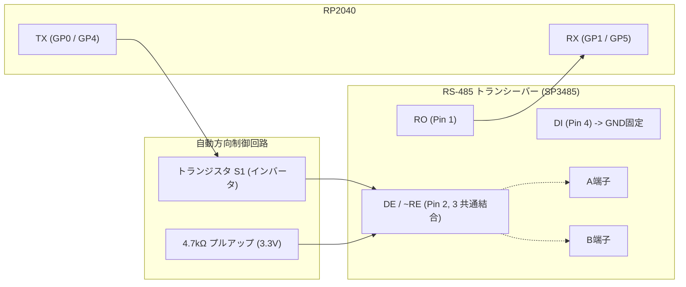

# M0: ハードウェア初期確認 & 回路解析レポート

## 1. 概要
本ドキュメントは、事前開発（Pre-development）で使用する **Raspberry Pi Pico H** および **Waveshare Pico-2CH-RS485** シールドの物理・電気的仕様の解析結果、ピンマップ、および自動方向制御回路の動作原理と LIN BREAK 適合性の評価をまとめたものである。

---

## 2. ピンアサイン & ハードウェア仕様

### 2.1 Pico ピンアサイン

| ピン番号 | 信号名 | 接続先 (Waveshare シールド) | 機能・用途 | 備考 |
| :--- | :--- | :--- | :--- | :--- |
| **Pin 1** | **GP0** | `TX_CH0` (Channel 0 TX) | UART0 TX / PIO TX | TX1 LED連動, Auto-direction駆動 |
| **Pin 2** | **GP1** | `RX_CH0` (Channel 0 RX) | UART0 RX / PIO RX | RX1 LED連動, SP3485 RO直結 |
| **Pin 3** | GND | GND | グランド | |
| **Pin 6** | **GP4** | `TX_CH1` (Channel 1 TX) | UART1 TX / PIO TX | TX2 LED連動, Auto-direction駆動 |
| **Pin 7** | **GP5** | `RX_CH1` (Channel 1 RX) | UART1 RX / PIO RX | RX2 LED連動, SP3485 RO直結 |
| **Pin 8** | GND | GND | グランド | |
| **-** | **GP25** | Pico オンボード LED | ステータスインジケータ | Pico H 基板上の緑色LED |
| **Pin 36** | 3V3(OUT) | 3.3V 電源ライン | シールド電源供給 | SP3485 (3.3V駆動) |
| **Pin 38** | GND | GND | グランド | |
| **Pin 40** | VBUS | USB 5V 電源 | USB給電モニタ等 | |

※ GP2, GP3, GP6〜GP22, GP26〜GP28 はシールド側では未使用（オープン）であり、外部ジャンパ線やロジックアナライザの接続に自由に使用可能。

### 2.2 端子台 & オンボード回路
- **CH0 端子台**: `A0`, `B0`, `GND`
- **CH1 端子台**: `A1`, `B1`, `GND`
- **終端抵抗**: 各チャンネルに 120Ω（R8, R18）が基板上に実装済
- **フェイルセーフバイアス抵抗**:
  - Aライン: 4.7kΩ で 3.3V にプルアップ（R9, R19）
  - Bライン: 4.7kΩ で GND にプルダウン（R7, R17）
- **TVSダイオード**: SMAJ12CA が各信号線と GND 間に実装（ESD/サージ保護）

---

## 3. 自動方向制御（Auto-direction）回路の動作解析

Waveshare 公式回路図（[Pico-2CH-RS485.pdf](https://www.waveshare.com/w/upload/0/02/Pico-2CH-RS485.pdf)）のネットリスト解析により、本シールドの自動方向切り替え回路の内部構成が判明した。

### 3.1 動作メカニズム（オープンコレクタ型エミュレーション）
1. **DI ピンの GND 固定**:
   - トランシーバーのドライバー入力（`DI`）は **GND（Low固定）** に配線されている。
2. **TX ピンによる DE/~RE 駆動**:
   - `DE`（送信有効：Highアクティブ）と `~RE`（受信有効：Lowアクティブ）が短絡結合されている。
   - トランジスタ $S1$ により、**TX ピンの論理レベルが反転されて DE/~RE に入力** される。

| Pico TX レベル | トランジスタ S1 | DE / ~RE 入力 | SP3485 状態 | RS-485 バス出力 | バス状態 |
| :--- | :--- | :--- | :--- | :--- | :--- |
| **High (1 / Idle)** | **ON** (GNDへ引き込み) | **Low (0)** | **ドライバー無効 (Hi-Z)** レシーバー有効 | ドライブ停止 (Hi-Z) バイアス抵抗で A>B | **Recessive High (1)** |
| **Low (0 / Space)** | **OFF** | **High (1)** (プルアップ) | **ドライバー有効** レシーバー無効 | $DI=0$ をアクティブ出力 (A=Low, B=High) | **Dominant Low (0)** |

### 3.2 LIN BREAK 適合性の評価結果
> [!IMPORTANT]
> **結論: 本シールドで LIN BREAK（長時間 Low）は完全に送出可能。**
> 
> - **RC 時定数によるタイムアウトなし**:
>   安価な一部のドングルに見られる「ワンショットタイマー（RC充放電）で一定時間後に自動で受信に戻る」回路構成ではない。
> - **完全な DC 直結制御**:
>   TX ピンを Low に固定している限り、トランジスタ S1 は OFF を維持し、DE は High にプルアップされ続けるため、**13bit 以上の Dominant Low を途切れずにアクティブドライブし続けることができる**。

### 3.3 本番基板（RPR4 rev1）との挙動差分（留意点）
1. **Recessive High の立ち上がり時間**:
   - High 送出時はアクティブドライブではなく「Hi-Z ＋ 4.7kΩ プルアップ/プルダウン」によるプル遷移となる。
   - ケーブル長が極めて長い場合や高容量負荷時には立ち上がりがわずかにナローになる可能性がある（通常の 115.2kbps〜250kbps 程度であれば問題なし）。
   - ※本番基板（`TDA51S485HC`）では GPIO による明示的な DE 制御を行うため、High も Low も完全プッシュプルドライブとなる。
2. **ローカルエコーバック**:
   - TX が Low（送信中）の期間は $DE=1, \sim RE=1$ となりレシーバーが無効化されるため、自身が送信した Low は RO（RX ピン）にはループバックされない。

---

## 4. ハードウェア初期確認手順 (Bring-up Check)

### 4.1 物理・外観チェック
- [ ] Pico H のピンヘッダ（下向き）と Waveshare シールドのソケット（上向き）がピンズレなく正常に挿入されていること。
- [ ] USB ケーブルを接続した際、シールド上の `PWR` LED（赤色）が点灯すること。

### 4.2 2CH ループバック結線
事前テスト（M2以降）をスムーズに行うため、以下の通り端子台間をジャンパ線で結線する：
- `CH0 A0`  <--->  `CH1 A1`
- `CH0 B0`  <--->  `CH1 B1`
- `CH0 GND` <--->  `CH1 GND`

---

## 5. M0 受入判定
- **ピンアサイン確定**: GP0/1 (CH0), GP4/5 (CH1), GP25 (LED) で確定。
- **回路解析完了**: Auto-direction 回路が LIN BREAK に適合することを論理的・回路構造的に証明完了。
- **判定**: **PASS (M0 完了、M1 へ移行)**

