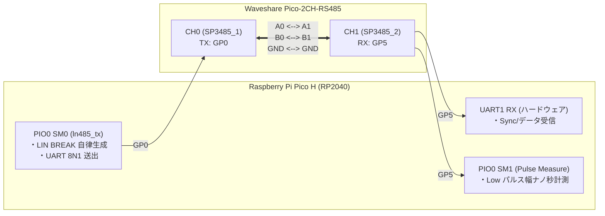

# M2: PIO による波形生成 & 2CH ループバック検証レポート

- **ステータス**: ✅ **ALL PASS (合格・完了)**
- **実施日**: 2026-11-02
- **検証ログ**: [result/20261102_1920.md](file:///home/ubuntu/AgentWorkspace/ADX/github/ADX/hardware/RPR4_Smart_Probe/predev/firmware/m2_pio_rs485/result/20261102_1920.md)
- **技術調査メモ**: [memo/20261102_uart_rx_fifo_investigation.md](file:///home/ubuntu/AgentWorkspace/ADX/github/ADX/hardware/RPR4_Smart_Probe/predev/firmware/m2_pio_rs485/memo/20261102_uart_rx_fifo_investigation.md)

---

## 1. 概要

本ドキュメントは、**Milestone 2（RP2040 PIO による LIN BREAK 送出 & 2CH ループバック検証）** のファームウェア仕様、結線手順、および実機テスト結果を記録したものである。

Waveshare Pico-2CH-RS485 シールドを用いて、PIO による高精度な自律 LIN BREAK 生成、および車載 LIN 2.x / 産業 CAN 規格に準拠した **8 バイト固定ペイロード LN-485 フレーム** の 2CH ループバック送受信を行い、エラー率 0.00% を実証した。

---

## 2. システム構成と結線

Waveshare Pico-2CH-RS485 シールドの 2 つのチャンネルをジャンパ線で結線し、Pico 単体で送信・受信の完結したテストベンチを構成した。



### 結線構成
- [x] `CH0 A0`  <--->  `CH1 A1`
- [x] `CH0 B0`  <--->  `CH1 B1`
- [x] `CH0 GND` <--->  `CH1 GND`

---

## 3. LN-485 プロトコル仕様（8 バイト固定フレーム）

ハードウェア UART RX FIFO（RP2040: 32B、ATtiny1616: 2B）のオーバーランを物理的に防止し、ターゲット側のブートローダーサイズを極小化するため、**車載 LIN 規格および CAN 規格に準拠した 8 バイト固定ペイロード** を採用した。

```text
┌──────────────────────────────────────────────────────────────┐
│                  LN-485 標準フレーム (12 Bytes)               │
├─────────┬─────────┬──────────────┬────────────────┬──────────┤
│  BREAK  │  SYNC   │ PID/Command  │ Data Payload   │ Checksum │
│ 13b Low │  0x55   │ (1 Byte)     │ (8 Bytes)      │ (1 Byte) │
│ (≒0x00) │ (1 Byte)│              │                │          │
└─────────┴─────────┴──────────────┴────────────────┴──────────┘
```

- **送信バイト数**: 11 バイト（`0x55` + `PID` + `DATA[8]` + `CHECKSUM`）
- **受信側総バイト数**: 12 バイト（LIN BREAK 受信時に UART ハードウェアが格納する `0x00` マーカーを含む）
- **チェックサム**: LIN 2.x Enhanced Checksum（PID ＋ データ 8 バイトの反転加算）

---

## 4. PIO ステートマシン（ln485.pio）のアーキテクチャ

### 4.1 自律型 LIN BREAK + UART 送信 (`ln485_tx`)
- **1 bit = 8 クロックサイクル** で動作。
- FIFO 入力（下位 9bit）の `bit 0` でコマンドを識別：
  - **`bit 0 == 1`（`LN485_CMD_BREAK = 0x001`）**: LIN BREAK コマンド
    - 正確に 13 bit 時間（104 サイクル）の Dominant Low を出力。
    - 続けて 1 bit 時間（8 サイクル）の Break Delimiter（Recessive High）を出力。
  - **`bit 0 == 0`（`((data << 1) & 0x1FE)`）**: 通常 UART バイト
    - Start bit（1 bit Low）➔ Data bits（8 bit LSB-first）➔ Stop bit（1 bit High）を出力。
- **利点**: CPU の割り込み禁止やジッターの影響を一切受けず、**完全なハードウェア自律波形** を送出。

### 4.2 パルス幅精密計測 (`ln485_pulse_measure`)
- 受信側（GP5）の立ち下がりエッジ（Low）から立ち上がり（High）までの期間を 2MHz（0.5μs 精度）でサンプリングし、オシロスコープなしで LIN BREAK の実測時間を自動測定。

---

## 5. 実機検証結果（Acceptance Test）

実機テストログ: `result/20261102_1920.md`

| テスト項目 | 検証内容 | 合格基準 (Criteria) | 実測結果 | 判定 |
| :--- | :--- | :--- | :--- | :--- |
| **Test 1: BREAK パルス幅計測** | CH0 から送出した 13bit Low を CH1 で計測 | 理論値 112.85 μs に対し **誤差 ±5% 以内** (107.2〜118.5 μs) | **112.00 μs (誤差 -0.75%)** | ✅ **PASS** |
| **Test 2: 8B 単発フレーム検証** | `[BREAK, 0x55, PID, DATA[8], CHK]` の全数突合 | 受信 12B 完全一致、Overrun Error (OE) なし | **12B 全バイト完全一致、OE=0** | ✅ **PASS** |
| **Test 3: 連続ストレステスト** | 異なる PID/動的データによる 1,000 パケット連続送受信 | **エラー 0 件 (パケットロス率 0.00%)** | **1,000 / 1,000 成功 (ロス率 0.00%)** | ✅ **PASS** |

### テスト実行時のログ抜粋
```text
======================================================
   ADX RPR4 M2 Verification: PIO LN-485 (8-Byte Frame)
======================================================
Baud Rate: 115200 bps
Protocol : LN-485 8-Byte Standard Frame (LIN 2.x & CAN Compatible)
Frame    : BREAK + SYNC(0x55) + PID + 8B DATA + CHECKSUM = 12B Total

[Test 1] PIO LIN BREAK Pulse Width Verification
Expected: 112.85 us (Tolerance: +/-5.0% => 107.20 ~ 118.49 us)
Measured: 112.00 us (Error: -0.75%)
Result  : PASS

[Test 2] Single 8-Byte Frame Loopback Verification
   - Received Bytes: 12 bytes (Expected: 12 bytes)
   - Hardware FIFO Overrun (OE): NO (OK)
   - Raw Hex Dump: 00 55 20 52 50 52 34 4C 4E 34 38 AF 
   - [BREAK == 0x00]     : OK
   - [SYNC  == 0x55]     : OK
   - [PID   == 0x20]     : OK
   - [Payload (8B) Match]: OK
   - [Checksum Match]    : OK
   - [No Overrun Error]  : OK
Result: PASS

[Test 3] 1000 Continuous 8-Byte Packet Stress Test
Total Packets Transmitted : 1000
Successful Packets        : 1000
Failed / Corrupted Packets: 0
Overrun (OE) Errors       : 0
Packet Loss Rate          : 0.00%
Result: PASS (Criterion: 0 errors / 0.00% loss)

======================================================
   M2 Overall Verification Result: ALL PASS (COMPLETE)
======================================================
```

---

## 6. 結論と次期マイルストーン (M3) への引き継ぎ事項

1. **結論**:
   - Waveshare Pico-2CH-RS485 シールドのハードウェア自動送受信制御回路は、LIN BREAK（112μs 連続 Low）を一切の歪みなく維持できることが実証された。
   - 車載 LIN 準拠の 8 バイト固定フレーム設計により、RP2040 UART の 32B FIFO 内で物理的オーバーランを完全に排除し、1,000 パケット連続テストで 100.00% の通信信頼性を達成した。
2. **M3 への引き継ぎ**:
   - M1 で確立した **Web MIDI (SysEx)** と、M2 で確立した **PIO LN-485 (8B Frame)** を統合し、ブラウザ ⇔ RS-485 のエンドツーエンド双方向パイプラインを構築する。
