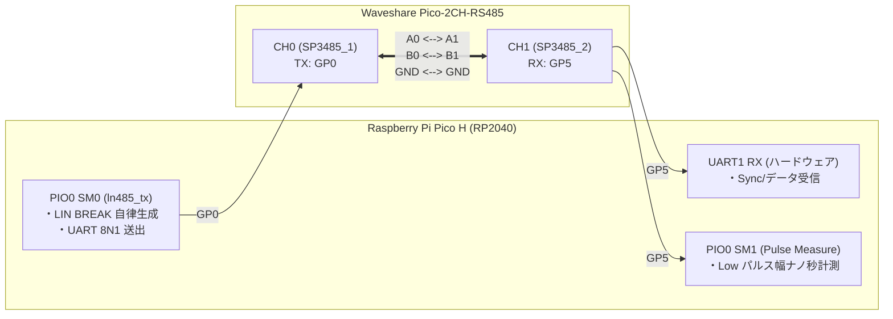

# M2: PIO による波形生成 & 2CH ループバック検証手順書

## 1. 概要
本ドキュメントは、**Milestone 2（RP2040 PIO による LIN BREAK 送出 & 2CH ループバック検証）** のファームウェア仕様、結線手順、およびテスト実行方法をまとめたものである。

---

## 2. システム構成と結線

Waveshare Pico-2CH-RS485 シールドの 2 つのチャンネルをジャンパ線で結線し、Pico 単体で送信・受信の完結したテストベンチを構成する。

### 結線確認
- [ ] `CH0 A0`  <--->  `CH1 A1`
- [ ] `CH0 B0`  <--->  `CH1 B1`
- [ ] `CH0 GND` <--->  `CH1 GND`

---

## 3. PIO ステートマシン（ln485.pio）のアーキテクチャ

### 3.1 自律型 LIN BREAK + UART 送信 (`ln485_tx`)
- **1 bit = 8 クロックサイクル** で動作。
- FIFO に送る 32bit データの下位 9bit を判定：
  - **`bit 8 == 1`（`0x100`）**: LIN BREAK コマンド
    - 正確に 13 bit 時間（104 サイクル）の Dominant Low を出力。
    - 続けて 1 bit 時間（8 サイクル）の Break Delimiter（Recessive High）を出力。
  - **`bit 8 == 0`（`0x00〜0xFF`）**: 通常 UART バイト
    - Start bit（1 bit Low）➔ Data bits（8 bit LSB-first）➔ Stop bit（1 bit High）を出力。
- **利点**:
  CPU の割り込み禁止や OS ジッターの影響を一切受けず、**ナノ秒精度の完全なハードウェア波形** を自律生成する。

### 3.2 パルス幅精密計測 (`ln485_pulse_measure`)
- 受信側（GP5）の立ち下がりエッジ（Low）から立ち上がり（High）までの期間を 2MHz（0.5μs 精度）で計測し、オシロスコープなしで LIN BREAK の実測時間を自動測定する。

---

## 4. 自動テスト項目と受入基準

| テスト項目 | 検証内容 | 合格基準 (Criteria) |
| :--- | :--- | :--- |
| **Test 1: BREAK パルス幅計測** | CH0 から送出した 13bit Low を CH1 で計測 | 理論値 112.85 μs に対し **誤差 ±5% 以内** (107〜118 μs) |
| **Test 2: フレーム送受信** | `[BREAK, 0x55(SYNC), "RPR4-...", 0]` の送受信 | 受信データが完全一致、SYNC バイト欠落なし |
| **Test 3: 連続ストレステスト** | 64B チャンク（Flash 1ページ相当）× 1,000 パケット | **エラー 0 件 (パケットロス率 0.00%)** |

---

## 5. テスト実行手順

1. **ファームウェア書き込み**:
   - Pico H の `BOOTSEL` を押しながら USB 接続。
   - [hardware/RPR4_Smart_Probe/predev/firmware/m2_pio_rs485/build/rpr4_m2_pio_rs485.uf2](file:///home/ubuntu/AgentWorkspace/ADX/github/ADX/hardware/RPR4_Smart_Probe/predev/firmware/m2_pio_rs485/build/rpr4_m2_pio_rs485.uf2) をドラッグ＆ドロップ。
2. **シリアルモニタでの確認 (任意)**:
   - TeraTerm, PuTTY, Arduino IDE シリアルモニタ等で、認識された COM ポート（115200 bps）を開く。
   - テストログがリアルタイムに出力される。
3. **LED による合否判定 (オシロ・PC 画面不要)**:
   - **全テスト合格時**: Pico H 本体の緑色 LED が **高速ピカピカ点滅（100ms 周期）** します。
   - **失敗時**: LED が **ゆっくり点滅（1000ms 周期）** します。

