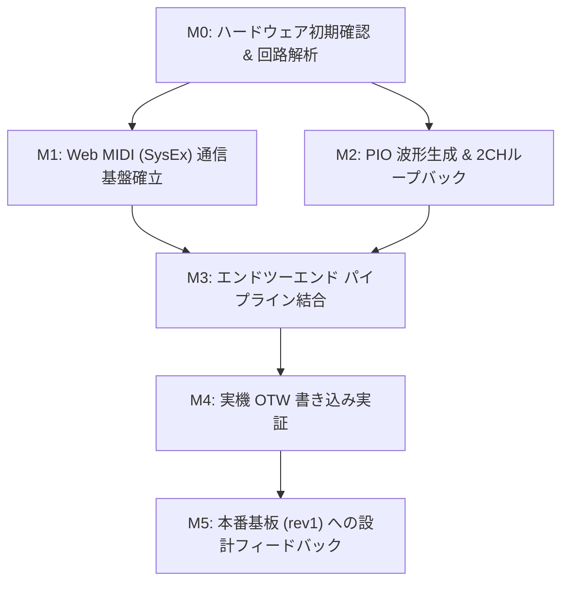

# RPR4 事前開発 実験計画書 (Pre-development Experiment Plan)

## 1. 目的とスコープ

本実験計画は、RPR4 Smart Probe 本番基板（カスタムPCBA）の開発・製造に着手する前に、市販オフザシェルフ部品を用いてプロトコルおよびハードウェア制御層の不確実性を完全に排除することを目的とする。

### 検証スコープ
1. **USB-MIDI (SysEx) 通信基盤**: Web MIDI API 経由での Android/PC ⇔ Pico の低遅延・高信頼双方向通信
2. **RP2040 PIO による波形制御**: ハードウェア UART では生成困難な LIN BREAK および高精度 LN-485 フレームの自律送出
3. **ハードウェア自動方向制御回路の影響評価**: Waveshare ボードの Auto-direction 回路と LIN BREAK 信号の整合性
4. **OTW (Over-The-Wire) スケッチ書き込みの実証**: ターゲット（ATtiny1616）への実書き込み完走と信頼性評価
5. **本番基板（RPR4 rev1）へのフィードバック**: ソフトウェア抽象レイヤー（HAL）の確立と回路設計要件の確定

---

## 2. 実験システム構成

```mermaid
flowchart LR
    subgraph Host ["ホスト環境 (Android / PC)"]
        Browser["ブラウザ (Chrome / Edge / Firefox)"]
        PWA["ADX Web ツール (PWA)"]
        WebMIDI["Web MIDI API (SysEx)"]
        PWA --> WebMIDI
    end

    subgraph PreDev ["事前開発プラットフォーム"]
        subgraph Pico ["Raspberry Pi Pico H (RP2040)"]
            TinyUSB["TinyUSB (MIDI Class)"]
            Parser["SysEx / LN-485 相互変換"]
            PIO_TX["PIO (TX / LIN BREAK)"]
            PIO_RX["PIO (RX / Sniffer)"]
            TinyUSB <--> Parser
            Parser <--> PIO_TX
            Parser <--> PIO_RX
        end

        subgraph Shield ["Waveshare Pico-2CH-RS485"]
            SP3485_0["CH0: SP3485 (GP0/GP1)"]
            SP3485_1["CH1: SP3485 (GP4/GP5)"]
            AutoDir["Auto-direction 回路"]
            PIO_TX --> AutoDir --> SP3485_0
            PIO_RX <-- SP3485_1
        end
    end

    subgraph Target ["検証ターゲット"]
        CORE_A["ADX CORE-A (ATtiny1616)"]
        Bootloader["LN-485 OTW Bootloader"]
        CORE_A --- Bootloader
    end

    WebMIDI <== "USB (Type-C / OTG)" ==> TinyUSB
    SP3485_0 <== "RS-485 バス" ==> SP3485_1
    SP3485_0 -. "実機検証時" .-> CORE_A
```

### 機材リスト
- **マイコンボード**: Raspberry Pi Pico H（ピンヘッダ実装済、Debug SWDピン付き）
- **RS-485シールド**: Waveshare Pico-2CH-RS485（SP3485 2系統、自動送受信方向制御）
- **接続ホスト**:
  - Android スマートフォン（OTG ケーブル / Chrome）
  - PC（Windows / Mac / Linux, Chrome / Firefox）
- **ターゲット（後半フェーズ）**: ADX CORE-A（または ATtiny1616 搭載テストボード）
- **計測器**: オシロスコープ / ロジックアナライザ（波形・タイミング検証用）

---

## 3. 実験マイルストーンと得るべき結果



---

### Milestone 0: ハードウェア初期確認 & 回路解析 (Bring-up)
- **目的**: 入手したモジュールの物理・電気仕様を確認し、特に自動方向制御回路の挙動特性を把握する。
- **実施内容**:
  1. Pico H と Waveshare シールドの嵌合、電源（VBUS / VSYS / 3V3）供給ラインの確認。
  2. Waveshare 回路図の解析（TX ピンからトランシーバー DE/~RE までのトランジスタ・時定数回路の確認）。
  3. LED（GP25）および CH0/CH1 の GPIO 疎通確認。
- **得るべき結果 (Acceptance Criteria)**:
  - [ ] ピンアサイン仕様シートの確定（GP0/1: CH0, GP4/5: CH1, GP25: LED）。
  - [ ] Auto-direction 回路の動作原理（TX Low 時のドライブ時間、ディレイ）の把握と、LIN BREAK への影響予測レポート。

---

### Milestone 1: Web MIDI (SysEx) 通信基盤の確立
- **目的**: Android スマホおよび PC ブラウザからドライバ不要で安定したパケット送受信が行えることを実証する。
- **実施内容**:
  1. Pico SDK + TinyUSB (`CFG_TUD_MIDI = 1`) による USB-MIDI ファームウェア構築。
  2. ブラウザ側 PWA テストツールの作成（`navigator.requestMIDIAccess({ sysex: true })`）。
  3. 7-to-8 パッキング / アンパッキング処理の実装。
  4. 双方向エコーバックテストによるスループットおよびレイテンシの測定。
- **得るべき結果 (Acceptance Criteria)**:
  - [ ] Android Chrome および PC（Chrome/Edge/Firefox）でプラグ＆プレイ認識されること（ドライバ不要）。
  - [ ] SysEx エコーバック（16KB データ転送）でパケット欠落・データ化け 0%。
  - [ ] 実効転送速度とレイテンシの計測データ取得（目標: 20KB/s 以上、16KB を 1秒以内で転送完了）。

---

### Milestone 2: PIO による RS-485 波形生成 & 2CH ループバック検証
- **目的**: RP2040 PIO を用いて LIN BREAK および LN-485 パケットを精密に生成・受信し、シールドの 2CH を使って単体検証する。
- **実施内容**:
  1. PIO 送信ステートマシンの実装（13bit以上の Dominant Low 送出 ＋ Break Delimiter ＋ UART 送出）。
  2. 車載 LIN / CAN 準拠の 8 バイト固定ペイロード LN-485 フレーム定義（全体 12 バイト）。
  3. CH0（送信）と CH1（受信）を A0-A1, B0-B1 で直結し、ループバック送受信テスト。
  4. パルス計測 PIO による LIN BREAK 波形観測（実測パルス幅 112.00 μs、誤差 -0.75% で合格）。
- **得るべき結果 (Acceptance Criteria)**:
  - [x] パルス計測 PIO にて、規定通り 13bit の Dominant Low（理論値 112.85 μs に対し 実測 112.00 μs、誤差 -0.75%）が維持されていることの確認。
  - [x] CH0 送出 → CH1 受信のループバックテストで、連続 1,000 パケット送信時にエラー率 0.00%（パケットロス 0 件）。
  - [x] ハードウェア UART RX FIFO（32B）のオーバーラン（OE）が 0 件であることを確認。
- **詳細レポート**: [M2_pio_verification.md](M2_pio_verification.md) / [技術調査メモ](firmware/m2_pio_rs485/memo/20261102_uart_rx_fifo_investigation.md) / [実機ログ](firmware/m2_pio_rs485/result/20261102_1920.md)

---

### Milestone 3: エンドツーエンド パイプライン結合
- **目的**: Web PWA ⇔ SysEx ⇔ Pico (RP2040) ⇔ RS-485 ⇔ ターゲット模擬 の全経路を結合する。
- **実施内容**:
  1. ブラウザから「LIN BREAK 送出コマンド」および「データ送信コマンド」を SysEx で発行。
  2. Pico が受信した SysEx をデコードし、CH0 から RS-485 バスへ送出。
  3. CH1 で受信したバス上の応答信号を Pico が SysEx にエンコードし、ブラウザへ返送。
- **得るべき結果 (Acceptance Criteria)**:
  - [ ] ブラウザの UI ボタン押下から RS-485 バスへの信号送出・返送までが一連のシーケンスとして動作すること。
  - [ ] 送受信バッファのオーバーフローや USB ストールが発生しないこと（ストレステスト）。

---

### Milestone 4: 実機 OTW スケッチ書き込み実証
- **目的**: 実際の ADX CORE-A（ATtiny1616）と接続し、Web PWA から現場での書き込み UX を実証する。
- **実施内容**:
  1. Pico CH0 端子台と ADX CORE-A の RS-485 端子（A, B, GND）を結線。
  2. Android スマホ（または PC）の PWA から、コンパイル済み HEX バイナリ（Lチカ等）の書き込みを実行。
  3. ページ（64バイト）ごとの「書き込み → ACK 受信」プロトコルの同期検証。
  4. 動作中からの強制書き込み（LIN BREAK によるリセット・ブートローダ復旧）の確認。
- **得るべき結果 (Acceptance Criteria)**:
  - [ ] Android スマホ＋OTG ケーブルのみで、外部電源なし（または給電あり）環境からスケッチ書き換えが成功すること。
  - [ ] 連続 20 回の書き込みテストで成功率 100%。
  - [ ] 不正パケット混入や途絶時のタイムアウト・リトライ処理が意図通りフェイルセーフに動作すること。

---

### Milestone 5: 本番基板 (RPR4 rev1) への設計フィードバック
- **目的**: 実験で得られた知見を、カスタム基板の設計および量産ファームウェアに反映する。
- **実施内容**:
  1. **ハードウェア差異の吸収レイヤー（HAL）整理**:
     - Waveshare（Auto-direction 自動制御） vs 本番基板（`TDA51S485HC` 明示的 DE/~RE GPIO 制御）。
     - 本番基板用の DE 制御コードの事前組み込みとピン定義のモジュール化。
  2. **ハードウェア設計レビュー**:
     - 終端抵抗（120Ω）のスイッチング要否、ESD 保護素子、インジケータ LED の視認性などのフィードバック。
  3. **開発ドキュメント・量産手順の整理**:
     - Crowd Supply 向けファームウェア書き込み・テストスクリプトの基礎作成。
- **得るべき結果 (Acceptance Criteria)**:
  - [ ] RPR4 rev1 回路図・アートワークの最終 FIX（JLCPCB PCBA 発注可能状態）。
  - [ ] 本番基板到着後、ピン定義の切り替えのみで即日稼働できるファームウェアコードベースの完成。

---

## 4. 進捗管理表

| Milestone | 内容 | 予定時期 / ステータス | 判定 |
| :--- | :--- | :--- | :--- |
| **M0** | ハードウェア初期確認 & 回路解析 | **完了** ([M0_hardware_bringup.md](M0_hardware_bringup.md)) | ✅ PASS |
| **M1** | Web MIDI (SysEx) 通信基盤確立 | **完了** ([M1_web_midi_setup.md](M1_web_midi_setup.md)) | ✅ PASS (実測 31〜50 KB/s) |
| **M2** | PIO 波形生成 & 2CH ループバック | **完了** ([M2_pio_verification.md](M2_pio_verification.md)) | ✅ PASS (1,000 pkt / ロス 0.00%) |
| **M3** | エンドツーエンド パイプライン結合 | 未着手 (次回着手予定) | ⬜ |
| **M4** | 実機 OTW 書き込み実証 | 未着手 | ⬜ |
| **M5** | 本番基板 (rev1) へのフィードバック | 未着手 | ⬜ |

