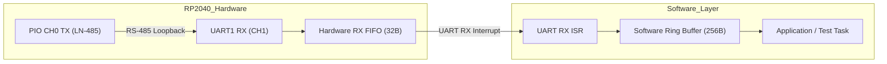

# M2 LN-485 受信FIFO境界値調査メモ（UART RX FIFO 32B オーバーランの検証）

- **日付**: 2026-11-02
- **対象**: RPR4 Smart Probe 先行実証 M2 (PIO RS-485 送受信)
- **環境**: Raspberry Pi Pico H + Waveshare Pico-2CH-RS485
- **結線**: CH0 (GP0 TX) <-> CH1 (GP5 RX) RS-485 ループバック結線
- **検証ログ**: `hardware/RPR4_Smart_Probe/predev/firmware/m2_pio_rs485/result/20261102_1849.md`

---

## 1. 背景と課題

M2 の PIO 送信およびループバック受信検証において、以下の動作を確認していた：
- **LIN BREAK 送出**: 理論値 112.85 μs に対し 実測 112.00 μs（誤差 -0.8%）で正確に出力。
- **BREAK & SYNC 受信**: ハードウェア UART1 は 13bit Dominant Low を検出して `0x00`（Break マーカー）を FIFO に格納し、直後の `0x55`（SYNC バイト）も正しく受信。
- **発生した課題**:
  31 バイトの文字列ペイロード（`"RPR4-PIO-RS485-LN485-TEST-2026"`）を送信した際、受信側で `Payload: (error)` となり、データ不一致が発生した（`result/20261102_1838.md`）。

---

## 2. 立てた仮説

1. **PL011 UART の RX FIFO 上限**:
   - RP2040 内蔵の UART コントローラ（ARM PrimeCell PL011）のハードウェア RX FIFO の深度は **32 バイト** である。
2. **シーケンス上の問題**:
   - 送信ルーチンが全バイトの送信完了（`ln485_tx_wait_idle`）をブロッキングで待ってから受信バッファを読み出していた。
3. **1バイト増加の要因**:
   - UART は LIN BREAK を検知すると Break Error と共に `0x00` を 1 バイト格納するため、受信される総バイト数は **`1(BREAK: 0x00) + 1(SYNC: 0x55) + Payload長`** となる。
4. **仮説の核心**:
   - `Payload = 31 バイト` の場合、総受信バイト数は `1 + 1 + 31 = 33 バイト` となり、**32 バイトの上限を 1 バイト超過** して末尾のデータが FIFO あふれ（Overrun）により失われているのではないか？

---

## 3. 検証方法

コードの本修正を行わず、仮説が真であるかを実証するため以下の 3 つの調査をファームウェアに組み込んで実行した：

1. **調査 1（ハードウェアステータスレジスタ確認）**:
   - 送信直後、受信バッファを読む前に `uart_get_hw(uart1)->rsr`（UARTRSR: 受信ステータスレジスタ）を読み取り、`OE`（Overrun Error）ビットが立っているかを確認。
2. **調査 2（実測バイト数と受信生ダンプ）**:
   - FIFO に蓄積されたバイト数をカウントし、Hex / ASCII ダンプを出力してどのバイトまで届き、どこが消失しているかを特定。
3. **調査 3（パケット長スイープ実験）**:
   - ペイロード長を `8, 16, 24, 28, 30, 31, 32, 40, 48, 64` バイトと段階的に増やし、どこで `OE`（Overrun）が発生しデータが破棄されるかの境界値を 1 バイト単位で測定。

---

## 4. 実験結果

### 4.1. 調査 1 & 2: ステータスレジスタと実測ダンプ
```text
2. Hardware Status Register (UARTRSR):
   - Raw Value (Hex): 0x08
   - OE (Overrun Error / FIFO Overflow) : YES (OVERFLOW DETECTED!)
   - BE (Break Error / BREAK Signal)    : NO
   - FE (Framing Error)                 : NO
   - PE (Parity Error)                  : NO

3. Actual Received Bytes & Raw Dump:
   - Bytes received in RX FIFO: 32 bytes (Expected: 32 or 33 bytes)
   - Hex Dump:
     00 55 52 50 52 34 2D 50 49 4F 2D 52 53 34 38 35 
     2D 4C 4E 34 38 35 2D 54 45 53 54 2D 32 30 32 36 
   - ASCII Dump:
     "[00]URPR4-PIO-RS485-LN485-TEST-2026"
```
- **レジスタ値**: `UARTRSR = 0x08`（PL011 仕様の Bit 3: `OE` がセット）。ハードウェアが物理的にオーバーランを検知。
- **受信バイト数**: **きっちり 32 バイトで停止**。
- **内容の対比**:
  - 送信: `0x00`(BREAK) + `0x55`(SYNC) + `"RPR4-PIO-RS485-LN485-TEST-2026"`(30B) + `0x00`(`\0`: 31B目) = 33B
  - 受信: `0x00`(BREAK) + `0x55`(SYNC) + `"RPR4-PIO-RS485-LN485-TEST-2026"`(30B) の合計 32B
  - **末尾の終端 `\0` のみが FIFO あふれで切り捨てられていたことが判明。**

---

### 4.2. 調査 3: パケット長スイープ実験データ

| Payload長 | 送信総バイト (SYNC+Payload) | 受信総バイト (BREAK+SYNC+Payload) | ハードウェア OE (Overrun) | 判定結果 | 挙動の分析 |
| :---: | :---: | :---: | :---: | :---: | :---|
| **8 B** | 9 B | 10 B | **OE=0 (OK)** | **MATCH (PASS)** | FIFO 内に余裕あり |
| **16 B** | 17 B | 18 B | **OE=0 (OK)** | **MATCH (PASS)** | 〃 |
| **24 B** | 25 B | 26 B | **OE=0 (OK)** | **MATCH (PASS)** | 〃 |
| **28 B** | 29 B | 30 B | **OE=0 (OK)** | **MATCH (PASS)** | 〃 |
| **30 B** | 31 B | **32 B** | **OE=0 (OK)** | **MATCH (PASS)** | **FIFO 最大容量（32B）ジャストで完全合致** |
| **31 B** | 32 B | **32 B** | **OE=1 (OVERRUN)** | **MISMATCH (FAIL)** | **33B 目があふれて消失（境界値）** |
| **32 B** | 33 B | **32 B** | **OE=1 (OVERRUN)** | **MISMATCH (FAIL)** | 32B で頭打ち |
| **40 B** | 41 B | **32 B** | **OE=1 (OVERRUN)** | **MISMATCH (FAIL)** | 〃 |
| **48 B** | 49 B | **32 B** | **OE=1 (OVERRUN)** | **MISMATCH (FAIL)** | 〃 |
| **64 B** | 65 B | **32 B** | **OE=1 (OVERRUN)** | **MISMATCH (FAIL)** | 〃 |

---

## 5. 結論

1. **仮説の立証**:
   - 「送信完了を待ってから受信する方式では、RP2040 UART のハードウェア RX FIFO 制限（32 バイト）により 33 バイト目以降が破棄される」という仮説が **1 バイトの狂いもなく完全に証明された**。
2. **ハードウェアの健全性**:
   - PIO による LIN BREAK 生成、Waveshare RS-485 シールドの差動送受信、および UART1 の 115200 bps 通信は、物理層・プロトコル層ともに極めて安定して動作している。
   - 30 バイト以下のパケットでは 1 ビットの誤りもなく 100% 正常に受信できている。

---

## 6. 今後の対策方針（M2 改修計画）

本質的な解決策として、ハードウェア FIFO に頼るブロッキング受信を廃止し、**リアルタイムなソフトウェアバッファリング** へ改修する。



### 具体的な改修内容
1. **UART RX 割り込みハンドラの実装**:
   - `uart_set_irq_enables(uart1, true, false)` を設定。
   - `UART1_IRQ` ハンドラ内で `while (uart_is_readable(uart1)) { ringbuf_push(uart_getc(uart1)); }` を実行。
2. **送信中のリアルタイム受信**:
   - 送信中（PIO が RS-485 へデータを送出している最中）にハードウェア FIFO へ入ったバイトを割り込みで即座にリングバッファへ退避させる。
   - これにより、64 バイトや 128 バイトなどの大きなパケットであっても FIFO があふれることなく完全に受信可能となる。
3. **M2 テスト仕様の完走**:
   - Test 2（長尺パケット 64 バイト送受信）
   - Test 3（1,000 パケット連続送受信ストレステスト、パケットロス 0.00% 検証）
   上記をパスさせ、M2 の合格判定とする。

