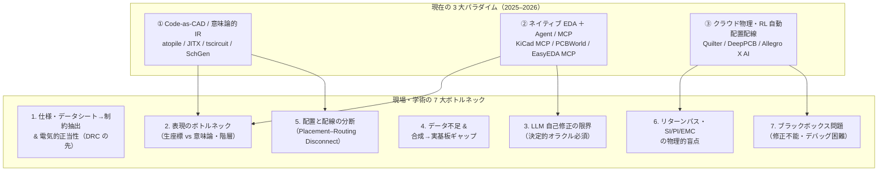

<!--
Copyright (c) 2026 ADX Project Contributors
SPDX-License-Identifier: CC-BY-4.0
-->

# AI 主導回路・PCB 設計 プリレビュー（スコーピング調査レポート）

〜 **世界の議論の全体像を俯瞰し、`UNOMODOKI R3` で抽出した課題の妥当性と盲点を検証する** 〜

- **作成日**: 2026-11-28
- **位置づけ**: ADX 内部 R&D・技術選定特化サーベイ（位置づけ B）の **Phase 0.5（プリレビュー／スコーピング調査）**
- **起点ドキュメント**:
  - [UNOMODOKI R3 プロジェクト総合レポート](../cloning/UNOMODOKI_R3/report/unomodoki_r3_project_report.md)
  - [UNOMODOKI R3 振り返り＆知見集](../cloning/UNOMODOKI_R3/lessons_learned.md)
  - ADX 本丸ターゲット: [ADX CORE-U rev6 技術仕様書](../../CORE-U/rev6/spec.md)

---

## エグゼクティブサマリー（プリレビューの結論）

本調査は、`UNOMODOKI R3` の振り返りで設定した独自課題（マッス階層設計、Courtyard 抽出、磁石ポテンシャル場／非 45° 配線、配線不可能性、GND ビア意味論）へいきなり深掘りする前に、**「そもそも世界の学術研究・OSS・商用ツール・実務エンジニアの現場では、AI 回路・PCB 設計の何が本質的な論点として議論されているのか」** をバイアスなしで俯瞰したものである。

### 得られた 4 つの重要な気づき

1. **「DRC 0 ≠ 電気的に動作する」が 2025〜2026 年の最大論点だった（ADX の盲点）**
   - `HWE-Bench (2026)` では最新 LLM でもゼロからの基板レベル回路図設計成功率が約 `8.15%` に留まる一方、`PCBSchemaGen (2026)` はデータシート由来の知識スキーマ＋決定的検証器により `81%` 超へ跳ね上げている。
   - `UNOMODOKI R3` は「お手本（Arduino UNO R3）」が存在し、かつデジタル検証（DRC/ネットリスト）止まりだったため顕在化しなかったが、新規設計（`CORE-U rev6` 等）では **「要件・データシート → 制約形式化 → SPICE/熱/SI/リターンパス検証」** が最優先ボトルネックになる。
2. **「45° vs 90° vs 曲線配線」の問いは、電気物理ではなく「配線収容・アルゴリズム」へ再定義すべき**
   - SI 権威（Howard Johnson / Eric Bogatin 等）の定説どおり、数十 GHz 級でない一般デジタル／電源基板（10〜16 MHz、USB Full-Speed 等）では **「90° 角による反射・EMI・酸トラップ」は事実上神話** である。
   - 一方で **トポロジカル／ゴム紐配線（TopoR 等）や任意角配線** の真の価値は「電気的魔法」ではなく、**グリッド制約を排した高密度配線収容率・配線長短縮・ビア削減** にある。電気的品質の本丸は角の形状ではなく **リターンパス連続性・GND プレーン・デカップリング配置（＝課題 5）** にある。
3. **世界の潮流は「表現の抽象化（Code/IR）」×「実 EDA エンジン＋決定的検証器（MCP/API）」の融合へ収束しつつある**
   - 生座標を LLM に直接いじらせるアプローチは失敗しやすく（`PCBWorld`, `SchGen`）、逆にブラックボックス型クラウド AI（Quilter / DeepPCB）は「EMC や熱で落ちたとき直せない」と現場から強い警戒を受けている。
   - **「意味論的な中間表現／階層（マッス）＋ 決定的アルゴリズム／既存ルーター ＋ 実 EDA エンジン（DRC オラクル）」** という構成が、ADX が目指す修正可能性・レビュー可能性と完全に合致する。
4. **PCB 分野は「データ不足（Data Scarcity）」が深刻であり、ADX は「非学習・ハイブリッド路線」を採るべき**
   - 公開 PCB データは単純な 2 層ホビー基板に偏っており、高品質な実務基板データは非公開。小規模 R&D チームが独自 RL/ML モデルをゼロ訓練するより、**LLM（計画・制約・意味論）× 決定的計算幾何・既存ルーター × 厳格検証ループ** に投資する方が圧倒的に合理的である。

---

## 第 1 章：世界の AI 回路・PCB 設計の全体マップ（2024–2026）

現在のエコシステムと議論は、大きく **3 つの実装パラダイム** と **7 つの主要論点** に整理できる。

### 1.1 3 大パラダイムの現在地と現場の評価

| パラダイム | 代表例 | 強み | 現場・研究で指摘されている限界 |
| :--- | :--- | :--- | :--- |
| **① Code-as-CAD / 意味論的 IR** | `atopile`, `JITX`, `tscircuit`, `SchGen` | Git 管理・モジュール再利用・LLM とのテキスト親和性が高い。回路ブロックの横展開に強い。 | 「箸で水を飲むよう（Reddit 評）」と言われる学習曲線。物理配置や微修正をコードへ逆反映する体験が未成熟。 |
| **② ネイティブ EDA ＋ MCP / Agent** | KiCad MCP 群, `PCBWorld`, **ADX（EasyEDA Pro MCP）** | 既存 EDA の厳格な DRC/ERC・製造出力・部品ライブラリをそのまま SSOT として使える。ベンダーロックイン回避。 | 中間抽象化なしに生座標を LLM が操作すると、微小セグメント乱造・DRC 修正無限ループ・全体作り直し地獄に陥る。 |
| **③ クラウド物理・RL 自動配置配線** | `Quilter`, `DeepPCB`, `Cadence Allegro X AI` | 高密度デジタルのファンアウトや単純配線の省力化に強い。Quilter は物理シミュレーション連動で高評価。 | **ブラックボックス問題**（EMC/熱で落ちた際、人間が原因調査・部分修正できない）。事前制約が不完全だと誤りを忠実に配線する。DeepPCB はアナログ混載やビア過多で厳しい評価（EEVblog 等）。 |

### 1.2 学術・現場で支配的な 7 つの議論

1. **「Parseable / DRC 0 ≠ Electrically Functional」問題**
   - 形式的に正しく DRC も通るが、電気的・物理的に壊れている基板（ピン誤読、絶対最大定格違反、デカップリング不足、熱破綻、リターンパス分断）をどう防ぐか。
   - ソフトウェアと違い「97% 正しい PCB ＝ 完全に動かない死んだ基板＋再試作コスト」という非対称性が、エンドツーエンド完全自動化への最大の障壁となっている。
2. **「表現のボトルネック（Representation Bottleneck）」**
   - `SchGen (2026)` や `PCBSchemaGen (2026)` が示すように、生の CAD 座標や冗長なネットリストを直接 LLM に生成させると破綻する。**意味論的コード・相対配置・ピン名ベース結線・IC データシート知識グラフ** などの中間表現が急浮上している。
3. **「決定的検証器（Deterministic Guardrails）必須論」**
   - `PCBSchemaGen` や `CircuitLM` 比較、および `PCBWorld` の知見として、純粋な LLM 自己レビューやマルチエージェントの対話ループはハルシネーションと無限修正ループを起こす。**「生成・計画＝LLM」「真偽判定＝決定的チェッカー（ERC/DRC/ネットリスト/SPICE/幾何検証）」** の明確な役割分担がコンセンサスになりつつある。
4. **「データ不足（Data Scarcity）＆ Sim-to-Real ギャップ」**
   - `Srinivasan et al. (2026)` や `PCBWorld (2026)` が指摘する通り、実務レベルの多層・混載 PCB は企業秘密であり公開データセットが極端に少ない。合成データで訓練した RL エージェントは、不規則外形や高密度実基板で性能が急落する。
5. **「配置と配線の分断（Placement–Routing Disconnect）」**
   - 現場の鉄則「PCB 設計の 8〜9 割は部品配置で決まる」に対し、従来の自動ルーター（DeepPCB / FreeRouting 等）は配置を固定前提とするため、配置ミスによる配線不能を救えない。
   - 学術側では、主要 IC を核に周辺部品を配置する **Component-Centric 配置（`PCBAgent`, ASP-DAC 2025）** や、配線長・混雑度を報酬に組み込む **RL 配置（`RL_PCB`, DATE 2024）**、および **力学的配置（Force-Directed）＋ トポロジカル配線（TopoR）** による協調最適化が議論されている。
6. **「リターンパス・SI/PI/EMC の物理的盲点」**
   - 多くの AI/オートルーターは「ピン A〜B を最短で幾何接続する」ことしか最適化しない。しかし実務の電磁界（Maxwell 方程式）では、高周波リターン電流が隣接基準プレーンを流れるため、**プレーン分断跨ぎ・ボイド通過・リターンビア欠如** が EMI/SI 破綻の主因となる。
   - 商業上位ツール（Cadence Sigrity/Allegro X 等）では、**データシートからの自動制約抽出 → サロゲートモデルによる高速 SI/PI 予測 → パターン認識による EMC 異常検知（プレーン分断跨ぎ等）** の「シフトレフト検証」が進んでいる。
7. **「エコシステムの KiCad 集中 ＆ 高速ルーターの復権」**
   - 2025〜2026 年の学術ベンチマーク（`PCBWorld`）や OSS（`atopile`, `OrthoRoute`, KiCad MCP 群）は圧倒的に **KiCad** を基盤としている。
   - また配線エンジン単体では、純粋な RL より **GPU 並列化された古典・探索アルゴリズム（例：KiCad 向け `OrthoRoute`）** や **商用トポロジカルルーター（`TopoR`）**、および汎用 `.dsn/.ses`（`FreeRouting`）が依然として高い実戦力を持つ。

---

## 第 2 章：プリレビューで確認した主要一次ソース（暫定インデックス）

※ 本章はプリレビュー段階で Web 一次確認した主要文献・ツール群のインデックスである。本調査フェーズで精読・詳細検証を行う土台とする。

### 2.1 学術サーベイ・ベンチマーク・主要論文（2024–2026）

| 区分 | 名称 / タイトル | 著者・発表年 / 会議・ID | プリレビューで確認した核心知見 |
| :--- | :--- | :--- | :--- |
| **総合サーベイ** | *Surveying GenAI-based Automation in Printed Circuit Board Design and Test* | S. Srinivasan, B. Turnbull, H. Pearce (2026, [arXiv:2606.17074](https://arxiv.org/abs/2606.17074)) | VLSI ではなく **PCB ライフサイクル全体**（仕様→回路図→配置配線→製造→実装→テスト）を対象とした体系的サーベイ。文脈長限界・データ不足・EDA 統合不足・セキュリティ欠如を 4 大課題として整理。 |
| **総合サーベイ** | *A Survey of Research in Large Language Models for Electronic Design Automation* | Pan et al. (2025–2026, ACM TODAES / arXiv) | EDA 全体における LLM 活用（テキスト・グラフ・視覚のマルチモーダル統合）を整理。 |
| **配線環境＆ベンチマーク** | *PCBWorld: A Benchmark Environment for Engine-Grounded PCB Design Automation* | H. Song et al. / LG AI Research (2026, [arXiv:2607.05915](https://arxiv.org/abs/2607.05915)) | KiCad エンジン直結のオープンソース配線環境＋679 実基板ベンチマーク（`PCBWorld-Bench`）。8 種の厳格 DRC 評価指標を導入。グリッド行動の限界、DRC 無限ループ、合成→実基板ギャップを実証。 |
| **配置配線ベンチマーク** | *PCB-Bench: Benchmarking LLMs for Printed Circuit Board Placement and Routing* | J. Li et al. (ICLR 2026, OpenReview: `Q5QLu7XTWx`) | テキスト推論 ~3,700 問、画像・テキスト ~500 問、実基板 170+ プロジェクトで LLM/VLM を評価。多層連続性・ビア判別・微細配線推論で最先端モデルも高失敗率。 |
| **回路図ベンチマーク** | *HWE-Bench: Can Language Models Perform Board-level Schematic Designs?* | (2026, arXiv) | 実 IC データシート約 3,000 件＋300 タスクで ERC ＋動的シミュレーション評価。ベースライン LLM の合格率は約 **8.15%** に留まり、物理的直感の欠如が露呈。 |
| **理解ベンチマーク** | *PCB-QA: Evaluating LLMs over the First Printed Circuit Board Design Q&A Dataset* | (2026, arXiv) | 8 OSS 基板由来の 480 Q&A で回路図・ネットリスト・SPICE 理解度を評価。 |
| **回路図生成（IR）** | *SchGen: PCB Schematic Generation with Semantic-Grounded Code Representations* | Q. Luo, R. Ma, X. Zhang, L. Qiu (2026, [arXiv:2605.30345](https://arxiv.org/abs/2605.30345)) | 座標依存の生フォーマットを排し、**相対配置＋ピン名結線の意味論的コード表現**を導入して接続正確性を大幅改善。 |
| **回路図生成（検証）** | *PCBSchemaGen: Constraint-Guided Schematic Design via LLM for PCBs* | (2026, arXiv) | 学習なし（Training-free）で IC データシート由来のスキーマ／知識グラフ＋**決定的 5 層検証器**＋Thompson Sampling により 81% 超の合格率を達成。 |
| **回路図生成（MA）** | *CircuitLM: A Multi-Agent LLM-Aided Design Framework for Generating Circuit Schematics* | K. S. Al Hasan et al. (2026, [arXiv:2601.04505](https://arxiv.org/abs/2601.04505)) | 部品選定・ピンアウト取得・`CircuitJSON`・検証のマルチエージェント構成。ただし決定的構造検証なしではハルシネーション耐性に課題。 |
| **RL 配置** | *Learning Circuit Placement Techniques Through RL with Adaptive Rewards (`RL_PCB`)* | L. Vassallo, J. Bajada (DATE 2024, GitHub: `LukeVassallo/RL_PCB`) | PCB 配置を MDP として定式化し、配線長・混雑度ペナルティの適応報酬で Simulated Annealing を上回る短縮を実証。 |
| **階層・核配置** | *PCBAgent: An Agent-based Framework for High-Density PCB Placement* | L. Chen et al. (ASP-DAC 2025, DOI: `10.1145/3658617.3697736`) | 主要 IC（MCU/PMIC 等）周辺へ探索空間を構造化する **Component-Centric** 配置により、人間に近い高密度配置を高速達成。 |

### 2.2 ツール・アルゴリズム・物理一次知見

| 領域 | 代表ツール / 権威 | 要点 |
| :--- | :--- | :--- |
| **Code-as-CAD** | `atopile`, `JITX`, `tscircuit` | テキスト／コード駆動でモジュール再利用・LLM 親和性を獲得。ただし物理レイアウト編集 UX に課題。 |
| **商用 AI 配置配線** | `Quilter`, `DeepPCB`, `Flux`, `Cadence Allegro X AI` | Quilter＝物理駆動で高密度デジタルに強いが高価・閉鎖的。DeepPCB＝RL 配線だがアナログ・ビア品質に現場批判あり。 |
| **トポロジカル／高速ルーター** | `TopoR`（Eremex）, `FreeRouting`, `OrthoRoute` | `TopoR` はゴム紐トポロジカル＋任意角配線の商用基準。`FreeRouting` は DSN/SES で EasyEDA とも接続可能。`OrthoRoute` は GPU 並列 PathFinder で桁違いの高速化を実現。 |
| **SI / 配線角度の物理** | Dr. Howard Johnson, Dr. Eric Bogatin | 90° 角の過剰容量は `~0.01–0.02 pF`（遅延 `~0.5 ps`）であり、数十 GHz 未満では電気的に透明。90° 酸トラップも現代エッチングでは神話（鋭角 `<90°` のみ有害）。**真の敵はリターンパス分断・デカップリング・スタブ**。 |

---

## 第 3 章：`UNOMODOKI R3` の当初仮説に対するストレステスト（妥当性診断）

プリレビューの結果に照らし合わせ、当初立てた課題 2〜5 および暗黙の前提を批判的に仕分けした。

| 当初想定していた要素 | 判定 | プリレビューを踏まえた診断・軌道修正 |
| :--- | :---: | :--- |
| **課題 2：3 階層「マッス（塊）」設計と修正可能性** | **◎ 的中・中核テーマ** | 世界でも「表現のボトルネック（`SchGen`, `atopile`, `JITX`）」「Component-Centric 配置（`PCBAgent`）」「ブラックボックス修正不能問題」として最重要論点。**配線だけでなく「回路図〜制約〜配置〜配線を貫く中間表現（IR）＋部分ロック」** として設計すべき。 |
| **課題 3：Courtyard 抽出・部品間クリアランス** | **○ 実装課題へ降格** | 学術的な未解決テーマではなく **IPC-7351B 標準＋DFM ルール実装** の領域。サーベイ論文で紙幅を割くより、標準マージン表と EasyEDA API の抽出検証（短期エンジニアリングタスク）へ切り出すのが合理的。 |
| **課題 4-1：磁石ポテンシャル場・力学的配置配線** | **◎ 有望・既知系譜へ接続** | 独自発想に見えるが、計算幾何学・EDA では **Force-Directed Placement** ＋ **Topological / Rubber-band Routing（`TopoR` 系譜）** に直結する。先行アルゴリズムの構造・失敗例を押さえた上で「EasyEDA 上で軽く組める力学／グラフ配置＋既存ルーター連携」へ落とすのが賢明。 |
| **課題 4-2：「45° ルール」再検討・曲線配線** | **△ 問いを再定義** | **「SI/EMI や酸トラップのために曲線にする」という仮説は一般デジタル帯域（`CORE-U rev6` 含む）では根拠薄**。調査ターゲットを「電気的優位」から **「トポロジカル／任意角配線による配線収容率・ビア削減・JLCPCB/EasyEDA の幾何対応可否」** へ狭く鋭く再定義すべき。 |
| **課題 4-3：配線不可能性（Unroutability）→ 配置フィードバック** | **◎ 最重要の本丸** | 業界最大の痛点 **Placement–Routing Disconnect** そのもの。混雑度推定・グラフ平面性／交差数最小化・回転／再配置ループは、AI 主導 PCB 開発の実用化を左右する核心課題。 |
| **課題 5：GND ビア配置の意味論・レビュー可能性** | **◎ 業界の盲点に刺さる本丸** | 現場が AI 基板を拒絶する最大要因 **「Return Path Blindspot（リターンパス・プレーン連続性無視）」** と **「説明可能性の欠如」** に真っ正面から応えるテーマ。電気物理ルール（ビアフェンス・リターンビア）と人間向け可視化を統合する価値は極めて高い。 |
| **【🆕 盲点 ①】仕様・データシート → 制約抽出 ＆ 電気的正当性検証（DRC の先）** | **🚨 新規追加（最優先級）** | `UNOMODOKI R3` はお手本あり＆実機なしだったため見落としていたが、`CORE-U rev6`（eFuse・2A 電源・Mode 遮断・アナログ計測）では **「DRC 0 だが回路・保護・熱・アナログが壊れている」リスク** が最大。データシート検証・制約形式化・SPICE/電気チェックの先行手法は必須調査項目。 |
| **【🆕 盲点 ②】学習ベース（RL 訓練）vs 非学習ベース（LLM＋決定的手法）の戦略選択** | **🚨 方針決定軸として追加** | データ不足・Sim-to-Real ギャップの現実から、ADX 規模で取り組むべきアーキテクチャ（非学習・決定的オラクル駆動）の根拠をサーベイで明確に裏付ける必要がある。 |
| **【🆕 盲点 ③】KiCad 中心エコシステムと EasyEDA Pro の橋渡し戦略** | **🔍 実務必須軸として追加** | 世界の OSS/研究資産（`atopile`, `PCBWorld`, `OrthoRoute`, `FreeRouting`）は KiCad 中心。EasyEDA Pro（JLCPCB/LCSC 一貫の強み）を活かしつつ、**DSN/SES・共通 IR・外部ソルバー経由でどれだけ既存資産を輸入できるか** を調査対象に含めるべき。 |

---

## 第 4 章：本調査（位置づけ B：内部 R&D 技術決定サーベイ）の再設計案

以上のプリレビュー結果を踏まえ、当初の「仮説ベース 6 軸」から、**世界の現実の議論と ADX の実務ニーズ（`CORE-U rev6` および次世代 AI-EDA 基盤）を直結させた「改訂 5 トラック」** へ再編成することを提案する。

| 改訂トラック | 調査テーマ（問い） | ADX としての最終意思決定（出口） |
| :---: | :--- | :--- |
| **Track 1** *（新規最優先）* | **仕様・データシート → 制約形式化 ＆「DRC の先」の検証ループ** `PCBSchemaGen`, `HWE-Bench`, SPICE/SI/熱チェック、VLM 検品 | `CORE-U rev6` で「DRC 0 だが電気的に壊れている」事故を防ぐための、**決定的検証ゲート構成**を決める。 |
| **Track 2** *（課題 2・盲点 ③ 統合）* | **中間表現（IR）・マッス階層設計 ＆ EasyEDA Pro 橋渡し** `SchGen`, `atopile`, `JITX`, `tscircuit`, `PCBWorld`, EasyEDA API 制約 | 「毎回全作り直し」を脱却し、**ブロック（マッス）単位の制約・配置・ロックを管理する ADX 向け中間データ表現**を設計するか、既存ツールを採用するか決める。 |
| **Track 3** *（課題 4-1・4-3 統合）* | **自動配置（力学的／Component-Centric）× 配線不可能性フィードバック** `PCBAgent`, `RL_PCB`, Force-Directed / グラフ描画アプローチ、混雑予測 | 人間の手配置を代替し、**配置と配線を往復できる軽量・非学習型（またはハイブリッド）配置アルゴリズム**の最適解を決める。 |
| **Track 4** *（課題 4-1・4-2・ツール比較統合）* | **実戦ルーター比較 ＆ トポロジカル／任意角配線の現実解** EasyEDA `startAutoRouting` / `FreeRouting` (DSN/SES) / `OrthoRoute` (GPU) / `TopoR` / 自作ルーター | 配線エンジンを **「自前で作るべき領域（重要ネット）」と「外部・既存ルーターに委譲すべき領域（一般信号）」** に切り分け、任意角／トポロジカル導入の費用対効果を判定する。 |
| **Track 5** *（課題 5 深化）* | **リターンパス・GND プレーン・ビア配置の理論化 ＆ 説明可能性** Return-path 設計指針、自動ビアフェンス／スティッチ手法、EMC ルールチェック、人間レビュー UX | アドホックな孤立島救済を卒業し、**電気・機械的意味論とレビュー可能性を備えた GND/PDN 自動化ルール**を確立する。 |

> [!TIP]
> **課題 3（Courtyard 自動抽出）と課題 6（Omnivoice GPU 移設）の扱い**  
> これらは「サーベイで論文を読むテーマ」ではなく「標準規格確認＋手を動かす実装タスク」であるため、サーベイ本編では IPC-7351B 等の参照に留め、並行して独立した実務タスクとして切り出すのが最も効率的です（なお、Omnivoice GPU マシンは EasyEDA 実行だけでなく、Track 4 で挙がった **GPU 並列ルーターや物理シミュレーションの実行ノード** としても活用できる可能性が見えてきました）。

---

## 第 5 章：本調査へ進む前の確認ポイント

このプリレビューをベースに本調査（Phase 1：トラック別一次精読・検証済み文献台帳 → Phase 2：Adopt / Adapt / Build 意思決定レポート執筆）へ進むにあたり、以下の点を確認・調整したい。

1. **改訂 5 トラックの過不足**：新規追加した **Track 1（制約抽出・DRC の先の検証）** と、**課題 4-2（45° 再検討）の論点縮小**、**課題 3（Courtyard）の実装タスク分離** の方針で違和感はないか？
2. **「KiCad 圏の資産」をどこまで視野に入れるか**：本丸の実行基盤は EasyEDA Pro 継続前提で「外部ソルバー／DSN-SES／中間 IR の輸入」に絞るか、あるいは将来的に KiCad 併用・移行の比較検討も Track 2/4 に含めるか？
3. **本調査の粒度とアウトプット形式**（位置づけ B）：
   - 各トラックごとに `evidence/trackN_*.md`（一次検証済み文献・ツール・定量根拠）を作成したうえで、
   - 最終成果物 `survey_report.md` に **「全体俯瞰 ＋ 各トラックの技術比較 ＋ ADX (`CORE-U rev6` / 次期 AI-EDA) 向け Adopt / Adapt / Build 意思決定表 ＋ 次期ミニ PoC 優先順位」** を 1 本の技術決定レポートとしてまとめる構成でよいか？
