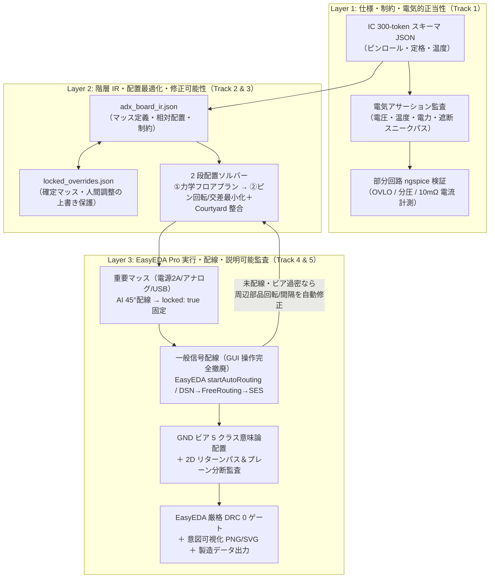

<!--
Copyright (c) 2026 ADX Project Contributors
SPDX-License-Identifier: CC-BY-4.0
-->

# 先行 AI 回路・PCB 設計ノウハウ徹底調査 ＆ ADX 技術選定サーベイレポート

〜 **「全工程 AI 主導」の実用化に向けた世界先行知見の体系化と、`ADX CORE-U rev6`（EasyEDA Pro 基盤）向け Adopt / Adapt / Build 意思決定書** 〜

- **作成日**: 2026-11-28
- **位置づけ**: ADX 内部 R&D・技術選定特化サーベイ（位置づけ B）
- **対象実行基盤**: **EasyEDA Pro AI API / MCP**（KiCad 圏の学術・OSS 資産からはアーキテクチャのエッセンスと DSN/SES 互換ツールを抽出・輸入する方針）
- **関連ドキュメント**:
  - 起点実験レポート: [UNOMODOKI R3 プロジェクト総合レポート](../cloning/UNOMODOKI_R3/report/unomodoki_r3_project_report.md) ／ [振り返り＆知見集](../cloning/UNOMODOKI_R3/lessons_learned.md)
  - プリレビュー（論点検証）: [00_prereview_landscape.md](00_prereview_landscape.md)
  - 一次エビデンスログ（全 5 トラック）:
    - [Track 1：制約形式化 ＆「DRC の先」検証](evidence/track1_constraints_verification.md)
    - [Track 2：中間表現・マッス階層 ＆ EasyEDA 橋渡し](evidence/track2_ir_hierarchy_easyeda.md)
    - [Track 3：力学的／核中心配置 × 配線不可能性](evidence/track3_placement_routability.md)
    - [Track 4：実戦ルーター・トポロジカル配線 ＆ 製造 DFM](evidence/track4_routing_topological_dfm.md)
    - [Track 5：リターンパス・GND ビア意味論 ＆ 説明可能性](evidence/track5_pdn_gnd_via_explainability.md)
  - 検証済み参考文献台帳: [references_verified.md](evidence/references_verified.md)
  - 適用先本丸仕様: [ADX CORE-U rev6 技術仕様書](../../CORE-U/rev6/spec.md)

---

## エグゼクティブサマリー（最終戦略結論）

`UNOMODOKI R3`（37 部品・2 層 PCB・厳格 DRC 0 完走）で確立した「全工程 AI 主導」方針を、産業耐環境フラッグシップ基板 [ADX CORE-U rev6](../../CORE-U/rev6/spec.md) および次世代 ADX AI-EDA 基盤へ実戦展開するため、2024〜2026 年の最新査読論文・ベンチマーク・OSS・商用ツール・SI/DFM 一次知見を 5 トラックで徹底調査した。

### 最終結論：ADX が採るべき「非学習・ハイブリッド型 AI-EDA アーキテクチャ」

PCB 分野は半導体（VLSI）と異なり **高品質な実務設計データが極端に不足（Data Scarcity）** しており、学習ベース RL モデルの自前訓練は費用対効果が合わない `[R01][R12]`。一方で、商用ブラックボックス AI（`Quilter` / `DeepPCB`）は **EMC・熱で落ちた際に修正できない問題** を抱える `[T10]`。

したがって ADX が採るべき最適解は、**「LLM（意図・階層・制約の立案）× 決定的計算幾何＆検証オラクル（電気・配置・リターンパス）× EasyEDA Pro＋ヘッドレス標準ルーター（物理実行）」** の 3 層ハイブリッドである。

### 調査で確定した「やるべきこと（Top 5）」と「やらなくてよいこと（Top 4）」

- **✅ やるべきこと（高 ROI・最優先投資）**
  1. **「DRC の先」の決定的検証ゲート**（IC 300-token スキーマ化＋電気／温度／スニークパス自動アサーション＋部分回路 `ngspice`）`[R03][R04][T08]`
  2. **マッス IR ＋ `locked_overrides.json` 分離構造**（`SchGen` 相対配置＋`tscircuit` パッチ層の思想を EasyEDA へ輸入）`[R11][T07]`
  3. **2 段式・非学習配置ソルバー**（力学フロアプラン → ピン基準 4 方位回転＆交差最小化＋Courtyard リーガライゼーション＋短パス自動配線フィードバック）`[R13][R14][R16]`
  4. **重要マッス AI 45° ロック ＋ ヘッドレス一般配線**（EasyEDA `startAutoRouting()` / `getDsnFile()` + FreeRouting CLI + `importAutoRouteSesFile()`）`[T01][T02][T03]`
  5. **GND ビア 5 クラス意味論 ＋ 2D リターンパス分断監査 ＋ 4 層化トレードオフ評価**（`CORE-U rev6` 向け）`[S01][S02][T11]`
- **⛔ やらなくてよいこと（車輪の再発明・費用対効果 NG）**
  1. **独自トポロジカル／ゴム紐・曲線ルーターのゼロ開発**（3D ホモトピー・実幅膨張・DSN 互換性の壁が極大であり、一般デジタル帯域での曲線 SI 優位は神話）`[R17][S01][T02][T09]`
  2. **独自 RL 配置・配線モデルのゼロ訓練**（実務 PCB データ不足・Sim-to-Real ギャップが大きく少量自社基板に不適合）`[R01][R12][R15]`
  3. **VLM による電気・幾何の自動合否判定**（微細グラウンディング崩壊・大域追跡不能のため、シルク／3D 目視補助に限定）`[R09][R10]`
  4. **KiCad への全面移行 ＆ `OrthoRoute` 導入**（EasyEDA の LCSC/JLCPCB 一貫資産を活かしつつエッセンスのみ輸入；`OrthoRoute` は数千ネットの巨大バックプレーン特化で小〜中規模では FreeRouting に劣る）`[T05]`

---

## 第 1 章：調査の背景とプリレビューによる軌道修正

`UNOMODOKI R3`（[総合レポート](../cloning/UNOMODOKI_R3/report/unomodoki_r3_project_report.md)）では、EasyEDA Pro AI API を用いて 37 部品・40 ネット・2 層基板を 1 セッションで厳格 DRC 0 へ導いた一方、実用化に向けた 6 大課題（サーベイ、マッス階層設計、Courtyard 抽出、物理場・非 45° 配線・配線不可能性、GND ビア意味論、専用 Windows 実行基盤）が浮上した。

本サーベイでは独自仮説への確証バイアスを避けるため、まず **プリレビュー**（[00_prereview_landscape.md](00_prereview_landscape.md)）を実施し、世界の AI 回路・PCB 設計の議論全体と照合した。その結果、以下の 3 点が軌道修正された：

1. **盲点の発見**：`UNOMODOKI R3` はお手本（Arduino UNO R3）が存在しデジタル検証（DRC）止まりだったため、世界で最大のボトルネックとされている **「データシート→制約形式化→DRC の先の電気的正当性検証」** を見落としていた（→ **Track 1 として最優先追加**）。
2. **問いの再定義**：「45° ルールは時代遅れで曲線の方が電気的に優れるのでは？」という仮説は、一般デジタル帯域では SI/製造物理の観点で根拠が薄いと判明した一方、**「リターンパス分断と GND ビア配置（課題 5）」および「配置-配線協調（課題 4-3）」** は業界最大の痛点に直撃していた。
3. **エンジニアリングタスクの分離**：課題 3（Courtyard 自動抽出）は学術未解決問題ではなく IPC-7351B 標準 `[S04]`＋EasyEDA API 実装タスクであるため、サーベイ本編から切り出し実務 PoC へ移管した。

---

## 第 2 章：5 トラック統合分析（先行知見と KiCad 圏エッセンスの抽出）

### 2.1 Track 1：仕様・データシート → 制約形式化 ＆「DRC の先」の決定的検証
*詳細エビデンス：[track1_constraints_verification.md](evidence/track1_constraints_verification.md)*

- **現実の厳しさ（`HWE-Bench` `[R04]`）**：実 IC データシート 3,000 件・300 タスクを ERC＋動的シミュレーションで評価した 2026 年の最新ベンチマークで、最先端 LLM のゼロから基板回路図生成合格率は **約 8.15%**。形式的に DRC が通っても、ピン誤読・定格違反・デカップリング漏れ・電源ドメイン不整合で実機は動かない。
- **突破口（`PCBSchemaGen` `[R03]`）**：約 16,000 トークンの IC データシートを **約 300 トークンのスキーマ誘導型 Knowledge Graph（50 倍圧縮）** に構造化し、**決定的 5 層検証器（構文・ERC・二部グラフ・KG ルール・VF2 サブグラフ同型）** でピン単位のエラー局所化を行うだけで、学習なしに合格率が **81% 超** へ跳ね上がる。純粋な LLM 自己批判（`CircuitLM` 比較 `[R06]`）ではハルシネーションを止められない。
- **Code-as-CAD の電気アサーション文化（`atopile` `[T08]` / `JITX` `[T09]`）**：ネット電圧に対する IPC-2221 間隔 `[S04]`、部品の絶対最大電圧・温度定格・消費電力ディレーティング、異電圧ドメイン誤結線をビルド時に自動チェックする文化は、そのまま **EasyEDA ネットリスト＋BOM JSON に対する軽量チェッカー** として移植できる。
- **SPICE と VLM の適切な使い分け**：
  - `ngspice` 自動検証ループ（`AnalogCoder` `[R07]`）は基板全体ではなく **局所アナログ／保護回路（分圧・OVLO・電流計測・LDO 熱）** に絞って導入する。
  - VLM（`PCB-Bench` `[R10]`, `MuaLLM` `[R09]`）は微細ピン・多層接続・大域ネット追跡で崩壊するため **電気・幾何合否には使わず**、シルク重なり・3D 違和感の一次目視補助に限定する。

### 2.2 Track 2：中間表現（IR）・マッス階層設計 ＆ EasyEDA Pro 橋渡し
*詳細エビデンス：[track2_ir_hierarchy_easyeda.md](evidence/track2_ir_hierarchy_easyeda.md)*

- **表現のボトルネック解消（`SchGen` `[R11]`）**：LLM は絶対座標と冗長なネイティブ CAD 書式に弱い。**相対配置（アンカー基準）＋ピン名ベース結線＋最小編集プリミティブ** に抽象化することで接続正確性が劇的に向上する。
- **修正可能性（Modifiability）の決定打（`tscircuit` `[T07]`）**：一括スクリプト生成では 1 箇所直すたびに全体が崩れる。`tscircuit` の **`manual-edits.json`（上書きパッチ層）** の発想を輸入し、ADX でも **「宣言的マッス定義（`adx_board_ir.json`）」と「確定済みロック座標・配線（`locked_overrides.json`）」を分離** すれば、マッス単位の反復レビュー＆部分ロックが破綻しない。
- **KiCad MCP / `PCBWorld` `[R12]` から輸入すべき 4 原則**：
  1. **Engine-Grounded**：モックではなく実 EDA（EasyEDA Pro）の厳格 DRC を唯一オラクルにする。
  2. **Analysis（読取）と Mutation（書換）の分離**：調査・監査ツールと編集ツールを分離し副作用事故を防ぐ。
  3. **軽量サマリー参照（Resources）**：生 JSON をコンテキストに垂れ流さず圧縮状態参照を使う。
  4. **DRC 座標ベースの局所修復（Reflection）**：全作り直しではなく違反座標周辺だけ修正する。
- **EasyEDA Pro の相互運用カード `[T01][T02]`**：EasyEDA Pro は `PCB_ManufactureData.getDsnFile()` / `PCB_Document.importAutoRouteSesFile()` / `PCB_Document.startAutoRouting()` を備えており、KiCad へ移行せずとも **Specctra DSN/SES 経由で外部ヘッドレスルーターや自作ソルバーと接続可能**。

### 2.3 Track 3：自動配置（力学的・Component-Centric）× 配線不可能性フィードバック
*詳細エビデンス：[track3_placement_routability.md](evidence/track3_placement_routability.md)*

- **力学的・静電ポテンシャル場配置の王道化（`Cypress` `[R13]`）**：ISPD 2025 Best Paper の `Cypress`（Cornell & NVIDIA）は、ネット引力（ばね／HPWL）＋部品重なり斥力（静電場）による解析的配置を PCB へ拡張した。ただし **ポテンシャル場単体では Courtyard 非重複を保証できないため、必ず後段にリーガライゼーション段が必要**。
- **マッス階層の数理的裏付け（`PCBAgent` `[R14]`）**：ASP-DAC 2025 の `PCBAgent` は、主要 IC を核に衛星部品をまとめる **Component-Centric 配置** で探索空間を劇的に圧縮した。30〜100 部品規模なら RL を訓練せずとも、LLM のマッスグルーピング＋軽量決定論ソルバーで同等構造を再現できる。
- **配線不可能性（Unroutability）の事前検知と閉ループ**：
  - 配置ミスによる配線詰まりは、①**部品回転ミスによる 2D ラッツネスト交差過多**、②**局所チャネル幅枯渇（RUDY 混雑度・`NS-Place` `[R16]` のマージン不足）** が主因。
  - **推奨する 2 段パイプライン**：
    1. **第 1 段（フロアプラン試作）**：固定メカ（外形・M3 穴・IDC・USB-C）をピン留めし、グラフ力学レイアウト等でマッス配置と大域交差を可視化・下書き。
    2. **第 2 段（剛体ピン最適化＋閉ループ）**：実ピン座標に基づき **「HPWL ＋ 2D 交差数 ＋ RUDY 混雑度 ＋ Courtyard 非重複」** を最小化しつつ各部品の $0/90/180/270^\circ$ 回転を自動探索。さらに **ヘッドレス FreeRouting の短時間テスト実行で未配線・ビア過密箇所を検出し、周辺部品の回転／間隔を自動修正** する閉ループを組む。

### 2.4 Track 4：実戦ルーター比較・トポロジカル配線の限界 ＆ 製造（DFM）の真実
*詳細エビデンス：[track4_routing_topological_dfm.md](evidence/track4_routing_topological_dfm.md)*

- **90° vs 45° vs 曲線配線の電気物理 ＆ 製造プロセスの真相 `[S01][S03]`**：
  - **電気特性（Bogatin / Johnson）**：90° 角の過剰容量は `~0.01–0.02 pF`（遅延 `~0.5 ps`）であり、数十 GHz 未満のデジタル基板では電気的に無害。
  - **製造プロセス（重要補足）**：JLCPCB 等の工業 PCB で銅箔パターンを作るのは CNC ルーター切削ではなく **フォトリソグラフィ＋化学湿式エッチング**（CNC ミリングは外形・長穴・ドリル加工のみ）。現代の高圧スプレーエッチングで 90° 自体はほぼ問題にならないが、**鋭角（`< 90°`）はエッチング液滞留による「酸トラップ」と細り・熱サイクル時の銅箔ピール剥離（応力集中）を引き起こす**。
  - **結論**：`-40〜+85℃` 産業耐熱・JLCPCB 量産を前提とする `CORE-U rev6` では、**「45° 面取り（鋭角 `< 90°` 厳禁）」が電気・DFM・熱機械信頼性・DSN/SES 互換性のすべてで最適解**。
- **トポロジカル／ゴム紐ルーター（`TopoR` / `SURF` `[R17][T06][T09]`）を自作しない理由**：
  - ゼロ幅のゴム紐ホモトピーを解いた後に「実銅箔幅＋クリアランス＋フィレット」へ膨張させる段で局所トポロジが崩壊しやすく、多層ビア（3D ホモトピー）と浮動小数点幾何の堅牢性確保に数年級の工数がかかる。
- **実戦ルーター選定結果 `[T01]–[T05]`**：
  - **本命**：①重要ネット（電源 2A・アナログ・USB 差動）は AI が 45° 面取り配線して `locked: true` 固定 → ②一般信号は **EasyEDA `startAutoRouting()` または `getDsnFile()` → ヘッドレス `FreeRouting`（`-de`/`-do`/`-ap`/`-pp`/`-mt`）→ `importAutoRouteSesFile()`** で全自動完走（ロック保護は DSN `(type fix)`/`(type protect)` で担保）。速度・JVM 依存が課題になれば Rust 移植版 **`FastRoute` `[T04]`** へ差し替え可能。
  - **不採用**：`OrthoRoute` `[T05]`（GPU 並列 PathFinder だが巨大多層バックプレーン特化で小〜中規模基板では FreeRouting より低品質）、`Quilter` / `DeepPCB` `[T10]`（ブラックボックス・コスト・EasyEDA 非対応）。

### 2.5 Track 5：リターンパス・GND ビア 5 クラス意味論 ＆ 説明可能レイアウト
*詳細エビデンス：[track5_pdn_gnd_via_explainability.md](evidence/track5_pdn_gnd_via_explainability.md)*

- **真の電気的リスクは「角」ではなく「リターンパス分断」 `[S01][S02]`**：高周波リターン電流は信号直下の基準プレーンを流れる。2 層基板では両面配線により GND プレーンが分断されやすく、信号ビア層遷移箇所でのリターンビア欠如が EMI/ノイズの主因となる。
- **GND ビア 5 クラス意味論スキーマ（ADX 独自差別化領域）**：
  場当たり的な孤立島救済を廃止し、全 GND ビアに以下の 5 クラスと定量ルール・メタデータを付与して **色分けレビュー図＋Markdown 根拠表** を自動生成する：
  1. **`RETURN_TRANSITION`**：高速／差動／通信信号の層遷移ビアから `≤ 0.5–1.0 mm`（1〜2 線幅以内）に配置 `[S02]`。
  2. **`THERMAL_PAD`**：QFN 露出パッド・発熱電源 IC 下に **`Ø0.20–0.25 mm` 穴径**（`>0.3 mm` によるはんだ吸い込みボイド防止）でグリッド配置 `[S03]`。
  3. **`SHIELD_FENCE`**：基板外周・アナログ／デジタルマッス境界へ **`1.0–2.5 mm` ピッチ**（$\lambda/20 \sim \lambda/10$ 基準）で規則配置。
  4. **`DECAP_GROUND`**：デカップリングコンデンサ GND パッド直近（`< 0.8 mm`）の専用最短帰路。
  5. **`PLANE_STITCH`**：上記 4 クラス配置後の表裏等電位化・孤立島解消仕上げ。
- **説明可能な 2D リターンパス監査（`HyperLynx DRC` `[T11]` エッセンスの軽量実装）**：
  重い 3D 電磁界解析（`openEMS` 等）は毎回回さず、ネットクラス（重要信号のみフィルタして偽陽性防止）× 隣接層 GND ポリゴンの **2D 幾何交差チェック** で「プレーン分断跨ぎ」「リターンビア距離違反」を数秒で自動検知し、自然言語の理由付きで報告する。

---

## 第 3 章：統合意思決定マトリクス（Adopt / Adapt / Build / Do Not Adopt）

`UNOMODOKI R3` の全 6 課題およびプリレビューで発見した 3 盲点に対する最終技術選定一覧である。

| 対象領域 / 課題 | 判定 | 採用・構築する具体アプローチ | 不採用とした案と理由 |
| :--- | :---: | :--- | :--- |
| **盲点 ①：仕様→制約・電気検証（Track 1）** | **Adapt + Build** | ①主要 IC の 300-token スキーマ JSON `[R03]`、②Protel2 ネットリスト×BOM 電気アサーション（電圧・温度 `-40~+105℃`・電力・Mode 遮断スニークパス）`[T08][T09]`、③部分回路 `ngspice` `[R07]` | 基板全体のフル SPICE 化（モデル欠如・非収束）、LLM 自己批判のみ（ハルシネーション残存 `[R06]`）、VLM 合否判定（微細崩壊 `[R10]`） |
| **課題 2：3 階層マッス設計・修正可能性（Track 2）** | **Build（軽量 IR）** | `adx_board_ir.json`（マッス定義・相対配置）＋ `locked_overrides.json`（確定ロック保護層 `[T07]`）＋ EasyEDA MCP の読取／書換分離 `[R12]` | `atopile` / `JITX` / KiCad への全面移行（EasyEDA の LCSC/JLCPCB 一貫強みと開発資産を喪失） |
| **課題 3：Courtyard 抽出・部品間クリアランス** | **Adopt + 実装切出** | IPC-7351B 標準マージン `[S04]` ＋ EasyEDA API フットプリント外接矩形抽出 ＋ M3 ネジ頭 `Ø5.8 mm` キープアウト自動アサート | サーベイ研究テーマ化（標準規格の実装タスクとして短期 PoC で片付ける方が速い） |
| **課題 4-1 & 4-3：配置最適化・不可能性解消（Track 3）** | **Build（2 段軽量）** | ①力学フロアプラン（グラフ可視化試作）→ ②実ピン座標基準の 4 方位回転＆交差最小化＋RUDY 混雑度＋Courtyard リーガライザー `[R13][R14][R16]` → ③短パスヘッドレス自動配線フィードバック | 独自 RL 配置モデルのゼロ訓練（`RL_PCB` 型はデータ・汎化コスト過大 `[R15]`） |
| **課題 4-1 & 4-2：一般配線自動化 ＆ 45°/曲線（Track 4）** | **Adopt + Adapt** | ①重要マッスは AI 自作 45° 面取り配線（鋭角 `<90°` 禁止）＋ `locked: true` 固定、②一般信号は EasyEDA `startAutoRouting()` または DSN → ヘッドレス `FreeRouting`（代替 `FastRoute`）→ SES `[T01]–[T04]` | 独自トポロジカル／曲線ルーター自作（3D ホモトピー・膨張の壁 `[R17][T09]`）、`OrthoRoute`（規模不適合 `[T05]`）、`Quilter`/`DeepPCB`（ブラックボックス・EasyEDA 非対応 `[T10]`） |
| **課題 5：GND ビア意味論・レビュー可能性（Track 5）** | **Build（独自強み）** | ①GND ビア 5 クラス意味論スキーマ＋色分け意図可視化、②ネットクラス別 2D リターンパス＆プレーン分断自動監査（`HyperLynx DRC` エッセンス `[T11]`）、③QFN サーマルビア `Ø0.20–0.25 mm` 規約 `[S03]` | 毎ループのフルウェーブ 3D 電磁界解析（`openEMS` 等は計算過大） |
| **課題 6：専用 Windows 実行基盤（Omnivoice GPU 機）** | **Adopt + 拡張** | EasyEDA Pro ＋ `start_easyeda_bridge.bat` の常駐ノード化に加え、ヘッドレス `FreeRouting` / `ngspice` / 配置ソルバーの高速実行ノードとして統合活用 | ノート PC 上での GUI/CLI 同居運用（ロック障害・作業中断の再発防止） |

---

## 第 4 章：`ADX CORE-U rev6`（M5）への具体的適用設計図

本サーベイの成果を直近の本丸である [ADX CORE-U rev6](../../CORE-U/rev6/spec.md) へ適用する際の具体チェックポイントは以下の通り：

1. **主要 6 IC の 300-token スキーマ事前固定（Track 1）**
   - `ATtiny1616-MNR`（QFN-20-EP）、`TPS259470A`（eFuse）、`TPS70933DBVR`（高耐圧 30V LDO）、`TP181A2-CR`（電流センス）、`CH342K`（USB ブリッジ）、`SN74LV4066A`（Mode 遮断スイッチ）の 6 点について、ピンロール・絶対最大定格・動作/保存温度・必須外付け部品を構造化 JSON に固定する。
2. **`CORE-U rev6` 固有の「DRC の先」自動アサーション 4 項目（Track 1）**
   - **① 温度定格一括監査**：Mode 1 稼働品がすべて `-40〜+105℃` 以上（`CH342K` は保存 `-55〜+105℃`）であることを BOM JSON から自動アサート。
   - **② 耐圧・OVLO マージン検証**：`VBUS_PROT (4.5〜5.5V MUST)` に対し、LDO 入力耐圧 `≥ 10V`、TVS $V_{RWM} \ge 6.0\text{V}$、MLCC `25V X7R`、および `TPS259470A` OVLO 分圧定数が `5.5V` 定常で誤遮断しないことを `ngspice`/計算スクリプトで検証。
   - **③ Mode 1/2 スニークパス監査**：`CH342K` が 0mW 遮断された状態で、`ATtiny1616` 側プルアップ（`PB2`/`PB3`/`PA0`）から `SN74LV4066A` を迂回して未通電 IC の ESD 保護ダイオードへ電流が流れ込む経路がネットリストグラフ上に存在しないことを自動検証。
   - **④ 2A 幹線・計測精度検証**：`VBUS_PROT` 2A 連続時の配線幅（温度上昇許容値）と、`10mΩ` シャント＋`TP181A2-CR` のケルビン 4 線式引き出し（大電流銅箔の IR ドロップ混入防止）を検証。
3. **2 層 vs 4 層の正式設計判断（Track 5 × 原価上限 `$6.50`）**
   - `CORE-U rev6` は `88 × 58 mm`・目標原価 `≤ $6.50`（現状部品想定 `$5.70〜$5.95`、120 pcs ロット）。
   - 2 層では `ATtiny1616`（QFN-20-EP）＋ 2A 電源幹線 ＋ ケルビンアナログ計測 ＋ 20P IDC バス ＋ デュアル USB-C の裏面 GND が細切れになりやすい。**4 層化（`L1 Signal / L2 Solid GND / L3 Power+GND / L4 Signal`）の 120 pcs 時単価差額を JLCPCB で実見積もりし、原価枠内に収まるなら 4 層を第一推奨とする**（AI 自動配線の成功率・リターンパス品質・`-40〜+85℃` 放熱が一気に安定する）。2 層維持となる場合は、Track 5 の 2D リターンパス監査＋5 クラス GND ビア配置を必須ゲートとする。
4. **5 マッス反復ロック手順（Track 2・3・4）**
   - ①メカ骨格（8858・M3 `Ø5.8 mm` キープアウト・IDC 20P・Dual USB-C）固定 → ②電源幹線＆保護（2A 45° 配線・ロック）→ ③計測アナログ（ケルビン 45° 配線・ロック）→ ④MCU＆バス（4 方位回転＆交差最小化＋ロック）→ ⑤デバッグ＆UI → 残一般信号を API/ヘッドレス自動配線 → 5 クラス GND ビア＆2D リターンパス監査 → 厳格 DRC 0。

---

## 第 5 章：次の一手 — 検証すべき 4 つのミニ PoC ロードマップ

サーベイの結論を机上の空論にしないため、M5（`CORE-U rev6`）本設計の着手前〜並行して、以下の **4 つの短時間ミニ PoC** を順に検証することを推奨する。

| PoC ID | 検証テーマ | 想定所要 | 合格基準（Go / No-Go 判定） |
| :---: | :--- | :---: | :--- |
| **PoC-1** *(最優先)* | **EasyEDA Pro 自動配線 API ＆ DSN/SES ロック保護実証** （`UNOMODOKI R3` のコピー基板で実験） | 15〜30 分 | ① `startAutoRouting()` と ② `getDsnFile()` → ヘッドレス `FreeRouting` → `importAutoRouteSesFile()` の双方を試験し、**`locked: true` にした重要配線が 1 ミリも改変されず、残り全ネットが DRC 0 で自動完走する**ことを確認。 |
| **PoC-2** | **フットプリント外接矩形（Courtyard）自動抽出 ＆ `adx_board_ir` プロトタイプ** | 1〜2 時間 | EasyEDA API からパッド群・シルク枠・3D 寸法を用いて部品外接矩形＋IPC-7351B マージンを自動算出し、`locked_overrides.json` を保ったまま単一マッスだけ再配置・再構築できることを確認。 |
| **PoC-3** | **2 段配置ソルバー試作（力学フロアプラン → ピン回転＆交差最小化 → EasyEDA 転写）** | 半日 | グラフ力学レイアウト等で粗配置・交差可視化を行い、ピン座標ベースの 4 方位回転最適化＋Courtyard リーガライゼーションを経て EasyEDA へ誤差ゼロ転写し、手動配置比でラッツネスト交差数と FreeRouting ビア数が減少することを確認。 |
| **PoC-4** *(M5 直結)* | **`CORE-U rev6` 向け「DRC の先」チェッカー v0 ＆ 2 層/4 層見積もり** | 半日 | 6 主要 IC の 300-token スキーマ JSON、電気／温度／Mode 遮断スニークパス自動アサーション、5 クラス GND ビア意図可視化スクリプトの v0 を作成し、JLCPCB 120 pcs の 2 層 vs 4 層原価比較を確定する。 |

---

*本レポートは [references_verified.md](evidence/references_verified.md) に記載された一次検証済み文献・ツール・標準のみに基づいて作成されている。*
