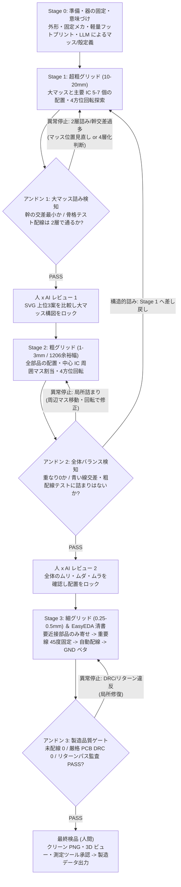

<!--
Copyright (c) 2026 ADX Project Contributors
SPDX-License-Identifier: CC-BY-4.0
-->

# 回路設計のAI自働化 ― グリッドステージ設計スキーム

- **作成日**: 2026-11-28
- **ステータス**: 構想・設計スキーム定義（v1.0）
- **位置づけ**: `UNOMODOKI R3` 実戦実験と先行 AI-EDA サーベイを踏まえ、人と AI が協調して手戻りなく実用基板を設計するための基本設計思想および実践プロトコル。
- **関連ドキュメント**:
  - 実戦振り返り: [UNOMODOKI R3 知見集](../UNOMODOKI_R3/lessons_learned.md) / [サポーター記録書](../UNOMODOKI_R3/supporter_log.md)
  - 先行研究調査: [AI 回路・PCB 設計サーベイレポート](../../ai_pcb_survey/survey_report.md)
  - 次期適用先（本丸）: [ADX CORE-U rev6 技術仕様書](../../../CORE-U/rev6/spec.md)
- **思想参照**: トヨタ自動車「[トヨタ生産方式 — ニンベンのついた自働化](https://global.toyota/jp/company/vision-and-philosophy/production-system/)」

---

## 1. 問題提起：なぜ「自動化（オートメーション）」だけでは行き詰まるのか

`UNOMODOKI R3`（37 部品・40 ネット・2 層 PCB）では、EasyEDA Pro AI API（MCP ブリッジ）を用いて 1 日で回路図から厳格 DRC 0・製造データ出力までを完走した。一方で、お手本が存在しないオリジナル基板（[ADX CORE-U rev6](../../../CORE-U/rev6/spec.md) 等）へ本格展開しようとすると、根源的な壁が見えてくる。

先行サーベイ（[survey_report.md](../../ai_pcb_survey/survey_report.md)）で世界の AI-EDA 研究を俯瞰すると、一見すると「完全自動の PCB 配置配線はまだ不可能に近い」という印象を受ける。その根本原因は、従来の研究や商用 AI の多くが **「あらゆる自由度（連続 2 次元座標・任意角度・任意サイズ・任意配線）を全開放したカオスな問題に対し、外側から巨大な最適化システムや学習モデルをぶつけて力技で解こうとしている（＝オートメーション志向）」** 点にある。

さらに実務上もっとも深刻な課題は、人間が雑に設計しても AI が一気通貫で生成しても同様に起こりうる **「最後の最後で配線不可能（例：2 層では物理的に無理）が発覚し、最初から作り直しになる」** という手戻りである。

本ドキュメントでは、この課題を「より複雑なシステムをつくる」方向ではなく、**「人間の手作業の原理原則を『規則』として織り込み、異常を工程内で早期検知して停止・改善する（＝ニンベンのついた自働化）」** によって解決する **グリッドステージ設計スキーム** を定義する。

---

## 2. 設計哲学：回路設計における「ニンベンのついた自働化（Jidoka）」

トヨタ生産方式における **「自働化」** は、単なる無人化・自動化（オートメーション）に **「人間の知恵」** を加えた概念である。この哲学の 4 つの柱は、そのまま AI 主導の回路・PCB 設計が目指すべき構造と 1 対 1 で対応する。

| トヨタ「自働化」の原則 | 回路・PCB 設計（グリッドステージスキーム）への翻訳 |
| :--- | :--- |
| **1. 機械ありきにせず、手作業の原理原則を徹底的に改善してから織り込む** | 難解な物理シミュレーターや RL をいきなり作るのではなく、熟練設計者が手作業で行っている **「大マッス配置 → 大きなグリッドで全体配置 → IC 回転で交差解消 → 必要に応じて細グリッドで詰める」** というカンコツを、そのまま再現可能な **単純な規則** として AI にビルトインする。 |
| **2. ムリ・ムダ・ムラ（3M）を工程の規則で排除する** | ・**ムリ（無理）**：外形／M3 穴干渉、Courtyard 重なり、ノイズ源近接、2 層物理配線不能<br>・**ムダ（無駄）**：青い線（ラッツネスト）の交差・ねじれ、信号の逆流・迂回、後工程での全やり直し<br>・**ムラ（斑）**：片隅への部品集中（ビア渋滞・熱集中）と反対側のデッドスペース、配線チャネル幅の不均一 |
| **3. 異常を自ら検知して自動停止する（アンドン／品質を工程でつくり込む）** | 全部品を並べて最後に「配線不能！」と気づくのではなく、**各グリッドステージの出口に定量的な異常検知ゲート（アンドン）を設置**する。特に大マッス段階で「幹の交差過多」「骨格テスト配線不能」を検知したら即座に停止し、不良な構図を後工程へ絶対に流さない。 |
| **4. 技能と技術のスパイラルアップ（人 × AI 協調）** | AI が高速な候補生成・交差計算・テスト配線・異常検知を担い、人間が構図判断・例外の意思決定・ロック指定・新たな規則へのフィードバックを担う。進化のために改善を続けられるのは人間であり、その気づきを規則とゲートへ継続的に織り込むことで設計ライン自体を進化させる。 |

---

## 3. 思考の収束：「システムで解く」から「規則による次元削減」へ

本スキームに至る検討の過程で、グラフ可視化（Cytoscape.js）や自然界の秩序（カタツムリの螺旋、蜂の巣、惑星軌道・原子殻、レナード-ジョーンズ・ポテンシャル）をヒントに本質を掘った結果、すべての難題をほどく鍵が **「規則によって問題の次元数を落とすこと」** にあると整理された。

1. **連続 2 次元空間の罠**：全部品が `(x, y)` 平面上を自由に動き回ると、2D 特有のすれ違い不能（渋滞・ガラス化）、サイズ比 100 倍の矩形衝突、GND ネットのブラックホール化が起き、探索が破綻する。
2. **「惑星軌道（原子殻）」と「青い線（ラッツネスト）」の視点**：
   - IC を中心（恒星）に据え、パスコン等を第 1 殻・抵抗類を第 2 殻という離散的な層に置けば、2 次元問題が「殻番号 × 1 次元の周囲位置」へ次元圧縮される。
   - 評価基準も複雑にする必要はなく、EasyEDA 上で表示される **「青い最短距離線（ラッツネスト：GND 除く）の交差数と距離」** を最小化することが配線しやすさの本質に直結する。
3. **熟練手作業の再発見：「できるだけ大きなグリッド」がそのまま原子殻である**：
   - 実際の設計手作業を振り返ると、最初から細かい座標に並べるのではなく、**「マッスも含めて、まずはめちゃくちゃ大きなグリッド（例：1206 部品が無理なく入る幅や 1mm 以上の粗い格子）に置き、全体バランスと青い線の交差を確定させてから、必要に応じてグリッドを細かくして詰める」** という手順を踏んでいる。
   - 中心 IC を原点 `(0, 0)` としたとき、周囲のグリッド交点はそのまま「原子殻（正方殻）」と数学的に一致する。

```text
  (-2, 2) (-1, 2) ( 0, 2) ( 1, 2) ( 2, 2)   <-- 外周 16 マス = 第 2 殻 (一般衛星)
  (-2, 1) [-1, 1] [ 0, 1] [ 1, 1] ( 2, 1)
  (-2, 0) [-1, 0]  [★IC★] [ 1, 0] ( 2, 0)   <-- 内周  8 マス = 第 1 殻 (パスコン・水晶等)
  (-2,-1) [-1,-1] [ 0,-1] [ 1,-1] ( 2,-1)
  (-2,-2) (-1,-2) ( 0,-2) ( 1,-2) ( 2,-2)
```

**「できるだけ大きなグリッドから始める」というたった 1 つの規則** が、以下 4 つの効果を一挙に生み出す：

- **ムリ（重なり）の消滅**：1 マス 1 部品（大型 IC は複数マス占有）とすれば Courtyard 衝突が構造的に起きない。
- **配線チャネルの自動確保**：グリッド幅に余裕があるため、部品間に自然と配線の通り道が空く。
- **ムラ（斑）の解消**：マッス領域いっぱいに均等な格子を張るため、疎密の偏りが生まれない。
- **探索の極小化**：連続座標の探索が、「限られた空きマスへの割り当て ＋ 4 方位回転（`0/90/180/270°`）」という高速に解ける離散パズルへ落ちる。

---

## 4. グリッドステージ設計スキーム（全体アーキテクチャ）

本スキームは、**「粗いグリッド → 細かいグリッド」** へと解像度を下げながら進む **4 段階（Stage 0 〜 Stage 3）** で構成される。各ステージの出口には必ず **異常停止ゲート（アンドン）** と **人×AI フィードバック＆ロック** を設け、確定した上位構造を壊さずに下流へ進む。



---

### Stage 0：準備・「器」の固定・電気的意味づけ

探索と配置を始める前に、変動しない制約（器）と電気的メタデータを JSON として固定する。

1. **器の固定（ロック）**：基板外形ポリゴン（例：`8858 Form Factor` `88.0 × 58.0 mm`）、M3 取付穴（ネジ頭キープアウト `Ø5.8 mm` 含む）、外部コネクタ（USB-C、20P IDC 等）の絶対座標をロック。
2. **軽量フットプリントの自動抽出**：EasyEDA Pro API（`getAllPinsByPrimitiveId` 等）から 1 回だけ全部品の **「推定 Courtyard 矩形 ＋ 実パッド相対座標 `(dx, dy)` ＋ ネット名」** を取得し、ローカル JSON 化（[pcb_initial_probe.json](../UNOMODOKI_R3/outputs/pcb_initial_probe.json) の拡張）。
3. **LLM による電気的意味づけ（規則パラメータ付与）**：
   - 部品を大マッス（例：電源幹線、計測アナログ、MCU ＆ バス、USB 通信）と中心 IC（恒星）へグルーピング。
   - 衛星部品に優先タグ（**要近接＝第 1 殻**：パスコン・水晶・ケルビン検出・ESD ／ **一般＝第 2 殻**：プルアップ・直列抵抗・LED 等）を付与。
   - **共通ネット除外指定**：`GND`（および必要に応じて全面ベタ電源）を青い線の交差カウント・引力計算から除外し、ブラックホール化を防止する。

---

### Stage 1：超粗グリッド ― 大マッス・骨格ステージ（例：`10〜20 mm`）

**「最後の最後で 2 層では無理になる」という致命的手戻りの最大原因は、大マッス（主要 IC とコネクタ）の位置関係ミスにある。** Stage 1 は、細かい衛星部品を 1 個も並べる前に、この骨格の正しさを科学的に確定する最重要工程である。

- **対象**：固定メカ ＋ 主要 IC / 大マッス（5〜7 塊のみ）。
- **AI の作業**：
  - 基板内の超粗グリッド上に主要 IC を配置し、位置の組み合わせと各 IC の 4 方位回転（`0/90/180/270°`）を網羅・高速探索する。
  - ネットを「太い幹（電源 2A 幹線、MCU⇄IDC バス束、USB 差動、アナログ計測等）」に束ねて評価する。
- **異常停止ゲート（アンドン ①）**：
  1. **幹の平面性（束の交差チェック）**：太い信号束同士や大電流幹線とアナログ経路が交差・逆流していないか。
  2. **骨格テスト配線（ドライラン）**：主要 IC と固定コネクタだけの状態で、ヘッドレスルーター（FreeRouting 等）を数秒間テスト実行する。この骨格段階ですでにビア過密・大迂回・未配線が出るなら **即座に異常停止** する。
  - *早期意思決定*：大マッスの全有望パターンを試しても 2 層骨格ドライランが破綻する場合、細かい配置に進む前に **「4 層化すべきか／コネクタ配置を見直すべきか」** を人間へ提言できる。
- **人 × AI フィードバック**：性格の異なる上位 3 案を SVG 図＋スコア表で提示。人間が設計意図（放熱、ノイズ隔離、保守性等）を踏まえて 1 案を選び、大マッス位置と主要 IC の大枠をロックする。

---

### Stage 2：粗グリッド ― 全体バランス・衛星配置ステージ（例：`1〜3 mm`）

手作業の知恵である **「1206 等の大きめ部品が無理なく入る余裕グリッドに、小さい部品も区別せずまず載せて全体バランスを確定させる」** 工程をそのまま実行する。

- **対象**：全実装部品。基板全体（またはマッス単位）で共通の粗グリッド（例：`1.0 mm` / `2.0 mm` / `2.5 mm`）を適用。
- **AI の作業**：
  - 大型 IC は複数マスを占有させ、衛星部品は 1 マス 1 部品として、優先タグ順に中心 IC の接続ピン最寄りの空きマス（第 1 殻 → 満員なら第 2 殻）へ配置する。
  - 各衛星部品を `0/90/180/270°` 回転させ、**青い線（ラッツネスト：GND 除く）の交差数と総距離が最小**になる向きを決定する。
  - 局所スワップ（空きマス移動・隣接交換）を反復し、青い線の絡まりをさらにほぐす。
- **異常停止ゲート（アンドン ②）**：
  1. **物理制約**：外形はみ出し `0`、M3 キープアウト侵入 `0`、Courtyard 重なり `0`。
  2. **交差スコア**：信号青い線の交差数および要近接部品のピン間距離が許容基準内か。
  3. **粗配置テスト配線**：この余裕グリッド状態のままでヘッドレス自動配線を短時間実行し、未配線・ビア過密箇所を検出する。異常が出た箇所は周辺部品を 1〜2 マスずらす・回転させて局所修復し、解消不能なら Stage 1 へ差し戻して停止する。
- **人 × AI フィードバック**：全体の SVG（グリッド・Courtyard・青い線・交差ハイライトをレイヤー表示）または EasyEDA プレビューを確認。人間がバランス・美観・保守性を確認し、確定した部品・マッスを `locked_overrides.json` にロックする。

---

### Stage 3：細グリッド ― 局所詰め・物理清書ステージ（例：`0.25〜0.5 mm` → EasyEDA 転写）

全体バランスと配線成立性が担保された状態で、最後に必要な箇所だけ細かく詰め、実基板として清書する。

- **対象**：全体配置は Stage 2 の粗グリッド整列を維持したまま、**要近接タグ付き部品（パスコン・水晶・ケルビン検出・ESD 保護等）だけ**を細グリッドで該当ピンの至近距離へ寄せる。
- **EasyEDA Pro への清書転写**：
  - `x = ox + col * gx, y = oy + row * gy`（および部品中心／Pin 1 オフセット逆算補正）で EasyEDA Pro API へ誤差 `0.000 mil` で転写。
  - 重要ネット（大電流幹線・ケルビンアナログ・USB 差動等）を AI が 45° 面取り配線（鋭角 `< 90°` 禁止）して `locked: true` 固定。
  - 一般信号線を `eda.pcb_Document.startAutoRouting()` または `getDsnFile()` → ヘッドレス `FreeRouting` → `importAutoRouteSesFile()` で全自動配線。
  - 5 クラス意味論に基づく GND ビア配置と表裏ベタ銅箔の生成。
- **異常停止ゲート（アンドン ③）**：
  - `eda.pcb_Document.getRatlines()` の残ラッツネスト `0` 本。
  - `eda.pcb_Drc.check(true, false, true)` の厳格 PCB DRC 違反 `0` 件。
  - 2D リターンパス＆プレーン分断監査 PASS、Courtyard クリアランス PASS。
- **人 × AI フィードバック**：DRC 前のクリーン PNG、5 クラス GND ビア意図可視化図、3D ビュー、測定ツールチェックリストで人間が最終検品・承認し、製造データ（Gerber / CPL / BOM）を出力する。

---

## 5. 技術的実現性とツール分業（なぜシンプルに組めるのか）

本スキームの大きな強みは、重厚な独自 CAD や学習インフラを必要とせず、**確認済みの軽量技術要素だけで実装できる** 点にある。

| 要素 | 採用する技術・API | 技術的根拠・ポイント |
| :--- | :--- | :--- |
| **青い線（ラッツネスト）の取得と高速評価** | **EasyEDA**: `eda.pcb_Document.getRatlines()`<br>**ローカル探索**: ユークリッド最小全域木（MST） | `UNOMODOKI R3` の [run_step4b_gnd_pour_and_drc.mjs](../UNOMODOKI_R3/scripts/run_step4b_gnd_pour_and_drc.mjs) で API 取得実証済み。探索中は初期プローブのパッド座標からローカルで MST を計算すれば、EasyEDA を叩かずに **毎秒数千回** 青い線の交差数と距離を評価できる。 |
| **任意原点・X/Y グリッドの転写** | `eda.pcb_PrimitiveComponent.modify(id, { x, y, rotation })`<br>`eda.pcb_Document.setCanvasOrigin(ox, oy)` | API の座標指定は GUI スナップに縛られない浮動小数点 mil 指定であり、`UNOMODOKI R3` の [run_step3b_mech_place_silk.mjs](../UNOMODOKI_R3/scripts/run_step3b_mech_place_silk.mjs) で誤差 `0.000 mil` を実証済み。原点 `(ox, oy)` と幅 `(gx, gy)` をスクリプト側で定義すれば X/Y 独立グリッドも自在。 |
| **ステージ間の可視化と人レビュー UI** | **mil 座標 1:1 の SVG 出力**<br>*(必要に応じて最小限のブラウザ対話 JS)* | `viewBox` で基板実寸 mil 座標をそのまま表現でき、部品回転・グリッド線・大マッス枠・青い線交差ハイライトを `<g>` レイヤーで重ねられる。生 JSON の可読性問題をゼロ依存で解消し、拡大しても劣化しない。 |
| **配線テスト（骨格＆粗配置ドライラン）** | EasyEDA `startAutoRouting()` または Specctra DSN → ヘッドレス `FreeRouting` → SES | 物理 DRC を満たす配線可否の判定を自前実装せず、既存の実戦ルーターを「異常検知オラクル（アンドン）」として流用する。 |
| **先行サーベイとの統合** | [survey_report.md](../../ai_pcb_survey/survey_report.md) 全 5 トラックと完全整合 | Track 1（DRC の先の電気検証）、Track 2（`adx_board_ir` + `locked_overrides`）、Track 4（45° ロック＋ヘッドレス配線）、Track 5（GND ビア 5 クラス意味論）の中核を繋ぐ、Track 3（配置×配線不可能性）の最シンプル実践アーキテクチャとなる。 |

---

## 6. 次の一手：適用イメージと検証ロードマップ

### 6.1 `ADX CORE-U rev6` への適用イメージ

次期フラッグシップ基板 [ADX CORE-U rev6](../../../CORE-U/rev6/spec.md)（`88 × 58 mm`・デュアル Type-C・20P IDC バス・2A 電源幹線・10mΩ アナログ計測・Mode 1 遮断）では、Stage 1 の大マッス配置が成否を分ける。

- **固定メカ（器）**：`8858` 外形、四隅 M3 穴（`Ø5.8 mm` キープアウト）、`USB-POW`、`USB-COM`、`IDC 20P` ラッチヘッダ。
- **Stage 1 大マッス（主要 IC 骨格）**：
  1. 電源保護マッス（`TVS` → `TPS259470A` eFuse → `TPS70933` LDO）
  2. 計測アナログマッス（`10mΩ` シャント ＋ `TP181A2-CR`）
  3. MCU マッス（`ATtiny1616-MNR` QFN-20-EP）
  4. デバッグ遮断マッス（`USBLC6` → `CH342K` ＋ `SN74LV4066A`）
- **最大の検証価値**：衛星部品を並べる前の **Stage 1 アンドン（幹の平面性＋骨格テスト配線）** によって、「`CORE-U rev6` が 2 層で健全に成立するか、それとも原価枠内で 4 層化すべきか」を早期かつ定量的に判定できる。

### 6.2 まずは `UNOMODOKI R3` データで回す 3 ステップ実証実験

いきなり大規模ツールを作らず、すでに全部品・ネット・座標データが揃っている `UNOMODOKI R3`（37 部品・40 ネット）を題材に、小さく検証してスキームを磨く。

| Step | 検証内容 | 確認したいこと（学びの焦点） |
| :---: | :--- | :--- |
| **Step 1** | **青い線（MST）交差計測 ＆ SVG 可視化 v0** | [pcb_initial_probe.json](../UNOMODOKI_R3/outputs/pcb_initial_probe.json) から GND 除外 MST と交差数を計算し、既存 `UNOMODOKI R3` 配置を SVG 描画して「どこに交差・ムラがあるか」を肉眼で確認する。 |
| **Step 2** | **Stage 1（骨格）＋ Stage 2（粗グリッド）探索実験** | 固定メカ（4 ヘッダ・ICSP・USB-C・4 穴）をロックし、主要 IC（`U1`, `U2`, `U3`）の Stage 1 探索 → 残り 30 部品の粗グリッド（例：`2.0 mm` / `1.0 mm`）配置＆4 方位回転を実行し、交差数と配置の美しさを既存配置と比較する。 |
| **Step 3** | **EasyEDA 転写 ＆ 自動配線アンドン接続** | 探索結果のグリッド座標を EasyEDA Pro コピー基板へ転写し、`getRatlines()` 一致と自動配線（`startAutoRouting` / FreeRouting）の完走性・ビア数変化を実測する。 |

---

## 7. おわりに：技能と技術のスパイラルアップへ

本スキームの本質は、AI に魔法の最適化を期待することではなく、**人間が長年の手作業で培ってきた「大きなグリッドで全体を掴み、異常（交差・詰み）を早い工程で止めて直し、最後に必要な細部だけを詰める」というモノづくりの原理原則を、そのまま人と AI の共通プロトコル（自働化ライン）に落とし込むこと** にある。

今後の実戦（`UNOMODOKI R3` 検証および `CORE-U rev6` 本設計）で遭遇する新しい異常や人間の気づきを、その都度各ステージの規則とアンドン（停止条件）へ織り込み続けることで、**「品質を工程でつくり込む」** AI 回路設計環境を継続的に育てていく。
