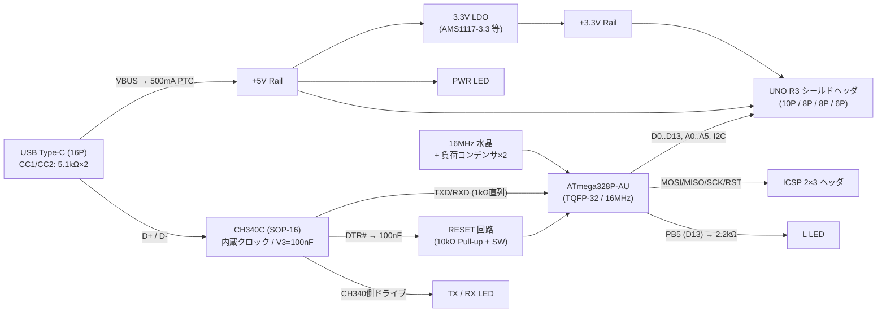

<!--
Copyright (c) 2026 ADX Project Contributors
SPDX-License-Identifier: CC-BY-4.0
-->

# UNOMODOKI R3 開発計画（EasyEDA AI API 実戦準備運動）

- **作成日**: 2026-11-28
- **プロジェクト名**: `UNOMODOKI R3`（Arduino UNO R3 フォームファクタ互換・現代風 USB-C クローン）
- **配置場所**: `hardware/SANDBOX/cloning/UNOMODOKI_R3/`
- **関連ドキュメント**:
  - サポーター指示書（読む専用）: [supporter_instructions.md](supporter_instructions.md)
  - サポーター記録書（書く専用）: [supporter_log.md](supporter_log.md)
  - 候補調査レポート: [research_report.md](../research_report.md)
  - EasyEDA Agent 進捗・技術知見: [status_summary.md](../../../../agent/easyeda/status_summary.md)
  - EasyEDA Agent 運用規約: [agent_rules.md](../../../../agent/easyeda/agent_rules.md)

---

## 1. プロジェクトの目的と「遊びのルール」

本プロジェクトは、EasyEDA Pro AI API（MCP ブリッジ）の M4「Hello Circuit（5 部品・単層・ビアなし）」から、本丸である [ADX CORE-U rev6](../../../CORE-U/rev6/spec.md) / [ADX Reference CARD](../../../CARD/Reference/concept.md) の設計（M5）へ進む前段階の**「遊び兼・実戦準備運動」**です。

「遊びのつもりが第 2 の本丸になってしまう」スコープクリープを防ぐため、以下の免罪符とゴールを最初に宣言します。

- **本プロジェクトでやること（ゴール）**:
  1. 公開仕様のみを参照し、EasyEDA AI API スクリプトによる**クリーンルーム実装**で UNO R3 互換基板をゼロから生成する。
  2. 部品 30 点規模の回路図・多ピン IC・USB Type-C・WCH USB-UART・2 層ビア配線・精密なメカ寸法（例の 160mil ズレ含む）・大量シルク自動配置を踏み抜き、**「AI に任せるべき工程 vs 人間が GUI で触るべき工程」の損益分岐点**を体得する。
  3. SCH DRC 0 / PCB DRC 0 / 未配線 0 の製造可能データ一式（Gerber / BOM / CPL / プレビュー PNG）まで完走する。
- **U0 確定仕様（PL 決定・2026-11-28 凍結）**:
  - **電源**: USB-C 5V 専任（DC ジャック＆自動電源切替カット）
  - **メイン MCU**: `ATmega328P-AU`（TQFP-32 / 16MHz / 5V・王道 UNO 互換）
  - **ゴール＆検証方式**: 実物製造・紙印刷ではなく、**Windows の EasyEDA Pro 上の測定ツール（[Arduino_uno_r3_size_mill.png](data/Arduino_uno_r3_size_mill.png) 照合）・2D/3D ビュー・DRC・製造データ一式（Gerber / BOM / CPL）によるデジタル完全検証**を完了ラインとする。
- **本プロジェクトでやらないこと（免罪符）**:
  - ADX 本流の過酷環境要件（`-40℃〜+85℃` 定格、熱設計、耐振動、筐体適合、サージ・逆流の厳密設計）は**対象外**。机上で楽しく動き、UNO シールドが物理的・電気的に刺されば大成功とする。
  - 本家の商標名（`Arduino` 等）や公式ロゴ、および CC BY-SA の公式 EAGLE/KiCad データは一切流用しない。

---

## 2. 「忠実に真似するところ」と「潔く割り切るところ」

| 項目 | 本家 Arduino UNO R3 | `UNOMODOKI R3` の方針 | 理由・狙い |
| :--- | :--- | :--- | :--- |
| **基板外形・穴** | `68.58 × 53.34 mm`・右端カット・M3 穴×4 | **忠実に再現（MUST）** | 任意多角形＋穴座標の API コード生成を検証 |
| **シールドヘッダ** | 10P / 8P / 8P / 6P（**D7–D8 間 160mil ズレ**） | **忠実に再現（MUST）** | 既存シールドが物理的に刺さる明確な合格基準 |
| **メイン MCU** | ATmega328P（DIP-28、5V / 16MHz） | **ATmega328P-AU（TQFP-32）** | 片面 SMT 実装化・多ピン IC のファンアウト検証 |
| **USB コネクタ** | USB Type-B（巨大 THT） | **USB Type-C 16P（SMD）** | 現代化＋CC1/CC2 抵抗含む USB-C 回路の定型化 |
| **USB-UART** | ATmega16U2 ＋ 16MHz 水晶 ＋ 専用 ICSP | **CH340C（SOP-16・水晶レス）** | 部品数大幅削減＋CORE-U の WCH UART 予行演習 |
| **外部電源系統** | DC バレルジャック＋5V LDO＋LMV358 自動切替 | **USB-C 5V 専任に簡略化** | 電源切替の複雑さを省き、部品数 30 点帯へ収める（`VIN` は未接続または保護付きテスト扱い） |
| **3.3V 出力** | 5V → 3.3V LDO（LP2985） | **3.3V LDO（AMS1117-3.3 等）** | 3.3V 電源ピンを使う UNO シールド互換性を維持 |
| **ICSP 6P ヘッダ** | MCU 用＋16U2 用の計 2 個 | **ATmega328P 用 1 個のみ** | 新品チップへの Optiboot 書き込み＆SPI シールド対応 |
| **オンボード LED** | `PWR`, `L(D13 バッファ付)`, `TX`, `RX` | **4 種すべて搭載（`L` は抵抗直結）** | オペアンプを省き `2.2kΩ` 程度の軽負荷直結で簡略化 |
| **ピン名シルク** | 全ピンラベル表示 | **スクリプトで自動生成（MUST）** | ADX の大量ピンシルク自動配置ノウハウの獲得 |
| **余剰アナログ** | なし（DIP-28） | `A6`/`A7` はテストパッド（または NC） | TQFP-32 固有ピンの遊び要素 |

---

## 3. 回路アーキテクチャと設計上の勘所

### 3.1 全体ブロック図



### 3.2 ハマりやすい回路の勘所（事前チェックリスト）

1. **USB-C の CC 抵抗は必ず独立 2 本**: `CC1` と `CC2` をまとめて 1 本の抵抗に繋ぐと、E-Marker 付き USB-C to C ケーブルで 5V が出力されない。必ず**独立して `5.1kΩ` × 2 本**を GND へ落とす。
2. **CH340C（5V 動作）の `V3` ピン（Pin 4）**: 5V 給電時は内部レギュレータ出力になるため、**`100nF` で GND へデカップリングするのみ**（5V に直結すると破損・動作不良）。
3. **CH340C ⇄ ATmega328P の UART 衝突防止と TX/RX LED 接続位置**:
   - `CH340C.TXD (Pin 2)` ─ `1kΩ` ─ `MCU.RXD (D0 / Pin 30)`
   - `CH340C.RXD (Pin 3)` ─ `1kΩ` ─ `MCU.TXD (D1 / Pin 31)`
   - `TX` / `RX` LED（`+5V → LED → 1kΩ → 信号線`）は必ず **`1kΩ` 直列抵抗の CH340C 側**に繋ぎ、D0/D1 に外部機器を繋いだ際の負荷干渉を抑える。
4. **オートリセット回路（DTR# → RESET）**:
   - `CH340C.DTR# (Pin 13)` → `100nF` → `RESET (Pin 29)`
   - `RESET` → `10kΩ` → `+5V`（プルアップ）＋ リセットタクトスイッチ（`RESET` ↔ `GND`）
   - リセット解除時のオーバーシュートによる高電圧書き込みモード誤突入を防ぐため、必要に応じて保護ダイオード（`1N4148WS` 等、アノード=`RESET` / カソード=`+5V`）を追加する。
5. **16MHz 水晶の負荷コンデンサは実選部品の `CL` から計算する**:
   - 例として JLCPCB Basic Part の `X322516MLB4SI`（`C13738`、`CL = 9pF`）を使う場合、配線浮遊容量 $C_s \approx 3\text{〜}4\,\text{pF}$ とすると $C_1 = C_2 \approx 2(C_L - C_s) \approx 10\text{〜}12\,\text{pF}$ となる。思考停止で `22pF` を付けず、**U1 で選定した水晶の仕様値に合わせて確定する**。
6. **ATmega328P-AU の全電源・I2C 接続**:
   - `VCC`（Pin 4, 6）と `AVCC`（Pin 18）をすべて `+5V`、`GND`（Pin 3, 5, 21）をすべて `GND`、近傍に `100nF` パスコン、`AREF`（Pin 20）に `100nF` → `GND`。
   - R3 互換のため、`A4 (PC4)` を上側 10P ヘッダの `SDA`、`A5 (PC5)` を `SCL` にも配線し、`IOREF` へ `+5V` を供給する。

### 3.3 想定 BOM（約 30〜35 点・U1 で LCSC 実測確定）

受動部品は **0603 サイズ・JLCPCB Basic Part** で統一し、種類数を絞ってコストとミスを最小化します。

| 区分 | 部品 | 想定パッケージ | 数量目安 | LCSC 検証候補（U1 で実測） | 備考 |
| :--- | :--- | :--- | :---: | :--- | :--- |
| MCU | `ATmega328P-AU` | TQFP-32 | 1 | `C14877` | Extended（メイン石） |
| USB-UART | `CH340C` | SOP-16 | 1 | `C84681` | 水晶レス・Extended 候補 |
| LDO | `AMS1117-3.3` | SOT-223 | 1 | `C6186` | Basic 定番 |
| USB-C | USB Type-C 16P レセプタクル | SMD 16P | 1 | `C165948` (`TYPE-C-31-M-12` 等) | ピン番号・フットプリント要実測 |
| 水晶 | 16MHz クリスタル | SMD3225-4P | 1 | `C13738` (`CL=9pF`) | Basic 定番 |
| ヒューズ | 500mA PTC リセッタブルヒューズ | 1206 or 0805 | 1 | U1 選定 | VBUS 簡易過電流保護 |
| 保護ダイオード | `1N4148WS`（任意） | SOD-323 | 1 | U1 選定 | RESET サージ対策 |
| タクト SW | リセットスイッチ | SMD 4P | 1 | U1 選定 | Basic 候補 |
| LED | `PWR`(緑) / `L`(黄) / `TX`(青or緑) / `RX`(黄or赤) | 0603 | 4 | `C2286` 等 Basic 群 | 1〜2色に絞れば種類削減可 |
| 抵抗 | `5.1kΩ`×2, `1kΩ`×5, `2.2kΩ`×1, `10kΩ`×1 | 0603 | 9 | Basic Part | `1kΩ`/`10kΩ`/`5.1kΩ` 等へ集約可 |
| コンデンサ | `100nF`×5〜6, `10µF`×2〜3, `12pF`×2 | 0603 | 9〜11 | Basic Part | 水晶負荷容量は U1 で確定 |
| ヘッダ（THT） | 1×10P, 1×8P×2, 1×6P, 2×3P (ICSP) | 2.54mm THT | 5 | 汎用 THT（手はんだ前提） | PCBA は SMT のみとし安価維持 |

---

## 4. メカニカル仕様（基準座標と U0 照合ルール）

EasyEDA Pro PCB API は **mil 単位**（`100 mil = 2.54 mm`）と相性が良いため、座標 SSOT（`spec_geometry.json`）は **Bottom-Left 原点 `(0, 0)` の mil 基準**（mm 併記）で定義します。

### 4.1 確定寸法（[Arduino_uno_r3_size_mill.png](data/Arduino_uno_r3_size_mill.png) 照合済み → [spec_geometry.json](spec_geometry.json)）

- **基板外形枠**: `2700 × 2100 mil`（`68.58 × 53.34 mm`）、9 頂点閉ポリゴン（右端 45° カット 3 箇所含む）。
- **M3 取付穴 4 点（`Ø125 mil = 3.175 mm` NPTH）**:
  - Hole 1 (左下): `(550, 100) mil` = `(13.97, 2.54) mm`
  - Hole 2 (右下): `(2600, 300) mil` = `(66.04, 7.62) mm`
  - Hole 3 (右上): `(2600, 1400) mil` = `(66.04, 35.56) mm`
  - Hole 4 (左上): `(600, 2000) mil` = `(15.24, 50.80) mm` *(SCL ヘッダと 140mil の超近接)*
- **シールド用 4 ヘッダ列（2.54mm = 100mil ピッチ）**:
  - **上側デジタル列（`Y = 2000 mil` = `50.80 mm`）**:
    - `J_DIG_HI` (10P: `SCL..D8`): `X = 740` (`SCL`) 〜 `1640` (`D8`)
    - **160 mil ギャップ**: `D8 (1640)` ↔ `D7 (1800)`
    - `J_DIG_LO` (8P: `D7..D0`): `X = 1800` (`D7`) 〜 `2500` (`D0`)
  - **下側電源・アナログ列（`Y = 100 mil` = `2.54 mm`）**:
    - `J_POWER` (8P: `NC..VIN`): `X = 1100` (`NC`) 〜 `1800` (`VIN`)
    - **200 mil ギャップ**: `VIN (1800)` ↔ `A0 (2000)`
    - `J_ANALOG` (6P: `A0..A5`): `X = 2000` (`A0`) 〜 `2500` (`A5`)
- **ICSP 2×3 ヘッダ**: 左上 Pin 1 (`MISO`) = `(2505, 1200) mil`、右列 `X = 2605 mil`、`Y = 1200 / 1100 / 1000 mil`。
- **USB Type-C 基準位置**: 左端 `X = 0`、中心 `Y = 1500 mil`（本家 USB-B `Y = 1275..1725` と中心一致）。

> [!NOTE]
> 上記すべての確定数値は [spec_geometry.json](spec_geometry.json) に SSOT として格納済みです。EasyEDA Pro の測定ツールで照合する 7 つのチェックポイントも同ファイルに定義しています。

---

## 5. 開発マイルストーン（U0 〜 U6）

| ID | フェーズ名 | 主担当 | 主な作業内容 | 完了条件（Exit Criteria） |
| :-: | :--- | :---: | :--- | :--- |
| **U0** | 仕様凍結 & 座標 SSOT 確定 | PL＋人間 | 割り切り仕様決定、お手本図面照合、`spec_geometry.json` 作成 | PL 仕様凍結済み、`spec_geometry.json` サポーター確認済み |
| **U1** | LCSC 実部品選定 & 環境疎通 | AI（MCP） | `doctor` 疎通確認、ローカル `.eprj3` 作成、`LIB_Device.getByLcscIds()` で全候補の在庫・Basic 区分・ピン番号を実測確定 | `bom_verified.json` 確定（廃番 0、全ピン実測済み） |
| **U2** | 回路図自動構築 & SCH DRC | AI（MCP） | 機能ブロック別にバッチ分割配置（20 部品以内/回）、実測ピン座標配線＋ネットラベル、`SCH_Drc` 実行、PNG・ネットリスト確認 | SCH DRC エラー 0、ネット対照チェック全一致、人間が回路図 PNG を目視 OK |
| **U3** | PCB 外形・メカ・初期配置自動化 | AI（MCP） | `importChanges` 同期、外形ポリライン・M3 穴×4・4 ヘッダ（160mil ズレ）・USB-C・ICSP・全ピン名シルクを SSOT から自動生成、全 SMD 初期配置 | 全ヘッダ/穴座標の誤差 0.01mm 以内、シルク重複なし、配置 PNG 目視 OK |
| **U4** | 2 層配線・ビア・GND ベタ（分業実験） | **AI ⇄ 人間** | **U4-a**: 電源・水晶・USB 等を API 配線し限界と工数を計測。<br>**U4-b**: 必要に応じて人間が GUI で仕上げ（または自動配線を併用）、表裏 GND ベタ再構築・DRC 実行 | PCB DRC エラー 0、`getRatlines().total === 0`、表裏 PCB PNG 目視 OK、分業ラインの記録完了 |
| **U5** | 製造データ出力 & EasyEDA 寸法検品 | AI＋人間 | Gerber ZIP / BOM CSV / CPL `.xlsx` 出力。Windows の EasyEDA Pro 測定ツールで [Arduino_uno_r3_size_mill.png](data/Arduino_uno_r3_size_mill.png) の主要 7 寸法を照合＋3D ビュー目視確認 | 製造データ 3 点セット完備、EasyEDA 測定ツール検品 7 項目全一致 |
| **U6** | 振り返り & M5 資産化 | AI＋人間 | 再利用可能な EasyEDA API スニペット（外形・穴・シルク・USB-C/WCH 等）と AI/人間分業ガイドを `lessons_learned.md` へ集約 | `lessons_learned.md` 完成、テストセッション正常クローズ |

---

## 6.「AI × 人間」分業実験の位置づけ（PL ＝ AI / サポーター ＝ 人間）

今回の SANDBOX における最大の収穫は、基板そのもの以上に**「ADX 本丸（CORE-U rev6）へそのまま持ち帰る実戦データ」**です。
本プロジェクトでは **AI をプロジェクトリーダー（PL）、人間をハードウェア・現場サポーター** と位置づけ、仮説検証・マイルストーンごとのサポーター指示チェックリスト・実測タイムログを専用ドキュメントへ切り出して運用します。

- 読む専用（仮説 H1〜H4、U0〜U6 の作業依頼・OK 基準）: **[supporter_instructions.md](supporter_instructions.md)**
- 書く専用（サポーターの回答・所要時間・実測タイムログ記入シート）: **[supporter_log.md](supporter_log.md)**

---

## 7. 想定ディレクトリ構成

```text
hardware/SANDBOX/cloning/UNOMODOKI_R3/
├── development_plan.md          # 本計画書（仕様・マイルストーン）
├── supporter_instructions.md    # サポーター指示書（読む専用）
├── supporter_log.md             # サポーター記録書（書く専用）
├── spec_geometry.json           # (U0) 外形・穴・ヘッダ・ICSP・シルク座標 SSOT
├── bom_verified.json            # (U1) EasyEDA API 実測済み LCSC BOM
├── scripts/                     # (U1〜U5) EasyEDA invoke 用 JS スクリプト群
│   ├── step0_verify_parts.js
│   ├── step1_sch_place.js
│   ├── step2_sch_wire_drc.js
│   ├── step3_pcb_mech_place.js
│   ├── step4_pcb_route_pour.js
│   └── step5_export_mfg.js
├── outputs/                     # (U2〜U5) 検品用 PNG / BOM / Netlist / 実行ログ
└── lessons_learned.md           # (U6) M5（CORE-U rev6）向け知見まとめ
```

> [!NOTE]
> EasyEDA Pro のプロジェクト本体（`Sandbox_UNOMODOKI_R3.eprj3`）は [agent_rules.md](../../../../agent/easyeda/agent_rules.md) に従い、Windows ローカルのテストディレクトリ配下に作成し、ADX の本番クラウドプロジェクトには一切触れません。

---

## 8. 想定リスクと事前対策

| リスク | 影響 | 事前対策 |
| :--- | :--- | :--- |
| **UNO R3 座標の微ズレ**（D7-D8 や ICSP の数 mil 差） | 既存シールドが刺さらない | U0 で公式図面と照合して `spec_geometry.json` 化。U3 後に実測パッド座標を自動アサート検証する。 |
| **フットプリント原点とピン 1 のズレ** | USB-C が基板端から飛び出しすぎ／引っ込みすぎ | U1 で候補 USB-C のフットプリント外形とピン座標を実測してから配置座標を決める。 |
| **API 未確認プリミティブ**（ビア、NPTH 穴、テキストシルク） | U3/U4 でスクリプトエラー | U3 着手前に `easyeda-pro.call` (`doc.api`) で `pcb_PrimitiveVia` / `pcb_PrimitiveHole` / `pcb_PrimitiveString` 等の最新シグネチャを必ず確認する。 |
| **30 部品一括 `invoke` でのタイムアウト・不完全反映** | ネット抜け・DRC 誤報 | [agent_rules.md](../../../../agent/easyeda/agent_rules.md) 通り 1 回 20 部品以内へ分割し、保存・DRC・書き出し前に 5〜10 秒の Settle Wait を徹底する。 |
| **AI による無理なフル自動配線での沼り** | 遊びが苦行になる | U4 は「AI 配線に 1〜2 時間以上かかりそうなら、そこで分業境界と認定して GUI 仕上げへ切り替える」タイムボックスを設ける。 |

---

## 9. U0 確定事項（2026-11-28 凍結済み）

サポーターからの委任および現場フィードバックを受け、PL にて以下を正式決定しました。

1. **電源**: **USB-C 5V 専任**（DC ジャック＆自動電源切替カット）で確定。
2. **メイン MCU**: 王道の **`ATmega328P-AU`**（純粋 UNO 互換）で確定。
3. **最終ゴール＆検証方式**: 今回は実物製造を行わず、**Windows の EasyEDA Pro 測定ツール（[Arduino_uno_r3_size_mill.png](data/Arduino_uno_r3_size_mill.png) 照合）・2D/3D ビュー・製造データ一式（Gerber / BOM / CPL）によるデジタル完全検証**をゴールとする。
4. **座標 SSOT**: [spec_geometry.json](spec_geometry.json) に 9 頂点外形・4 穴・全 38 ピン（ヘッダ 32P＋ICSP 6P）・EasyEDA 測定チェックポイント 7 項目を確定記述済み。
