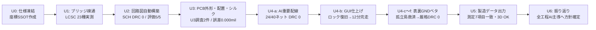

<!--
Copyright (c) 2026 ADX Project Contributors
SPDX-License-Identifier: CC-BY-4.0
-->

# UNOMODOKI R3 プロジェクト総合レポート

〜 **EasyEDA Pro AI API による 37 部品・2 層 PCB クリーンルーム実装の記録・教訓・次世代課題** 〜

- **作成日**: 2026-11-28
- **プロジェクト期間**: 2026-11-28（U0 〜 U6 全 7 マイルストーン・1 セッション完走）
- **体制**: プロジェクトリーダー（PL）＝ AI（Antigravity / EasyEDA MCP） ／ 現場サポーター ＝ 人間
- **対象プロジェクト**: `Sandbox_UNOMODOKI_R3`（Arduino UNO R3 フォームファクタ互換・USB-C 現代化クリーンルームクローン）
- **関連ドキュメント**:
  - 開発計画書: [development_plan.md](../development_plan.md)
  - サポーター指示書（読む専用）: [supporter_instructions.md](../supporter_instructions.md)
  - サポーター記録書（書く専用）: [supporter_log.md](../supporter_log.md)
  - M5 向け技術知見集: [lessons_learned.md](../lessons_learned.md)
  - U3 個別調査レポート: [USB 外形クリアランス調査](u3_usb_outline_clearance_report.md) ／ [DRC 後の全パッド `×` マーク調査](u3_pad_x_markers_investigation.md)

---

## エグゼクティブサマリー

本プロジェクトは、ADX フラッグシップ基板（M5：[CORE-U rev6](../../../../CORE-U/rev6/spec.md)）の本格設計に進む前段の実戦準備運動として、EasyEDA Pro AI API（非・常駐 MCP ブリッジ）を用いて **37 部品・40 ネット・2 層ビア配線・精密メカ外形（160 mil Arduino Gap 含む）を持つ UNO R3 互換基板 `UNOMODOKI R3`** をゼロからクリーンルーム実装した記録である。

- **成果**: 回路図 DRC `0` 件・PCB 厳格 DRC `0` 件・未配線 `0` 本・座標誤差 `0.000 mil`・EasyEDA 測定ツール 7 項目全一致・3D ビュー高評価・製造データ 3 点（Gerber 15 ファイル / CPL `.xlsx` / BOM CSV）を **1 日で完走**した。
- **最大の結論**: 仮説 H1〜H4 はすべて支持されたが、現場体感から **「人間が GUI でオートルーティング等を操作する時代は終わりつつあり、M5 以降は全工程を AI 主導へ移行すべき」** という明確な転換方針が確定した。
- **次の一手**: 車輪の再発明を避けるための **先行 AI 回路設計サーベイ論文の作成**、**マッス（塊）単位の反復型設計とフットプリント外接矩形抽出**、**次世代ルーティング（物理ポテンシャル場・非 45° 曲線配線・不可能性解消）**、**GND ビアの意味論化**、および **LAN 内専用 Windows 機（Omnivoice GPU マシン）への EasyEDA 実行基盤移設** を次フェーズの中核課題として設定した。

---

## 第 1 章：なにをやったのか（実施内容と最終成果）

### 1.1 プロジェクトの目的と設計方針

M4 の「Hello Circuit PoC（5 部品・単層・ビアなし）」から M5（ADX CORE-U rev6）へ直接飛ぶリスクを低減するため、以下の 3 条件を満たす実戦ベンチマークとして `UNOMODOKI R3` を選定・実施した（[候補調査レポート](../../research_report.md)）。

1. **クリーンルーム実装**: 本家 Arduino の商標・ロゴ・CC BY-SA 設計データは一切流用せず、公開外形図（[Arduino_uno_r3_size_mill.png](../data/Arduino_uno_r3_size_mill.png)）の数値寸法のみを機械可読 SSOT（[spec_geometry.json](../spec_geometry.json)）化してゼロから構築。
2. **M5 予行演習としての技術要素**: 30 部品超の回路図、TQFP-32 多ピン MCU（`ATmega328P-AU`）、USB Type-C 16P（独立 `5.1kΩ` CC 抵抗）、WCH USB-UART（`CH340C`）、16MHz 水晶、3.3V LDO（`AMS1117-3.3`）、2 層ビア配線、表裏 GND ベタ、9 頂点多角形外形＋4 穴＋160 mil ギャップ＋大量ピン名シルクを網羅。
3. **デジタル完全検証ゴール（U0 凍結仕様）**: 電源は USB-C 5V 専任に割り切り、実物製造は行わず「EasyEDA Pro 測定ツール 7 項目照合・3D ビュー検品・製造データ 3 点完備」を合格基準とした。

### 1.2 全工程（U0 〜 U6）の実施フローと実績

| 工程 | 主担当 | 主な実施内容 | 結果・定量的エビデンス |
| :-: | :---: | :--- | :--- |
| **U0** | PL ＋ 人 | 仕様 3 点凍結、お手本図面から 9 頂点外形・4 穴・全 38 ピンを [spec_geometry.json](../spec_geometry.json) へ定義。指示書（読む専用）と記録書（書く専用）を分離。 | **PASS**（仕様・座標 SSOT 確定） |
| **U1** | AI（MCP） | ローカルプロジェクト `Sandbox_UNOMODOKI_R3` 作成。`LIB_Device.getByLcscIds()` で 23 種・37 部品の在庫・Basic 区分・3D モデル・全ピン極性を 4 部品バッチで実測。人間向け [bom_summary.md](../bom_summary.md) を生成。 | **PASS**（廃番 `0`・主要全部品 3D モデルあり） |
| **U2** | AI（MCP） | 機能ブロック別に回路図を自動配置・実測座標配線・ネットラベル結線。`SCH_Drc` 実行と Protel2 ネットリスト全数照合を実施。 | **PASS**（SCH DRC エラー `0`・40/40 ネット一致・可読性 **`5 / 5`**） |
| **U3** | AI ＋ 人 | `importChanges` 同期後、9 頂点外形・M3 NPTH 穴×4・5 ヘッダ（閉ループ自動キャリブレーション）・全 SMD 配置・41 シルクを自動生成。途中の `×` マーク 2 件を個別調査・解消。 | **PASS**（全 42 点誤差 **`0.000 mil`**・Arduino Gap **`160.00 mil`**・実用度 **`4 / 5`**） |
| **U4** | AI ⇄ 人 | **U4-a**: AI が USB 差動・VBUS・水晶・3.3V・LED・上位/アナログバス等 24 ネット（140 線＋10 ビア）をクリアランス 0 で配線。 **U4-b**: 人間が GUI オートルーティング（12 分）で残り 15 信号ネットを配線。 **U4-c〜f**: AI が表裏 GND ベタ（20 mil 内側）・孤立島スティッチビア・設計ルール同期を実施。 | **PASS**（372 線 / 48 ビア / 未配線 **`0` 本** / PCB 厳格 DRC **`PASS`・違反 `0` 件**） |
| **U5** | AI ＋ 人 | AI が Gerber ZIP・CPL `.xlsx`・UTF-8 BOM CSV・クリーン PNG を出力後、CLI セッションをクローズ。人間が通常 GUI の測定ツール 7 項目と 3D ビューで最終検品。 | **PASS**（測定 7 項目 **全一致**・3D モデル高評価） |
| **U6** | PL ＋ 人 | 仮説 H1〜H4 の最終判定、M5 分業方針（全工程 AI 主導）、次世代 AI 回路開発 R&D 課題を [lessons_learned.md](../lessons_learned.md) に確定。 | **完了・プロジェクトクローズ** |

### 1.3 最終成果物一覧

| 区分 | ファイル | 検証結果 |
| :--- | :--- | :--- |
| **回路図 PNG / BOM / Netlist** | [unomodoki_sch.png](../outputs/unomodoki_sch.png) / [unomodoki_bom.csv](../outputs/unomodoki_bom.csv) / [unomodoki_netlist.net](../outputs/unomodoki_netlist.net) | 37 部品（23 種）・40 ネット完全一致・SCH DRC エラー 0 |
| **最終 PCB PNG / DRC ログ** | [unomodoki_pcb_final.png](../outputs/unomodoki_pcb_final.png) / [step4_final_drc.json](../outputs/step4_final_drc.json) | 黄色 `×` ゼロ・ラッツネスト `0` 本・厳格 DRC `true`（カテゴリ `0`） |
| **座標 SSOT アサート** | [step5_final_geometry_assert.json](../outputs/step5_final_geometry_assert.json) | 全 42 点（ヘッダ 32P＋ICSP 6P＋M3 穴 4 点）誤差 `0.000 mil` |
| **Gerber ZIP** | [unomodoki_gerber.zip](../outputs/unomodoki_gerber.zip) | 122.8 KB・全 15 ファイル（表裏銅箔/シルク/レジスト/ペースト/外形＋PTH/NPTH/Via ドリル完備） |
| **配置座標 CPL** | [unomodoki_cpl.xlsx](../outputs/unomodoki_cpl.xlsx) | 10.5 KB・mm 単位 Excel 形式（XLSX マジック検証済） |
| **PCB BOM CSV** | [unomodoki_bom_pcb.csv](../outputs/unomodoki_bom_pcb.csv) | UTF-16LE → UTF-8 変換済・23 種 / 37 部品 |
| **自動化スクリプト群** | `hardware/SANDBOX/cloning/UNOMODOKI_R3/scripts/`（全 19 本） | U1〜U5 の全 API 実行・検証手順を再現可能に保存 |

---

## 第 2 章：起こった出来事はなにか（時系列トラブル・発見・意思決定の記録）

実戦の中で **10 件のリアルな事象** が発生した。いずれも隠さず原因特定・対処・記録を行ったことが、本実験最大の財産となった。

### 出来事 1（U0）：生 JSON レビューの壁 ＆ ドキュメント責務分離
- **事象**: 座標 SSOT である [spec_geometry.json](../spec_geometry.json) を確認依頼したところ、サポーターから *「json の羅列はレビューできるレベルでは読めなかった（笑）」* との率直なフィードバックがあった。また 1 ファイルに指示と記入欄が混在すると扱いにくい課題も浮上した。
- **対応**: 指示書（読む専用：[supporter_instructions.md](../supporter_instructions.md)）と記録書（書く専用：[supporter_log.md](../supporter_log.md)）へ即座に分離し、U1 以降は生 JSON ではなく人間向け Markdown 表（[bom_summary.md](../bom_summary.md)）や PNG で提出する運用へ切り替えた。

### 出来事 2（U1）：一括プローブの 120s タイムアウト、仮当て LCSC 誤り、LED 極性の罠
- **事象**: ① 23 部品を一括 `invoke` で検索すると `REQUEST_TIMEOUT (120s)` が発生。② 記憶ベースの初期候補 LCSC 番号（ヘッダ 4 種・12pF コンデンサ等）が別部品に紐づいていた。③ 同一メーカーの `KT-0603*` 0603 LED でも、**緑 (`C12624`)・青 (`C2288`) は `Pin1=K / Pin2=A`** なのに、**黄 (`C2287`)・赤 (`C2286`) は `Pin1=A / Pin2=K`** と極性が逆転していた。
- **対応**: **4 部品/バッチ**（約 10 秒/回）へ分割し、`lib_Device.search()` と `getAllPinsByPrimitiveId()` で全 23 種・3D モデル有無・実ピン極性を確定したことで、LED 逆接続バグを未然に防いだ。

### 出来事 3（U2）：回路図の回転角正規化、警告 13 件、タイムアウト残留による重複部品
- **事象**: ① `sch_PrimitiveComponent.create(..., rot=90)` が内部で `270` へ正規化され、期待角基準の反転が空振りして LED 3 個が逆向きに配線された。② 電源/GND フラグ直結ワイヤへの `net` 付与で `ONENETNAME` 警告が多発。③ `invoke` タイムアウト後も EasyEDA 側で配置が走り続け、再実行時に `R10`, `D2`, `SW2` 等の自動リネーム重複部品が発生した。
- **対応**: ページ再生成＋実測回転角ベース補正＋ホワイトリスト部品数アサート＋Protel2 ネットリスト全数照合により、37 部品・40/40 ネット一致・意図的 NC 14 ピン以外の DRC 違反 0 件を達成。サポーターから **可読性 `5 / 5`** の評価を獲得した。

### 出来事 4（U3-①）：サポーターが `J_USB` 外形上の `×` マークを発見 → API 検知実証
- **事象**: 初回 U3 プレビューで、サポーターが USB-C 端子と基板外形線の交差部に黄色 `×` マークを発見し、*「これは大丈夫か？ API から確認できるのか？」* と問題提起。
- **調査・対応**: `pcb_Drc.check(true, false, true)` で照合した結果、前シェル長穴（`J_USB_2`, `J_USB_3`）と基板外形線の距離が **`7.2 mil < 11.8 mil`** という実際の製造クリアランス違反（`Board Outline to TH Pad`）を 100% 機械検知できた。`J_USB` を `X = 1140 → 1160 mil` へ移動してクリアランス `27.2 mil`・違反 `0` 件へ解消し、[u3_usb_outline_clearance_report.md](u3_usb_outline_clearance_report.md) にまとめた。

### 出来事 5（U3-②）：全パッド 152 個への黄色 `×` 一斉出現 → リードオンリー立ち止まり調査
- **事象**: `J_USB` 修正後の 2 回目 PNG で、突如ボード上のほぼ全パッドに黄色 `×` マークが出現。サポーターの *「改修せず一旦立ち止まって調査レポートをまとめよう」* という的確な判断を受け、完全リードオンリー調査を実施。
- **調査結果**: 全 166 パッド＝配線対象 **152 パッド** ＋ 意図的 NC **14 パッド** であり、`Clearance Error = 0`・`Connection Error = 152`・`Ratlines = 112`（理論値 $152 - 40 = 112$）と 1 対 1 一致。**`pcb_Drc.check()` は `userInterface = false` でもキャンバスへ未配線 `×` を一斉描画する副作用があり、DRC 実行後に PNG を撮ったことが原因**と完全証明した（[u3_pad_x_markers_investigation.md](u3_pad_x_markers_investigation.md)）。

### 出来事 6（U4-a）：ビア後付けによる `length: 0` 未配線バグ ＆ 初期クリアランス 15 件解消
- **事象**: AI 重要配線（140 線＋10 ビア）の初回実行時、表裏配線が同一座標のビアに到達しているのに EasyEDA が `length: 0` の未配線ラッツネストを報告する怪現象と、USB/水晶周辺のクリアランス違反 15 件が発生。
- **対応**: EasyEDA Pro 4.1.105 では **`pcb_PrimitiveVia.create()` を `pcb_PrimitiveLine.create()` より先に実行しないと表裏結合が認識されない** ことを突き止め（Via-Before-Track 原則）、配線トポロジ修正と合わせて **クリアランス違反 0 件・24/40 ネット完走**（ラッツネスト `112 → 68`）を達成した。

### 出来事 7（U4-b）：`origin: "cli"` ウィンドウでの GUI ロック・保存不能障害 ＆ EasyEDA 新設定ポップアップ
- **事象**: AI が開いた `origin: "cli"` ウィンドウ上でサポーターが GUI 配線を行おうとしたところ、**配線コマンドがグレーアウトし、`Ctrl+S` 保存もエラーになる**トラブルが発生。また再起動時に EasyEDA から新設定 `Drag Net Name` の選択ダイアログが表示された。
- **対応**: 即座にメモリ上の全配線・ビアを `outputs/u4b_emergency_backup.json` へ緊急退避したうえで安全に再起動。新設定には意図せぬネット名改変を防ぐ **`Modify Property Position (Strict)`** を推奨・選択。通常の `origin: "user"` ウィンドウで再開したサポーターが **12 分（17:56〜18:08）** で残り 15 信号ネットをオートルーティング完走・保存した。

### 出来事 8（U4-c〜f）：表裏 GND ベタ孤立島（32→6→2→1→0）、`Slot Region` 干渉、ビア最小径、`Netlist Error`
- **事象**: 表裏 GND ベタ投入後、① 信号線ループに囲まれた 6 箇所（`J_USB` / `C5` / `C6` / `R2` / `C2` / `Y1` / `U1.3`）が孤立島として残留、② `J_USB` の GND 接続線がフットプリント内位置決めスロット（無ネット `Slot Region`）へ `5.2 mil < 11.8 mil` で抵触、③ 一部ビアの穴径 `10 mil` が標準ルール（`>= 11.8 mil`）に抵触、④ GUI オートルーティング後の設計ルール構造差分（`common` vs `1`）により `Netlist Error` 1 件が発生。
- **対応**: PCB 全線・全ビアを抽出し、**ローカル Node で 2 層 10 mil グリッド・フラッドフィル＋幾何クリアランス計算** を実行して 100% クリアかつ主 GND プレーン到達済みの座標へ `12/22 mil` スティッチビアと迂回線を投入。さらに全 40 ネットの 100% 一致を検証したうえで `importChanges(undefined, true)` を実行し、配置・配線を一切壊さずに **`Ratlines = 0`・厳格 PCB DRC `PASS`（違反 `0` 件）** に到達した。

### 出来事 9（U5-①）：製造データの UTF-16LE エンコード罠 ＆ ロック回避ハンドオフ
- **事象**: EasyEDA API の `getBomFile(..., 'csv')` は UTF-16LE（`0xff 0xfe`）で出力され、そのまま保存すると文字化け・ツール誤読の原因となる。
- **対応**: CPL は `getPickAndPlaceFile(name, 'xlsx', 'mm')`、BOM はマジックバイト自動判定で UTF-8 へデコード出力。さらに U4-b の教訓を即反映し、**書き出し・保存後に PL 側で先に `session.close(destroy: true)` を実行してからサポーターへ引き渡した**ため、U5 の GUI 測定・3D 検品はトラブルゼロで完了した。

### 出来事 10（U5-②）：「ネジ穴が大きく見えた」指摘に対する Gerber 実ドリル検証
- **事象**: U5 検品で全 7 項目一致・3D モデル高評価を得た一方、サポーターから *「なんかネジ穴がでかかった！」* との違和感メモが挙がった。
- **検証結果**: [unomodoki_gerber.zip](../outputs/unomodoki_gerber.zip) 内の実 CNC ドリルファイル `Drill_NPTH_Through.DRL` を照合したところ、**`T02C3.17500`（`3.175 mm = 125.00 mil`）** で UNO R3 規定と完全一致していた。2D 上でベタ銅クリアランス（片側 ~12 mil）が重なり約 `150 mil` 径に見えた点と、`MH4` が `SCL` に 140 mil で超近接している構造的視覚効果によるものであった。

---

## 第 3 章：えられた教訓はなにか（検証結果と実践鉄則）

### 3.1 4 つの仮説の最終判定と戦略転換

| ID | 仮説 | U6 最終判定 | 本質的な学び |
| :-: | :--- | :---: | :--- |
| **H1** | 回路図は 30 部品級でもブロック分割＋ネットラベル中心なら 90% 以上 AI 自律で実用になる | **支持** | 100% AI 自律で SCH DRC 0・可読性 **5/5**。実務投入可能レベルに達している。 |
| **H2** | メカ・配置・シルクは AI（SSOT 駆動）が人間手作業より圧倒的に速く正確 | **支持** | 42 点誤差 **`0.000 mil`**・41 シルク 14.6 秒・測定 7 項目全一致。人間の GUI 手作業は不要。 |
| **H3** | 2 層配線は重要ネット/ベタ＝AI、一般信号＝人間 GUI のハイブリッドが最適 | **支持** *(現行環境)* | 現行環境での実用性は実証できたが、**GUI オートルーティング操作が人間にとって最大のストレス**であることも判明。次フェーズは **全工程 AI 主導** へ振り切るべきとの結論に至った。 |
| **H4** | 事前エビデンス整備により人間負荷は 1 工程 5〜15 分に収まる | **支持** | U4 実作業 12 分・他工程も短時間で完走。ただし「生 JSON を渡さず Markdown 表・クリーン PNG で渡す」ことが前提条件。 |

### 3.2 EasyEDA Pro 4.1.105 AI API 実践鉄則（M5 必須チェックリスト）

1. **LCSC・極性は 4 部品/バッチで必ず実測する**（記憶禁止・同一 LED シリーズでも極性反転あり）。
2. **回路図の回転補正は配置後の `getState_Rotation()` 実測値を基準にする**（`90→270` 正規化対策）。
3. **回路図検証は「ホワイトリスト部品数アサート＋Protel2 全数ネット照合＋NC フィルタ DRC」を 1 セットにする**。
4. **U3 配置完了直後に「配線前クリアランス DRC ＝ 0（`Connection Error` 除外）」を必須ゲート化する**。
5. **レビュー用 PNG は必ず `pcb_Drc.check()` の「前」に撮影する**（未配線 `×` 描画の副作用回避）。
6. **PCB ビアは必ず配線より「先」に生成し（Via-Before-Track）、標準径は `hole=12 / dia=22 mil` 以上とする**。
7. **USB-C 等の長穴・位置決めボス（`Slot Region`）へは GND 線でも `11.8 mil` 以上離して迂回する**。
8. **GND ベタ孤立島対策はローカル 2 層グリッド・フラッドフィルで事前到達確認してから API 投入する**。
9. **GUI/CLI 競合防止のため、AI 作業後は必ず `save()` → `session.close(destroy: true)` で CLI ウィンドウを閉じてから人間へ渡す**（`Drag Net Name` は `Strict` 固定）。
10. **製造出力は CPL＝`xlsx (mm)`、BOM＝UTF-16LE→UTF-8 自動デコードを標準化する**。
11. **EasyEDA Pro 4.1.105 には `pcb_Document.startAutoRouting` / `getDsnFile` / `importAutoRouteSesFile` 等の Beta API が存在**し、人間 GUI オートルーティングを API 置換できる余地が大きい。

### 3.3 AI × 人間協業から得た組織・プロセス上の教訓

- **「立ち止まってリードオンリー調査する」勇気の価値**: U3 で改修を急がず原因を数値証明したことで、EasyEDA DRC のキャンバス描画仕様という恒久的な知見（鉄則 #5）が確立できた。
- **API の得意領域と 3D 物理領域の明確な境界**: 「銅箔・穴・外形クリアランスと座標精度＝AI が 100% 機械保証」「3D 物理突き出し・ケーブル挿抜感・視認性＝人間が 3D ビューで最終検品」という役割分担がクリアに見えた。
- **「やりとり」より「AI が開発しやすい環境整備」へ**: 人間と AI が GUI を介して細かくキャッチボールするより、AI が自律的に検証・修正ループを回せるツール・インフラ・分割構造を整える方が圧倒的にレバレッジが高い。

---

## 第 4 章：今後の課題はなにか（全工程 AI 主導へ向けた R&D 課題）

U6 にて **「全工程 AI 主導へ移行する」** 方針が確定したことを受け、ADX 本丸（[CORE-U rev6](../../../../CORE-U/rev6/spec.md)）の実用化と AI ネイティブ基板開発基盤の構築に向けて、以下の **6 つの優先課題** を整理する。

### 課題 1（最優先）：先行 AI 回路設計ノウハウ・研究の徹底調査 ＆ サーベイ論文の作成
- 独自実装へ飛びつく前に、世界の先行研究・OSS・産業事例（LLM × EDA、強化学習／解析的配置、トポロジカル／任意角ルーター、物理場ルーター、DRC 自動修復ループ等）を網羅的に調査し、**体系的なサーベイ論文（技術レポート）** としてまとめる。そのうえで不足領域だけを自前開発する。

### 課題 2：3 階層「マッス（塊）」設計と高い修正可能性（Modifiability）の実現
- 一括スクリプト生成は全体作り直しのコストが重い。絵画のデッサンのように、基板を以下の **3 階層＋ブロック反復ループ** で構築する開発方式を確立する：
  1. 全体の **マッス（機能・電源・ノイズドメインの塊）分割**
  2. マッスごとの **配置エリア下書き（フロアプラン）**
  3. マッス内の **部品配置・配線・部分レビュー・ロック（`locked: true`）** を反復

### 課題 3：フットプリント外接矩形（長径・短径・Courtyard）の自動取得と部品間クリアランス
- U4 で顕在化した「0603 抵抗と IC パッケージの超近接」および U5 の「M3 ネジ穴周りの視認・干渉」を機械的に防ぐため、以下を検証・実装する：
  - EasyEDA のフットプリント情報（パッド群・シルク枠・3D モデル寸法）から **部品ごとの正確な外接矩形（短径・長径・Courtyard）を自動取得できるか** の技術検証。
  - 部品 Courtyard 同士の重なり・最小クリアランスチェック、および M3 ネジ頭キープアウト（`Ø5.8 mm`）の自動アサート化。

### 課題 4：次世代ルーティング理論の開拓（物理ポテンシャル場・非 45° 曲線配線・配線不可能性）
1. **AI 事前準備 × 高度オートルーティング（磁石 N/S ポテンシャル場構想）**: パッドや配線間に磁石の N/S のような引力・斥力関係（Force-Directed / Potential-Field）を与え、パッドから出発した配線が全体の力学バランスに沿って滑らかに位置・経路を自己組織化するアルゴリズム、および EasyEDA `startAutoRouting` / `.ses`（FreeRouting）連携の検証。
2. **「45° ルール」自体の本質的再検討**: 人間の手配線時代の慣習である 45° 制約が電気的・製造的に本当に最適なのかを再検証し、**任意角（Any-Angle）・多角形・曲線配線** の電気特性・配線密度・製造歩留まり上の優位性を調査する。
3. **配線不可能性（Unroutability）と配置-配線協調最適化**: 部品の配置や回転角が悪いせいで物理的に配線不能（トポロジ的閉塞）となるケースを自動検出し、**部品の回転・再配置へ自動で戻すフィードバック機構** を構想する。

### 課題 5：GND ビア配置の理論化（電気的・機械的意味論 ＆ レビュー可能性）
- 孤立島救済として場当たり的に点在させる GND ビアから脱却し、**「マッス単位の GND 分割 → 外周（シールド／ビアフェンス）および内部（リターンパス近傍）への規則的配置」** の設計ルールを策定する。
- すべての GND ビアに **電気的意味論**（リターン電流・EMI・熱）、**機械的意味論**（強度・製造クリアランス）、および **レビュー可能性**（設置意図を人間・AI が一目で検証できる分類・可視化）を持たせる。

### 課題 6：専用 Windows 実行インフラの再整備（Omnivoice GPU マシンへの移設）
- 開発者のノート PC 上に EasyEDA Pro を同居させると、GUI 競合・作業占有・非・常駐起動の手間がボトルネックになる。
- LAN 内にすでに稼働している **Podcast 生成用の Omnivoice 用 GPU Windows マシン** へ EasyEDA Pro と `start_easyeda_bridge.bat` を専用実行ノードとして移設し、開発者の作業環境から独立した常時アクセス可能な AI 回路開発インフラを構築する。

---

## まとめ

`UNOMODOKI R3` は「遊び兼・実戦準備運動」としてスタートしたが、**37 部品・2 層 PCB のゼロエラー完走**という確かな技術実証だけでなく、**「全工程 AI 主導への転換」と「AI ネイティブ基板設計の 6 大 R&D 課題」** という ADX 全体の将来を拓く戦略的指針を生み出すに至った。本レポートおよび [lessons_learned.md](../lessons_learned.md) を土台として、次フェーズ（先行研究サーベイ論文 ＆ 専用実行インフラ整備 → M5 `ADX CORE-U rev6`）へ進む。
