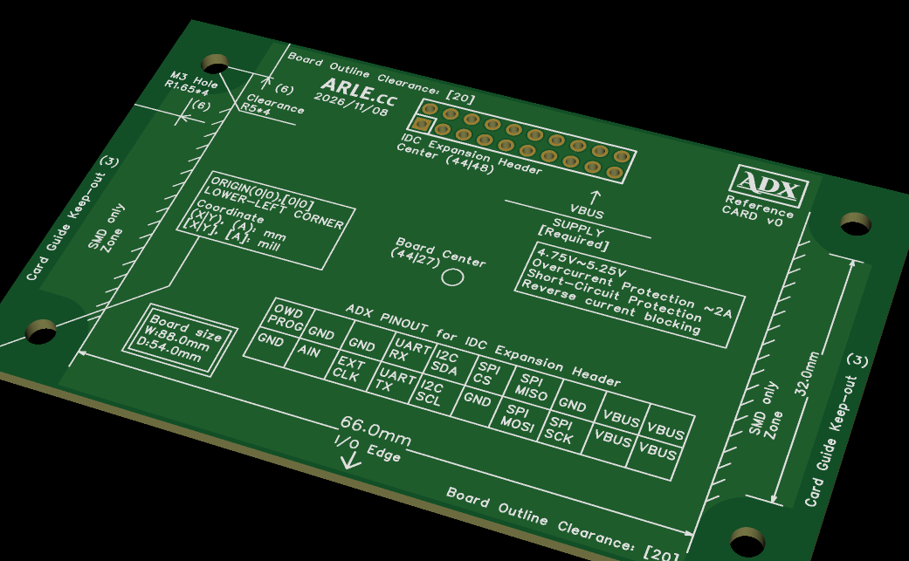
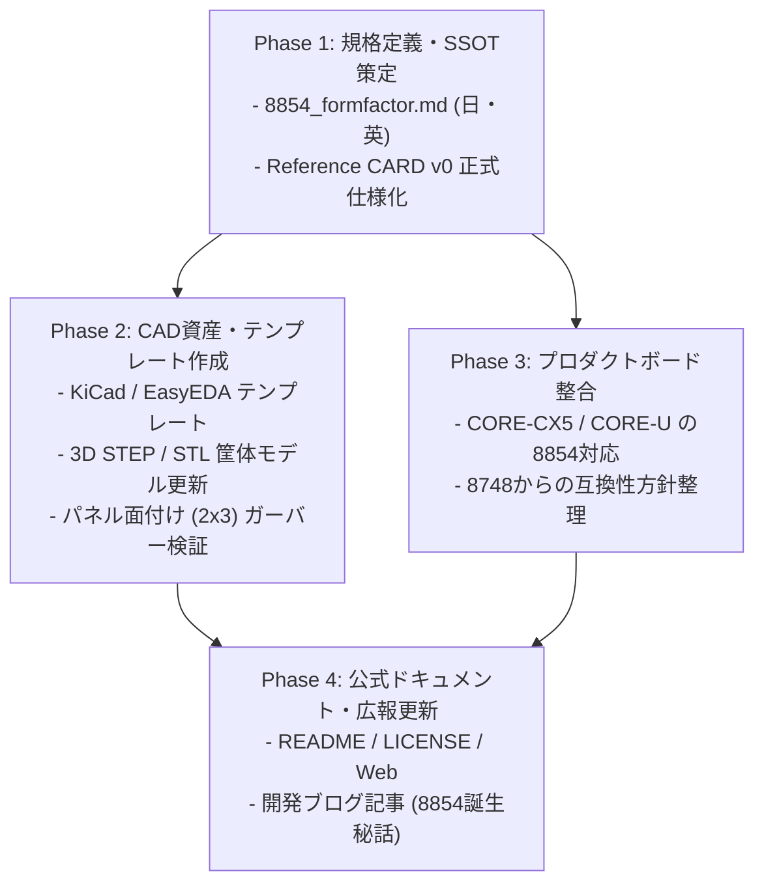

<!--
Copyright (c) 2026 ADX Project Contributors
SPDX-License-Identifier: CC-BY-4.0
-->

# ADX 8854 Form Factor 規格改訂・移行計画書
(ADX 8854 Form Factor Migration & Documentation Plan)

- **文書ID**: PLAN-ADX-8854-FORMFACTOR-001
- **ステータス**: DRAFT / レビュー中
- **作成日**: 2026-11-09
- **対象スコープ**: リポジトリ全域のフォームファクタ仕様（`docs/`、`hardware/`、`memo/`、`site/`、`README.md`）
- **リファレンス実装**: `hardware/CARD/Reference/` （ADX Reference CARD v0）
- **キービジュアル**: `docs/blog/images/reference_card_v0_20261109.png`

---

## 1. 背景と改訂の必然性 (Background & Rationale)

ADXプロジェクトでは、産業用制御盤・現場設備に組込可能な「現場で動くArduino」として、基板外形 $87.0\,\text{mm} \times 48.0\,\text{mm}$ の「8748 Form Factor」を策定・推進してきました。
しかし、rev1〜rev2の実機試作および量産パネル製造（PCBA）の検討を進める中で、複数の重要な製造上・構造上の課題と改善機会が明らかとなりました。

これらを解決し、真に量産性と現場組込性に優れた次世代標準として策定されたのが **「8854 Form Factor」($88.0\,\text{mm} \times 54.0\,\text{mm}$)** です。

```
┌────────────────────────────────────────────────────────────────────────┐
│                   【 8748 から 8854 への進化の要点 】                  │
├────────────────────────────────────────────────────────────────────────┤
│ 1. コネクタ形式の刷新 : ライトアングル IDC ➔ バーティカル (Vertical) IDC │
│ 2. パネル製造性 (DFM) : C3面取り廃止によるストレート V-Cut パネル化       │
│ 3. 経済ロット最適化   : 2×3 = 6pcs/Panel (186×162mm, JLCPCB最適域)     │
│ 4. 認知工学 (Miller)  : マジカルナンバー7以下の「6個/組」で検査ミス低減   │
│ 5. スロットイン筐体   : 66mm I/O辺 + 左右SMD Only領域による下面スライド   │
│ 6. 機械的マージン     : ネジ穴中心 5mm ➔ 6mm で Φ10mm座面外周に1mm肉厚 │
└────────────────────────────────────────────────────────────────────────┘
```

### 1.1 コネクタ形式の刷新と実質奥行寸法の最適化
- **旧8748の制約**: 当初は水平方向に引き抜くライトアングル IDC Eject Header（ラッチ付き）を前提とし、奥行48mmで規格化されていました。しかし、ライトアングルコネクタは基板外側に約15〜20mm飛び出し、筐体全体の奥行きやケーブリング空間を圧迫していました。
- **8854での解決**: IDCコネクタを **バーティカル（垂直実装）** に変更。コネクタの基板外張り出しをゼロ化し、基板寸法を54mmに微増させても、コネクタ込みの筐体フットプリントはむしろ小型化・高密度化されます。

### 1.2 パネル製造性（Vカット適性とコスト低減）
- **旧8748の課題**: 角部に「C3 面取り（$3\text{mm} \times 45^\circ$）」を規定していたため、基板外周の全辺を通し刃で一括加工する「Vカット（V-Scoring）」が不可能でした。ルーター加工（外形フライス抜き＋ミシン目タブ）が必要となり、面付け効率の低下と加工コスト・基板端バリの発生原因となっていました。
- **8854での解決**: C3面取りをオミットし完全な矩形（$88 \times 54\,\text{mm}$）とすることで、**全方向ストレートVカット加工** が可能となりました。

### 1.3 経済的パネルサイズと認知工学（マジカルナンバー7）
- **JLCPCB等の推奨パネルサイズ整合**:
  - $2 \text{列} \times 3 \text{行}$（1パネルあたり 6 枚）の面付けにより、外形寸法は捨て基板（両端各5mm）を含めて **$186\,\text{mm} \times 162\,\text{mm}$** となります。
  - これは基板製造工場（JLCPCB / PCBWay等）の標準パネル製造推奨レンジ（$150 \sim 200\,\text{mm}$ 角）に完璧に合致します。
- **認知負荷の低減（マジカルナンバー 7）**:
  - 1パネルが $2 \times 4 = 8$ 枚になると、パネル寸法が200mmを超えて割増対象となるだけでなく、人間の瞬間的把握・短期記憶の限界（Millerの法則: $7 \pm 2$）を超えます。
  - **「6個」** という作業単位に抑えることで、面実装（SMT）後の目視検査、通電テスト、ピッキング工程での取り違え・見落としミスを有意に抑制します。

### 1.4 筐体スロットインと干渉回避（SMD Only ゾーン）
- スナップフィットやスライドレールによる工具レス組込を実現するため、前面長辺の中央 **66.0 mm** を「I/O Edge」と規定。
- I/O Edgeの外側（基板左右両端部）の裏面を **「SMD Only（スルーホールリード突出禁止領域）」** に指定。これにより、基板下部に筐体レールやスナップフィット爪をスムーズに潜り込ませることが可能となりました。

### 1.5 ネジ穴配置の最適化
- 旧8748では四隅端から 5.0 mm でしたが、8854では **6.0 mm** に変更。
- $\Phi 10.0\,\text{mm}$（半径 5.0 mm）のネジ頭・M3座金・スペーサー禁止領域を確保しても、外形端部との間に **1.0 mm の肉厚マージン** が残るため、締め付け時の基板割れやパターン剥離を防止できます。

---

## 2. 8854 Form Factor 仕様要約 (Reference Specification)



### 2.1 メカニカル仕様 (Mechanical Specification)

| 項目 | 8854 規格値 | 旧8748規格値 | 備考 |
| :--- | :--- | :--- | :--- |
| **基板外形 (Board Size)** | **$88.0\,\text{mm} \times 54.0\,\text{mm}$** | $87.0\,\text{mm} \times 48.0\,\text{mm}$ | Vカット製造に適した完全矩形 |
| **原点 (Origin)** | 左下角 $(0.0, 0.0)$ | 左下角 $(0.0, 0.0)$ | エレキ・メカ共通基準点 |
| **基板中心 (Board Center)**| $(44.0, 27.0)\,\text{mm}$ | $(43.5, 24.0)\,\text{mm}$ | |
| **取付穴径 (M3 Hole)** | **$\Phi 3.30\,\text{mm}$ (R1.65)** | $\Phi 3.30\,\text{mm}$ | NPTH (非メッキスルーホール) 4箇所 |
| **取付穴中心座標** | **$(6.0, 6.0), (6.0, 48.0),$**<br>**$(82.0, 6.0), (82.0, 48.0)$** | $(5.0, 5.0), (5.0, 43.0),$<br>$(82.0, 5.0), (82.0, 43.0)$ | 四隅端から $6.0\,\text{mm}$ オフセット |
| **取付穴ピッチ** | **$76.0\,\text{mm} \times 42.0\,\text{mm}$** | $77.0\,\text{mm} \times 38.0\,\text{mm}$ | |
| **取付穴クリアランス** | **半径 $5.0\,\text{mm}$ ($\Phi 10.0\,\text{mm}$)** | 半径 $5.0\,\text{mm}$ | ネジ頭・ワッシャー干渉禁止領域 |
| **I/O Edge 有効幅** | **$66.0\,\text{mm}$** (下面中央) | 約 $67 \sim 70\,\text{mm}$ | $X = 11.0 \sim 77.0\,\text{mm}$ に配置 |
| **カードガイドキープアウト**| **左右端 $3.0\,\text{mm}$** | 左右端 $3.0\,\text{mm}$ | スロットインガイドレール用 |
| **SMD Only ゾーン** | **左右外側領域 (下面)** | 規定なし | スナップフィット爪の潜り込み許容 |
| **外形クリアランス** | **長辺側 20 mil ($0.508\,\text{mm}$)** | 規定なし | パターン・銅箔のキープアウト |

### 2.2 20-Pin バスコネクタ仕様 (IDC Expansion Header)
- **コネクタ形式**: 2.54mmピッチ 2列×10ピン バーティカル IDC ボックスヘッダー
- **中心座標**: **$(44.0, 48.0)\,\text{mm}$**（長辺 $88\,\text{mm}$ の完全センター配置、上端から $6.0\,\text{mm}$）
- **ドリル径**: $\Phi 1.10\,\text{mm}$ (PTH)
- **電源供給要件 (VBUS Supply)**:
  - 電圧: $4.75\,\text{V} \sim 5.25\,\text{V}$
  - 保護機能: 過電流保護（$\approx 2\,\text{A}$）、短絡保護、逆電流防止（Reverse current blocking）
- **ピンアサイン**: ADX 20-Pin Bus (SSOT) 準拠
  - 上列 (奇数): `OWD_PROG` | `GND` | `GND` | `UART_RX` | `I2C_SDA` | `SPI_CS` | `SPI_MISO` | `GND` | `VBUS` | `VBUS`
  - 下列 (偶数): `GND` | `AIN` | `EXT_CLK` | `UART_TX` | `I2C_SCL` | `GND` | `SPI_MOSI` | `SPI_SCK` | `VBUS` | `VBUS`

---

## 3. リポジトリ内影響範囲と対象ドキュメント一覧 (Impact Analysis)

リポジトリ全域で「8748」の記載を検出し、改訂対象を4つのティアに分類しました。

### Tier 1: コア規格ドキュメント（最優先改訂）
プロジェクトの根本規格を定めるSSOTドキュメント群です。
1. **`docs/ja/8748_formfactor.md`** ➔ `docs/ja/8854_formfactor.md` へ移行・刷新（旧仕様はアーカイブまたは併記）。
2. **`docs/en/8748_formfactor.md`** ➔ `docs/en/8854_formfactor.md` へ移行・刷新。
3. **`memo/architecture/8748_formfactor.md`** ➔ アーキテクチャ検討メモの改訂。
4. **`docs/spec/ADX_PINOUT.md`** ➔ ボード外形およびコネクタ位置の更新。

### Tier 2: ハードウェア設計・リファレンスボード
1. **`hardware/CARD/Reference/`**:
   - `concept.md`（確定仕様へのアップデート）
   - 新規スペックシート・製造手引きの作成。
2. **`hardware/CARD/Prototyping/`**:
   - `proposal.md` 内の外形参照・寸法記述の更新。
3. **`hardware/CORE-U/` / `hardware/CORE-CX5/`**:
   - 現行開発中のボードの外形図・ネットリストを8854寸法（$88 \times 54\,\text{mm}$、ネジ穴 $76 \times 42\,\text{mm}$）へ整合。

### Tier 3: プロジェクト概要・入門・トップページ
1. **`README.md`**:
   - フォームファクタ記述（8748 ➔ 8854）、リンク先仕様書の更新。
2. **`LICENSE.md`**:
   - Creative Commonsの対象文書名（「8748 Form Factor」➔「8854 Form Factor」）の整合。
3. **`Project_Snapshot.md`**:
   - ハードウェア仕様要約の更新。
4. **`site/README.md` & `site/src/pages/draft_lp.html`**:
   - LPドラフトの寸法（8748 ➔ 8854）の更新。

### Tier 4: マーケティング・過去ブログ・開発メモ（追記・アーカイブ管理）
*原則として過去の日付のブログ・レポートは改ざんせず、「Note: 2026/11より8854へ改訂」の注記を追加、または新記事でアナウンスする方針とします。*
1. **`memo/REPORT/`**:
   - `README_PROPOSAL.md`, `what_is_adx.md`, `STARTER_KIT_MARKET_RESEARCH_REPORT.md`
2. **`memo/merketing/`**:
   - `market_positioning.md`, `crowd_supply_application.md`, `core-r_concept_hack_the_rs485.md`
3. **`docs/blog/posts/` / `docs/blog/dist/`**:
   - 2026-10-22, 2026-11-03 などの過去記事は歴史的記録として保持し、次期週報（2026-11-10予定）にて「8854 フォームファクタ策定とリファレンスカード公開」を特集。

---

## 4. 移行ロードマップ (Phased Execution Roadmap)



### Phase 1: 規格定義・SSOT策定（即時着手）
- [ ] `docs/ja/8854_formfactor.md` および `docs/en/8854_formfactor.md` の新規作成。
  - `reference_card_v0_20261109.png` を基図として掲載。
  - メカニカル仕様、エレキ仕様（mil換算値）、DFM（Vカット面付けガイドライン）の完全定義。
- [ ] 旧 `8748_formfactor.md` に「8854 Form Factorへの移行通知」と新ドキュメントへのリンクを追記。
- [ ] `hardware/CARD/Reference/concept.md` を正式版仕様書へとアップデート。

### Phase 2: CAD資産・テンプレートの整備
- [ ] EasyEDA Pro / KiCad 向け「8854 ボード外形・キープアウト テンプレート」の作成。
  - 外形（$88 \times 54\,\text{mm}$）、M3取付穴（$76 \times 42\,\text{mm}$）、クリアランス $\Phi 10\,\text{mm}$、20-Pin バス位置 $(44, 48)$、SMD Only ゾーンの初期レイヤー定義。
- [ ] 3D CAD（STEP / STL）の作成:
  - 8854 ベースプレート、スロットイン筐体、レールサンプル。
- [ ] 2×3 パネル製造ガーバーのテスト生成・JLCPCB DFMチェック。

### Phase 3: ハードウェアプロジェクトの移行
- [ ] `hardware/CARD/Prototyping/`: 8854フォームファクタに合わせたユニバーサル基板の再設計。
- [ ] `hardware/CORE-CX5/`: メカニカル外形を8854へ更新し、端子台配置と前面パネル整合を確認。
- [ ] `hardware/CORE-U/`: 8854フォームファクタでのアートワーク検討。

### Phase 4: 広報・公式ドキュメント・Webサイト更新
- [ ] ルート `README.md`、`Project_Snapshot.md`、`LICENSE.md` の記述を更新。
- [ ] 公式サイト（`site/`）のスペック記述更新。
- [ ] 週報ブログ（`docs/blog/posts/`）にて「8854 Form Factorの発表と製造性革新（V-Cutとマジカルナンバー7）」を発信。

---

## 5. DFM・品質検証チェックリスト (Verification Checklist)

8854準拠の各ボード設計時に確認すべき要件です：

- [ ] **外形**: 外形寸法は $88.0 \times 54.0\,\text{mm}$ の完全矩形（Vカットを阻害する外形欠けや面取りがないこと）。
- [ ] **ネジ穴**: M3穴（$\Phi 3.3\,\text{mm}$）中心が四隅から $6.0\,\text{mm}$（ピッチ $76.0 \times 42.0\,\text{mm}$）に配置されていること。
- [ ] **ネジ頭キープアウト**: ネジ穴中心から半径 $5.0\,\text{mm}$（$\Phi 10.0\,\text{mm}$）以内に配線・部品・シルクが存在しないこと。
- [ ] **長辺配線マージン**: 長辺側（上下）外形線から 20 mil 以内に銅箔・パターンが進入していないこと。
- [ ] **ガイドレールマージン**: 左右短辺から $3.0\,\text{mm}$ の帯状エリアに部品が配置されていないこと。
- [ ] **裏面SMD Only遵守**: 中央 66.0 mm のI/O Edge外側領域（下面）にスルーホールピン（DIPリード）が飛び出していないこと。
- [ ] **バスコネクタ位置**: 20-Pin Vertical IDC ヘッダーの中心が $(44.0, 48.0)\,\text{mm}$ に正確に配置されていること。
- [ ] **パネル化**: 2×3面付け時に $186 \times 162\,\text{mm}$ となり、Vカット線がパネル全幅を直線で貫通していること。

---

## 6. 付録: 図面・参考画像

- **リファレンスボード実図（シルク表示）**:
  `docs/blog/images/reference_card_v0_20261109.png`
- **リファレンスボード・ガーバー製造データ**:
  `hardware/CARD/Reference/data/Gerber_PCB1_2026-11-09.zip`

