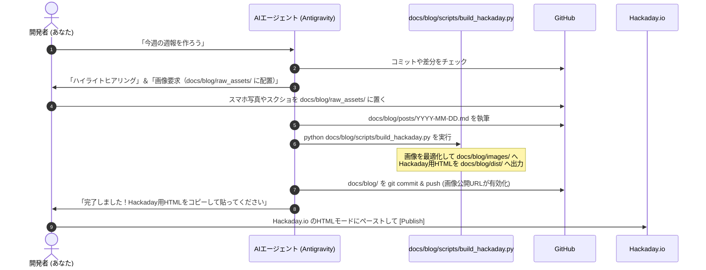

<!--
Copyright (c) 2026 ADX Project Contributors
SPDX-License-Identifier: CC-BY-4.0
-->

# ADX Hackaday.io 特化型 Weekly 開発ログ生成システム計画書
〜 「シンプルこそ金」：docs/blog/ に完全区画化された、Hackaday.io 最適化パイプライン 〜

- **策定日**: 2026-10-22 (docs/blog/ 完全区画化改定)
- **ステータス**: APPROVED / 計画確定
- **対象ディレクトリ**: `memo/PLAN/HACKADAY_WEEKLY_DEVLOG_SYSTEM_PLAN.md`
- **設計思想**: **KISS原則（Keep It Simple, Stupid） ＆ モジュール完全区画化**

---

## 1. エグゼクティブ・サマリー（完全区画化の狙い）

本リポジトリはハードウェア（`hardware/`）、ファームウェア（`firmware/`）、通信ソフトウェア（`software/`）の開発を主務とする**基幹開発リポジトリ**です。
開発のノイズにならないよう、ブログ・コミュニティ発信に関するすべての機能（原稿、生画像、公開画像、スクリプト、生成HTML）を **`docs/blog/` 配下に完全に区画化（カプセル化）** します。

```
ADX/ (リポジトリルートは一切汚さない)
├── firmware/
├── hardware/
├── software/
└── docs/
    ├── index.html                  # 既存のWebSerial Explorer (独立維持)
    └── blog/                       # 【ここに完全自己完結】
        ├── raw_assets/             # 開発者が生写真を置く作業フォルダ
        ├── images/                 # SSG最適化済み画像 (GitHub Pages公開用)
        ├── posts/                  # 週報Markdown原稿 (Git永続管理)
        ├── scripts/                # Hackaday特化型ビルドスクリプト
        └── dist/                   # Hackaday貼り付け用完成HTML
```

### 区画化による3大メリット
1. **リポジトリルートの汚染ゼロ**:
   - ルートに `scripts/` や `raw_assets/`、`dist/` などのフォルダを散らかさず、本筋の開発作業に一切影響を与えない。
2. **画像の公開パスが極めて美しく整理される**:
   - GitHub Pages経由の画像URLが `https://masafuro.github.io/ADX/blog/images/YYYY-MM-DD-filename.jpg` となり、直感的で管理しやすい。
3. **自己完結型モジュール**:
   - `docs/blog/` ごと移動・バックアップ・切り離しが可能。

---

## 2. ディレクトリ設計（`docs/blog/` 完全集約）

```
ADX/
└── docs/
    ├── index.html                      # 既存のWebSerial Explorer (トップ維持・不可侵)
    │
    └── blog/                           # ★ ブログ・Hackaday連携の完全区画
        ├── raw_assets/                 # [開発者用] スマホ写真やスクショを置く一時フォルダ
        │   └── 2026-10-22-hero.jpg
        │
        ├── images/                     # [公開用] スクリプトで自動最適化・圧縮された画像
        │   ├── 2026-10-22-hero.jpg     # (Pages URL: https://masafuro.github.io/ADX/blog/images/...)
        │   └── 2026-10-22-scope.png
        │
        ├── posts/                      # [原稿] 週報Markdownファイル (Git履歴管理)
        │   └── 2026-10-22.md
        │
        ├── scripts/                    # [ツール] ビルド・変換スクリプト
        │   └── build_hackaday.py
        │
        └── dist/                       # [成果物] Hackaday.io 貼り付け用HTML
            └── 2026-10-22.html
```

---

## 3. Hackaday.io エディタ特化 HTML仕様

Hackaday.ioのUIの癖（改行の自動挿入、狭いコード枠、画像の崩れ）をカバーするインラインスタイルを付与したスニペットを出力します。

### 出力完成形例 (`docs/blog/dist/2026-10-22.html`)

```html
<!-- Hackaday Project Log HTML Snippet (Ready to Paste) -->

<!-- Hero Image -->
<div style="text-align: center; margin-bottom: 20px;">
  
</div>

<p style="font-size: 1.1em; line-height: 1.6;"><strong>Solving the MCU pinout bottleneck and tuning WebSerial break signal timings.</strong></p>

<!-- The Challenge -->
<h2 style="border-bottom: 2px solid #00f0ff; padding-bottom: 4px; margin-top: 28px;">The Challenge</h2>
<p>今週直面した課題や、設計の壁について...</p>

<!-- The Solution & Experiment -->
<h2 style="border-bottom: 2px solid #00f0ff; padding-bottom: 4px; margin-top: 28px;">How We Solved It</h2>
<p>オシロスコープで波形を確認しながら、スルーレートとブレーク信号長を調整...</p>

<div style="text-align: center; margin: 16px 0;">
  
  <p style="font-size: 0.85em; color: #666; margin-top: 4px;"><em>Fig 1: Break timing capture on ATTiny1616 UPDI line</em></p>
</div>

<blockquote style="border-left: 4px solid #10b981; padding: 8px 16px; margin: 16px 0; background: rgba(16, 185, 129, 0.08);">
  <strong>Key Takeaway:</strong> ハードウェアの制約をソフトウェアのタイミング制御で吸収する設計手法。
</blockquote>

<!-- Highlights -->
<h2 style="border-bottom: 2px solid #00f0ff; padding-bottom: 4px; margin-top: 28px;">Weekly Progress</h2>
<ul style="line-height: 1.8;">
  <li><strong>Hardware:</strong> CORE-A 基板アートワーク修正</li>
  <li><strong>Firmware:</strong> ATTiny1616 UPDI & UART レジスタ最適化</li>
  <li><strong>Tools:</strong> WebSerial Explorer の接続安定性向上</li>
</ul>

<!-- Next Steps & Community -->
<h2 style="border-bottom: 2px solid #00f0ff; padding-bottom: 4px; margin-top: 28px;">Next Steps & Feedback</h2>
<p>来週はプロトタイプの実装に入ります。このピン配置についてアドバイスがあればぜひコメントください！</p>

<!-- CTA Footer -->
<hr style="margin: 32px 0; border: 0; border-top: 1px solid #ddd;">
<div style="background: #f8fafc; border: 1px solid #e2e8f0; border-radius: 6px; padding: 16px; margin-top: 20px;">
  <h3 style="margin-top: 0; font-size: 1.05em; color: #0f172a;">⚡ Project Links & Interactive Tools</h3>
  <p style="margin: 6px 0; font-size: 0.95em;">
    • <strong>Try WebSerial Explorer Online:</strong> <a href="https://masafuro.github.io/ADX/" target="_blank">Launch ADX Web Tool</a><br>
    • <strong>Open Source Hardware & Code:</strong> <a href="https://github.com/Masafuro/ADX" target="_blank">GitHub Repository (Masafuro/ADX)</a><br>
    • <strong>Technical Specs:</strong> <a href="https://github.com/Masafuro/ADX/tree/main/docs" target="_blank">ADX Full Documentation</a>
  </p>
</div>
```

---

## 4. 特化型スクリプト (`docs/blog/scripts/build_hackaday.py`) の仕様

`docs/blog/` 内で完結して動作する軽量スクリプトです。

1. **画像処理**:
   - `docs/blog/raw_assets/` の画像をスキャン。
   - JPG/PNGへ正規化、最大横幅 **1200px** にリサイズ、容量 **150〜300KB** に圧縮。
   - 最適化画像を `docs/blog/images/` に配置。
2. **Markdownパース ＆ HTML生成**:
   - `docs/blog/posts/YYYY-MM-DD.md` を読み込み。
   - 画像パスを `https://masafuro.github.io/ADX/blog/images/YYYY-MM-DD-xxx.jpg` に置換。
   - Hackaday用スタイル付きHTML断片を生成し、`docs/blog/dist/YYYY-MM-DD.html` に出力。

---

## 5. 毎週の運用ルーティン（開発者の作業時間は3分）



---

## 6. 実装・整備ロードマップ

* [x] **Step 1: ディレクトリ構成の作成 (完了)**
  - `docs/blog/raw_assets/`
  - `docs/blog/images/`
  - `docs/blog/posts/`
  - `docs/blog/scripts/`
  - `docs/blog/dist/`
* [x] **Step 2: ビルドスクリプト (`docs/blog/scripts/build_hackaday.py`) の実装 (完了)**
  - Pillowによる画像最適化（リサイズ・圧縮・16:9クロップ・フォーマット変換）
  - Markdown → Hackaday特化HTML変換ロジック（絶対URL置換、インライン装飾、CTAフッター）
* [x] **Step 3: Week #01 の試験運用 ＆ end-to-end検証 (完了)**
  - テスト画像・原稿（ATTiny1616 / WebSerial）でビルドを実行し、`docs/blog/dist/2026-10-22.html` の生成を確認
* [ ] **Step 4: Hackaday.io 実機登録と本運用**
  - 生成されたHTMLを実際のHackaday.ioエディタに貼り付けて公開テスト
  - 毎週の定例運用フローへ移行
