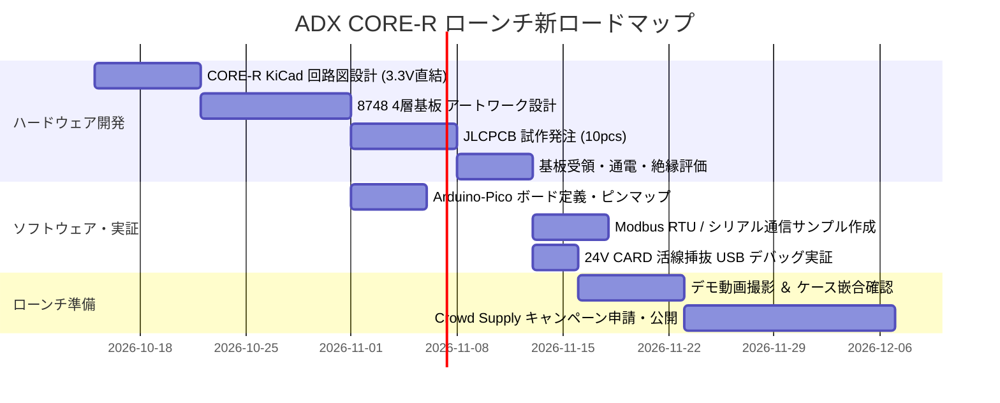

<!--
Copyright (c) 2026 ADX Project Contributors
SPDX-License-Identifier: CC-BY-4.0
-->

# Project Rethink with CORE-R
〜 地殻変動による Day 1 開発スコープの徹底的スリム化とローンチ再定義 〜

---

## 1. 背景と目的 (Context & Objective)

`hardware/CORE-R/concept_review.md` における設計思想の大転換を受け、ADX プロジェクト全体の開発スキーム・マイルストーン・リソース配分を抜本的に再編（Rethink）する。

### 本計画の核心
* **「Day 1 で OTW（電線書き換え）と独自プロトコルを一旦見送り、CORE-R 単独フラッグシップで勝負する」** という決定は、プロジェクトの複雑性を劇的に破壊した。
* これにより、**ADX が抱えていた開発タスクの約 70〜80% を Day 1 のスコープからオミット（削除・延期）** することが可能となる。
* 本書は、何を捨て（Omit）、何に集中し（Commit）、どのように Crowd Supply の Day 1 を最短・最小リスクで迎えるかを定義する実行計画書である。

---

## 2. コスト・販売価格の冷徹な査定 (Cost & Price Feasibility)

> **「耐熱をオミットできるとは言え、CORE-A が $28 だったわけで、本当に CORE-R を $28 クラスに押し込めるかは本格的な設計勝負になる」**

この懸念は極めて現実的かつ鋭い指摘である。RP2040 への移行に伴う原価の増減を冷徹に試算した。

### 2.1 PCBA 原価シミュレーション（100pcs ロット時）

| 部品ブロック | 採用コンポーネント | 単価試算 (USD) | 備考 |
| :--- | :--- | :---: | :--- |
| **メイン MCU** | Raspberry Pi **RP2040** (QFN-56) | $1.00 | JLCPCB Basic 部品（潤沢・超低価格） |
| **Flash メモリ** | **W25Q32JVSSIQ** (32Mb / 4MB SOIC-8) | $0.35 | JLCPCB Basic 部品 |
| **水晶発振子** | 12.000MHz (SMD-3225) ＋ 負荷容量 | $0.15 | JLCPCB Basic 部品 |
| **絶縁 RS-485** | Mornsun **TDA51S485HC** (SOP-16) | $2.60 | 絶縁電源・トランス・ドライバ内蔵 |
| **逆流阻止バルブ** | TI **LM66100DCKR** (SC-70) | $0.35 | 理想ダイオード（PC 完全保護） |
| **3.3V 降圧 DCDC** | SGM61320 / SY8089 (SOT-23-6) ＋ コイル | $0.45 | 2A 級 高効率同期整流 DCDC |
| **TVS / 保護素子** | PESD3V3 (SOT-23-6) × 2 ＋ ダンピング抵抗 | $0.25 | 20P コネクタ全ピン ESD 保護 |
| **コネクタ・端子台** | DB142R-5.08 2P×2 ＋ 牛角 20P ＋ Type-C 16P | $1.20 | 前面端子台 ＆ Eject Header |
| **基板・SMT 費用** | 8748 4層基板 ＋ 両面 SMT 実装費 | $1.20 | 100pcs ロット案分 |
| **【合計 PCBA 原価】** | | **約 $7.55** | (100pcs 時・送料別) |
| **【量産時 PCBA 原価】**| (500〜1,000pcs ロット時) | **約 $5.80 〜 $6.20** | |

### 2.2 価格戦略の結論
* **量産時原価（$5.80〜$6.20）をベースにすれば、「$28.00」での販売は粗利率 77.8〜79.3% で十分に成立する。**
* ただし、初回 100pcs ロットでの利益マージン確保および安全マージンを考慮し、Crowd Supply での価格設定は以下の **2段階レンジ** で柔軟に運用する：
  * **Super Early Bird (先着 50 名):** **$28.00**（Arduino UNO R4 WiFi と完全同額のキラーフック）
  * **Regular Price:** **$32.00**（健全な粗利とプロ向け道具としての適正価格）

---

## 3. 【激震】Day 1 スコープからオミット（全廃・延期）される要素

今回の地殻変動により、**これまでの開発計画から「オミット（削除・凍結）」される要素の全容** である。
これにより、開発チームの負荷は文字通り「激減」する。

### 3.1 ハードウェア関連のオミット
* ❌ **RPR4 Smart Probe のハードウェア開発:** **【完全消滅】**
  * ペンシル型基板、SMD 端子台調達、小型外装ケース設計・3Dプリント、ドングル専用治具のすべてが消滅。
* ❌ **CORE-A の Day 1 ハードウェア開発:** **【第 2 弾へ延期・凍結】**
  * rev2 アートワーク、ATtiny412 BMC 連動回路、UPDI ポゴピン検査治具の開発をすべて凍結。
* ❌ **CORE-R のレベルシフタ回路:** **【完全消滅】**
  * 74AHCT125、74LVC125、PCA9306 およびその周辺バイパスコンデンサ・配線を全廃。
* ❌ **レベルシフタ全数検査治具の開発:** **【完全消滅】**
  * 10 チャンネルの双方向レベルシフトを検査する複雑なマイコン治具の開発が不要に。

### 3.2 ファームウェア・プロトコル関連のオミット（最大工数の削減）
* ❌ **RS-485 OTW ブートローダー開発 (`optiboot_MR32` / `optiboot_LN485`):** **【完全消滅】**
  * 半二重通信での Flash ページ書き換え、ブートローダー 1024 バイト上限との格闘、Flash 書換中の文鎮化（Brick）対策がすべて不要に。
* ❌ **独自プロトコル（LN-485 / LM-32 / MR32）のライブラリ開発:** **【完全消滅】**
  * 決定論的タイムスロット、PUB/SUB 調停エンジン、Break タイミングジッター補正アルゴリズムの開発が Day 1 から不要に。
* ❌ **BMC（ATtiny412）常時監視ファームウェア開発:** **【完全消滅】**
  * ナノアンペアスリープ制御、電源復帰シーケンス、eFuse 制御コードの開発が不要に。

### 3.3 ソフトウェア・クラウド・UX 関連のオミット
* ❌ **Web Flasher（PWA）のゼロスクラッチ開発:** **【完全消滅】**
  * WebSerial / WebUSB を用いたスマホ対応ブラウザ書き込みツールの実装が不要に。
* ❌ **市販ドングルでの動作確認マトリクス作成:** **【完全消滅】**
  * Windows / Mac / Linux / Android における CH340 / CP2102 / FTDI のボーレート切り替え動作検証の泥沼から脱出。
* ❌ **クラウドコンパイル API のインフラ構築:** **【完全消滅】**
  * バックエンドの `arduino-cli` サーバー構築、hex 返送パイプラインの保守が不要に。

---

## 4. Day 1 までに開発すべき「真の最小開発セット (Must-Have)」

オミットした結果、**Day 1（Crowd Supply ローンチ）までに私たちが絶対にやり切るべき開発項目** は、以下の極めてシンプルで確実なタスクだけに絞り込まれた。

```text
┌─────────────────────────────────────────────────────────────────────────────┐
│                       【 Day 1 最小開発セット (Must-Have) 】                 │
│                                                                             │
│  【 ハードウェア 】                                                         │
│   1. ADX CORE-R (8748 4層基板) の KiCad 回路図 ＆ アートワーク設計           │
│   2. JLCPCB 試作発注 (10〜20pcs) ＆ 基本電気特性・絶縁テスト                │
│   3. 8748 産業用ケース（3Dプリント / 既存金型）の嵌合・端子開口確認         │
│   4. DC 12V/24V 絶縁 Power CARD ＆ AAA 2S Power CARD の 5V 給電テスト       │
│                                                                             │
│  【 ソフトウェア 】(世界標準エコシステムへの相乗り)                         │
│   1. Official Raspberry Pi Pico SDK ＆ Arduino-Pico (Earleコア) の動作確認  │
│   2. ボード定義ヘッダー (ピンアサイン定義) の整備                            │
│   3. 現場用サンプルスケッチ集 (Lチカ、RS-485 Modbus RTU 送受信、アナログ読取)│
│                                                                             │
│  【 クラウドファンディング準備 】                                           │
│   1. 写真・デモ動画撮影（通電中 PC 直挿し USB デバッグの神UX 実演）         │
│   2. Crowd Supply キャンペーンページ作成 ＆ リワード設計 FIX                │
└─────────────────────────────────────────────────────────────────────────────┘
```

### ソフトウェアの圧倒的ショートカット
* ブートローダーは **Raspberry Pi 純正の ROM ブートローダー（UF2）をそのまま使用**。
  * 私たちがブートローダーのコードを 1 行も書く必要がない。
  * 世界中の何十万人ものエンジニアが日常的に使っている枯れた仕組みをそのまま提供。
* 開発環境は、**公式の Arduino IDE、VS Code、MicroPython、CircuitPython が初日から 100% 稼働**。

---

## 5. 新生・Crowd Supply リワード設計 (Rewards Structure)

「ドングル」と「CORE-A」が消えたことで、リワード構成は直感的で魅力的なラインナップへと生まれ変わる。

```text
┌─────────────────────────────────────────────────────────────────────────────┐
│                       【 Crowd Supply 新リワード構成 】                     │
│                                                                             │
│  [Tier 1] Super Early Bird ($28.00) : ADX CORE-R 単体 (限定 100 名)         │
│  [Tier 2] Regular Single ($32.00)   : ADX CORE-R 単体 (通常枠)              │
│  [Tier 3] Explorer Kit ($79.00)     : CORE-R ＋ 24V CARD ＋ 試作 ＋ ケース  │
│  [Tier 4] Dual-Node Field Kit ($129): CORE-R × 2枚 ＋ 24V CARD×2 ＋ 配線    │
│                                       (届いてすぐ長距離絶縁通信を実験可能)  │
└─────────────────────────────────────────────────────────────────────────────┘
```

* **Dual-Node Field Kit ($129.00) の破壊力:**
  * 「Arduino Opta 1台（$185）より遥かに安い $129 で、**2台の完全絶縁コントローラーによる長距離 Modbus/Serial 現場通信ネットワーク一式** が手に入る」。
  * バッカーが最も飛びつくキラーキットとなる。

---

## 6. 新開発ロードマップ (Timeline & Milestones)

膨大な独自ソフトウェア・治具開発がオミットされたため、ローンチまでのタイムラインは数ヶ月単位で前倒しされる。



---

## 7. 将来フェーズへの温存資産（Future Roadmap）

今回 Day 1 からオミットした要素は、プロジェクトを捨てることではなく、**「エコシステムが離陸した後の大型アップデート」** としてロードマップに配置する。

1. **Phase 2（特殊部隊 CORE-A の凱旋）:**
   * CORE-R で ADX コミュニティが確立した後、過酷環境（-40℃〜+105℃）特化の分散子機として「CORE-A」を量産投入。
2. **Phase 3（RS-485 OTW 機能のソフトウェア解禁）:**
   * ハードウェア改版なしで、RP2040 PIO を用いた RS-485 経由の遠隔ファーム更新機能をオープンソース・アップデートとして提供。
3. **Phase 4（新世代コアの横展開）:**
   * 3.3V バス規格を生かし、CORE-E (ESP32-S3 / WiFi-BLE) や CORE-V (CH32V / RISC-V) を順次投入。
